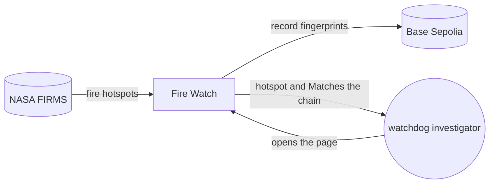
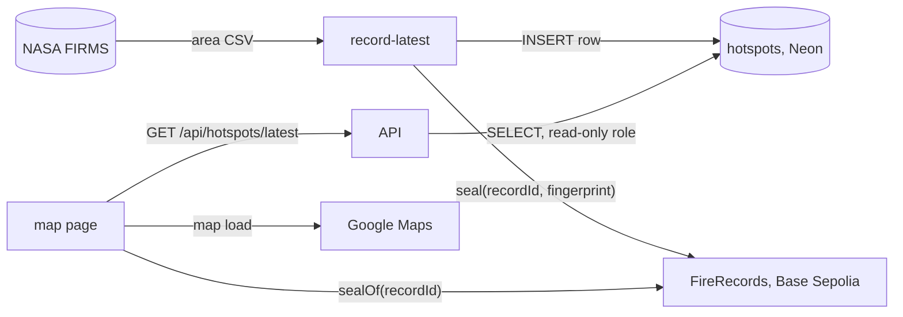

# ClimateChain hackathon entry · architecture

**Status:** Active · **Updated:** 2026-10-13 by /ship walking-skeleton

## Context

## Components

Only the operator's machine writes. The API only reads, and the page checks the chain itself.

| Component     | Folder                          | Does                                                                          |
| ------------- | ------------------------------- | ----------------------------------------------------------------------------- |
| FireRecords   | `contracts/`                    | Stores each record's fingerprint once; only the recorder wallet can seal      |
| record-latest | `api/`                          | Operator CLI: fetches FIRMS, stores the latest hotspot, seals it on chain     |
| API           | `api/`                          | Read-only FastAPI: `GET /api/hotspots/latest` and `GET /api/health`           |
| hotspots      | `api/migrations/`               | The Postgres table on Neon, with up and down migrations                       |
| Map page      | `web/`                          | Shows the hotspot, recomputes its fingerprint and compares it with the chain  |
| CI and deploy | `.github/workflows/`, `infra/`  | Tests on every push; a push to main ships the API image and the page to Azure |
