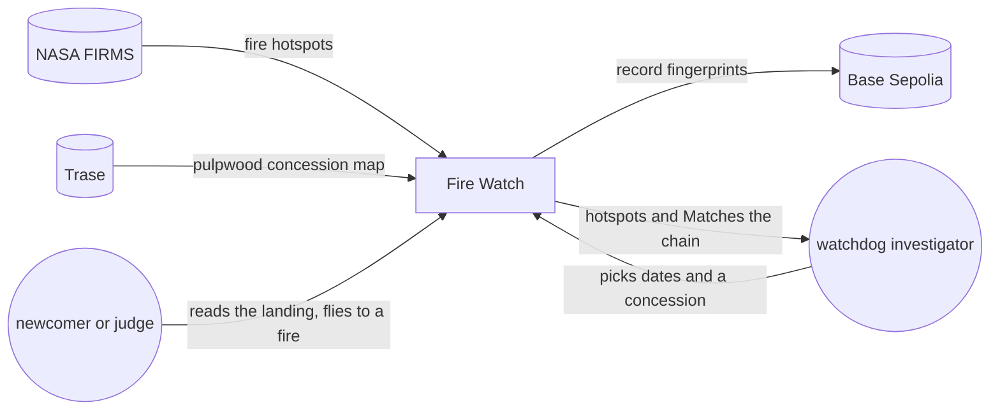
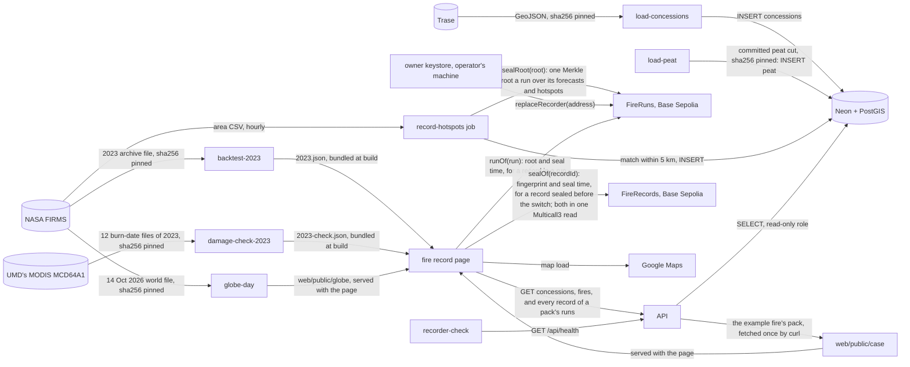

# ClimateChain hackathon entry · architecture

**Status:** Active · **Updated:** 2026-10-23 by /ship claim-fixes

## Context

## Components

Only the recorder job writes, and only it holds the recorder key. The owner key, which can only
replace the recorder key, stays off Azure (D104). The API only reads, and the page checks the chain
itself.

| Component        | Folder                          | Does                                                                                          |
| ---------------- | ------------------------------- | --------------------------------------------------------------------------------------------- |
| FireRuns         | `contracts/`                    | Stores one Merkle root per recorder run, numbered from 1, each once; only the recorder key seals, and only the owner key replaces it (D103, D107) |
| FireRecords      | `contracts/`                    | Holds each record's fingerprint sealed before the switch to FireRuns; seals nothing new (D103) |
| record-hotspots  | `api/`                          | Hourly Container Apps job: fetches FIRMS, matches hotspots to concessions and stores them; by the chain's clock, settles waiting forecasts and forecasts each fire with a new pass (`forecast.py`, D48, D50); stores one Merkle tree over every record not sealed yet with each record's proof, then seals its root on FireRuns in one transaction (`merkle.py`, D105, D108, D110) |
| load-concessions | `api/`                          | Operator CLI: loads Trase's pulpwood concession map, once per map version                     |
| load-peat        | `api/`, `fixtures/peat/`        | Operator CLI: loads the committed cut of WRI's Global Peatlands map, once per map version (D69). `--cut` redoes the cut from the 10 pinned tiles with a GFW key (D70) |
| globe-day        | `api/`, `web/public/globe/`     | Operator CLI: redoes the landing globe's three gzipped files from FIRMS's 14 Oct 2026 world file, Natural Earth 110m and 10m land, and Trase, each pinned by sha256 (D79) |
| backtest-2023    | `api/`, `fixtures/backtest/`    | Operator CLI, run by hand on the compose db: replays 2023 as the recorder would have run it, with rule version 1, the downwind guess, the near-edge step alone, the next-pass guess and the rule version 2 tried (D57, D60, D99, D133), and writes the totals, also split at 1 October 2023, and every forecast to `fixtures/backtest/`. Seals nothing (D55) |
| damage-check-2023 | `api/`, `fixtures/damage/`     | Operator CLI, run by hand on the compose db: joins the squares of 2023's detections near concessions and measures the part MODIS MCD64A1 mapped burned, from 12 files on the operator's disk, each pinned by sha256 (D130, D131). Writes the peat and other-ground shares of large patches to `fixtures/damage/2023-check.json` (D127) |
| API              | `api/`                          | Read-only FastAPI: `GET /api/concessions`, `GET /api/concessions/{id}`, `GET /api/concessions/{id}/fires/{key}` (`?as_of=` for a pack, D37, with the FireRuns runs in its window, D123; each record with its run and proof, D109), `GET /api/runs` (every record of up to 100 sealed runs, D122) and `GET /api/health`; groups a concession's detections into fires on each request (`fires.py`, D31); the fire route adds when a fire's first sighting was one detection alone and the fires joined to it, pass by pass (fire rule version 2, D112, D114, D117); a fire lists its forecasts, and a concession lists fires forecast inside first (D45); a fire and a pack carry the four hectare parts of its damage, inside and outside, on peat and off it (`peat.py`, D71) |
| Database         | `api/migrations/`               | Postgres with PostGIS on Neon: hotspots, concessions, their matches, forecasts, recorder runs, peat, and each run's root with its records' proofs |
| Landing          | `web/`                          | The site's address (D72): what Fire Watch is and who it is for, dated facts (D73), and the fire globe of 14 Oct 2026 with one flight to the example fire (D75, D77). three.js loads only on a desktop with WebGL; under 30 fps, and on phones, the flat map stays (D76, D80). The real case scrolls the example fire step by step on Google Maps, as one detection and then a second fire joined on 14 Oct (D111), from the committed copy of its pack, `case/pack-0332.json` (D82, D85, D90); at its seal step it loads the chain code and checks the 283 seals in one Multicall3 read (D83, D91). Reads nothing from the API |
| Fire record page | `web/`                          | At `/?tool` (D74), with About Fire Watch back to the landing. Lists concessions for the dates, shows one with its fires, shows where a fire was first seen, with "as one detection" in the headline and a note when that was one detection alone (D138), a note when the fire was joined from others, and a note under every fire on what the satellite can miss (D139), and replays its passes, checks a record against its run's root on FireRuns, or an older one's own seal on FireRecords, and shows its seal time by the chain's clock, whatever the API says (D97, D106). A fire shows each forecast and its outcome, checked in one Multicall3 read, and the bundled 2023 replay's totals for rule version 1 and three guesses (D54, D59, D99). A complaint pack (`/?pack=`) holds one fire as of a stored time and checks every detection through Multicall3 (D38). Then it rebuilds each run's root in its window from every record the run sealed, checks the roots on FireRuns, and lists any detection the fire rule joins to the fire that the pack lacks (`leftOut.ts`, D119, D123, D124). A fire and a pack show its damage estimate, with the factors and the bundled 2023 shares applied in the page (D64, D71, D126), its CO₂ led by IPCC's 95% interval for burned peat (D140) |
| CI and deploy    | `.github/workflows/`, `infra/`  | Tests on every push; a push to main ships the API, then the page; the job's image is set by hand, by digest |
| recorder-check   | `.github/workflows/`            | Hourly: fails, so GitHub emails, after 2 hours without a good run or when a run seals nothing |
