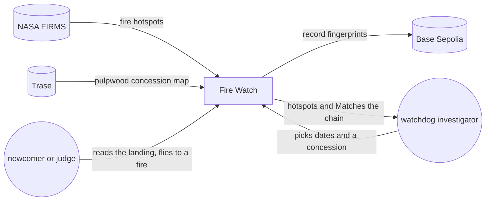
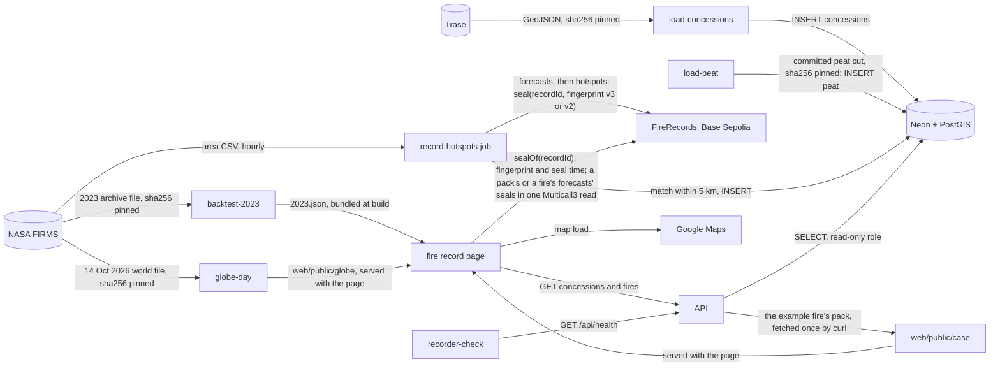

# ClimateChain hackathon entry · architecture

**Status:** Active · **Updated:** 2026-10-22 by /ship fair-baseline

## Context

## Components

Only the recorder job writes, and only it holds the wallet key. The API only reads, and the page
checks the chain itself.

| Component        | Folder                          | Does                                                                                          |
| ---------------- | ------------------------------- | --------------------------------------------------------------------------------------------- |
| FireRecords      | `contracts/`                    | Stores each record's fingerprint once; only the recorder wallet can seal                      |
| record-hotspots  | `api/`                          | Hourly Container Apps job: fetches FIRMS, matches hotspots to concessions and stores them; by the chain's clock, settles waiting forecasts and forecasts each fire with a new pass (`forecast.py`, D48, D50); seals the forecasts, then the hotspots (D49) |
| load-concessions | `api/`                          | Operator CLI: loads Trase's pulpwood concession map, once per map version                     |
| load-peat        | `api/`, `fixtures/peat/`        | Operator CLI: loads the committed cut of WRI's Global Peatlands map, once per map version (D69). `--cut` redoes the cut from the 10 pinned tiles with a GFW key (D70) |
| globe-day        | `api/`, `web/public/globe/`     | Operator CLI: redoes the landing globe's three gzipped files from FIRMS's 14 Oct 2026 world file, Natural Earth 110m and 10m land, and Trase, each pinned by sha256 (D79) |
| backtest-2023    | `api/`, `fixtures/backtest/`    | Operator CLI, run by hand on the compose db: replays 2023 as the recorder would have run it, with rule version 1, the downwind guess, the near-edge step alone and the next-pass guess (D57, D60, D99), and writes the totals and every forecast to `fixtures/backtest/`. Seals nothing (D55) |
| API              | `api/`                          | Read-only FastAPI: `GET /api/concessions`, `GET /api/concessions/{id}`, `GET /api/concessions/{id}/fires/{key}` (`?as_of=` for a pack, D37) and `GET /api/health`; groups a concession's detections into fires on each request (`fires.py`, D31); a fire lists its forecasts, and a concession lists fires forecast inside first (D45); a fire and a pack carry the four hectare parts of its damage, inside and outside, on peat and off it (`peat.py`, D71) |
| Database         | `api/migrations/`               | Postgres with PostGIS on Neon: hotspots, concessions, their matches, forecasts, recorder runs and peat |
| Landing          | `web/`                          | The site's address (D72): what Fire Watch is and who uses it, dated facts (D73), and the fire globe of 14 Oct 2026 with one flight to the example fire (D75, D77). three.js loads only on a desktop with WebGL; under 30 fps, and on phones, the flat map stays (D76, D80). The real case scrolls the example fire step by step on Google Maps, from the committed copy of its pack, `case/pack-0332.json` (D82, D85, D90); at its seal step it loads the chain code and checks the 283 seals in one Multicall3 read (D83, D91). Reads nothing from the API |
| Fire record page | `web/`                          | At `/?tool` (D74), with About Fire Watch back to the landing. Lists concessions for the dates, shows one with its fires, shows where a fire was first seen and replays its passes, checks a record against the chain and shows its seal time by the chain's clock, whatever the API says (D97). A fire shows each forecast and its outcome, checked in one Multicall3 read, and the bundled 2023 replay's totals for rule version 1 and three guesses (D54, D59, D99). A complaint pack (`/?pack=`) holds one fire as of a stored time and checks every detection through Multicall3 (D38). A fire and a pack show its damage estimate, with the factors applied in the page (D64, D71) |
| CI and deploy    | `.github/workflows/`, `infra/`  | Tests on every push; a push to main ships the API, then the page; the job's image is set by hand, by digest |
| recorder-check   | `.github/workflows/`            | Hourly: fails, so GitHub emails, after 2 hours without a good run or when a run seals nothing |
