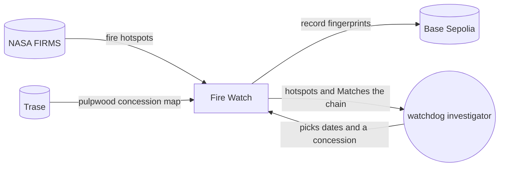
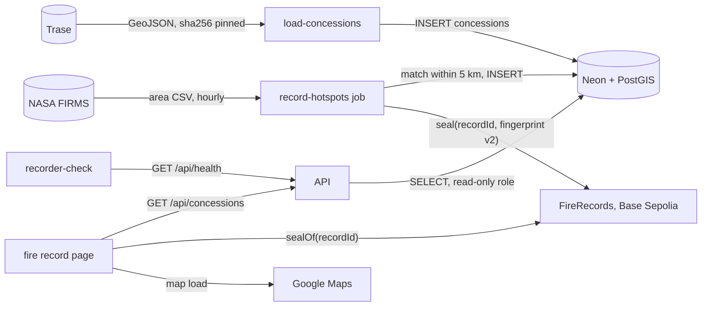

# ClimateChain hackathon entry · architecture

**Status:** Active · **Updated:** 2026-10-16 by /ship fire-record

## Context

## Components

Only the recorder job writes, and only it holds the wallet key. The API only reads, and the page
checks the chain itself.

| Component        | Folder                          | Does                                                                                          |
| ---------------- | ------------------------------- | --------------------------------------------------------------------------------------------- |
| FireRecords      | `contracts/`                    | Stores each record's fingerprint once; only the recorder wallet can seal                      |
| record-hotspots  | `api/`                          | Hourly Container Apps job: fetches FIRMS, matches hotspots to concessions, stores and seals them |
| load-concessions | `api/`                          | Operator CLI: loads Trase's pulpwood concession map, once per map version                     |
| API              | `api/`                          | Read-only FastAPI: `GET /api/concessions`, `GET /api/concessions/{id}`, `GET /api/concessions/{id}/fires/{key}` and `GET /api/health`; groups a concession's detections into fires on each request (`fires.py`, D31) |
| Database         | `api/migrations/`               | Postgres with PostGIS on Neon: hotspots, concessions, their matches and recorder runs         |
| Fire record page | `web/`                          | Lists concessions for the dates, shows one with its fires, shows where a fire was first seen and replays its passes, checks a record against the chain |
| CI and deploy    | `.github/workflows/`, `infra/`  | Tests on every push; a push to main ships the API and the page; the job's image is set by hand, by digest |
| recorder-check   | `.github/workflows/`            | Hourly: fails, so GitHub emails, after 2 hours without a good run or when a run seals nothing |
