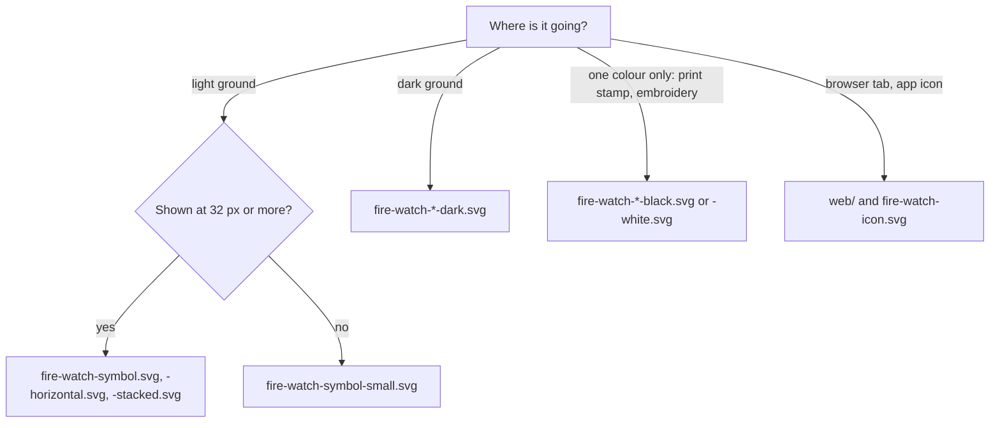

# Fire Watch logo

**Mark:** Clasp. A ring that only closes because the fire square locks into it. The record is sealed.

The square is the fire, so it is the only ember in the logo. Everything else is ink.

## Which file

| File | Use |
| --- | --- |
| `fire-watch-horizontal.svg` | Site header, README, complaint pack header, slides |
| `fire-watch-stacked.svg` | Title cards, video, square layouts |
| `fire-watch-symbol.svg` | The mark alone, 32 px and up |
| `fire-watch-symbol-small.svg` | The mark alone under 32 px: heavier ring, wider gap. The page header draws it as `LogoMark` in `web/src/icons.tsx` |
| `fire-watch-icon.svg` | The small cut on an ink tile: favicon, app icon, avatar |
| `*-dark.svg` | Dark grounds; 1 unit thinner so it doesn't look heavier |
| `*-black.svg`, `*-white.svg` | One colour only |
| `png/` | Rasters: marks at 1024 px, lockups 512 px tall |
| `web/` | `favicon.ico` (16, 32, 48), `favicon.svg`, `apple-touch-icon.png`, `icon-192.png`, `icon-512.png`. The site uses copies in `web/public/`; change both together |
| `board/` | Presentation slides with mockups |

## Colour

From the design system tokens.

| Role | Light | Dark |
| --- | --- | --- |
| Ink: ring and name | `#1f2421` | `#e8e9e4` |
| Ember: the square | `#c2410c` | `#ff8a4c` |
| Icon tile | `#1f2421` | `#1f2421` |

Contrast: ember is 5.2:1 on white, 4.6:1 on the page ground `#eef3e4`, 7.8:1 dark on `#121610`.
Ink is 13.9:1 or more everywhere.

## Clear space and size

- **Clear space:** one square's width on every side (52/256 of the symbol's height).
- **Smallest:** the master symbol at 32 px; the small cut below that, down to 16 px. The
  horizontal lockup at 32 px tall, where the name's capitals are about 10 px.
- **Lockup:** the name is IBM Plex Sans SemiBold, outlined, cap height 84/256 of the symbol,
  44/256 from it. Don't reset it in live type.

## Don't

- Colour the ring ember, or the square anything but ember (or the one colour in a one-colour version).
- Close the gap, move the square off 3 o'clock, or turn it into a diamond. It reads as a ring with a gem.
- Put the light version on a dark ground, or the master under 32 px.
- Add a flame, glow, shadow or gradient.

## Source

The letters are IBM Plex Sans SemiBold, under the SIL Open Font License, which allows logo use.
The geometry is a ring of outer radius 102 and stroke 26 on a 256 grid, closed at 3 o'clock by a
52 square with 12 clear on each side. No trademark search has been run.
