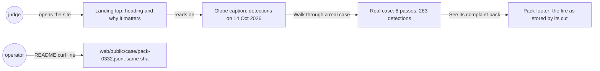
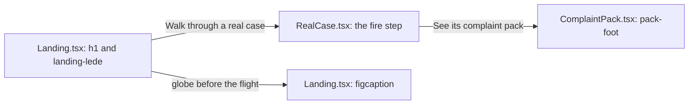
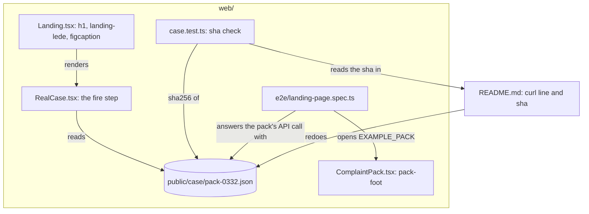
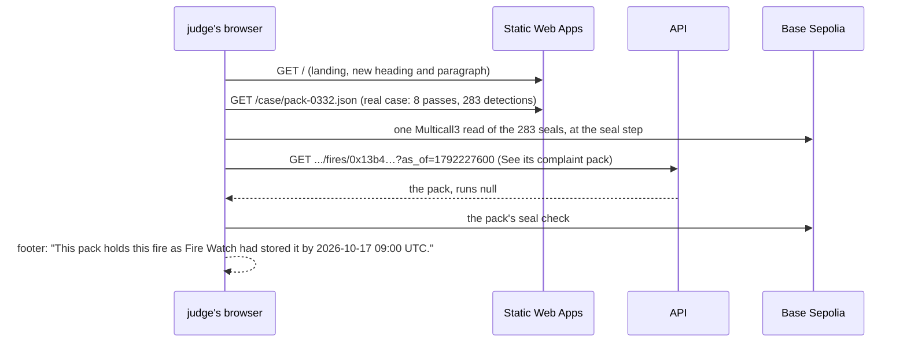

# Claim fixes

**Version:** v1 · **Status:** Refined · **Type:** Bug · **Project type:** Web UI

**Shape doc:** docs/specs/judge-review/shape.md
**Depends on:** None

The landing and the complaint pack stop making four claims the chain or the data doesn't support,
and the README's example pack sha matches the API again. The landing's top says why Fire Watch
matters before the reader reaches the example.

## Problem

The judge review rerun on the live site on 2026-10-23 (judge-review O4) found claims that the
chain or the data doesn't support. Four are on the page and one is in the README:

- The pack footer says "This pack holds every detection of this fire that Fire Watch had stored
  by 2026-10-17 09:00 UTC." The 0332 pack has no recorder runs, so nothing checks that. The same
  pack's check panel says "Fire Watch's server chose which records to send."
- The landing says "Watchdog groups use Fire Watch…". No watchdog or buyer has seen it (judge-review
  O3).
- The globe caption says "Every dot is a fire". Each dot is one detection, and the real case
  groups 283 of them into one fire.
- The real case says the satellite "saw this fire 283 times". It is 283 detections on 8 passes.
- The README gives the example pack's sha256 as `740b31f…`. Since complete-packs, the API adds
  `"runs": null`, and the same curl line now gives `33037b98…`. D90 says one curl line redoes the
  committed copy.

The review's other claims are out of this slice; Scope says where each one goes.

A reader who saw the site on 2026-10-23 had to read the example to understand why it matters. The
reason is in the first shape's O3: companies answer fire grievances by saying the fire started
outside their land, or that the complaint names no site, date or basis. The landing never says so.

## Slice test

| Check                         | Result |
| ----------------------------- | ------ |
| Cuts every layer it needs     | yes: the page copy in `web/src`, the committed example pack in `web/public/case`, and the README. The API, the recorder and the chain don't change |
| One e2e test walks it         | yes: the landing e2e reads the heading, the globe caption and the real case, then opens the example pack and reads its footer. The e2e's API holds no example fire, so the test answers the pack's one API call from the committed copy |
| Worth shipping alone          | yes: a judge reads no claim on the landing or the pack that the chain or the data doesn't back, and reads why it matters first |
| Fits (≤5 scenarios, ≤2 areas) | yes: 5 scenarios; two areas, the landing and the complaint pack, plus the README |

**Path:** full. The change is copy, but it touches four page files and the README, above the light
path's three.

## User story

As a hackathon judge reading the site once, I want every claim on it to hold up and the reason it
matters to come first, so that I can score it on what it does.

## Flow



A judge reads the landing top to bottom and opens the example pack. Each place they read says only
what the chain or the data shows. An operator redoes the landing's example pack and gets the sha the
README gives.

## Acceptance criteria

```gherkin
Scenario: The pack says what it holds without claiming it is complete
  Given the complaint pack of the ID-WOOD-CONCESSION-0332 fire, cut at 2026-10-17 09:00 UTC,
    which the API gives no recorder runs
  When anyone opens it
  Then the footer says "This pack holds this fire as Fire Watch had stored it by 2026-10-17 09:00 UTC.
    Passes after that are not in it."
  And no text on the pack says it holds every detection of the fire

Scenario: The landing says why it matters before the example
  Given the landing at the site's address
  When a judge reads the top of the page
  Then the heading says "When a company says a fire spread in from outside its land, show where
    satellites first saw it."
  And the paragraph under it says "Fire Watch is built for the watchdog groups that report
    plantation fires to the companies that buy from the plantation. It shows where satellites first
    saw a fire and how it spread, on records the buyer checks in their own browser."
  And no text on the landing says that watchdog groups use Fire Watch

Scenario: The globe counts detections, not fires
  Given the landing's globe, before it flies to the example fire
  Then its caption says "Every dot is one detection by the NOAA-20 satellite on 14 Oct 2026: 62,489
    worldwide, 9,923 of them in and around Indonesia."

Scenario: The real case counts passes and detections
  Given the real case's first stop, read from the committed 0332 pack
  Then it says "From 12 Oct to 17 Oct 2026, the NOAA-20 satellite saw this fire on 8 passes, 283
    detections in all, near ID-WOOD-CONCESSION-0332, in Central Kalimantan."

Scenario: The README's curl line gives the committed example pack
  Given a fresh checkout
  When anyone runs the README's "Redo the real case's data" curl line and sha256sum
  Then the sha256 is the one the README gives
  And the file equals the committed web/public/case/pack-0332.json byte for byte
```

The heading and the paragraph rest on the first shape's O3: KLK said the fires "originated outside"
its concession, and Wilmar said an allegation gave no "specific sites, dates or the basis" (both
September 2026).

## Scope

**In:**

- The pack footer's sentence, for every pack.
- The landing's heading and the paragraph under it.
- The globe's caption before the flight.
- The real case's first stop.
- The committed example pack, fetched again with its `"runs": null`, and the README's sha.

**Out:**

- The pack header's "A newer one is under its recorder run's root on FireRuns": true once FireRuns
  seals its first root. FireRuns went live on 2026-10-23, so the rollout closes it.
- The README, OVERVIEW, ARCHITECTURE and CHANGELOG lines on run roots: the same rollout closes them.
- The damage estimate's 2023 shares on small fires: D127 chose the large-patch shares, so this slice
  doesn't change them.
- The forecast panel's "more than 3,400 variants": forecast-v2-trial's O1 records 17 + 2,482 + 944
  variants, so the claim holds.
- Naming cloud, canopy and smouldering peat where the first sighting shows, leading the CO₂ estimate
  with a range, and review hole 5's one-pixel headline: origin-and-range, a later slice (O2).

## Interface

Four sentences change in the real components, and one heading. Nothing is added, moved or
restyled.



The reader meets the new heading and paragraph first, the globe caption beside them, the real
case's first stop below, and the pack footer last.

| Where | Was | Now |
| ----- | --- | --- |
| Landing heading | Show where satellites first saw a plantation fire, on records anyone can check. | When a company says a fire spread in from outside its land, show where satellites first saw it. |
| Landing paragraph | Watchdog groups use Fire Watch to report a fire on plantation land to the companies that buy from it. It shows where satellites first saw the fire and how it spread, and the buyer checks every record in their own browser. | Fire Watch is built for the watchdog groups that report plantation fires to the companies that buy from the plantation. It shows where satellites first saw a fire and how it spread, on records the buyer checks in their own browser. |
| Globe caption, before the flight | Every dot is a fire the NOAA-20 satellite saw on 14 Oct 2026: 62,489 worldwide, … | Every dot is one detection by the NOAA-20 satellite on 14 Oct 2026: 62,489 worldwide, … |
| Real case, first stop | …the NOAA-20 satellite saw this fire 283 times near ID-WOOD-CONCESSION-0332… | …the NOAA-20 satellite saw this fire on 8 passes, 283 detections in all, near ID-WOOD-CONCESSION-0332… |
| Pack footer | This pack holds every detection of this fire that Fire Watch had stored by 2026-10-17 09:00 UTC. … | This pack holds this fire as Fire Watch had stored it by 2026-10-17 09:00 UTC. … |

The real case counts passes with `times.length`, as its "Pass 2 of 8" stops do. The heading avoids
"fire started", so the honest-claims guard in `Landing.test.tsx` stays as it is (O3).

**Motion tier:** none new. The globe keeps tier 3 (D3) and the real case tier 1 (D89).

**Components used:** the landing's `h1` and `landing-lede`, the globe's `figcaption`, the real
case's step, and the pack's `pack-foot` with `fw-help`. There is no new component, no new token and
no CSS change.

**Design system:** Fire Watch, `docs/design/design-system/` (D2).

**Preview:** real components in `web/src`, after `cd web && pnpm dev`:
`http://localhost:5173/?preview=landing-page`, `?preview=newcomer-walkthrough` and
`?preview=complaint-pack`. The drift check passed over the 3 files changed. `tsc -b` is clean, all
326 web unit tests pass, and the landing and complaint pack e2e tests pass, 7 of 7. Each changed
test failed on the old copy first. At 390 px and 360 px the landing and the real case don't scroll
sideways. The pack preview does, by 43 px and 73 px, but the cause is the preview's own State
`<select>`, not the pack.

**Craft checks:** a one-line prompt would write "Track plantation fires with blockchain-verified
satellite data". This heading names the answer a company gives, from the first shape's O3, and the
one thing the tool shows against it. Next to Stripe's documentation, the reference for D2, it says
what the reader can do in plain words, with no selling.

## Technical plan

### Approach

The copy changed at pause 2 in `Landing.tsx`, `RealCase.tsx` and `ComplaintPack.tsx`, with their
tests. This plan adds the rest. The README's curl line fetches the example pack again, which adds
`"runs": null`, and the README gives its new sha. A unit test holds the committed copy to that sha.
The landing e2e reads every new sentence, then opens the example pack and reads its footer. The API,
the recorder and the chain don't change.

Relies on: D26, D33, D72, D88, D90, D92, D98, D125, D135, D136, D137.



The landing and its real case read the committed copy. The README's curl line redoes that copy, and
a unit test keeps the README's sha and the copy in step. The e2e opens the example pack with its API
answer taken from the same copy.



A judge reads the landing and its real case from static files, then opens the example pack from the
API. In the e2e, the API's part is answered from the committed copy, and the seals are on anvil.

### Changes

| File | What | Why |
| ---- | ---- | --- |
| `web/public/case/pack-0332.json` | Fetched again by the README's curl line. It gains `"runs": null` and nothing else: 163,544 bytes, sha256 `33037b98adedebb862c94dc110d5a13b4c562cfb5b19349898d42323f38728fa`, the same on two fetches on 2026-10-23 | Scenario 5; D90 |
| `README.md:182` | The sha256 becomes `33037b98…f38728fa` | Scenario 5 |
| `web/src/case.test.ts:74` | A test after "names no company": the sha256 of `public/case/pack-0332.json` equals the one in the README's "Redo the real case's data" section, read from `../README.md`, by `node:crypto` | Scenario 5 |
| `web/e2e/landing-page.spec.ts:29` | The walk reads the paragraph, the globe caption in full and the real case's first stop. At its end it opens `EXAMPLE_PACK`, answers the fire route with `public/case/pack-0332.json` through `page.route`, reads "283 of 283" and the footer, and finds no "every detection of this fire". The title becomes "a newcomer reads the landing, walks the real case to its seals, opens the tool, comes back and opens the example pack" | E2E; scenarios 1–4 |
| `docs/ARCHITECTURE.md:60` | The landing row says "who it is for", not "who uses it" | Scenario 2 |

Done at pause 2 and kept: `web/src/Landing.tsx`, `RealCase.tsx`, `ComplaintPack.tsx`, their tests,
and the e2e's `HEADLINE`.

Reusing: the README's curl line, `EXAMPLE_PACK` and `fakeMaps()` in the landing e2e, global setup's
seals of the 283 records on anvil (D92), and `case.test.ts`'s `resolve("public/case/pack-0332.json")`.

### Earn-it

| Added | Triggered by |
| ----- | ------------ |
| The sha test in `case.test.ts` | Scenario 5: the README's sha went stale once without any test noticing |
| The `page.route` for the fire route in the landing e2e | Scenario 1 in the same walk: the e2e's API holds no example fire (`landing-page.spec.ts:7`) |

Cut: a footer that changes with the left-out check's result (the check panel already says it, D136),
storing the example fire in the e2e's database (it would change other specs' counts, D137), and a
change to the CHANGELOG's past landing line.

### Non-functionals

|                      |                                                                               |
| -------------------- | ----------------------------------------------------------------------------- |
| **Load**             | None new. The committed copy grows by 12 bytes, to 163,544 |
| **Breaks first**     | Nothing at 10×. The README's sha goes stale whenever the API adds a field to a pack; the sha test catches a copy that no longer matches the README, and the curl line is checked by hand |
| **Security surface** | No new route, input or secret. The committed copy is public data with concession IDs and no company names (`case.test.ts` "names no company") |
| **Proof it works**   | After Deploy, the live bundle holds "When a company says a fire spread in from outside its land" and "This pack holds this fire as Fire Watch had stored it by". The README's curl line gives `33037b98…f38728fa` |
| **Rollout**          | No flag, as D81. Merge to main; Deploy ships the page. Rollback: revert the merge |

### Test plan

| Scenario | Test | Command |
| -------- | ---- | ------- |
| 1. The pack footer | `ComplaintPack.test.tsx` "reads the site, dates and basis of the 0332 fire"; the landing e2e | `cd web && pnpm test && pnpm e2e landing-page` |
| 2. The landing top | `Landing.test.tsx` "says why Fire Watch matters, who it is for, and that Indonesia is the first map"; the landing e2e | as above |
| 3. The globe caption | `Landing.test.tsx` "gives the tool's four steps, the dated facts and the four words"; the landing e2e | as above |
| 4. The real case | `RealCase.test.tsx` "tells the fire, the claim, …"; the landing e2e | as above |
| 5. The README's sha | `case.test.ts`, the new sha test; the curl line by hand | `cd web && pnpm test` |
| Earlier slices | the full suites | `cd api && uv run pytest`; `cd web && pnpm test && pnpm e2e` |

The e2e needs `docker compose up -d --wait db` and `~/.foundry/bin` on `PATH`.

**E2E:** `web/e2e/landing-page.spec.ts` "a newcomer reads the landing, walks the real case to its
seals, opens the tool, comes back and opens the example pack". It reads the heading, the paragraph,
the globe caption and the real case's first stop. It then opens the example pack, with its API answer
taken from the committed copy, and reads the footer.

### Chunks

Single chunk. The copy is done; the rest is one file fetched again, one sha, one unit test and one
e2e.

### Risks

| Risk | Mitigation |
| ---- | ---------- |
| The 0332 pack gains runs once FireRuns seals them, and its bytes change again | Its window ends at its cut, 2026-10-17 09:00 UTC, and FireRuns sealed nothing before 2026-10-23. D123 ends a pack's runs at the newest run holding a detection stored by the cut, so `runs` stays null |
| A judge reads the new heading as Fire Watch saying the company is wrong | It says what Fire Watch shows: where satellites first saw the fire. The real case's second stop already frames the company's answer the same way |
| The e2e's fulfilled API answer hides a real API change | The sha test and the README's curl line tie the committed copy to the live API's bytes, and `test_app.py` covers the fire route |

### Decisions to record

Recorded as D135, D136, D137.

## Open items

| ID | What | Type | Raised at | Owner | Status | Answer |
| -- | ---- | ---- | --------- | ----- | ------ | ------ |
| O1 | Does the landing's heading change to lead with the company's answer, or does it stay "Show where satellites first saw a plantation fire, on records anyone can check." with only the paragraph changed? | question | spec p1 | user | Resolved | 2026-10-23: the new heading, "When a company says the fire started outside its land, show where satellites first saw it." A judge reads the reason first |
| O2 | Do the reader's other two points go in this slice: name cloud, canopy and smouldering peat where the first sighting shows, and lead the CO₂ estimate with a range? Review hole 5 goes with them: the headline "First seen outside, 3.1 km" rests on one nominal-confidence pixel | question | spec p1 | user | Resolved | 2026-10-23: a later slice, origin-and-range. This slice keeps to copy that is wrong today. The CO₂ range needs IPCC's emission-factor intervals checked first, and the headline touches D111's example |
| O3 | The approved heading says "the fire started outside its land". honest-claims fails the landing on any "fire started" (`web/src/Landing.test.tsx:34`), so the page never claims where a fire started (D26). The heading only quotes the company | question | spec p2 | user | Resolved | 2026-10-23: reword to "When a company says a fire spread in from outside its land, show where satellites first saw it." The same dispute, in the first shape's words, and the honest-claims guard stays as it is |

_Never delete this section or its rows. See references/ledger.md._

## Glossary

- **Detection**: one spot where the satellite saw fire on one pass, about 375 m across.
- **Pass**: one trip of the NOAA-20 satellite over the area. It sees a place about twice a day.
- **Recorder run**: one hourly start of the recorder. Since run-roots, each run seals one Merkle
  root on FireRuns.
- **Cut**: the time a complaint pack is made at. Detections stored after it are not in the pack.
- **e2e**: end-to-end: one test that walks the whole slice as a user would.
