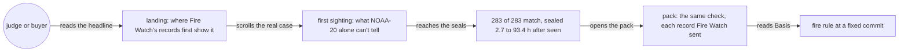
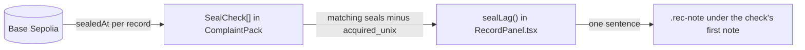
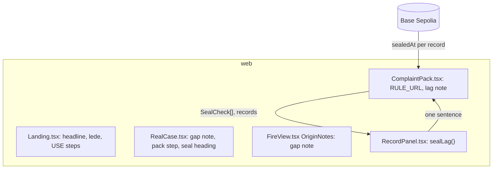
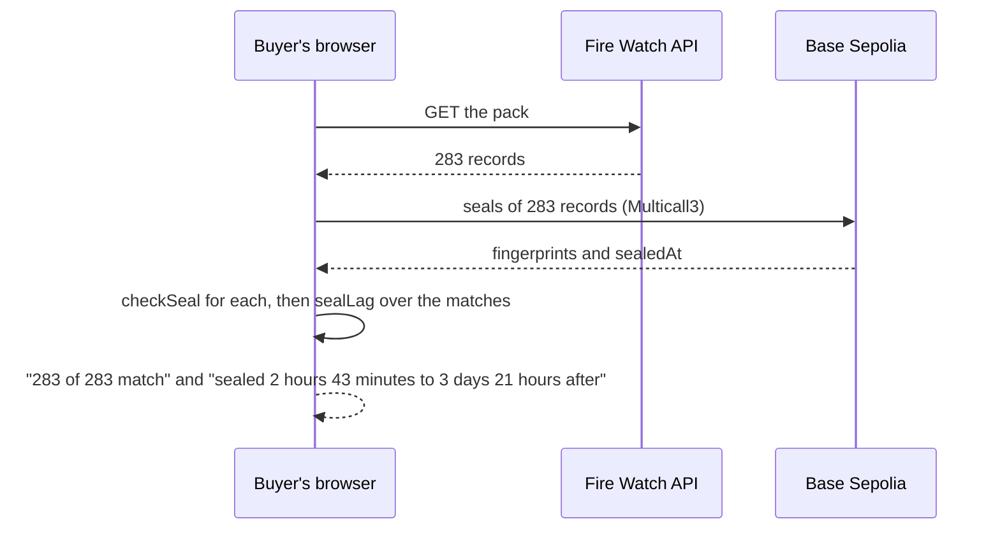

# Claim gaps

**Version:** v1 · **Status:** Refined · **Type:** Bug · **Project type:** Web UI

**Shape doc:** docs/specs/judge-review/shape.md
**Depends on:** None

The landing, the fire view and the complaint pack stop making four claims that the chain or the
data doesn't support, and the seal check says how late each record was sealed. It comes now
because a second hostile review on 2026-10-25 found these gaps, and Devpost closes at 14:00 UTC
that day.

## Problem

The judge-review shape's test (its O4) is that a second hostile review finds no claim the chain or
the data doesn't support. The review on 2026-10-25 found five:

- The landing promises "where the satellite first saw it" (`web/src/Landing.tsx:18`, `:44`, `:48`).
  NOAA-20 saw fire 965 m from the example's first record on 11 Oct, before Fire Watch's records
  begin, and the page itself says so (`web/src/RealCase.tsx:157`).
- "283 of 283 detections match the chain" gives a record sealed 93.4 hours after the satellite saw
  it the same check as a prompt one (`web/src/RecordPanel.tsx:74`). The example's 283 records were
  sealed 2.7 to 93.4 hours after they were seen, half of them after 43.9 hours. A seal shows the
  record is unchanged since it was sealed, not since it was seen.
- The landing says the buyer's browser "checks every record" (`web/src/Landing.tsx:19`,
  `web/src/RealCase.tsx:192`, heading "Every record is sealed" at `:246`). The example pack has
  `runs: null`, so the left-out check doesn't run on it. The browser checks every record Fire
  Watch sent.
- "The satellite didn't see this fire again for 25 hours, so that detection may be a separate fire"
  (`web/src/FireView.tsx:66`, `web/src/RealCase.tsx:155`). That is true of NOAA-20 only. NOAA-21 saw
  fire 64 m from the example's first detection 43 minutes later. Fire Watch reads only NOAA-20, so
  it can't tell.
- The pack's "Fire rule: Version 2, in full" links to `blob/main` (`web/src/ComplaintPack.tsx:51`).
  A printed pack then cites a rule that can change after the pack was made.

## Slice test

| Check                         | Result |
| ----------------------------- | ------ |
| Cuts every layer it needs     | yes: the landing, the fire view and the pack in `web/`. The seal times are already read from the chain (honest-claims). The API, the recorder and the chain don't change |
| One e2e test walks it         | yes: the landing's walk from the headline to the example pack's seal check and its Basis |
| Worth shipping alone          | yes: a judge or a company's lawyer finds no claim on these pages that the chain or the data contradicts |
| Fits (≤5 scenarios, ≤2 areas) | yes: 5 scenarios, one area (`web/`) |

**Path:** full. The seal-delay line is a new element in the pack's check and the landing's seal
step, and the change touches more than three files.

## User story

As a buyer reading a grievance's pack, I want each claim on it to hold up when the company checks
it, so that the company can't dismiss the whole pack over one overclaim.

## Flow



The reader meets the same four corrected claims on the landing and in the pack, and the rule link
no longer moves.

## Acceptance criteria

```gherkin
Scenario: The landing claims Fire Watch's first record, not the satellite's first sighting
  Given a judge opens the site's address
  When the landing loads
  Then neither the headline, the lede nor the tool's steps say "the satellite first saw"
  And the headline reads "When a company says a fire spread in from outside its land, show where the record first places it, and how it spread."

Scenario: The seal check says how late the records were sealed
  Given the example pack for the ID-WOOD-CONCESSION-0332 fire, cut at 17 Oct 2026 09:00 UTC
  When the buyer's browser has read all 283 seals from Base Sepolia
  Then the check reads "283 of 283 detections match the chain"
  And it reads "Fire Watch sealed them 2 hours 43 minutes to 3 days 21 hours after the satellite saw them. A seal shows a record is unchanged since it was sealed, not since it was seen."
  And the landing's seal step still says passes 1 to 6 were sealed 23 hours to 4 days after the satellite saw them

Scenario: "Every record" claims only what the browser checks
  Given the example pack has no recorder runs in its window
  When the judge reads the landing's tool steps, the real case's pack step and its seal step
  Then none of them says the browser checks every record, or that every record is sealed
  And each says the browser checks each record Fire Watch sent

Scenario: A long gap names the one satellite
  Given the example fire's first detection was alone for 25 hours on NOAA-20
  When the judge reads its first sighting in the fire view, the pack or the landing
  Then the note reads "NOAA-20 didn't see this fire again for 25 hours. Fire Watch reads only NOAA-20, so it can't tell whether that detection belongs to this fire."

Scenario: The pack's fire rule link doesn't move
  Given the example pack names fire rule version 2
  When the buyer opens "Version 2, in full" under Basis
  Then the link opens api/src/firewatch/fires.py at commit 71ebcf6, not at main
```

## Scope

**In:** the four claims above on the landing, the real case, the fire view and the pack, the
seal-delay line in the pack's check and the landing's seal step, and the pinned rule link.

**Out:**

- A second, FireRuns-era example fire whose pack shows the left-out check passing. It needs a
  suitable fire first; a research task is checking whether one exists.
- Marking each record sealed late in the record list. The range in the check's note covers the
  claim; a per-record mark is a later slice if a reader asks for it.
- The submission documents. They are fixed on `docs/submission`.

## Interface



The pack's check gains one note once every seal is read: the shortest and longest time from the
satellite's pass to the seal, by the chain's clock, over the records that match. It uses the
`duration()` long form already in `web/src/format.ts`. The landing's seal step already gives the
example's delay in its `SEALED_WHEN` line, so it doesn't change.

The other four changes are copy and a link, with no new element.

**Motion tier:** 0. Nothing moves.

**Components used:** `.fw-help.rec-note` in the pack's check panel. No new component, class or
token.

**Preview:** `/?preview=origin-confidence&state=pack` on `pnpm dev`.

## Technical plan

### Approach

Four of the five changes are copy and one link. The fifth, the seal delay, uses the seal times the
pack already reads from the chain (`SealCheck.sealedAt`, `web/src/RecordPanel.tsx:54`). It needs no
new read, and it was built at pause 2. Every test that pins the old copy changes with it.

Relies on: D26 ("first seen", never "started"), D83 and D91 (the landing checks its seals in the
browser, from the seal step on), D113 and D139 (the weak first-sighting note), D149 (drafted below).



`sealLag()` turns the pack's chain seal times into one sentence. The other files change their copy
only.



The browser reads the seals once, as it does now, and the lag line comes from the same answer.

### Changes

| File | What changes | Why |
| ---- | ------------ | --- |
| `web/src/Landing.tsx:19` | "See where its records first place it against the concession's edge, and step through how it spread, pass by pass." | scenario 1 |
| `web/src/Landing.tsx:20` | "The buyer opens it in their own browser, which checks each record Fire Watch sends against the blockchain." | scenario 3 |
| `web/src/Landing.tsx:45` | The headline from O1 | scenario 1 |
| `web/src/Landing.tsx:49` | "It shows where its records first place a fire and how it spread, on records the buyer checks in their own browser." | scenario 1 |
| `web/src/RealCase.tsx:155` | The gap note from O2, with "the fire" | scenario 4 |
| `web/src/RealCase.tsx:191` | "…and the 283 sealed records Fire Watch sent, at one link. The buyer's browser checks each of them, the same way yours does on this page." | scenario 3 |
| `web/src/RealCase.tsx:247` | Heading "Each record is sealed" | scenario 3 |
| `web/src/FireView.tsx:66` | The gap note from O2 | scenario 4 |
| `web/src/ComplaintPack.tsx:51` | `RULE_URL` at `blob/71ebcf6/…/fires.py` | scenario 5 |
| `web/src/RecordPanel.tsx`, `web/src/ComplaintPack.tsx` | `sealLag()` and its note. Done at pause 2 | scenario 2 |
| `web/src/*.test.tsx`, `web/e2e/landing-page.spec.ts`, `origin-and-range.spec.ts`, `origin-confidence.spec.ts`, `pack-claims.spec.ts` | Expect the new copy and link | scenarios 1 to 5 |
| `web/e2e/claim-gaps.spec.ts` | New: the e2e below | scenarios 1 to 5 |

Reusing: `duration()` in `web/src/format.ts`, `SealCheck` and `checkSeal` in `RecordPanel.tsx`, and
the committed pack route from `landing-page.spec.ts`.

### Earn-it

| Added | Triggered by |
| ----- | ------------ |
| `sealLag()` | Scenario 2. `RecordPanel.tsx` already holds `checkTitle()`, the pack check's other sentence |

### Non-functionals

|                      |   |
| -------------------- | - |
| **Load**             | None added. The lag comes from seals the pack already reads |
| **Breaks first**     | Nothing at 10× |
| **Security surface** | No input, no secrets, no stored data. Copy and one link |
| **Proof it works**   | The live landing's headline reads O1's words, and the example pack shows "Fire Watch sealed them 2 hours 43 minutes to 3 days 21 hours after the satellite saw them" |
| **Rollout**          | No flag. Rollback is `git revert` of the slice's commits |

### Test plan

| Scenario | Test | Command |
| -------- | ---- | ------- |
| 1 · Fire Watch's first record | `Landing.test.tsx` | `cd web && pnpm test` |
| 2 · How late the seals came | `RecordPanel.test.tsx` for `sealLag()`: none matching, one, a range, two at the same lag | same |
| 3 · "Every record" | `RealCase.test.tsx`, `Landing.test.tsx` | same |
| 4 · The gap note | `FireView.test.tsx`, `ComplaintPack.test.tsx`, `RealCase.test.tsx` | same |
| 5 · The pinned link | `ComplaintPack.test.tsx` | same |
| All | `web/e2e/claim-gaps.spec.ts` | `cd web && pnpm e2e claim-gaps` |

**E2E:** `claim-gaps.spec.ts` opens `/`, reads the headline and the tool's steps, then opens the
example pack from the committed copy. It waits for "283 of 283 detections match the chain", reads
the lag note, checks the gap note, and checks that "Version 2, in full" links to `71ebcf6`. The e2e
seals its records on a local anvil, so it matches the lag note to its pattern, not the live hours.

### Chunks

Single chunk.

### Risks

| Risk | Mitigation |
| ---- | ---------- |
| The video says "the satellite first saw it" in places this slice changes | The narration was fixed on 2026-10-25, in the re-render then running |
| The peat, damage-check and forecast links still point at `blob/main` | Out of scope here: they cite code, not a rule a pack names by version. A later slice can pin them |

### Decisions to record

## D149 · 2026-10-25 · Pin the pack's fire-rule link to the commit the live API runs

Why: a printed pack names "fire rule version 2" and links to it. A link to `main` can show code
changed after the pack was made. Commit `71ebcf6` is the last change to `fires.py`, and the live API
runs it at rule version 2.
Rejected: `blob/main` (moves after printing), commit `5e3b685` (set version 2, but the API runs the
later `71ebcf6`).
Source: docs/specs/claim-gaps.md
Status: active

## Open items

| ID  | What | Type | Raised at | Owner | Status | Answer |
| --- | ---- | ---- | --------- | ----- | ------ | ------ |
| O1  | The landing's headline is "When a company says a fire spread in from outside its land, show where the satellite first saw it." What should it say instead? | question | spec p1 | user | Resolved | "When a company says a fire spread in from outside its land, show where the record first places it, and how it spread." 2026-10-25 |
| O2  | The long-gap note: name NOAA-20 and say Fire Watch can't tell if the detection belongs to the fire, or drop the note? | question | spec p1 | user | Resolved | Keep it: "NOAA-20 didn't see this fire again for 25 hours. Fire Watch reads only NOAA-20, so it can't tell whether that detection belongs to this fire." Dropping the note was rejected. 2026-10-25 |
| O3  | Which commit should the rule link pin: the one that set rule version 2 (`5e3b685`), or the last change to `fires.py` (`71ebcf6`)? | question | spec p1 | user | Resolved | `71ebcf6`, the `fires.py` the live API runs, still rule version 2. 2026-10-25 |

_Never delete this section or its rows. See references/ledger.md._

## Glossary

- **Seal delay** — the time from the satellite's pass to the record's seal on Base Sepolia
- **Left-out check** — the browser rebuilds each recorder run's root to show that no stored
  detection of a fire is missing from the pack
- **e2e** — end-to-end: one test that walks the whole slice as a user would
