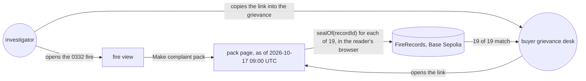
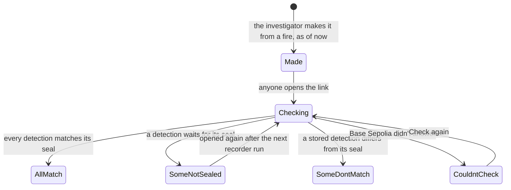
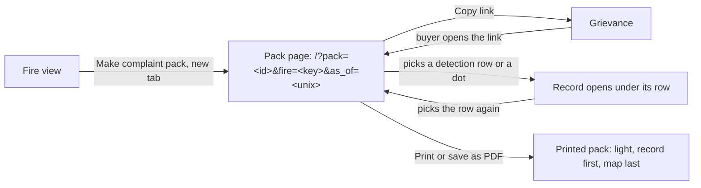
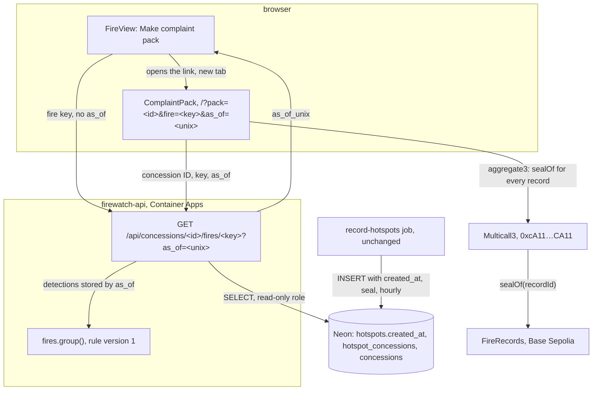
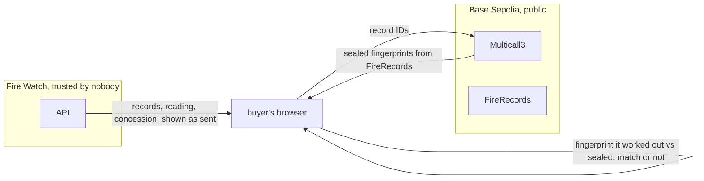

# Complaint pack

**Version:** v1 · **Status:** Draft · **Type:** Feature · **Project type:** Web UI

**Shape doc:** docs/specs/fire-watch/shape.md
**Depends on:** fire-origin

The investigator turns one fire into a pack with its own public link, to put in a grievance. The
pack gives the site, the dates and the basis for where the fire was first seen, and the reader's
own browser checks every detection against the chain. It comes now because it joins fire-record
and fire-origin into what a buyer reads, and the demo video is built on it (shape).

## Problem

Companies answer fire grievances in two ways. Wilmar said a complaint gave no "specific sites,
dates or the basis", and KLK said its fires "originated outside" its concession (both Sept 2026,
shape O3). Fire Watch can now answer both, but only on its own page. No view has a link
(fire-record O10), so the investigator can't point a buyer at a fire. A screenshot asks the buyer
to trust the investigator's word about the chain check.

A link to a live fire is not stable either. A fire grows with each pass, and its key changes when
a pass joins it to an older fire (fire-origin O11). Of the 1,801 fire and concession pairs recorded
to 2026-10-15, 39 grew and 1 lost its key by the next morning's passes. So the pack keeps its own
copy of the fire.

The ID-WOOD-CONCESSION-0332 fire is the example. It was first seen outside, 950 m from the edge,
on 2026-10-13 17:37 UTC, and seen inside from 2026-10-15 18:43 UTC: 19 detections on 4 passes.

## Slice test

| Check                         | Result |
| ----------------------------- | ------ |
| Cuts every layer it needs     | yes — "Make complaint pack" on the fire view, a pack route in the API, a public pack page, shipped by the existing deploy. The recorder and the contract don't change |
| One e2e test walks it         | yes — record the 0332 fire on anvil, open it, make a pack, open the pack's link in a new browser context, see "First seen outside, 950 m from the edge" and "19 of 19 detections match the chain" |
| Worth shipping alone          | yes — a grievance can carry one link with the site, dates and basis, which the buyer checks against the chain without trusting the investigator or Fire Watch |
| Fits (≤5 scenarios, ≤2 areas) | yes — 5 scenarios; two areas: the API's pack route and the page's pack view |

Earlier slices handed two more items here:

- A link for every view, and Back stepping out of a record (fire-record O10). This is routing for
  the whole page, a third area, so it would fail "Fits". Not planned (O4, D34).
- Basescan verification of FireRecords (walking-skeleton risks). In, as a one-time operator step
  with no scenario of its own. It is not an area of the system (O5, D35).

**Path:** full — a new public page and a new API route.

## User story

As a watchdog investigator, I want to turn one fire into a link that I can put in a grievance, so
that the buyer sees the site, the dates and the basis for where it was first seen, and checks
every detection against the chain without taking my word or Fire Watch's.

## Flow



The investigator makes a pack from a fire and sends its link. The buyer opens the same page, and
their own browser checks each detection against the chain.

## States



A pack never changes after it is made. Only the result of the chain check moves, each time
someone opens it.

## Acceptance criteria

```gherkin
Scenario: The investigator makes a pack for a fire first seen outside
  Given the ID-WOOD-CONCESSION-0332 fire of fire-origin scenario 1 is recorded and sealed:
    19 VIIRS NOAA-20 detections on 4 passes, 2026-10-13 17:37 to 2026-10-15 18:43 UTC
  And the recorder's 2026-10-17 09:00 UTC run is the last one to have stored detections
  When the investigator opens the fire and picks "Make complaint pack" at 09:20 UTC
  Then a pack page opens at its own link
  And it reads "First seen outside, 950 m from the edge"
  And the site: ID-WOOD-CONCESSION-0332, Kalimantan Tengah, first detection at 2.8517°S, 112.72527°E
  And the dates: first seen 2026-10-13 17:37 UTC, seen inside from 2026-10-15 18:43 UTC,
    last seen 2026-10-15 18:43 UTC
  And the basis: 4 passes with 19 detections, each with its record ID and transaction,
    the map "Trase pulpwood concessions 2023–2024, v2026-02-20", and fire rule version 1 written out
  And "As of 2026-10-17 09:00 UTC"
  And no company name anywhere on it

Scenario: Anyone with the link checks every detection against the chain
  Given the pack from scenario 1, made while 6 of its 19 detections waited for their seal
  When a buyer opens its link the same hour, in a browser that has never opened Fire Watch
  Then the page shows the same pack
  And their browser reads each detection's seal from FireRecords on Base Sepolia
  And it reads "13 of 19 detections match the chain. 6 are not on the chain yet."
  When they open it again after the next recorder run
  Then it reads "19 of 19 detections match the chain"

Scenario: A detection changed after its seal
  Given the pack from scenario 1, every detection sealed
  And the 2026-10-14 06:18 UTC detection at 2.85500°S, 112.72607°E has its fire power changed
    in the database from 14.48 to 1.45 MW
  When anyone opens the pack
  Then it reads "18 of 19 detections match the chain. 1 does not."
  And that detection is listed first, marked "Does not match the chain"

Scenario: The fire grows after the pack is made
  Given the pack from scenario 1, made at 2026-10-17 09:00 UTC
  And a NOAA-20 pass at 2026-10-17 18:20 UTC adds 3 detections to the fire
  When anyone opens the pack
  Then it still lists 4 passes and 19 detections
  And it still reads "First seen outside, 950 m from the edge" and "As of 2026-10-17 09:00 UTC"
  And this holds also when a later pass joins the fire to an older one

Scenario: A pack for a fire the record can't settle carries its caveat
  Given the ID-WOOD-CONCESSION-0540 fire of fire-origin scenario 3, first seen 158 m inside the edge
  When the investigator makes a pack for it
  Then its headline reads "First seen 160 m inside the edge, within one satellite pixel of it"
  And directly under it "The satellite record can't say which side this fire started on."
  And a pack for the 0540 fire of fire-origin scenario 4 carries "Seen on 5 passes without
    spreading. This can be a fixed heat source, such as a mill, or peat smouldering in place."
```

## Scope

**In:**

- "Make complaint pack" on the fire view, for any fire, open to anyone using the site. No login
  (O6, D36).
- The pack: a public page at its own link, with the site, dates and basis of scenario 1. Each
  detection shows its record ID, its transaction and its own chain check. A count sits at the top.
  Only the pack gets a link (O4, D34).
- The pack holds the fire's detections stored when it was made, and the reading worked out from
  them by rule version 1. It never changes after that (O2, D33, fire-origin O11).
- Detections that wait for their seal stay in the pack, and read "Not on chain yet" until the
  recorder seals them (O3, D33).
- Every caveat from fire-origin goes directly under the pack's headline: too close to tell, both
  sides of the edge, never spread, and the recording-start note (O7, D36).
- The reader's browser does the check against FireRecords (D7). The pack says so, and names the
  contract address and the network.
- Wording says "first seen", never "started" (D26). No company names (shape O10).
- The pack page prints cleanly to PDF from the browser (O1, D34).
- FireRecords verified on Basescan once, by the operator, so a seal's transaction reads
  `seal(recordId, fingerprint)` (O5, D35).

**Out:**

- A link for every view, and Back stepping out (fire-record O10) — not planned (O4, D34).
- A file of the pack's records to download — not planned; each raw record opens on the page (O1).
- A count of detections seen after the pack was made — not planned (O2).
- Company names or concession holders — not planned (shape O10).
- A pack for several fires or for a whole concession's season — not planned; one fire a pack.
- Sealing the pack itself — not planned. Each detection is already sealed, and D24 rejects sealing
  readings. A pack can't show that no detection was left out (fire-origin O7).
- Bahasa Indonesia — not planned.
- Where the fire goes next — spread-forecast.
- Burned area and carbon — damage-estimate.

## Interface

The fire view gains one primary button. It opens the pack in a new tab, so the investigator keeps
their place. The pack is a page of its own: a document on the left, the fire's map on the right,
as on the record page (D2). Its sections are named after the objection it answers: Site, Dates,
Basis (shape O3).



The investigator makes the pack from the fire view and copies its link into the grievance. The
buyer opens the same page, opens any detection's record, and can print it.

| Part | What shows |
| ---- | ---------- |
| Fire view | Under "How this is worked out": "Make complaint pack" (primary, opens a new tab), then "Opens this fire as it stands now on a page with its own link, to put in a grievance. The pack never changes, and anyone with the link can check it against the chain." The pack holds the detections the fire view shows: those stored by the recorder's last run before it loaded (D37) |
| Pack head | "Complaint pack, as of 2026-10-17 09:00 UTC", the reading as the title ("First seen outside, 950 m from the edge"), "ID-WOOD-CONCESSION-0332, Kalimantan Tengah", every caveat that applies, then Copy link and Print or save as PDF (secondary) |
| Check | A panel: the count as its title with one status label, "Your browser worked out each detection's fingerprint and read its seal from FireRecords on Base Sepolia, a test network. Fire Watch's server only sent the records.", and the contract, linked to Basescan |
| Site | Concession, Province, First detection, Boundaries |
| Dates | First seen; Seen inside from or Seen outside from, as on the fire view; Last seen |
| Basis | The rule in two paragraphs, the fire-origin "How this is worked out" text shown in full. Fire rule "Version 1, in full", linked to `fires.py` on GitHub. Passes. "Spread, pass by pass": Pass, Seen (UTC), Against the edge ("4 inside, 190 m to 800 m; 2 outside, 10 m to 280 m"). Then every detection, oldest first, with mismatches first: Detected (UTC) with its pass, Where, Chain. A row opens the record panel under it, unchanged from fire-record |
| Foot | "This pack holds every detection of this fire that Fire Watch had stored by 2026-10-17 09:00 UTC. It never changes, so passes after that are not in it.", the full link in mono for print, and the Trase credit with "Company names are left out on purpose." |
| Map | As the fire view: framed on the fire, first-seen diamonds, older to newer fade, inside tint, the replay starting on the last pass. A dot opens its row |

| State | What shows |
| ----- | ---------- |
| Every detection matches | "19 of 19 detections match the chain" and Matches the chain |
| Some not on the chain yet | "13 of 19 detections match the chain. 6 are not on the chain yet." and Not on chain yet, then "The recorder seals new detections each hour. Open this pack again later to check the rest." Those rows read Not on chain yet |
| One does not match | "18 of 19 detections match the chain. 1 does not." and Does not match the chain, then "A detection that doesn't match was changed after it was sealed. It is listed first below." |
| Checking | "Checking 19 detections against the chain" and Checking, each row Checking |
| Couldn't reach the chain | "Couldn't check 6 of 19 detections", no label, "Couldn't reach Base Sepolia to check every detection." and Check again (primary). Unchecked rows read "Couldn't check" |
| Caveats | Directly under the title, as on the fire view: too close to tell, both sides, never spread, recording start (D36) |
| Loading | The head and check panel as skeletons; after 3 s "Starting the server after a quiet spell. This can take up to a minute; the pack loads on its own." |
| Couldn't load | "Couldn't load this pack", "The server didn't answer. Try again in a moment." and Try again |
| Broken link | "This link doesn't open a pack", "Part of the link may be missing. Ask whoever sent it for the whole link." Also for a link the API answers 404 |
| Link copied | The button reads "Link copied" for 2 s; if the browser blocks it, "Couldn't copy. Copy the link from the address bar instead." |
| Print | Light whatever the screen's theme. No buttons, no replay, no zoom. The record first, then the map at 12 cm tall with its legend |
| Phone | One column: the pack, then the map, as the record page |

**The page expects** (settled at pause 3, D37): the fire route's answer gains `as_of_unix`, the
time the recorder's newest stored detection was stored. The pack link is `/?pack=<id>&fire=<key>&as_of=<unix>`, built in the browser
(`packHref` in `web/src/api.ts`). `GET /api/concessions/<id>/fires/<key>?as_of=<unix>` answers
the fire from the detections stored by then, as `PackDetail`: the fire with `province`,
`boundary`, `map_version` and `rule_version`. It answers 404 when no such fire existed then.

**Motion tier:** 1, with the existing tier 2 replay on the pack's map: one pass every
`--fw-replay-step` (600 ms, D30). Nothing new moves.

**Components used:** `fw-panel`, `fw-kv`, `fw-table` (with the selected row), `fw-chip` (all four
states), `fw-btn` (primary and secondary), `fw-link`, `fw-help`, `fw-mono`, `fw-empty`,
`fw-skeleton`, the record panel, and from the detections guideline: fire dots, older-to-newer
fade, first-seen diamond, selected ring, concession boundary with its inside tint, and the replay
timeline. No new token or component. One shared key column in the pack lines up Site, Dates and
Basis.

**Design system:** Fire Watch, `docs/design/design-system/` (D2, D4, D22, D29, D30). Reference:
Stripe's receipts and docs, for one status line that answers the question, a key and value
summary, line items in a table, and a print that drops the controls.

**Preview:** real components in `web/src`: `ComplaintPack` (new), `FireView` (the button),
`FireMap` (restyles for print), `api.ts` (`PackDetail`, `packHref`, `packRef`, `pack()`), and
`main.tsx` (the `?pack=` route). Run `cd web && pnpm dev` and open
`http://localhost:5173/?preview=complaint-pack`. Pickers switch between 12 states, numbered by
scenario, and themes. Scenario 1 starts at `?preview=fire-origin&state=outside`, whose Make
complaint pack opens the pack preview. The data is the fire-origin fixture's real detections near
ID-WOOD-CONCESSION-0332 and 0540; seals and transactions are made up, and the contract is the
deployed FireRecords. Drift check passed over the 11 files written; all 14 tokens used exist in
`docs/design/design-system/tokens/`. A Chromium print to A4 came out light from a dark screen, on
4 pages with the map last. `pnpm test` passes, 95 tests.

## Technical plan

### Approach

The fire route takes an optional `as_of`. It groups only the detections stored by then, so a fire
read at that time always reads the same (D37). Without `as_of`, it reads the newest stored time
first and cuts there, then returns that time as `as_of_unix`. The fire view builds the pack link
from it. The pack page asks the same route with the link's `as_of`, and gets the concession too.
Nothing new is stored or sealed (D24). The browser reads every seal of the pack in one Multicall3
call (D38), because Base Sepolia's public RPC allows 25 calls a second.

Relies on: D7, D9, D17, D19, D21, D24, D25, D26, D27, D31, D32, D33–D38.



The fire route cuts at a stored time and groups as before. The pack page reads the fire at its
link's time, then reads every seal through Multicall3.

```mermaid
sequenceDiagram
    participant I as investigator
    participant B as buyer's browser
    participant A as API
    participant D as Neon
    participant M as Multicall3
    I->>A: GET /api/concessions/ID-WOOD-CONCESSION-0332/fires/0x48f2…fbc1
    A->>D: newest created_at: 2026-10-17 09:00:01
    A->>D: 0332's detections stored by 09:00:02, grouped
    A-->>I: fire, as_of_unix 1792227602
    I->>B: link /?pack=ID-WOOD-CONCESSION-0332&fire=0x48f2…fbc1&as_of=1792227602, in the grievance
    B->>A: GET …/fires/0x48f2…fbc1?as_of=1792227602
    A->>D: 0332's detections stored by then, grouped; the 19 records; the concession
    A-->>B: the fire as of 09:00, province, boundary, map version, rule version
    B->>M: aggregate3, 19 sealOf calls in one eth_call
    M-->>B: 19 sealed fingerprints
    B->>B: fingerprint each record, compare: "19 of 19 detections match the chain"
```

The investigator's fire view fixes the time; the buyer's browser reads the fire at that time and
checks every seal itself.



The browser shows what the API sent, but trusts only what the chain sealed. A changed record
shows as "Does not match". A record left out of the pack can't show (fire-origin O7).

### Changes

| File | What | Why |
| ---- | ---- | --- |
| `api/src/firewatch/app.py:27` | `RECORDING_STARTED` and `CONCESSION_DETECTIONS` (`:58`) gain `AND (%(as_of)s::timestamptz IS NULL OR h.created_at <= %(as_of)s)`. New `LATEST_STORED`: `SELECT max(created_at) FROM hotspots WHERE fingerprint_version = 2`, rounded up to the whole second. `_group()` (`:133`) takes `as_of`; the concession route passes none, as today | Scenarios 1, 4 |
| `api/src/firewatch/app.py:215` | `fire()` takes `as_of: int \| None = Query(None, ge=1)`. A future `as_of` is 422. Without it, `as_of` is `LATEST_STORED`, read before the detections. The answer adds `as_of_unix`. With it, the answer also adds `concession_id`, `province`, `boundary` (rings as `:208`), `map_version` (`CONCESSION` gains it) and `rule_version` (`fires.RULE_VERSION`). 404 when the fire didn't exist then. The log adds `as_of=` | Scenarios 1, 4, 5 |
| `api/tests/test_app.py:34` | `record()` takes `created_at`. New: `test_fire_answers_as_of_the_newest_stored_detection`, `test_pack_leaves_out_detections_stored_after_it` (scenario 4), `test_pack_keeps_its_key_after_a_join_to_an_older_fire`, `test_pack_has_its_concession_map_and_rule`, `test_future_as_of_is_422`, `test_as_of_before_any_record_is_404` | Scenarios 1, 4 |
| `web/src/chain.ts` | `sealsOf(recordIds)`: one `aggregate3` read on Multicall3 at `0xcA11bde05977b3631167028862bE2a173976CA11`, `sealOf` for each record, 500 records a call. Returns each sealed fingerprint, zero when unsealed | Scenario 2, D38 |
| `web/src/chain.test.ts` (new) | 19 records make one `eth_call`; 1,200 make three; a zero seal comes back as zero | Scenario 2 |
| `web/src/ComplaintPack.tsx` | `PackSource.sealOf` becomes `sealsOf(records)`, called once. A zero seal reads Not on chain yet. One failure reads "Couldn't check the detections" for all of them, with Check again. Foot copy as the Interface table | Scenarios 2, 3 |
| `web/src/api.ts` | `packSource.sealsOf` from `chain.ts`. `PackDetail`, `pack()`, `packHref`, `packRef` from pause 2 stay | Scenario 1 |
| `web/src/ComplaintPack.test.tsx` (new) | On `fire-origin.fixture.json`: the head, Site, Dates and Basis of scenario 1; 13 of 19 then 19 of 19 (scenario 2); a changed record first (scenario 3); caveats (scenario 5); loading note, couldn't load, broken link, copy link, light theme on `beforeprint` | Scenarios 1–3, 5 |
| `web/src/FireView.test.tsx`, `FireRecordPage.test.tsx`, `api.test.ts` | The button's link and new tab; the page passes `packHref` for the open fire; `packRef` refuses a short key or a missing `as_of`; `pack()` gives null on 404 | Scenario 1 |
| `web/src/preview/ComplaintPackPreview.tsx` | `sealsOf` in place of `sealOf` | Pause 2 states |
| `fixtures/chain/multicall3.hex` (new) | Multicall3's deployed bytecode, read from Base Sepolia with `cast code` | E2E |
| `web/e2e/global-setup.ts:103` | After anvil answers, `anvil_setCode` puts Multicall3 at its usual address | E2E |
| `web/e2e/complaint-pack.spec.ts` (new) | Scenarios 1 and 2 through the browser, then scenario 3 by changing one row and putting it back | E2E |
| `README.md` | The operator's Basescan step: `forge verify-contract 0x6a55489a05a9c79d2cd35212878d113557dceb2a src/FireRecords.sol:FireRecords --chain 84532 --constructor-args "$(cast abi-encode 'constructor(address)' "$RECORDER_ADDRESS")" --watch`, with `ETHERSCAN_API_KEY` from `.env` | D35 |

Reusing: `connect()`, `_group()`, `_fire()`, `_record()`, `CONCESSION`, `FIRE_HOTSPOTS`, the `record()`
and `client` pytest fixtures, `fingerprint()`, the e2e harness with its anvil, FIRMS server, fake
map and `sql()` helper, and every pause 2 component.

**API.**

| Route | Answers |
| ----- | ------- |
| `GET /api/concessions/<id>/fires/<key>` | As today, cut at the newest stored detection, plus `as_of_unix` |
| `GET /api/concessions/<id>/fires/<key>?as_of=<unix>` | The fire from the detections stored by `as_of`, plus `as_of_unix`, `concession_id`, `province`, `boundary`, `map_version` and `rule_version`. 404 when the concession or the fire is unknown at that time. 422 for a malformed key, an `as_of` under 1, or one in the future |

### Earn-it

| Added | Triggered by |
| ----- | ------------ |
| `as_of` on the fire route | Scenarios 1 and 4: a pack reads the same however the fire grows or joins (D33, D37) |
| The concession fields with `as_of` | Scenario 1: the pack's site and map need the province, boundary and map version, and it has no dates for the concession route |
| `sealsOf` through Multicall3 | Scenario 2 on any fire over 25 detections: the public RPC answered 25 of 188 (D38) |
| `multicall3.hex` and `anvil_setCode` | The e2e runs on anvil, which has no Multicall3 |
| `ComplaintPack` and the `?pack=` route | Scenarios 1–5 |

Cut: a packs table (D37), a link shortener, PDF made on the server (the browser prints, D34), a
seal read per detection (D38), a `rule` field in the link (the `as_of` date says which rule held).

### Non-functionals

|                      |                                                                               |
| -------------------- | ----------------------------------------------------------------------------- |
| **Load**             | Tens of packs opened a day during judging. A pack is one fire request, the same cost as a fire view (17–30 ms fetch and 24 ms grouping for 1,083 detections, fire-origin), and one `eth_call`: 545 ms for 188 seals and 505–712 ms for 488, on 2026-10-17 |
| **Breaks first**     | The public RPC's 25 calls a second, per visitor: a pack is one call per 500 detections, so 10 visitors on one network open packs together before it bites. Then grouping time as the record grows (fire-origin O12) |
| **Security surface** | Public: the GET route. `as_of` is a whole number, bound as a timestamp, 1 to now; the key and concession ID as before. Read-only role, CORS for the site only. No secrets in the page or the API. The Etherscan key stays in the operator's untracked `.env`, used once. Stores nothing |
| **Proof it works**   | The API logs `served fire id=ID-WOOD-CONCESSION-0332 key=0x48f2…fbc1 as_of=1792227602 detections=19 passes=4 group_ms=31`. The live pack of the 0332 fire reads "19 of 19 detections match the chain". The e2e passes in CI. Basescan shows FireRecords' source |
| **Rollout**          | No flag: the button and the page are the release. Merge to main: Deploy ships the API, then the page. Rollback: the previous API image and page commit; nothing to migrate. Pack links made since then open the home page until the next release. Basescan verification is separate and can't be undone, and needs none |

### Test plan

| Scenario | Test | Command |
| -------- | ---- | ------- |
| 1. Make a pack | `web/e2e/complaint-pack.spec.ts`; `test_app.py::test_pack_has_its_concession_map_and_rule`; `ComplaintPack.test.tsx` "reads the site, dates and basis of the 0332 fire"; `FireView.test.tsx` "links to a pack in a new tab" | `cd web && pnpm e2e`; `cd api && uv run pytest`; `cd web && pnpm test` |
| 2. Anyone checks it | `complaint-pack.spec.ts` in a new browser context; `ComplaintPack.test.tsx` "13 of 19, then 19 of 19"; `chain.test.ts` | `cd web && pnpm e2e`; `cd web && pnpm test` |
| 3. A changed detection | `complaint-pack.spec.ts` "a changed detection reads first"; `ComplaintPack.test.tsx` "lists the changed detection first" | both |
| 4. The fire grows | `test_app.py::test_pack_leaves_out_detections_stored_after_it`, `test_pack_keeps_its_key_after_a_join_to_an_older_fire` | `cd api && uv run pytest` |
| 5. Caveats | `ComplaintPack.test.tsx` "too close to tell" and "never spread" | `cd web && pnpm test` |
| `as_of` edges | `test_fire_answers_as_of_the_newest_stored_detection`, `test_future_as_of_is_422`, `test_as_of_before_any_record_is_404` | `cd api && uv run pytest` |
| Earlier slices still work | `fire-record.spec.ts`, `fire-origin.spec.ts`, every existing unit test | `cd web && pnpm e2e && pnpm test`; `cd api && uv run pytest` |

pytest and e2e need `docker compose up -d --wait db` and anvil on the path, as before. Run one API
suite at a time (lesson: one-api-suite-at-a-time).

**E2E:** `web/e2e/complaint-pack.spec.ts` "makes a pack of the 0332 fire and every detection
matches the chain". It records the fixture rows on anvil, opens ID-WOOD-CONCESSION-0332 for
2026-10-12 to 15, and opens the fire first seen 13 Oct 17:37. It picks Make complaint pack and
sees "First seen outside, 950 m from the edge" in the new tab. It opens that link in a new browser
context and sees "19 of 19 detections match the chain".

### Chunks

| Chunk | Scenarios | Files owned |
| ----- | --------- | ----------- |
| A | 1, 4 (API) | `api/`, `README.md` |
| B | 1–3, 5 (page), e2e | `web/`, `fixtures/chain/` |

A and B run in parallel. B builds against the API shapes above, already typed in `web/src/api.ts`;
its e2e passes only once A is in. Neither chunk adds a dependency, so neither lockfile changes.

### Risks

| Risk | Mitigation |
| ---- | ---------- |
| A pack's detections rest on `created_at`, which is stored, not sealed. Someone with the owner login could move a row into or out of an old pack (O11) | The same login could delete a row today (fire-origin O7). Every detection in a pack is still checked against its seal |
| Multicall3 on anvil is set by `anvil_setCode`, so the e2e can't prove the public RPC | Measured on Base Sepolia on 2026-10-17; after deploy, open the live 0332 pack and read "19 of 19" |
| The public RPC caps the gas of one `eth_call`, unmeasured | 488 seals in one call worked; calls hold at most 500 records |
| A rule version 2 would read old packs differently | Version 2 applies only to `as_of` after its release; old links keep version 1 |
| `forge verify-contract` fails for Base Sepolia (O10) | Nothing depends on it; transactions keep showing raw hex |
| The printed map in Firefox or Safari (O8) | Accepted; the record and tables still print |

### Decisions to record

```
## D37 · 2026-10-17 · Cut a pack at the newest stored detection's time, carried in its link

Why: a pack must hold what the investigator saw (D33). The fire route reads the newest created_at
first and groups only detections stored by then, so the fire view and its pack read the same rows.
The link carries the concession, the fire key and that time, so nothing new is stored.
Rejected: a packs table (the API reads with a read-only role; a write route open to anyone, D36,
needs a new role and abuse limits), the time of the click (a recorder run's rows carry the time
its transaction began, before FIRMS was fetched, so a pack could gain rows committed after the
click), every record ID in the link (188 IDs make a link of about 12,000 characters).
Source: docs/specs/complaint-pack.md
Status: active

## D38 · 2026-10-17 · Read a pack's seals through Multicall3, one call per 500 records

Why: Base Sepolia's public RPC allows 25 calls a second and counts each call in a JSON-RPC batch.
A batch of 188 seal reads got 25 answers and 163 "25/second request limit reached" errors. One
aggregate3 call through Multicall3 read all 188 in 545 ms, and 0540's 488 in 505–712 ms
(2026-10-17).
Rejected: one sealOf per detection in a batch (rate-limited, as above), batches of 20 a second
(about 25 s for 0540's 488-detection fire), a batch read on FireRecords (a redeploy, which D19
rejected).
Source: docs/specs/complaint-pack.md
Status: active
```

## Open items

| ID | What | Type | Raised at | Owner | Status | Answer |
| -- | ---- | ---- | --------- | ----- | ------ | ------ |
| O1 | What the buyer gets: a link whose page prints cleanly to PDF, the link only, or the link plus a file of the records (JSON) to redo the rule | question | spec p1 | user | Resolved | 2026-10-17: a link whose page prints cleanly to PDF from the browser; no JSON file (D34) |
| O2 | When the fire grows, or joins an older fire, after the pack is made: the pack stays as made; it stays as made and says how many newer detections exist; or it always shows the fire as it is now | question | spec p1 | user | Resolved | 2026-10-17: stays as made, stamped "As of"; no count of newer detections (D33) |
| O3 | Detections not sealed yet when the pack is made. On 2026-10-16 16:40 UTC, 6 of the 0332 fire's 19 waited, during the recorder's backfill of 625 | question | spec p1 | user | Resolved | 2026-10-17: they stay in the pack and read "Not on chain yet", the design system's label, until sealed (D33) |
| O4 | A link for every view, and Back stepping out of a record, handed here by fire-record O10. Including it adds routing for the whole page, a third area, and fails "Fits" | question | spec p1 | user | Resolved | 2026-10-17: not planned; only the pack gets a link (D34) |
| O5 | Basescan verification of FireRecords, handed here by walking-skeleton. A buyer who opens a transaction sees raw hex today. Verifying needs a free Etherscan API key | question | spec p1 | user | Resolved | 2026-10-17: in, as a one-time operator step; the user creates the key and keeps it in the untracked `.env` (D35) |
| O6 | Who can make a pack. The site has no login, and every detection in a pack is public already | question | spec p1 | user | Resolved | 2026-10-17: anyone using the site (D36) |
| O7 | A pack for a fire the record can't settle: too close to tell, both sides, or never spread (a possible mill, D27) | question | spec p1 | user | Resolved | 2026-10-17: allowed; the caveat goes directly under the headline (D36) |
| O8 | The printed map relies on Google Maps drawing again at print size. Chromium's print to PDF drew it, light, on 2026-10-17; Firefox and Safari are not checked. If it doesn't draw, the record and tables still print | flag | spec p2 | user | Accepted risk | 2026-10-17: Chromium is checked; in another browser the worst case is a blank map box on the last page, and the record and tables still print |
| O9 | What "as of" means. The recorder stores a run's rows with the time its transaction began, before FIRMS is fetched. A pack cut at the click time could gain rows committed after the click. Cutting at the newest stored time avoids it, but a pack made at 09:20 reads "As of 09:00" | question | spec p3 | user | Resolved | 2026-10-17: the newest stored time; scenario 1 reads "As of 2026-10-17 09:00 UTC" for a pack made at 09:20 (D37) |
| O10 | `forge verify-contract` 1.8.5 with an Etherscan V2 key verifies FireRecords on Basescan for chain 84532. Not run; it needs the user's key | unproven | spec p3 | user | Open | — |
| O11 | A pack's detections rest on `created_at`, which is stored, not sealed. Someone with the database owner login could move a row into or out of an old pack, as they could delete one today (fire-origin O7) | flag | spec p3 | user | Accepted risk | 2026-10-17: the same exposure as fire-origin O7; every detection in a pack is still checked against its seal |

_Never delete this section or its rows. See references/ledger.md._

## Glossary

- **Grievance** — a complaint a watchdog files with a buyer about one of the buyer's suppliers.
- **Pack** — here, one fire's site, dates, basis and detections on a page with its own link.
- **Seal** — the record's fingerprint, written once to the chain so later changes show.
- **Record ID** — the random 32-byte name each detection's seal is stored under (D9).
- **Transaction** — the chain entry that wrote a seal; Basescan shows it.
- **Basescan** — the public website that shows Base Sepolia's transactions and contracts.
- **Contract verification** — publishing a contract's source on Basescan, so its calls read as
  `seal(recordId, fingerprint)` instead of raw hex.
- **Backfill** — the recorder catching up on detections stored before they could be sealed.
- **anvil** — a local test chain; the e2e test seals records on it instead of Base Sepolia.
- **RPC** — the web address a browser or program sends chain reads to; Base runs a free public one.
- **eth_call** — one read of a contract through an RPC, which changes nothing on the chain.
- **JSON-RPC batch** — several RPC requests sent in one HTTP request.
- **Multicall3** — a public contract, at the same address on most chains, that makes many reads
  in one `eth_call`; `aggregate3` is its function for that.
- **anvil_setCode** — an anvil command that puts a contract's code at an address, for tests.
- **Etherscan V2 key** — one free API key that Etherscan's sites, Basescan among them, accept for
  contract verification.
- **created_at** — the time a detection's row was stored, set by the database.
- **e2e** — end-to-end: one test that walks the whole slice as a user would.
