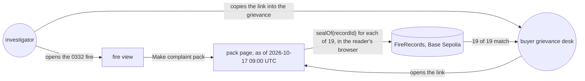
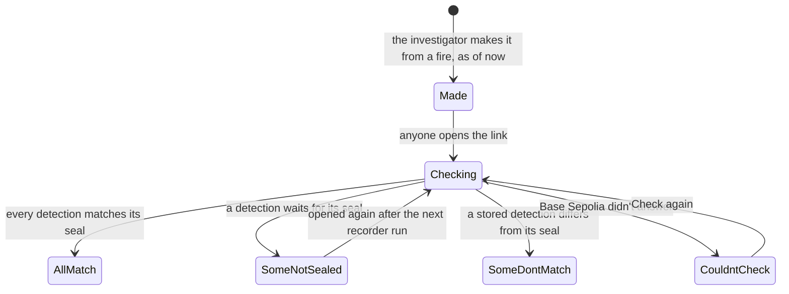

# Complaint pack

**Version:** v1 · **Status:** Draft · **Type:** Feature · **Project type:** Web UI

**Shape doc:** docs/specs/fire-watch/shape.md
**Depends on:** fire-origin

The investigator turns one fire into a pack with its own public link, to put in a grievance. The
pack gives the site, the dates and the basis for where the fire was first seen, and the reader's
own browser checks every detection against the chain. It comes now because it joins fire-record
and fire-origin into what a buyer reads, and the demo video is built on it (shape).

## Problem

Companies answer fire grievances in two ways. Wilmar said a complaint gave no "specific sites,
dates or the basis", and KLK said its fires "originated outside" its concession (both Sept 2026,
shape O3). Fire Watch can now answer both, but only on its own page. No view has a link
(fire-record O10), so the investigator can't point a buyer at a fire. A screenshot asks the buyer
to trust the investigator's word about the chain check.

A link to a live fire is not stable either. A fire grows with each pass, and its key changes when
a pass joins it to an older fire (fire-origin O11). Of the 1,801 fire and concession pairs recorded
to 2026-10-15, 39 grew and 1 lost its key by the next morning's passes. So the pack keeps its own
copy of the fire.

The ID-WOOD-CONCESSION-0332 fire is the example. It was first seen outside, 950 m from the edge,
on 2026-10-13 17:37 UTC, and seen inside from 2026-10-15 18:43 UTC: 19 detections on 4 passes.

## Slice test

| Check                         | Result |
| ----------------------------- | ------ |
| Cuts every layer it needs     | yes — "Make complaint pack" on the fire view, a pack route in the API, a public pack page, shipped by the existing deploy. The recorder and the contract don't change |
| One e2e test walks it         | yes — record the 0332 fire on anvil, open it, make a pack, open the pack's link in a new browser context, see "First seen outside, 950 m from the edge" and "19 of 19 detections match the chain" |
| Worth shipping alone          | yes — a grievance can carry one link with the site, dates and basis, which the buyer checks against the chain without trusting the investigator or Fire Watch |
| Fits (≤5 scenarios, ≤2 areas) | yes — 5 scenarios; two areas: the API's pack route and the page's pack view |

Earlier slices handed two more items here:

- A link for every view, and Back stepping out of a record (fire-record O10). This is routing for
  the whole page, a third area, so it would fail "Fits". Not planned (O4, D34).
- Basescan verification of FireRecords (walking-skeleton risks). In, as a one-time operator step
  with no scenario of its own. It is not an area of the system (O5, D35).

**Path:** full — a new public page and a new API route.

## User story

As a watchdog investigator, I want to turn one fire into a link that I can put in a grievance, so
that the buyer sees the site, the dates and the basis for where it was first seen, and checks
every detection against the chain without taking my word or Fire Watch's.

## Flow



The investigator makes a pack from a fire and sends its link. The buyer opens the same page, and
their own browser checks each detection against the chain.

## States



A pack never changes after it is made. Only the result of the chain check moves, each time
someone opens it.

## Acceptance criteria

```gherkin
Scenario: The investigator makes a pack for a fire first seen outside
  Given the ID-WOOD-CONCESSION-0332 fire of fire-origin scenario 1 is recorded and sealed:
    19 VIIRS NOAA-20 detections on 4 passes, 2026-10-13 17:37 to 2026-10-15 18:43 UTC
  When the investigator opens the fire and picks "Make complaint pack" at 2026-10-17 09:00 UTC
  Then a pack page opens at its own link
  And it reads "First seen outside, 950 m from the edge"
  And the site: ID-WOOD-CONCESSION-0332, Kalimantan Tengah, first detection at 2.85170°S, 112.72527°E
  And the dates: first seen 2026-10-13 17:37 UTC, seen inside from 2026-10-15 18:43 UTC,
    last seen 2026-10-15 18:43 UTC
  And the basis: 4 passes with 19 detections, each with its record ID and transaction,
    the map "Trase pulpwood concessions 2023–2024, v2026-02-20", and fire rule version 1 written out
  And "As of 2026-10-17 09:00 UTC"
  And no company name anywhere on it

Scenario: Anyone with the link checks every detection against the chain
  Given the pack from scenario 1, made while 6 of its 19 detections waited for their seal
  When a buyer opens its link the same hour, in a browser that has never opened Fire Watch
  Then the page shows the same pack
  And their browser reads each detection's seal from FireRecords on Base Sepolia
  And it reads "13 of 19 detections match the chain. 6 are not sealed yet."
  When they open it again after the next recorder run
  Then it reads "19 of 19 detections match the chain"

Scenario: A detection changed after its seal
  Given the pack from scenario 1, every detection sealed
  And the 2026-10-14 06:18 UTC detection at 2.85500°S, 112.72607°E has its fire power changed
    in the database from 14.48 to 1.45 MW
  When anyone opens the pack
  Then it reads "18 of 19 detections match the chain. 1 does not."
  And that detection is listed first, marked "Does not match the chain"

Scenario: The fire grows after the pack is made
  Given the pack from scenario 1, made at 2026-10-17 09:00 UTC
  And a NOAA-20 pass at 2026-10-17 18:20 UTC adds 3 detections to the fire
  When anyone opens the pack
  Then it still lists 4 passes and 19 detections
  And it still reads "First seen outside, 950 m from the edge" and "As of 2026-10-17 09:00 UTC"
  And this holds also when a later pass joins the fire to an older one

Scenario: A pack for a fire the record can't settle carries its caveat
  Given the ID-WOOD-CONCESSION-0540 fire of fire-origin scenario 3, first seen 158 m inside the edge
  When the investigator makes a pack for it
  Then its headline reads "First seen 160 m inside the edge, within one satellite pixel of it"
  And directly under it "The satellite record can't say which side this fire started on."
  And a pack for the 0540 fire of fire-origin scenario 4 carries "Seen on 5 passes without
    spreading. This can be a fixed heat source, such as a mill, or peat smouldering in place."
```

## Scope

**In:**

- "Make complaint pack" on the fire view, for any fire, open to anyone using the site. No login
  (O6, D36).
- The pack: a public page at its own link, with the site, dates and basis of scenario 1. Each
  detection shows its record ID, its transaction and its own chain check. A count sits at the top.
  Only the pack gets a link (O4, D34).
- The pack holds the fire's detections stored when it was made, and the reading worked out from
  them by rule version 1. It never changes after that (O2, D33, fire-origin O11).
- Detections that wait for their seal stay in the pack, and read "Not sealed yet" until the
  recorder seals them (O3, D33).
- Every caveat from fire-origin goes directly under the pack's headline: too close to tell, both
  sides of the edge, never spread, and the recording-start note (O7, D36).
- The reader's browser does the check against FireRecords (D7). The pack says so, and names the
  contract address and the network.
- Wording says "first seen", never "started" (D26). No company names (shape O10).
- The pack page prints cleanly to PDF from the browser (O1, D34).
- FireRecords verified on Basescan once, by the operator, so a seal's transaction reads
  `seal(recordId, fingerprint)` (O5, D35).

**Out:**

- A link for every view, and Back stepping out (fire-record O10) — not planned (O4, D34).
- A file of the pack's records to download — not planned; each raw record opens on the page (O1).
- A count of detections seen after the pack was made — not planned (O2).
- Company names or concession holders — not planned (shape O10).
- A pack for several fires or for a whole concession's season — not planned; one fire a pack.
- Sealing the pack itself — not planned. Each detection is already sealed, and D24 rejects sealing
  readings. A pack can't show that no detection was left out (fire-origin O7).
- Bahasa Indonesia — not planned.
- Where the fire goes next — spread-forecast.
- Burned area and carbon — damage-estimate.

## Open items

| ID | What | Type | Raised at | Owner | Status | Answer |
| -- | ---- | ---- | --------- | ----- | ------ | ------ |
| O1 | What the buyer gets: a link whose page prints cleanly to PDF, the link only, or the link plus a file of the records (JSON) to redo the rule | question | spec p1 | user | Resolved | 2026-10-17: a link whose page prints cleanly to PDF from the browser; no JSON file (D34) |
| O2 | When the fire grows, or joins an older fire, after the pack is made: the pack stays as made; it stays as made and says how many newer detections exist; or it always shows the fire as it is now | question | spec p1 | user | Resolved | 2026-10-17: stays as made, stamped "As of"; no count of newer detections (D33) |
| O3 | Detections not sealed yet when the pack is made. On 2026-10-16 16:40 UTC, 6 of the 0332 fire's 19 waited, during the recorder's backfill of 625 | question | spec p1 | user | Resolved | 2026-10-17: they stay in the pack and read "Not sealed yet" until sealed (D33) |
| O4 | A link for every view, and Back stepping out of a record, handed here by fire-record O10. Including it adds routing for the whole page, a third area, and fails "Fits" | question | spec p1 | user | Resolved | 2026-10-17: not planned; only the pack gets a link (D34) |
| O5 | Basescan verification of FireRecords, handed here by walking-skeleton. A buyer who opens a transaction sees raw hex today. Verifying needs a free Etherscan API key | question | spec p1 | user | Resolved | 2026-10-17: in, as a one-time operator step; the user creates the key and keeps it in the untracked `.env` (D35) |
| O6 | Who can make a pack. The site has no login, and every detection in a pack is public already | question | spec p1 | user | Resolved | 2026-10-17: anyone using the site (D36) |
| O7 | A pack for a fire the record can't settle: too close to tell, both sides, or never spread (a possible mill, D27) | question | spec p1 | user | Resolved | 2026-10-17: allowed; the caveat goes directly under the headline (D36) |

_Never delete this section or its rows. See references/ledger.md._

## Glossary

- **Grievance** — a complaint a watchdog files with a buyer about one of the buyer's suppliers.
- **Pack** — here, one fire's site, dates, basis and detections on a page with its own link.
- **Seal** — the record's fingerprint, written once to the chain so later changes show.
- **Record ID** — the random 32-byte name each detection's seal is stored under (D9).
- **Transaction** — the chain entry that wrote a seal; Basescan shows it.
- **Basescan** — the public website that shows Base Sepolia's transactions and contracts.
- **Contract verification** — publishing a contract's source on Basescan, so its calls read as
  `seal(recordId, fingerprint)` instead of raw hex.
- **Backfill** — the recorder catching up on detections stored before they could be sealed.
- **anvil** — a local test chain; the e2e test seals records on it instead of Base Sepolia.
- **e2e** — end-to-end: one test that walks the whole slice as a user would.
