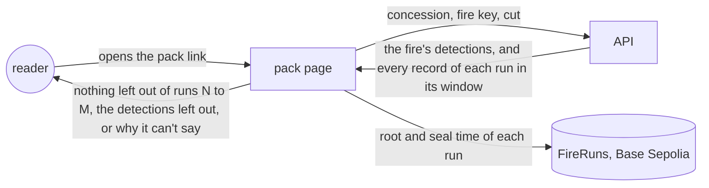
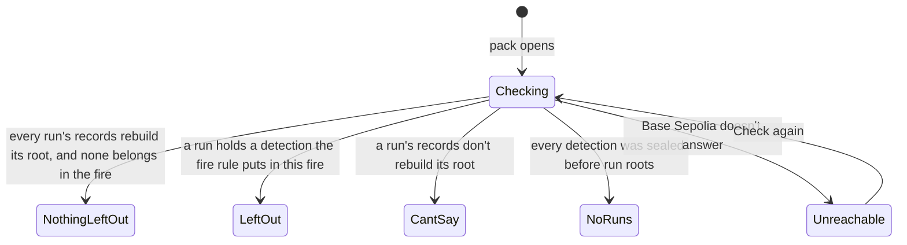

# Complete packs

**Version:** v1 · **Status:** Draft · **Type:** Enhancement · **Project type:** Web UI

**Shape doc:** docs/specs/judge-review/shape.md
**Depends on:** run-roots, complaint-pack

A complaint pack shows, in the reader's browser, that no stored detection of its fire was left
out of the recorder runs in its window. It comes now because run-roots seals each run's whole list,
and a pack's list is still the server's word.

## Problem

A pack's link names only the concession, the fire key and a cut time (D37). The API groups the
fire again on each open, so a detection deleted from Neon still leaves "N of N match the chain".
The pack says so today: "Fire Watch's server chose which records to send" (D98).

run-roots seals one Merkle root per run over every record the run seals, and stores each run's
list (D103, D110). Nothing reads those lists yet. Three facts set the limits of this slice:

- **No root exists yet.** On 23 Oct 2026 at 01:27 UTC the `roots` table in Neon was empty. The
  recorder job still seals each record on FireRecords, as before run-roots.
- **FireRecords holds no list.** Its 17,173 detection seals each sit in their own transaction.
  Base Sepolia's public RPC answers `eth_getLogs` for 200 blocks at most (measured 23 Oct 2026).
  A week is 302,400 blocks, so about 1,500 calls at 25 a second. A browser can't list them.
- **A run's list covers all of Indonesia.** The browser can only rebuild a root from every record
  in it. The fire rule joins detections up to 48 hours apart, so the window starts 48 hours before
  the fire was first seen. For 0341's largest fire (17 to 22 Oct), that window held 19,398
  detections and 890 forecasts: 2.0 MB gzipped as the API's JSON, 10.3 MB unzipped.

## Slice test

| Check                         | Result |
| ----------------------------- | ------ |
| Cuts every layer it needs     | yes: the API sends each run's records in the pack's window, and the pack checks them in the browser. No contract or recorder change |
| One e2e test walks it         | yes: on the e2e's anvil, with runs sealed from FireRuns, open a pack and read "nothing left out". Then move one detection past the cut and read it listed as left out. Then delete one and read that its run doesn't match its root |
| Worth shipping alone          | yes: once the recorder seals roots, a buyer no longer takes the server's word for a pack's list |
| Fits (≤5 scenarios, ≤2 areas) | yes: 5 scenarios; one area, viewing (the API's fire route and the pack) |

**Path:** full. It adds data to an API route and a new block to the pack.

## User story

As a buyer's sustainability officer reading a complaint pack, I want my browser to show that no
recorded detection of the fire was left out, so that I don't take Fire Watch's word for the list.

## Flow



The API sends the fire and every record of each run in its window. The browser rebuilds each
run's root, checks it against FireRuns, and looks for a detection that the fire rule puts in this
fire but the pack lacks.

## States



A pack whose fire began before run roots reads NothingLeftOut for the runs it has, and says that
the older part can't be checked.

## Acceptance criteria

```gherkin
Scenario: Nothing is left out of a fire's pack
  Given ID-WOOD-CONCESSION-0341's fire was first seen on 27 Oct 2026 at 18:04 UTC
  And it has 42 detections, all sealed in FireRuns runs 21 to 40
  And every record stored from 25 Oct 18:04 UTC to the pack's cut is in those runs
  When the reader opens the fire's complaint pack
  Then it reads that no stored detection of this fire is left out of runs 21 to 40
  And it gives the seal times of runs 21 and 40 by Base Sepolia's clock
  And a print to PDF carries the same lines

Scenario: The server leaves a detection out of the pack
  Given run 31 holds a detection taken on 28 Oct 2026 at 06:12 UTC, 410 m inside the concession
  And it is 600 m and 9 hours from the fire's nearest detection
  And Fire Watch's server leaves it out of the fire's pack
  When the reader opens the pack
  Then it reads "1 detection of this fire is left out of this pack"
  And it lists that detection's time and place, and that it matches run 31's root

Scenario: A run's records no longer rebuild its root
  Given a detection in run 31 is deleted from Fire Watch's database after the run was sealed
  When the reader opens the pack
  Then it reads that run 31's records don't match its root on FireRuns
  And that the pack can't show that nothing is left out
  And each detection in the pack still shows its own check

Scenario: A fire that began before run roots
  Given ID-WOOD-CONCESSION-0341's fire was first seen on 17 Oct 2026 at 18:04 UTC
  And its detections before the switch on 23 Oct 2026 at 06:00 UTC are sealed one by one on FireRecords
  And its later detections are sealed in runs 1 to 12
  When the reader opens its pack
  Then it reads that no stored detection of this fire is left out of runs 1 to 12
  And that detections sealed before 23 Oct 06:00 UTC each have their own seal, with no list on the chain
  And that NASA FIRMS's public archive shows whether one of those is missing
  And the landing's 0332 pack, cut on 17 Oct 2026 at 09:00 UTC, has no run and reads as it does today

Scenario: The newest pass waits for its root
  Given the 28 Oct 2026 09:00 UTC run stored 6 detections of the fire
  And its root transaction failed because the recorder wallet was empty
  When the reader opens a pack cut after that run
  Then those 6 detections read "Not on chain yet"
  And the pack reads that nothing is left out of runs 21 to 40, the newest run sealed
```

## Scope

**In:**

- The pack checks, in the reader's browser, every FireRuns run from 48 hours before the fire was
  first seen to the pack's cut.
- The API sends every record of each of those runs in full, detections and forecasts, so the
  browser can rebuild each root.
- The pack names the runs it checked and their seal times by the chain's clock.
- A detection that the fire rule puts in this fire but the pack lacks is listed, with its time,
  place and run.
- A run whose records don't rebuild its root stops the claim. This also covers a root that Fire
  Watch holds no list for, such as one sealed from a stolen recorder key.
- A pack with detections sealed before run roots says that part can't be checked. The note from
  D98 changes to match.
- When Base Sepolia doesn't answer, the block says so, with Check again, as the seal checks do.

**Out:**

- The fire view in the tool. No slice: the pack is what goes to a buyer.
- A list of the detections sealed one by one on FireRecords. No slice: a browser can't read it
  from the public RPC.
- Proof that the recorder stored every FIRMS detection. No slice: FIRMS's public archive shows
  that (D24).
- The landing's real case. Its 283 seals stay on FireRecords, and its check doesn't change.
- Switching the recorder job to FireRuns. It is run-roots' rollout, steps 3 to 6 in the README.
- A smaller download for long windows, such as a list per concession inside each root. No slice
  until packs get slow.

## Technical plan

_(the rest is added at pause 3)_

### Decisions to record

Drafted at pause 1. `/build` appends them to `DECISIONS.md` and flips D24's Status line to
`superseded by D119`.

```markdown
## D119 · 2026-10-23 · Work out readings from sealed detections, and check a pack's list against each run's sealed list

Why: a reading changes when a pass grows a fire or joins two, so a sealed reading would need
sealing again (D24's reason, which still holds). run-roots seals each run's whole list (D103) and
stores it (D110). A browser can rebuild a run's root from its records and find a detection that a
pack lacks. FIRMS's public archive still shows a detection the recorder never stored.
Rejected: sealing each reading (proves what we said, not what the satellite saw, and needs sealing
again as fires grow or join), leaving a pack's list on the server's word (a deleted detection
still leaves "N of N match the chain", D98).
Supersedes: D24
Source: docs/specs/complete-packs.md
Status: active

## D120 · 2026-10-23 · Check a pack's list against FireRuns' runs only, and say plainly that older seals can't be checked

Why: FireRecords' 17,173 detection seals have no list on the chain. Base Sepolia's public RPC
answers `eth_getLogs` for 200 blocks at most (measured 23 Oct 2026), so listing a week of seals
takes about 1,500 calls at 25 a second. FIRMS's public archive still shows whether an older
detection is missing.
Rejected: reading FireRecords' seal events in the browser (about 1,500 calls for a week), sealing
the old lists once in catch-up roots (proves only that nothing was removed after that day, and
needs recorder work).
Source: docs/specs/complete-packs.md
Status: active

## D121 · 2026-10-23 · Check that nothing is left out when the pack opens, after the seal checks

Why: a buyer gets the pack as a link or a PDF (D95), so a print must carry the result. The check
downloads every record of each run in the window: about 1 MB gzipped for 4 days, 2 MB for a week
(0341's fire, measured 23 Oct 2026).
Rejected: a button the reader taps (a print made without the tap has no result).
Source: docs/specs/complete-packs.md
Status: active
```

## Open items

| ID | What | Type | Raised at | Owner | Status | Answer |
| -- | ---- | ---- | --------- | ----- | ------ | ------ |
| O1 | complete-packs supersedes D24's rejection of sealing each run's record list (from shape O7) | flag | shape | user | Resolved | 2026-10-23: supersede D24. Readings stay unsealed, and a pack checks its list against the sealed run lists (D119) |
| O2 | The recorder job still seals on FireRecords: Neon had no root on 23 Oct 2026 at 01:27 UTC. Until the switch, no pack has a run to check | flag | spec p1 | user | Resolved | 2026-10-23: the operator switches the job now, before `/build`, by the README's "Turning on run roots", steps 3 to 6 |
| O3 | FireRecords' seals have no list on the chain, and the public RPC reads 200 blocks of logs at a time. What does a pack say about detections sealed before run roots? | question | spec p1 | user | Resolved | 2026-10-23: check the runs only, and say plainly that the older detections can't be checked. FIRMS's archive shows whether one is missing (D120) |
| O4 | The check needs every record of each run in the window: 2.0 MB gzipped for a week. Does it run when the pack opens, or when the reader asks? | question | spec p1 | user | Resolved | 2026-10-23: when the pack opens, after the seal checks, so a print always carries the result (D121) |

_Never delete this section or its rows. See references/ledger.md._

## Glossary

- **Merkle root**: one hash that stands for a whole list of records. A change to any record
  changes it.
- **Run**: one root on FireRuns. The recorder seals one in each hourly start that has records.
- **Cut**: the time a pack holds its fire as of, carried in its link (D37).
- **Window**: the runs a pack checks, from 48 hours before the fire was first seen to the cut.
- **FireRecords**: the older contract, with one seal per record.
- **FireRuns**: the contract from run-roots, with one root per run.
- **RPC**: the server a browser asks to read the chain.
- **`eth_getLogs`**: the RPC call that lists a contract's events, such as each seal.
- **gzip**: the compression the API already applies to its answers.
- **e2e**: end-to-end: one test that walks the whole slice as a user would.
