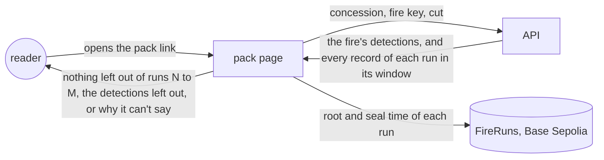
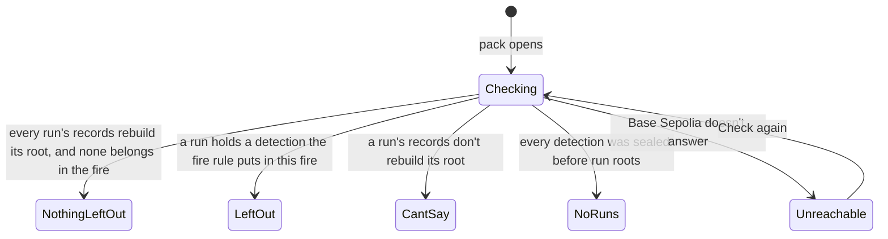
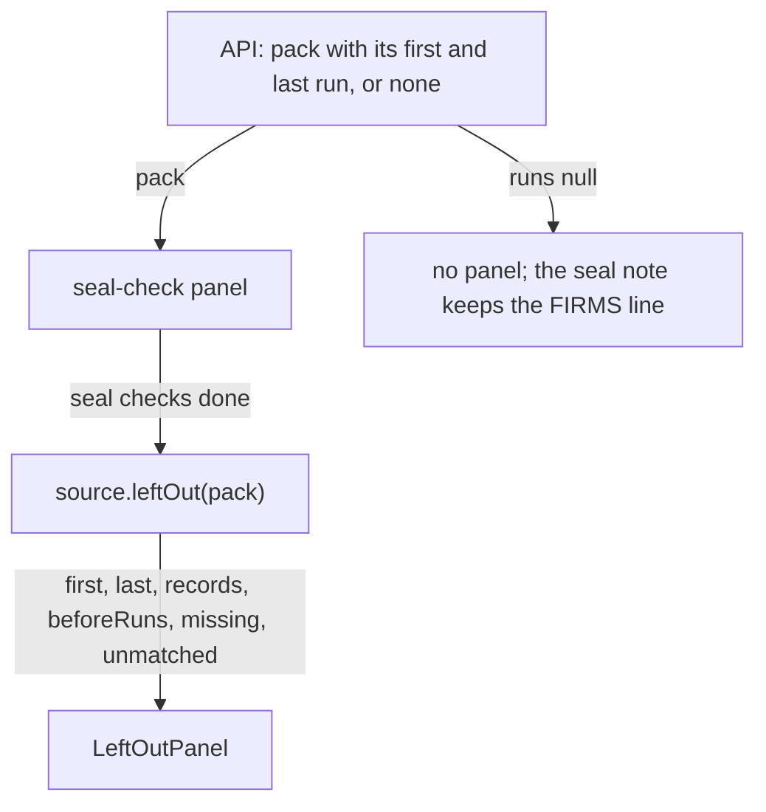
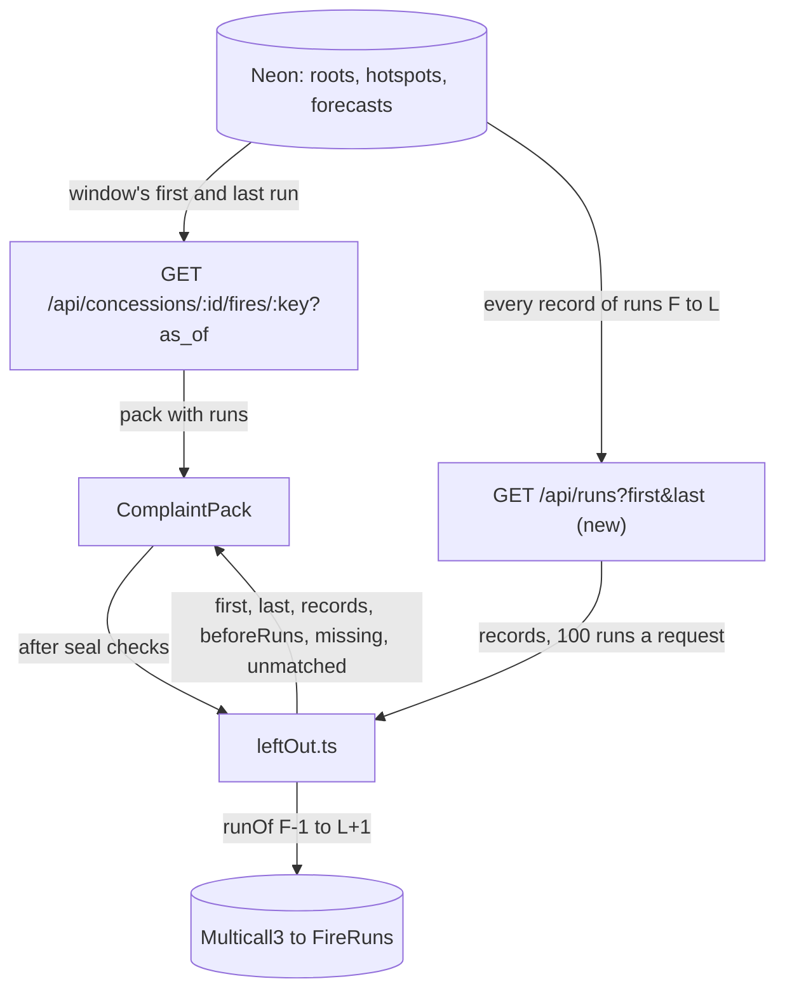
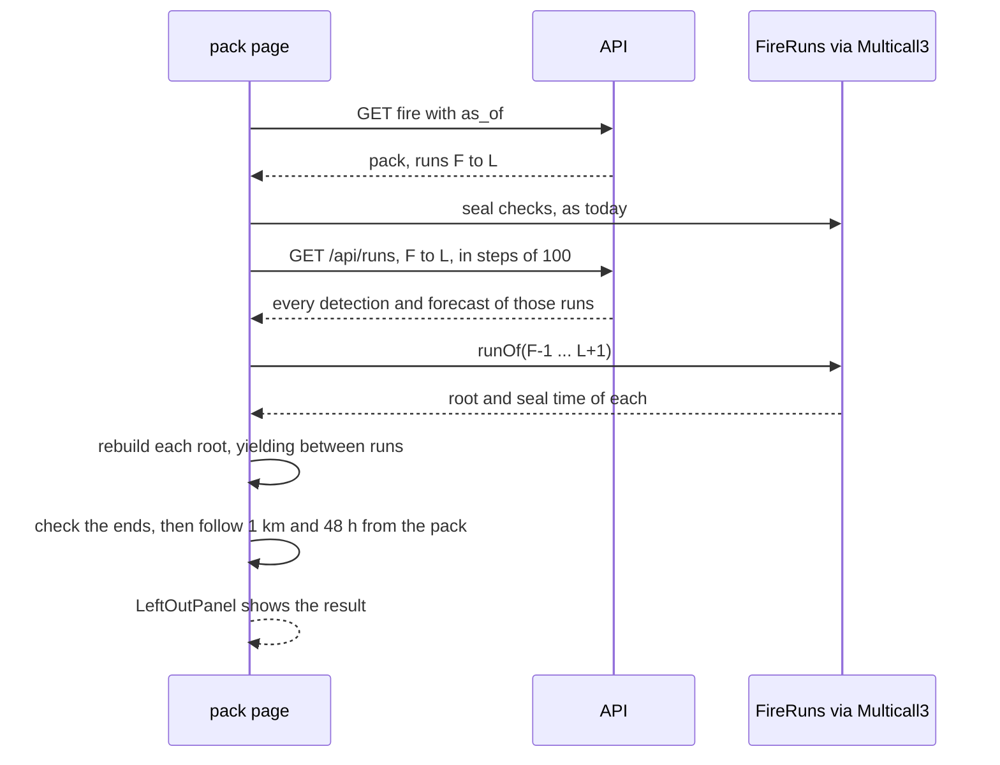
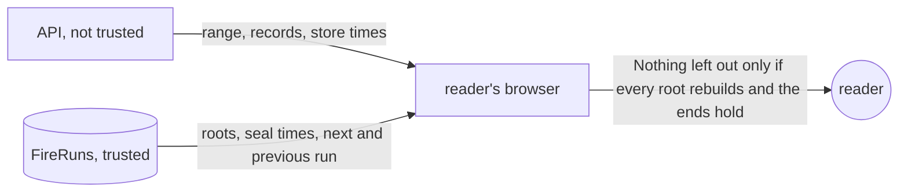

# Complete packs

**Version:** v1 · **Status:** Built · **Type:** Enhancement · **Project type:** Web UI

**Shape doc:** docs/specs/judge-review/shape.md
**Depends on:** run-roots, complaint-pack

A complaint pack shows, in the reader's browser, that no stored detection of its fire was left
out of the recorder runs in its window. It comes now because run-roots seals each run's whole list,
and a pack's list is still the server's word.

## Problem

A pack's link names only the concession, the fire key and a cut time (D37). The API groups the
fire again on each open, so a detection deleted from Neon still leaves "N of N match the chain".
The pack says so today: "Fire Watch's server chose which records to send" (D98).

run-roots seals one Merkle root per run over every record the run seals, and stores each run's
list (D103, D110). Nothing reads those lists yet. Three facts set the limits of this slice:

- **No root exists yet.** On 23 Oct 2026 at 01:27 UTC the `roots` table in Neon was empty. The
  recorder job still seals each record on FireRecords, as before run-roots.
- **FireRecords holds no list.** Its 17,173 detection seals each sit in their own transaction.
  Base Sepolia's public RPC answers `eth_getLogs` for 200 blocks at most (measured 23 Oct 2026).
  A week is 302,400 blocks, so about 1,500 calls at 25 a second. A browser can't list them.
- **A run's list covers all of Indonesia.** The browser can only rebuild a root from every record
  in it. The fire rule joins detections up to 48 hours apart, so the window starts 48 hours before
  the fire was first seen. For 0341's largest fire (17 to 22 Oct), that window held 19,398
  detections and 890 forecasts: 2.0 MB gzipped as the API's JSON, 10.3 MB unzipped.

## Slice test

| Check                         | Result |
| ----------------------------- | ------ |
| Cuts every layer it needs     | yes: the API sends each run's records in the pack's window, and the pack checks them in the browser. No contract or recorder change |
| One e2e test walks it         | yes: on the e2e's anvil, with runs sealed from FireRuns, open a pack and read "nothing left out". Then move one detection past the cut and read it listed as left out. Then delete one and read that its run doesn't match its root |
| Worth shipping alone          | yes: once the recorder seals roots, a buyer no longer takes the server's word for a pack's list |
| Fits (≤5 scenarios, ≤2 areas) | yes: 5 scenarios; one area, viewing (the API's fire route and the pack) |

**Path:** full. It adds data to an API route and a new block to the pack.

## User story

As a buyer's sustainability officer reading a complaint pack, I want my browser to show that no
recorded detection of the fire was left out, so that I don't take Fire Watch's word for the list.

## Flow



The API sends the fire and every record of each run in its window. The browser rebuilds each
run's root, checks it against FireRuns, and looks for a detection that the fire rule puts in this
fire but the pack lacks.

## States



A pack whose fire began before run roots reads NothingLeftOut for the runs it has, and says that
the older part can't be checked.

## Acceptance criteria

```gherkin
Scenario: Nothing is left out of a fire's pack
  Given ID-WOOD-CONCESSION-0341's fire was first seen on 27 Oct 2026 at 18:04 UTC
  And it has 42 detections, all sealed in FireRuns runs 21 to 40
  And every record stored from 25 Oct 18:04 UTC to the pack's cut is in those runs
  When the reader opens the fire's complaint pack
  Then it reads that no stored detection of this fire is left out of runs 21 to 40
  And it gives the seal times of runs 21 and 40 by Base Sepolia's clock
  And a print to PDF carries the same lines

Scenario: The server leaves a detection out of the pack
  Given run 31 holds a detection taken on 28 Oct 2026 at 06:12 UTC, 410 m inside the concession
  And it is 600 m and 9 hours from the fire's nearest detection
  And Fire Watch's server leaves it out of the fire's pack
  When the reader opens the pack
  Then it reads "1 detection of this fire is left out of this pack"
  And it lists that detection's time and place, and that it matches run 31's root

Scenario: A run's records no longer rebuild its root
  Given a detection in run 31 is deleted from Fire Watch's database after the run was sealed
  When the reader opens the pack
  Then it reads that run 31's records don't match its root on FireRuns
  And that the pack can't show that nothing is left out
  And each detection in the pack still shows its own check

Scenario: A fire that began before run roots
  Given ID-WOOD-CONCESSION-0341's fire was first seen on 17 Oct 2026 at 18:04 UTC
  And its detections before the switch on 23 Oct 2026 at 06:00 UTC are sealed one by one on FireRecords
  And its later detections are sealed in runs 1 to 12
  When the reader opens its pack
  Then it reads that no stored detection of this fire is left out of runs 1 to 12
  And that detections sealed before 23 Oct 06:00 UTC each have their own seal, with no list on the chain
  And that NASA FIRMS's public archive shows whether one of those is missing
  And the landing's 0332 pack, cut on 17 Oct 2026 at 09:00 UTC, has no run and reads as it does today

Scenario: The newest pass waits for its root
  Given the 28 Oct 2026 09:00 UTC run stored 6 detections of the fire
  And its root transaction failed because the recorder wallet was empty
  When the reader opens a pack cut after that run
  Then those 6 detections read "Not on chain yet"
  And the pack reads that nothing is left out of runs 21 to 40, the newest run sealed
```

## Scope

**In:**

- The pack checks, in the reader's browser, every FireRuns run from 48 hours before the fire was
  first seen to the pack's cut.
- The API sends every record of each of those runs in full, detections and forecasts, so the
  browser can rebuild each root.
- The pack names the runs it checked and their seal times by the chain's clock.
- A detection that the fire rule puts in this fire but the pack lacks is listed, with its time,
  place and run.
- A run whose records don't rebuild its root stops the claim. This also covers a root that Fire
  Watch holds no list for, such as one sealed from a stolen recorder key.
- A pack with detections sealed before run roots says that part can't be checked. The note from
  D98 changes to match.
- When Base Sepolia doesn't answer, the block says so, with Check again, as the seal checks do.

**Out:**

- The fire view in the tool. No slice: the pack is what goes to a buyer.
- A list of the detections sealed one by one on FireRecords. No slice: a browser can't read it
  from the public RPC.
- Proof that the recorder stored every FIRMS detection. No slice: FIRMS's public archive shows
  that (D24).
- The landing's real case. Its 283 seals stay on FireRecords, and its check doesn't change.
- Switching the recorder job to FireRuns. It is run-roots' rollout, steps 3 to 6 in the README.
- A smaller download for long windows, such as a list per concession inside each root. No slice
  until packs get slow.

## Interface

One new panel in the pack, under the seal-check panel, built from the parts that panel already
uses. It shows only when the API gives the pack's window a run range. No new token, component or
motion. The two craft checks pass. The panel's look comes from the seal-check panel, not from a
generic prompt. It holds up as documentation-grade: a result, how it was worked out, and its limit
(D2).

**Motion tier:** 1. The panel enters with the pack's existing `enter`, and nothing else moves (O5).

**Components used:** `fw-panel` with `pack-check`, `rec-head`, `Chip` for Checking and "Does not
match the chain", `fw-chip--ok` and `fw-chip--bad` with `OkIcon` and `BadIcon`, `fw-help rec-note`,
`rec-act` with `fw-btn`, `table-box` and `fw-table`, `sub`, `fw-mono`, `fw-kv`. All exist in
`docs/design/design-system` and `web/src/styles/app.css`.

**Preview:** `/?preview=complete-packs` on the dev server, one state per scenario, plus Checking and
Couldn't check. The code is `LeftOutPanel` in `web/src/ComplaintPack.tsx`, and the fixture is
`web/src/preview/CompletePacksPreview.tsx`. Run numbers, seal times and record counts there are
made up.



The seal checks run first. Then the pack asks for the left-out check, and the panel shows its
result. A pack with no run in its window shows no panel, as today.

### The panel's states

| State | Heading | Chip | Notes |
| --- | --- | --- | --- |
| Checking | Checking runs `<first>` to `<last>` for a detection left out | Checking | Your browser reads every record these runs sealed and rebuilds each root, so this can take a few seconds. |
| Nothing left out | No detection of this fire is left out of runs `<first>` to `<last>` | Nothing left out (ok) | The method note, then: No run holds a detection that the fire rule joins to this fire and this pack leaves out. |
| Left out | `<n>` detection(s) of this fire is (are) left out of this pack | Left out (bad) | The method note, then: The fire rule joins each detection below to this fire, through detections at most 1 km and 48 hours apart, but this pack leaves it out. Each one sits in a run whose root matches FireRuns. Then a table: Detected (UTC), Where with the coordinates under it, Sealed in ("Run 31") |
| Can't say | Can't show that nothing is left out of runs `<first>` to `<last>` | Does not match the chain (bad) | The method note, then: Fire Watch's records for run `<n>` don't rebuild its root on FireRuns. A record was removed or changed after its run was sealed, or Fire Watch holds no list for that root. So this pack can't show that nothing is left out. |
| Couldn't check | Couldn't check runs `<first>` to `<last>` for a detection left out | none | Couldn't read the runs from Fire Watch's server or Base Sepolia. Then Check again, which reruns only this check |

The method note: "Fire Watch sent all `<records>` records these runs sealed. Your browser rebuilt
each run's root from them and compared it with FireRuns. The runs start 48 hours before this fire
was first seen and end at the pack's cut."

When both a detection is left out and a run doesn't match, the heading and chip say "left out", and
both notes show. When the window starts before FireRuns' first run, a last note follows: "Detections
sealed before `<first run's seal time>` each have a seal of their own on FireRecords. The chain
holds no list of them, so NASA FIRMS's public archive is the way to find one left out."

Under the notes, `fw-kv` rows: "Runs checked" (`<first>` to `<last>`, with `<records>` records),
"First run sealed" and "Last run sealed" by the chain's clock ("Run sealed" for one run), and "Not
matching" with the run numbers when a run doesn't match.

### Copy

| Where | Today | After |
| --- | --- | --- |
| `ComplaintPack.tsx`, seal-check note, pack with runs | … Fire Watch's server chose which records to send. NASA FIRMS's public archive shows whether one is missing. | … Fire Watch's server chose which records to send. The check below shows whether it left one out. |
| the same, pack with no runs | as today | as today (D98) |

A printed pack carries the panel, as it does the seal-check panel. Check again doesn't print. At
390 px the panel and its table fit without a sideways scroll, in both themes.

## Technical plan

### Approach

The fire route gives a pack its window as a range of FireRuns runs. A new read-only route sends
every record of those runs. After the seal checks, the browser rebuilds each run's root from those
records, reads the roots and their times from FireRuns in one Multicall3 call, and checks the
range's ends against the chain. Then it follows the fire rule's 1 km and 48 hours from the pack's
detections through the concession's other detections, and lists any it reaches. No contract,
recorder or schema change.

Relies on: D7, D10, D31, D37, D38, D97, D98, D103, D108, D110, D119, D120, D121, D122, D123, D124,
D125



The API sends the range and the records. The page gets the roots from the chain, and `leftOut.ts`
decides.



The seal checks finish first. Then one more API read and one chain read give the browser all it
needs.



The browser trusts the chain. It takes the API's store time only for a record in a run sealed
after the pack's cut (D123, O7).

**The rules `leftOut.ts` applies,** in order:

1. Each run from F to L must rebuild its root on FireRuns from the records sent for it. A run with
   no records sent, or a zero root, fails too. A failed run goes in `unmatched`, and its records
   are not used.
2. When F is more than 1, run F−1 must be sealed before 48 hours before the pack's first detection.
   Otherwise run F−1 goes in `unmatched`.
3. Run L+1 must not exist, or must be sealed after the pack's cut. Otherwise it goes in
   `unmatched`.
4. Each of the pack's detections with a run must have a run from F to L. Otherwise that run goes
   in `unmatched`.
5. The candidates are the detections in the matching runs that match the pack's concession and are
   not in the pack. In a run sealed after the cut, one that the API says was stored after the cut
   is left out of the candidates.
6. A candidate is left out when it is at most 1,000 m and 48 hours from a pack detection or from
   another left-out candidate. Distance is `fires.py`'s haversine.
7. `beforeRuns` is true when F is 1 and run 1 was sealed after 48 hours before the first detection.

The API's window: F is the first run sealed at or after 48 hours before the fire's first
detection. L is the newest run holding a detection stored by the cut. No run, or F after L, gives
`null`.

### Changes

| File | What changes | Why |
| ---- | ------------ | --- |
| `api/src/firewatch/app.py:25`, `:262`, `:308` | `MAX_RUNS = 100`. A `WINDOW_RUNS` query gives F and L, and the pack (a request with `as_of`) adds `runs`, or `null`. The log line adds `runs=F-L` | 1, 4, 5 |
| `api/src/firewatch/app.py` | New `GET /api/runs?first=&last=`: every hotspot of the sealed runs with `_record`, its `run` and `stored_unix`, and every forecast with `record_id`, `forecast_fields` and `run`. 422 when `first` is under 1, `last` is under `first`, or the range is over 100 runs. Logs `served runs first= last= hotspots= forecasts=` | 1, 2, 3 |
| `api/tests/test_app.py` | The pack's `runs`: the window's start, the cut, `null` with no root, none on the fire view. The run route: records with their runs and store times, sealed runs only, each 422 | 1–5 |
| `fixtures/join-vectors.json` | New. Pairs of real detections from `fixtures/firms/fire-origin.csv` on both sides of 1,000 m and 48 hours, with `fires.distance_m` and the join answer | 2 |
| `api/tests/test_fires.py` | Reads the join vectors against `distance_m` and the 1 km and 48 hour limits | 2 |
| `web/src/merkle.ts` | Adds `rootOf(leaves)`, as `merkle.py`'s `tree` gives the root (D108) | 1, 3 |
| `web/src/chain.ts:51` | Adds `runsOf(runs)`: each run's root and seal time through `readAll` | 1, 3 |
| `web/src/leftOut.ts` | New. `distanceM` as `fires.distance_m`, and `checkRuns(pack, sent, chain)`, which applies the seven rules and returns `LeftOutCheck`. It yields to the page between runs | 1–5 |
| `web/src/api.ts:192`, `:225` | Adds `runRecords(first, last)` in steps of 100 runs. `packSource.leftOut` reads the records and `runsOf(F-1 … L+1)`, then calls `checkRuns` | 1–3 |
| `web/src/ComplaintPack.tsx` | Pause 2's panel, unchanged. `leftOut.ts` imports `LeftOutCheck` from it (O8) | 1–5 |
| `web/src/*.test.ts(x)` | `leftOut.test.ts`, `merkle.test.ts`, `chain.test.ts`, `api.test.ts`, `ComplaintPack.test.tsx`: below | 1–5 |
| `web/e2e/complete-packs.spec.ts` | New: the slice's e2e, below | 2, 3, 4 |
| `web/e2e/complaint-pack.spec.ts:157` | 0332's pack now has runs, so its note ends "The check below shows whether it left one out." | 4 |

Reusing: `_record` and `forecast_fields` for the run route, `_range`'s 422 pattern, `readAll` and
its 500-read chunks, `leaf` and the merkle vectors, `fingerprint` and `forecastFingerprint`, the
e2e's `makePack`, `openAsBuyer` and `sql` helpers from `run-roots.spec.ts`, and its runs 1 to 4.

### Earn-it

| Added | Triggered by |
| ----- | ------------ |
| `GET /api/runs` | Scenarios 1 to 3: the browser needs every record of each run (D122) |
| `runs` on the pack | Scenarios 1, 4 and 5: the browser must know which runs the window covers |
| `MAX_RUNS` and the steps of 100 | The risk of one request reading the whole table from an open API (D122) |
| `stored_unix` on each run record | The risk of a detection stored after the cut reading as left out (D123) |
| `rootOf`, `runsOf` | Scenarios 1 and 3: rebuild a root and read it from the chain |
| `leftOut.ts` | Scenarios 1 to 5: the rules and the 1 km and 48 hour join (D124) |
| `fixtures/join-vectors.json` | The risk that Python and TypeScript disagree on a pair near 1,000 m, so a detection reads as left out wrongly |
| The yield between runs | A week's window takes about 3 s of hashing on this machine (below), which would freeze the page |

No new dependency, table, column or index.

### Non-functionals

|                      |                                                                               |
| -------------------- | ----------------------------------------------------------------------------- |
| **Load**             | One run read per pack open, after the seal checks. About 6 roots a day, so a 4-day window is about 25 runs and 9,000 records, near 1 MB gzipped. 20,000 version 2 fingerprints and their leaves took 2.8 s, and the tree 0.3 s, in Node on this machine (23 Oct 2026). A phone is slower |
| **Breaks first**     | At 10×, a week is 20 MB gzipped and half a minute of hashing. Then a list per concession goes inside each root (the rejected option in D122). The run route reads `hotspots` without an index on `root_id`; add one when it shows in the log's timing |
| **Security surface** | `GET /api/runs`: anyone, read-only, two whole numbers, 100 runs at most. No secret, nothing stored. The browser trusts FireRuns' roots and times. It trusts the API's store time only in a run sealed after the cut (O7) |
| **Proof it works**   | The API's `served runs first=12 last=31 hotspots=8812 forecasts=402` after a pack opens, and `runs=12-31` on its fire line. A pack in prod reads "No detection of this fire is left out of runs 12 to 31" |
| **Rollout**          | No flag, as D81. Merge, and Deploy ships the API and the page. The panel shows only for a pack with runs, so nothing changes until the job seals roots (O2). Rollback: revert the merge; nothing is stored |

### Test plan

| Scenario | Test | Command |
| -------- | ---- | ------- |
| 1, 4, 5 | `api/tests/test_app.py`: the pack's `runs` from the window's start to the cut; `null` with no root | `cd api && PATH=$HOME/.foundry/bin:$PATH uv run pytest tests/test_app.py` |
| 1, 2, 3 | the same file: the run route's records, runs and store times; sealed runs only; each 422 | the same |
| 2 | `api/tests/test_fires.py` and `web/src/leftOut.test.ts`: the join vectors | the same, with `tests/test_fires.py`; `cd web && pnpm test src/leftOut.test.ts` |
| 1–5 | `web/src/leftOut.test.ts`: whole; left out through a chain of two; a root that doesn't rebuild; a run with no records; run F−1 sealed inside the window; run L+1 sealed before the cut; a pack detection past L; a store time after the cut skipped only in a run sealed after it; `beforeRuns` | `cd web && pnpm test src/leftOut.test.ts` |
| 1, 3 | `web/src/merkle.test.ts`: `rootOf` gives each vector's root | `cd web && pnpm test src/merkle.test.ts` |
| 1 | `web/src/chain.test.ts`, `web/src/api.test.ts`: `runsOf` in one `aggregate3`; `runRecords` for 250 runs in 3 requests | `cd web && pnpm test` |
| 1–5 | `web/src/ComplaintPack.test.tsx`: each state in the Interface table, and the note. Each test is seen to fail against a broken panel first, as the pause 2 lesson says | `cd web && pnpm test src/ComplaintPack.test.tsx` |

**E2E:** `web/e2e/complete-packs.spec.ts`, on the e2e's anvil with runs 1 to 4. It makes 0332's
pack from the tool and opens it as a buyer. It reads "No detection of this fire is left out of runs
1 to 4", the note on detections sealed before run 1, and the panel in print. It dates one detection
of run 2 after the pack's cut, reopens the link, and reads "1 detection of this fire is left out of
this pack" with its row in run 2. It deletes one detection of run 3 with its matches, and reads
"Can't show that nothing is left out of runs 1 to 4" and "Not matching 3". It blocks
`/api/runs`, reads "Couldn't check", and taps Check again at 390 px. It puts each row back in a
`finally`. Command: `cd web && pnpm e2e e2e/complete-packs.spec.ts`; the whole suite with `pnpm e2e`.

### Chunks

| Chunk | Scenarios | Files owned |
| ----- | --------- | ----------- |
| A | 1–5 (API) | `api/`, `fixtures/join-vectors.json` |
| B | 1–5 (page) and the e2e | `web/` |

A, then B: B's tests read A's join vectors, and its e2e calls A's run route. Only A runs the API
suite. No lockfile changes.

### Risks

| Risk | Mitigation |
| ---- | ---------- |
| The deadline is 25 Oct 2026, and no root exists until the operator switches the job (O2) | The page shows no panel without runs, so the slice can merge before the switch |
| A phone hashes a long window slowly | The check yields between runs, and the panel says it can take a few seconds. Over 100 runs, the page asks in steps |
| A detection stored after the cut, sealed with a failed run's records, reads as left out | The run route sends each store time, and the browser skips one stored after the cut in a run sealed after it (D123) |
| The server hides a detection of the newest pass by dating it after the cut | Accepted (O7). The panel names its last run and that run's seal time |
| The server sends no range, so no panel shows | Accepted (O6). The pack then claims only what it claims today (D125) |
| Python and TypeScript disagree on a pair near 1,000 m | Both suites read `fixtures/join-vectors.json` |
| The e2e's changes to runs 2 and 3 leak into other serial specs | Each change is put back in a `finally`, as `run-roots.spec.ts` does |

### Decisions to record

Recorded as D119, D120, D121, D122, D123, D124, D125. D24 is superseded by D119.

## Open items

| ID | What | Type | Raised at | Owner | Status | Answer |
| -- | ---- | ---- | --------- | ----- | ------ | ------ |
| O1 | complete-packs supersedes D24's rejection of sealing each run's record list (from shape O7) | flag | shape | user | Resolved | 2026-10-23: supersede D24. Readings stay unsealed, and a pack checks its list against the sealed run lists (D119) |
| O2 | The recorder job still seals on FireRecords: Neon had no root on 23 Oct 2026 at 01:27 UTC. Until the switch, no pack has a run to check | flag | spec p1 | user | Resolved | 2026-10-23: the operator switches the job now, before `/build`, by the README's "Turning on run roots", steps 3 to 6 |
| O3 | FireRecords' seals have no list on the chain, and the public RPC reads 200 blocks of logs at a time. What does a pack say about detections sealed before run roots? | question | spec p1 | user | Resolved | 2026-10-23: check the runs only, and say plainly that the older detections can't be checked. FIRMS's archive shows whether one is missing (D120) |
| O4 | The check needs every record of each run in the window: 2.0 MB gzipped for a week. Does it run when the pack opens, or when the reader asks? | question | spec p1 | user | Resolved | 2026-10-23: when the pack opens, after the seal checks, so a print always carries the result (D121) |
| O5 | Which motion tier the new panel uses | question | spec p2 | user | Resolved | 2026-10-23: tier 1. The panel enters with the pack's existing `enter`, and nothing else moves |
| O6 | A server can send a pack no runs. Then no panel shows, and the pack reads as today | flag | spec p3 | user | Accepted risk | 2026-10-23: the pack then makes no false claim; it only loses the check, and keeps D98's lines. A chain read of run 1 for every pack would add a state beyond the approved interface (D125) |
| O7 | In a run sealed after the cut, the browser takes the server's store time. A server can drop a detection of the newest pass by dating it after the cut | flag | spec p3 | user | Accepted risk | 2026-10-23: the panel names its last run and that run's seal time, and every run sealed before the cut is checked on chain facts alone. Checking only runs sealed by the cut would never check the newest pass (D123) |
| O8 | The Changes table said `LeftOutCheck` moves to `leftOut.ts` | flag | build | user | Decided alone | Chose: it stays in `ComplaintPack.tsx`, and `leftOut.ts` imports it with `import type`, so the two page chunks could build at once. Other: move it and `RunSeal` to `leftOut.ts`. Undo: move both, and import them in `ComplaintPack.tsx`, `ComplaintPack.test.tsx` and the preview. 2026-10-23 |
| O9 | The Changes table drew the join vectors from `fixtures/firms/fire-origin.csv` | flag | build | user | Decided alone | Chose: the 1,626 real detections in `web/src/preview/fire-origin.fixture.json`. The CSV's 19 rows hold no pair near 1,000 m, and the fixture gives pairs 0.002 m either side of it (commit 6e6568a). Other: the CSV, with no pair near the limit. Undo: regenerate the file from the CSV. 2026-10-23 |
| O10 | Two files the plan didn't name. `web/e2e/global-setup.ts` sealed run 1's root over 0332's first pass, then moved those 3 rows to FireRecords, so run 1's list could no longer rebuild its root. `web/e2e/run-roots.spec.ts:100` expected one chain read, and a pack with runs now makes two | flag | build | user | Decided alone | Chose: before run 1, a run from the owner key stores and forecasts, and FireRuns refuses its root (D110). The first pass is then sealed on FireRecords, and run 1's root holds the rest (commit a75b83f). run-roots waits for the left-out panel and expects two reads (commit abfbb69). Other: keep the old staging, and have every e2e pack read "Not matching 1". Undo: `git revert a75b83f abfbb69`. 2026-10-23 |
| O11 | `web/e2e/complaint-pack.spec.ts` needed more than the note at `:157` | flag | build | user | Decided alone | Chose: it expects two chain reads after the left-out panel settles, and its print test waits for "Couldn't check runs 1 to 4 for a detection left out" and counts 3 Check again buttons (commit 13afb4f). Other: leave them, so they race or fail. Undo: revert those hunks of 13afb4f. 2026-10-23 |
| O12 | The plan didn't say whether `runRecords` asks its steps of 100 runs together or in turn | flag | build | user | Decided alone | Chose: together, kept in order (commit 271d125). Other: one after another, which is gentler on the API. Undo: a plain `for` loop with `await` in `runRecords`. 2026-10-23 |
| O13 | The test Postgres on 127.0.0.1:55432 can't be reached: its Docker bridge `br-4f6b8ed739a0` is up with no IPv4 address. Chunk A's 8 new `test_app.py` tests, the API suite and the e2e have not run. The fix needs `sudo ip addr add 172.19.0.1/16 dev br-4f6b8ed739a0` | question | build | user | Resolved | 2026-10-23: the user gave the bridge its address back. The API suite then passed (198), the web suite (322) and the e2e (29) |

| O14 | Two more files the plan didn't name. `web/e2e/fire-record.spec.ts`'s last test left a run 2 detection's match edited, so every later 0332 pack rightly read that run 2 doesn't match. `web/e2e/palette.spec.ts` read `.pack-check`, which now matches two panels | flag | build | user | Decided alone | Chose: fire-record puts the match back in a `finally` (commit 313ddb9), and palette checks that both panels print white (commit 8d72808). Other: run fire-record last. Undo: `git revert 313ddb9 8d72808`. 2026-10-23 |
_Never delete this section or its rows. See references/ledger.md._

## Glossary

- **Merkle root**: one hash that stands for a whole list of records. A change to any record
  changes it.
- **Run**: one root on FireRuns. The recorder seals one in each hourly start that has records.
- **Cut**: the time a pack holds its fire as of, carried in its link (D37).
- **Window**: the runs a pack checks, from 48 hours before the fire was first seen to the cut.
- **FireRecords**: the older contract, with one seal per record.
- **FireRuns**: the contract from run-roots, with one root per run.
- **RPC**: the server a browser asks to read the chain.
- **`eth_getLogs`**: the RPC call that lists a contract's events, such as each seal.
- **gzip**: the compression the API already applies to its answers.
- **Multicall3**: a contract that answers many chain reads in one call (D38).
- **Haversine**: the distance between two points on a sphere, as `fires.py` measures it.
- **Store time**: when Fire Watch stored a record (`created_at`). Only the server knows it.
- **Yield**: hand control back to the page between pieces of work, so it stays responsive.
- **Lockfile**: the file that pins the exact version of every dependency. This slice changes none.
- **e2e**: end-to-end: one test that walks the whole slice as a user would.
