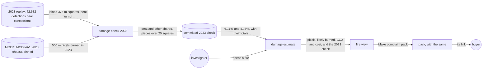
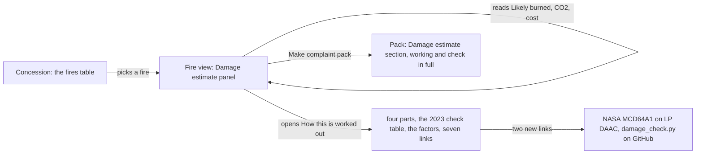
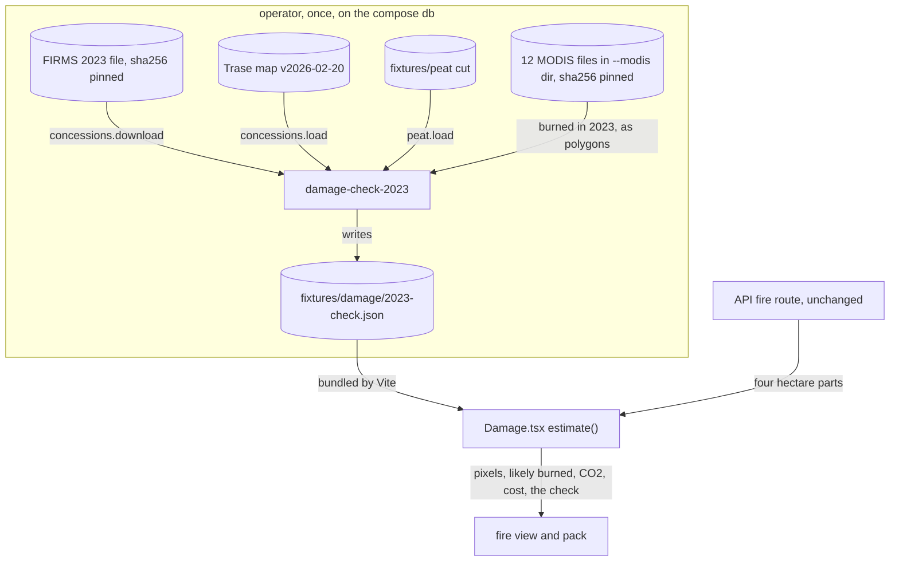
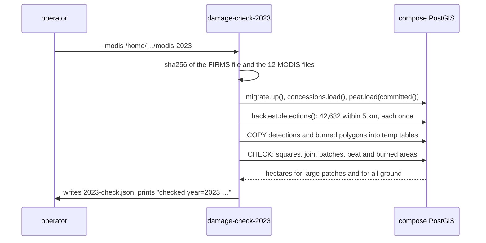
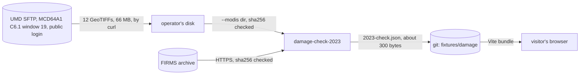

# Damage check

**Version:** v1 · **Status:** Refined · **Type:** Enhancement · **Project type:** Web UI

**Shape doc:** docs/specs/judge-review/shape.md
**Depends on:** damage-estimate, season-backtest

The damage estimate scales its ground by the share that NASA's MODIS mapped as burned in 2023:
61.1% on peat and 41.6% on other ground. It comes now because a company can call the unchecked
375 m squares too high, and the O1 spike shows they are.

## Problem

A damage estimate counts every 375 m square around a detection as burned ground (D63). A detection
only means fire somewhere in its pixel, so the squares can hold much unburned ground. The CO₂ and
the cost scale with that ground. A company can say the figures are too high, and nothing on the
page answers it.

The 2026-10-22 review gave a rough number. The joined squares of 2023's detections came to about
2.5 million ha. Indonesia's ministry reported 1.16 million ha burned that year. Nobody has checked
the rough union, or compared the squares with an independent burned-area map.

The 0332 fire shows the stakes. Its 19 detections join into 209.8 ha, 203.5 ha of it on peat. Its
estimate reads about 120,000 t of CO₂ and US$1.3 million. If only half of the squares burned, both
halve.

The 2023 replay already has the ground to test on: 42,682 VIIRS NOAA-20 detections within 5 km of
a concession (season-backtest). MODIS MCD64A1 maps burned ground each month at 500 m.

The O1 spike measured the gap on 23 Oct 2026. It used UMD's public copy of MODIS MCD64A1
Collection 6.1: window 19, the 12 monthly burn-date files of 2023. Every 2023 burn fell in a mapped
pixel.

| 2023 ground near concessions | Squares | On peat | MODIS burned | Share | Peat share | Other share |
| ---------------------------- | ------- | ------- | ------------ | ----- | ---------- | ----------- |
| All 42,682 detections        | 456,345 ha | 105,961 ha | 67,688 ha | 14.8% | 35.8% | 8.5% |

The share grows with the size of the joined ground. Each row is a piece of connected squares.

| Squares in the piece | Pieces | Ground | Share | Peat share | Other share |
| -------------------- | ------ | ------ | ----- | ---------- | ----------- |
| 1                    | 15,063 | 211,895 ha | 6.4% | 20.1% | 4.0% |
| 2 to 4               | 4,369  | 124,840 ha | 8.2% | 22.7% | 5.2% |
| 5 to 20              | 816    | 62,160 ha  | 22.0% | 34.8% | 15.6% |
| 21 to 100            | 104    | 29,264 ha  | 49.9% | 58.1% | 42.5% |
| More than 100        | 33     | 28,186 ha  | 55.2% | 63.5% | 40.3% |
| More than 20, joined | 137    | 57,450 ha  | 52.5% | 61.1% | 41.6% |

MODIS's 500 m pixels miss small burns. A lone square's 6.4% is therefore partly MODIS's blind spot
and partly ground that did not burn. The spike cannot separate the two.

## Slice test

| Check                         | Result |
| ----------------------------- | ------ |
| Cuts every layer it needs     | yes: a command redoes the 2023 comparison from pinned files (`api/`), and the damage estimate in the fire view and the pack shows it and applies it (`web/`) |
| One e2e test walks it         | yes: open the 0332 fire, read its estimate and the 2023 check under "How this is worked out", make a pack, and read the same in the pack |
| Worth shipping alone          | yes: a buyer sees the ground figure checked against NASA's burned-area map, and a company can't call it unchecked |
| Fits (≤5 scenarios, ≤2 areas) | yes: 5 scenarios; two areas: the 2023 replay data (`api/`, `fixtures/`) and the damage estimate (`web/`) |

**Path:** full. It adds a pinned input and a new command, and it can change the figures on two
screens.

## User story

As a watchdog investigator, I want the damage estimate to say how its ground compares with NASA's
burned-area map, so that a company can't dismiss the figures as unchecked.

## Flow



A command joins the 2023 squares and measures how much of them MODIS mapped as burned. The two
shares scale the damage estimate, which shows the check in the fire view and the pack.

How each number is made now:

| Number | Peat ground | Other ground |
| ------ | ----------- | ------------ |
| Ground in its pixels | The joined squares, as today (D63) | The same |
| Likely burned | The squares' peat × 61.1% | The squares' other ground × 41.6% |
| CO₂ | Likely burned peat × 600.6 t per ha, likely 289.2 to 911.9 | Likely burned other ground × 66.7 t per ha |
| Cost | All likely burned ground × US$6,192 per ha | The same |

## Acceptance criteria

```gherkin
Scenario: The fire view scales a peat fire's ground by the 2023 shares
  Given the ID-WOOD-CONCESSION-0332 fire of fire-origin scenario 1: 19 VIIRS NOAA-20 detections
    whose squares join into 59.21 ha inside on peat, 144.31 ha outside on peat and 6.30 ha
    outside on other ground
  When the investigator opens the fire
  Then its damage estimate reads "Ground in its pixels: About 210 ha"
  And "Likely burned: About 130 ha", with "36 ha of it inside the concession."
  And "CO₂ released: About 75,000 t", with "Likely 36,000 to 110,000 t. 22,000 t of it inside
    the concession."
  And "Cost: About US$790,000", with "US$220,000 of it inside the concession."

Scenario: A fire off peat scales by the other-ground share
  Given hotspot B of fire-record scenario 1, 2026-10-14 06:18 UTC, 370 m outside
    ID-WOOD-CONCESSION-0377, whose square is 14.06 ha with no peat
  When the investigator opens its fire from ID-WOOD-CONCESSION-0377
  Then its damage estimate reads "Ground in its pixels: About 14 ha" and "Likely burned: About
    5.8 ha"
  And "CO₂ released: About 390 t", with no range
  And "Cost: About US$36,000"

Scenario: "How this is worked out" gives the 2023 check
  Given the 0332 fire from scenario 1
  When the investigator opens "How this is worked out"
  Then it says that MODIS mapped 61.1% of the peat and 41.6% of the other ground as burned, in
    2023's 57,450 ha of joined squares in pieces of more than 20 squares near concessions
  And it says that MODIS mapped 14.8% of all 456,345 ha, because its 500 m pixels miss small
    burns, so a small fire may have burned less than its share
  And it links MODIS MCD64A1 Collection 6.1 and the command that redoes the check

Scenario: The pack carries the same figures and the check in full
  Given the pack for the 0332 fire made at 2026-10-17 09:00 UTC, as in complaint-pack scenario 1
  When anyone opens the pack
  Then its damage estimate reads "About 210 ha", "About 130 ha" and "About 75,000 t"
  And the 2023 check from scenario 3 is shown in full, so a printed pack carries it

Scenario: Anyone can redo the 2023 check
  Given the pinned 2023 FIRMS file, the Trase map v2026-02-20, the WRI peat cut and the 12
    pinned MODIS burn-date files of 2023
  When an operator runs damage-check-2023
  Then it writes the committed 2023 check byte for byte, with 61.1% on peat and 41.6% on other
    ground
```

The figures come from the spike's shares and the parts that the damage estimate's tests use. The
page rounds each to two significant figures, as today.

## Scope

**In:**

- One comparison over 2023's detections within 5 km of a concession, as the 2023 replay takes
  them (D52, D57): their joined 375 m squares against MODIS MCD64A1's 2023 burned pixels.
- MODIS MCD64A1 Collection 6.1, the tiles over Indonesia, each pinned by sha256.
- Two fixed 2023 shares applied to every fire: 61.1% for peat and 41.6% for other ground. Each is
  the part MODIS mapped burned in 2023's pieces of more than 20 joined squares (O8). MODIS arrives
  months late, so a live fire can't be checked against its own burned pixels.
- "Ground in its pixels" stays as the ceiling. "Likely burned" is new, and the CO₂ and the cost
  follow it (O3).
- Every pack, old or new, shows the scaled figures when opened (O6).
- The check in the damage estimate's "How this is worked out", in the fire view and the pack (D64).
- A command that redoes the check from pinned files, as `backtest-2023` redoes the replay (D52).

**Out:**

- MODIS for each fire: not planned. It arrives two to three months late.
- A share for each fire size: not planned. It would put MODIS's small-fire blind spot into each
  small fire (O8).
- Other years than 2023: not planned.
- Burned area from Landsat or Sentinel-2: not planned. Each needs a pipeline of its own.
- The real size of each VIIRS pixel: not planned, as in damage-estimate.
- Methane and carbon monoxide: still left out (D68).

## Interface

The damage estimate keeps its place in the fire view and the pack (D64). It gains one figure,
"Likely burned", between the pixels and the CO₂. The CO₂ and the cost now follow that figure. The
2023 check goes into "How this is worked out", after the four parts: one table and one paragraph.



The investigator reads the figures first. The 2023 check sits one click away in the fire view,
and is always shown in the pack.

| Part | What shows |
| ---- | ---------- |
| Figures, a key-value list | "Ground in its pixels": "About 210 ha". "Likely burned": "About 130 ha". "CO₂ released": "About 75,000 t". "Cost": "About US$790,000" |
| Under "Ground in its pixels" | "59 ha of it inside the concession.", as today |
| Under "Likely burned" (new) | "At NASA's 2023 shares: 61% of peat, 42% of other ground. 36 ha of it inside the concession." The inside part shows only for a fire on both sides of the edge |
| Under the CO₂ and the cost | As today, worked out from the likely burned ground |
| Under the figures | "An estimate, not a measurement. A detection means fire somewhere in its 375 m pixel, not that the whole pixel burned." |
| The method paragraph | As today, plus "The ground that likely burned is each part at the share NASA found burned in 2023, below." |
| The 2023 check (new) | The lead "In 2023, NASA's MODIS burned-area map checked the squares of every detection within 5 km of a concession:", then a table. Rows "Peat, in large patches", "Other ground, in large patches" and "All ground". Columns "Ground in its pixels" and "Found burned": 31,915 ha and 61.1%, 25,535 ha and 41.6%, 456,345 ha and 14.8% |
| Under the check | "A large patch is more than 20 squares that touch. MODIS's 500 m pixels miss small burns, so the shares come from large patches, which it can see. A small fire may have burned less than these shares." |
| Factors | A new first row, "Likely burned": "61.1% of the peat and 41.6% of the other ground in its pixels." Then the CO₂ and cost rows, as today |
| The closing line | "… Its detections are sealed, and the maps, the 2023 check and the factors are pinned, so anyone can redo it." |
| Links (two new, seven in all) | "NASA MODIS Burned Area, MCD64A1 Collection 6.1" and "The 2023 check, its files and their sha256" |

The large-patch hectares, 31,915 and 25,535, are sums of the spike's rounded rows. `damage-check-2023`
gives the exact figures at `/build`, and the page takes them from its output.

| State | What shows |
| ----- | ---------- |
| A fire on both sides of the edge | The four figures, each with its part inside |
| A fire wholly inside or outside | The four figures, then the "All" or "None" line |
| A fire with no peat ground | No CO₂ range, as today. The "Likely burned" line still names both shares |
| A fire flagged as never spread | The caveat above the figures, as today (D67) |
| The fire loading, or the server not answering | The fire view's and the pack's own states, as today |
| An answer without `damage` | No panel and no section, as today |

**Motion tier:** 1, chosen 2026-10-23. The panel enters with the fire view, and the disclosure opens as today. The new
row and table have no motion of their own.

**Components used:** `fw-kv` with `sub` lines, `fw-help`, `table-box` with `fw-table` and row
headers as in the four-parts table, `fw-link` with the external icon through the existing `Source`,
and `pack-section`. There is no new component, no new token and no new CSS.

**Design system:** Fire Watch, `docs/design/design-system/` (D2, D4).

**Preview:** the real `web/src/Damage.tsx`, through the existing damage-estimate preview. Run
`cd web && pnpm dev` and open `http://localhost:5173/?preview=damage-estimate`. The six states and
both themes show the new figures. The pack state shows the 2023 check in full. The drift check
passed over the one file that was written. `tsc -b` is clean. At 390 px, in dark theme and with
the disclosure open, no state scrolls sideways. Six unit tests in `Damage.test.tsx` and
`ComplaintPack.test.tsx` fail, because they check the old figures. `/build` changes them, and
proves each one with a mutant.

## Technical plan

### Approach

`damage-check-2023` takes 2023's detections near concessions as `backtest-2023` matches them. It
joins their squares in PostGIS, splits the join by the peat cut, and measures the part inside
MODIS's 2023 burned pixels. It writes `fixtures/damage/2023-check.json`. The page bundles that
file, as it bundles the replay's totals (D59), and scales each fire's four parts by the two
shares. The API, the database and Neon don't change.

Relies on: D52, D57, D59, D62, D69, D70, D71, and the drafted D126 to D131



The operator runs the check once and commits its output. The page multiplies the API's four parts
by the committed shares.



The command checks every input's sha256, loads what the match needs, and lets PostGIS measure the
areas in one query.



MODIS crosses two boundaries. It reaches the operator over UMD's public SFTP, and the command
accepts only the 12 pinned files. Only the small output reaches git and the page.

**The check, so anyone can redo it** (written into `damage_check.py`'s docstring):

1. Take every 2023 detection within 5 km of a concession, as `backtest-2023` matches them. Count
   each detection once.
2. Draw each detection's square as the damage estimate does: 187.5 m each way in its UTM zone.
3. Join the squares. A patch is one connected piece of the join. A large patch holds more than 20
   squares, counted by their centres.
4. Burned ground is every MODIS pixel with a 2023 burn date in any of the 12 monthly files.
5. For the large patches and for all ground, measure the area, its peat, its burned part and its
   burned peat, on the WGS 84 ellipsoid. Round each to whole hectares.
6. Each share is the burned part over the area, rounded to three places. Peat and other ground
   use the large patches. All ground uses every patch.

The output, `fixtures/damage/2023-check.json`:

```json
{
  "year": 2023,
  "detections": 42682,
  "large_patch_squares": 21,
  "peat": { "ha": 31915, "burned_ha": 19500, "share": 0.611 },
  "other": { "ha": 25535, "burned_ha": 10622, "share": 0.416 },
  "all": { "ha": 456345, "burned_ha": 67688, "share": 0.148 }
}
```

The values above are the spike's. The `burned_ha` for peat and other ground are worked out from
its rounded shares. The command writes the exact figures.

The 12 pinned files, all `MCD64monthly.A2023<day>.Win19.061.burndate.tif`:

| Day | sha256 |
| --- | ------ |
| 001 | `e6081bd99a37381ca8845fc919f52f312de5ab6c3fea07e47aee770f62eb59c1` |
| 032 | `a554db1adb76aa3c74630566ff55952affc4d3410cacfdb2b1bed9d5aaef27b0` |
| 060 | `2c007e1d3efff7a6f3a664719d80cb5d9d896cab200bb4ea977f67035209eff9` |
| 091 | `4e3c8a85144821e48118a6503ea54326798a7987c86d91e0c88c05d2cf832a52` |
| 121 | `63f9ed51896395f1649cd78a607ec80b6b74e2f49863b41d3d6f13bd81f37722` |
| 152 | `e085f32a8cf9ef8baa973071c91f1a81cc28297878d97688e9e650bb739acc74` |
| 182 | `64d964e08fab259591210c00788f4d70340120d49f130e21957498f62c6a42b1` |
| 213 | `c51cc0aaf458f17b3d1660488bf1b94c9ed6602a34de11a6ca855ed4382ccc10` |
| 244 | `ce48779f90e1b5e496820cd2d6da6eabcd428ba477fbe04775d7808a3091f0d0` |
| 274 | `f75aa4d4459f68254989bb5172d2d369905fdd46652ef1149547cd11693e6a2d` |
| 305 | `dffd9188f5526d3dd72d03d3acbd5bc44459680eef736e28167807ae6d23565a` |
| 335 | `7d96755ab8922330f8ed10b54887941bc58af831a7105c1aadfab95439b15792` |

Fetched twice on 2026-10-23, with the same bytes each time. In each file, -2 is water, 0 is
unburned, and 1 to 366 is the burn day. None of the 12 has a -1, unmapped, pixel over the
detections' bounds.

### Changes

| File | What changes | Why |
| ---- | ------------ | --- |
| `api/src/firewatch/damage_check.py` (new) | The check in the docstring. `MODIS_FILES`, the 12 names with their sha256. `CHECK`, the query. `burned(dir, bounds)` reads each file over the detections' bounds with rasterio, joins the months with burn date > 0, and turns the pixels into polygons in raster order. `main()`: `--modis <dir>` (required), `--firms <path>`, `--map <path>`, `--out <dir>`, as `backtest-2023` has them | Scenarios 3, 5 |
| `api/pyproject.toml:17` | The script `damage-check-2023`. No new dependency: rasterio is in the `cut` and `dev` groups | Scenario 5 |
| `fixtures/damage/2023-check.json` (new) | The command's output, run on the compose db | Scenarios 1–5 |
| `api/tests/test_damage_check.py` (new) | Runs on `fixtures/backtest/2023-cut.csv`, `trase-cut.geojson` and `peat-cut.geojson.gz`, with a GeoTIFF that the test writes. Checks the hectares and shares for known burned pixels, the same bytes twice, and a refusal for a changed or missing file | Scenario 5 |
| `web/src/Damage.tsx:16` | `CHECK_2023` comes from the bundled JSON, not from typed numbers | Scenarios 1–4 |
| `web/src/Damage.test.tsx` | The new figures for the 0332, B and 0540 fires, the "Likely burned" row, the check table, its paragraph and the two new links | Scenarios 1–3 |
| `web/src/ComplaintPack.test.tsx` | The pack's damage section, with the new figures and the check in full | Scenario 4 |
| `web/e2e/damage-estimate.spec.ts:15` | Reads "About 130 ha", "About 75,000 t" and the "Peat, in large patches" row with 61.1%, in the fire view and the pack. The tap check at `:60` already covers every `.damage` link, so it covers the two new ones | All |
| `README.md:78`, `docs/ARCHITECTURE.md:54`, `CHANGELOG.md` | How to redo the check, with the fetch line. The component row and an edge in the diagram. One changelog line | Operators |

Reusing: `concessions.download()` for the FIRMS file, `backtest.hotspots()` and
`backtest.detections()` for the match, `backtest.FIRMS_URL` and `FIRMS_SHA256`, `concessions.load()`,
`peat.load()` with `peat.committed()`, the square from `peat.DAMAGE`, and `migrate.up()`. The page
reads the JSON as `api.ts:2` reads `2023.json`. `Damage.tsx` and its preview exist from pause 2.

The README's fetch line, with real values:

```sh
mkdir -p ~/modis-2023 && cd ~/modis-2023 && for d in 001 032 060 091 121 152 182 213 244 274 305 335; do f=MCD64monthly.A2023$d.Win19.061.burndate.tif; curl -su fire:burnt -o $f sftp://fuoco.geog.umd.edu/data/MODIS/C61/MCD64A1/TIFF/Win19/2023/$f; done
```

### Earn-it

| Added | Triggered by |
| ----- | ------------ |
| `damage_check.py` and the `damage-check-2023` script | Scenario 5: anyone can redo the shares from pinned files (D130, D131) |
| `fixtures/damage/2023-check.json` | Scenarios 1–4: the page needs the shares and the check's hectares, from one place (D59) |
| `test_damage_check.py` | Scenario 5 |

### Non-functionals

|                      |                                                                               |
| -------------------- | ----------------------------------------------------------------------------- |
| **Load**             | The page bundles about 300 more bytes. There is no new request, and the API is unchanged. The command runs once, in about 2 minutes on the compose db: the spike took 57 s for the match, 4 s for MODIS and 9 s for the areas |
| **Breaks first**     | The page: nothing new. The command, at 10 times the detections: the join, which took 5.8 s. Expect about a minute |
| **Security surface** | No new route and no secret. UMD publishes its SFTP login. The command accepts only files that match their pinned sha256. It writes to `DATABASE_URL`: it loads the same concession map and peat cut that are already there, and uses temporary tables for the rest. The README points it at the compose db |
| **Proof it works**   | The command prints `checked year=2023 detections=42682 squares_ha=456345 burned_ha=67688 peat_share=0.611 other_share=0.416 seconds=…`. On the live site, the 0332 fire reads "Likely burned: About 130 ha", and the e2e reads it on every push |
| **Rollout**          | No flag. The merge deploys the page (D21). There is no API deploy and no migration. Rollback: revert the merge |

### Test plan

| Scenario | Test | Command |
| -------- | ---- | ------- |
| 1. A peat fire, scaled | `Damage.test.tsx` | `cd web && pnpm test Damage` |
| 2. Off peat, scaled | `Damage.test.tsx` | the same |
| 3. "How this is worked out" | `Damage.test.tsx` | the same |
| 4. The pack | `ComplaintPack.test.tsx` | `cd web && pnpm test ComplaintPack` |
| 5. Anyone can redo it | `test_damage_check.py` | `cd api && uv run pytest tests/test_damage_check.py` |

Pause 2 already wrote the page code, so each new or changed web test is first run against a broken
copy of the code, to see it fail.

**E2E:** `web/e2e/damage-estimate.spec.ts`. It opens the ID-WOOD-CONCESSION-0332 fire from
`fire-origin.csv`, reads "About 130 ha" and "About 75,000 t". It opens "How this is worked out" and
reads the "Peat, in large patches" row with 61.1%. It makes a complaint pack and reads the same.
`cd web && pnpm e2e damage-estimate`.

Run one API suite at a time, because every worktree shares `firewatch_test`.

### Chunks

Single chunk. The page reads the file that the command writes, so the command goes first, then the
page.

### Risks

| Risk | Mitigation |
| ---- | ---------- |
| The shares come from 2023, an El Niño year with large fires. In a wetter year, fires may burn a different part of their pixels | The page names 2023 in the figure line and in the check. The command can check a later year once MODIS maps it |
| MODIS misses small burns, so a small fire's "Likely burned" may still be high | The check's paragraph says so (O8, D127) |
| UMD takes its SFTP copy down | The committed JSON stays. LP DAAC's HDF tiles are a different format, so a later check would need new pins |
| A different GEOS or PROJ version moves an area | Whole hectares and three-place shares. The README names the compose db's PostGIS 3.5, as for `backtest-2023` |
| An older PDF of a pack shows the old figures | Accepted (O6, D129) |

### Decisions to record

`/build` appends these to `DECISIONS.md`. D126 supersedes D63, so `/build` also sets D63's Status
to `superseded by D126`.

#### D126 · 2026-10-23 · Count a fire's ground as its joined 375 m squares, and scale it by the 2023 MODIS shares for what likely burned

Why: ground seen on several passes counts once, so the 0332 fire covers 209.8 ha, not 267.2.
MODIS mapped only 14.8% of 2023's 456,345 ha of joined squares near concessions as burned, far
under the 80% at which the figures would stay. The squares stay as the ceiling.
Rejected: detections times 14.06 ha (counts the same ground again on each pass), the squares
alone as burned ground (MODIS shows that most of them did not burn), a range from the MODIS share
up to the squares (stacks on the peat factor's range), the check alone with no figure changed.
Supersedes: D63
Source: docs/specs/damage-check.md
Status: active

#### D127 · 2026-10-23 · Take the shares from 2023's pieces of more than 20 joined squares: 61.1% on peat, 41.6% on other ground

Why: MODIS's 500 m pixels miss small burns. A lone square showed 6.4%, and pieces of more than
20 squares 52.5%. Peat and other ground differ, 61.1% against 41.6%, and their CO₂ differs 9
times.
Rejected: the shares of all 2023 ground, 35.8% and 8.5% (mostly MODIS's blind spot, which favours
the company), a share for each size band (puts the blind spot into each small fire), one share
for all ground (peat and other ground differ by 19.5 points).
Source: docs/specs/damage-check.md
Status: active

#### D128 · 2026-10-23 · Check the squares against MODIS near concessions only, not against the ministry's national total

Why: the estimate covers only ground within 5 km of a concession, and MODIS in the same place is
like for like.
Rejected: a national line against the ministry's 1.16 Mha (a different map, over ground the
estimate never covers).
Source: docs/specs/damage-check.md
Status: active

#### D129 · 2026-10-23 · Every pack, old or new, shows the current estimate method

Why: no buyer has a pack yet, and "How this is worked out" names the 2023 check, so a reader with
an older PDF sees why the figures differ.
Rejected: a method version in the pack link, with the old factors kept for old links (more code
for packs that nobody has sent).
Source: docs/specs/damage-check.md
Status: active

#### D130 · 2026-10-23 · Read the 12 MODIS files from the operator's disk, each checked by its pinned sha256

Why: UMD serves the GeoTIFFs only over SFTP, with a public login, and httpx has no SFTP. Only the
command reads the files, and the page reads the command's 300-byte output.
Rejected: a committed MODIS cut (one more committed file and a --cut path, for reruns only), the
command fetching over SFTP (paramiko, one more dependency to audit).
Source: docs/specs/damage-check.md
Status: active

#### D131 · 2026-10-23 · Run the check as its own command, damage-check-2023

Why: it shares only the FIRMS file and the match with the replay, and it writes one file. The
forecast replay and its outputs stay as they are.
Rejected: a --damage flag on backtest-2023 (ties the check to the forecast replay's module and run).
Source: docs/specs/damage-check.md
Status: active

## Open items

| ID | What | Type | Raised at | Owner | Status | Answer |
| -- | ---- | ---- | --------- | ----- | ------ | ------ |
| O1 | Joined 375 m squares overstate burned ground. A rough union gave about 2.5 Mha for 2023, against the ministry's 1.16 Mha; nobody has checked it (from shape O10) | unproven | shape | spike | Resolved | 2026-10-23, measured: the 42,682 detections' squares join into 456,345 ha, 105,961 ha of it on peat. MODIS MCD64A1 C6.1 mapped 67,688 ha of it as burned in 2023: 14.8%. On peat 35.8%, on other ground 8.5%. Both are below O7's 80%, so the estimate scales |
| O2 | Two days remain to the 2026-10-25 deadline. The video and the written deliverables are not done, and forecast-v2 is not specced | flag | spec p1 | user | Resolved | 2026-10-23: go ahead. The spike decides: at a share of 80% or more, ship only the check and change no figure (O7) |
| O3 | What changes in the estimate when MODIS maps much less of the squares as burned | question | spec p1 | user | Resolved | 2026-10-23: scale the ground burned, the CO₂ and the cost by the 2023 share. "Ground in its pixels" stays as the ceiling. The page says MODIS misses small fires, so the share may be low |
| O4 | Whether the share is one number for all ground, or one for peat and one for other ground | question | spec p1 | user | Resolved | 2026-10-23: one share for peat and one for other ground |
| O5 | Whether the check also compares all of Indonesia's 2023 squares with the ministry's 1.16 Mha | question | spec p1 | user | Resolved | 2026-10-23: no. Only the ground within 5 km of a concession, against MODIS in the same place |
| O6 | The page applies the factors (D71), so a pack made before this ships shows the new figures when opened. A PDF printed earlier keeps the old ones | flag | spec p1 | user | Accepted risk | 2026-10-23: every pack uses the current method, and "How this is worked out" names the 2023 check. No buyer has a pack yet (judge-review shape O3) |
| O7 | At what share the figures stay unchanged | question | spec p1 | user | Resolved | 2026-10-23: at 80% or more. A gap under a fifth sits inside the CO₂ range the page already gives |
| O8 | The share follows fire size more than peat. A lone square: 6.4%. Joined ground of more than 20 squares: 52.5%, 61.1% on peat and 41.6% on other ground. MODIS's 500 m pixels miss small burns, so a small fire's low share is partly MODIS's blind spot. Which share scales the estimate? | question | spike | user | Resolved | 2026-10-23: the shares of 2023's pieces of more than 20 joined squares, 61.1% on peat and 41.6% on other ground, for every fire. The page says a small fire may have burned less |
| O9 | How the command gets the 12 MODIS files, which UMD serves only over SFTP | question | spec p3 | user | Resolved | 2026-10-23: the operator fetches them with one curl line, and the command checks each file's pinned sha256 (D130) |
| O10 | Whether the check is its own command or a flag on backtest-2023 | question | spec p3 | user | Resolved | 2026-10-23: its own command, damage-check-2023 (D131) |

_Never delete this section or its rows. See references/ledger.md._

## Glossary

- **VIIRS** — the satellite sensor whose fire detections FIRMS publishes. Each detection stands for
  a pixel about 375 m across.
- **MODIS MCD64A1** — NASA's monthly map of burned ground, from the MODIS sensors, at 500 m.
- **Joined squares** — each detection's 375 m square, with overlapping ground counted once (D63).
- **Share** — the part of the joined squares' ground that MODIS mapped as burned.
- **Spike** — a short, throwaway test that answers one question before the plan relies on it.
- **sha256** — a fingerprint of a file. Any change to the file changes it.
- **e2e** — end-to-end: one test that walks the whole slice as a user would.
- **Patch** — one connected piece of the joined squares. A large patch holds more than 20 squares.
- **SFTP** — a way to copy files over SSH. UMD serves the MODIS GeoTIFFs this way, with a public login.
- **UMD** — the University of Maryland, which makes MCD64A1 and serves copies in map-ready tiles.
- **LP DAAC** — NASA's archive for land data, which hosts MCD64A1's official HDF tiles.
- **GeoTIFF** — an image file whose pixels carry map positions.
- **rasterio** — a Python library that reads GeoTIFFs and turns pixels into polygons.
- **El Niño** — a Pacific weather pattern that dries out Indonesia. 2023 was an El Niño year.
- **GEOS, PROJ** — the geometry and projection libraries under PostGIS; versions can differ by host.
- **Vite** — the tool that builds the page; it can bundle a JSON file into it.
