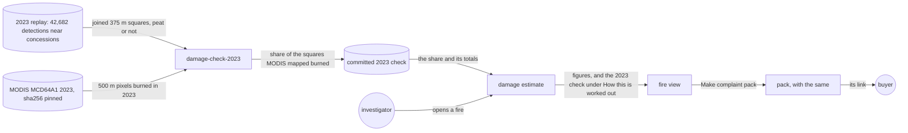

# Damage check

**Version:** v1 · **Status:** Draft · **Type:** Enhancement · **Project type:** Web UI

**Shape doc:** docs/specs/judge-review/shape.md
**Depends on:** damage-estimate, season-backtest

The damage estimate's method shows how its joined 375 m squares compare with NASA's MODIS burned
area for 2023. If MODIS maps much less of that ground as burned, the estimate is corrected.

## Problem

A damage estimate counts every 375 m square around a detection as burned ground (D63). A detection
only means fire somewhere in its pixel, so the squares can hold much unburned ground. The CO₂ and
the cost scale with that ground. A company can say the figures are too high, and nothing on the
page answers it.

The 2026-10-22 review gave a rough number. The joined squares of 2023's detections came to about
2.5 million ha. Indonesia's ministry reported 1.16 million ha burned that year. Nobody has checked
the rough union, or compared the squares with an independent burned-area map.

The 0332 fire shows the stakes. Its 19 detections join into 209.8 ha, 203.5 ha of it on peat. Its
estimate reads about 120,000 t of CO₂ and US$1.3 million. If only half of the squares burned, both
halve.

The 2023 replay already has the ground to test on: 42,682 VIIRS NOAA-20 detections within 5 km of
a concession (season-backtest). MODIS MCD64A1 maps burned ground each month at 500 m.

The O1 spike measured the gap on 23 Oct 2026. It used UMD's public copy of MODIS MCD64A1
Collection 6.1: window 19, the 12 monthly burn-date files of 2023. Every 2023 burn fell in a mapped
pixel.

| 2023 ground near concessions | Squares | On peat | MODIS burned | Share | Peat share | Other share |
| ---------------------------- | ------- | ------- | ------------ | ----- | ---------- | ----------- |
| All 42,682 detections        | 456,345 ha | 105,961 ha | 67,688 ha | 14.8% | 35.8% | 8.5% |

The share grows with the size of the joined ground. Each row is a piece of connected squares.

| Squares in the piece | Pieces | Ground | Share | Peat share | Other share |
| -------------------- | ------ | ------ | ----- | ---------- | ----------- |
| 1                    | 15,063 | 211,895 ha | 6.4% | 20.1% | 4.0% |
| 2 to 4               | 4,369  | 124,840 ha | 8.2% | 22.7% | 5.2% |
| 5 to 20              | 816    | 62,160 ha  | 22.0% | 34.8% | 15.6% |
| 21 to 100            | 104    | 29,264 ha  | 49.9% | 58.1% | 42.5% |
| More than 100        | 33     | 28,186 ha  | 55.2% | 63.5% | 40.3% |
| More than 20, joined | 137    | 57,450 ha  | 52.5% | 61.1% | 41.6% |

MODIS's 500 m pixels miss small burns. A lone square's 6.4% is therefore partly MODIS's blind spot
and partly ground that did not burn. The spike cannot separate the two.

## Slice test

| Check                         | Result |
| ----------------------------- | ------ |
| Cuts every layer it needs     | yes: a command redoes the 2023 comparison from pinned files (`api/`), and the damage estimate in the fire view and the pack shows it and applies it (`web/`) |
| One e2e test walks it         | yes: open the 0332 fire, read its estimate and the 2023 check under "How this is worked out", make a pack, and read the same in the pack |
| Worth shipping alone          | yes: a buyer sees the ground figure checked against NASA's burned-area map, and a company can't call it unchecked |
| Fits (≤5 scenarios, ≤2 areas) | yes: 4 scenarios; two areas: the 2023 replay data (`api/`, `fixtures/`) and the damage estimate (`web/`) |

**Path:** full. It adds a pinned input and a new command, and it can change the figures on two
screens.

## User story

As a watchdog investigator, I want the damage estimate to say how its ground compares with NASA's
burned-area map, so that a company can't dismiss the figures as unchecked.

## Flow



A command joins the 2023 squares and measures how much of them MODIS mapped as burned. The share
goes into the damage estimate, which shows the check in the fire view and the pack.

## Acceptance criteria

The figures in these scenarios wait for the spike (O1). Each `Then` below says what the page
reads, and the spike gives the numbers before pause 1 is approved.

```gherkin
Scenario: The fire view checks a peat fire's ground against 2023
  Given the ID-WOOD-CONCESSION-0332 fire of fire-origin scenario 1: 19 VIIRS NOAA-20 detections
    whose squares join into 59.21 ha inside on peat, 144.31 ha outside on peat and 6.30 ha
    outside off peat
  And the 2023 check, in which MODIS mapped a share of the squares near concessions as burned
  When the investigator opens the fire
  Then its damage estimate still reads "Ground in its pixels: About 210 ha"
  And the CO₂ and the cost follow the answer to O3

Scenario: "How this is worked out" gives the 2023 check
  Given the 0332 fire from scenario 1
  When the investigator opens "How this is worked out"
  Then it gives the 2023 squares' ground, the part of it MODIS mapped as burned, and the share
  And it says that MODIS misses fires much smaller than its 500 m pixel
  And it links MODIS MCD64A1 Collection 6.1 and the command that redoes the check

Scenario: The pack carries the same check
  Given the pack for the 0332 fire made at 2026-10-17 09:00 UTC, as in complaint-pack scenario 1
  When anyone opens the pack
  Then its damage estimate gives the same figures and the 2023 check in full

Scenario: Anyone can redo the 2023 check
  Given the pinned 2023 FIRMS file, the Trase map v2026-02-20, the WRI peat cut and the pinned
    MODIS tiles
  When an operator runs damage-check-2023
  Then it writes the committed 2023 check byte for byte
```

## Scope

**In:**

- One comparison over 2023's detections within 5 km of a concession, as the 2023 replay takes
  them (D52, D57): their joined 375 m squares against MODIS MCD64A1's 2023 burned pixels.
- MODIS MCD64A1 Collection 6.1, the tiles over Indonesia, each pinned by sha256.
- One fixed 2023 share applied to every fire. MODIS arrives months late, so a live fire can't be
  checked against its own burned pixels.
- The check in the damage estimate's "How this is worked out", in the fire view and the pack (D64).
- A command that redoes the check from pinned files, as `backtest-2023` redoes the replay (D52).

**Out:**

- MODIS for each fire: not planned. It arrives two to three months late.
- Other years than 2023: not planned.
- Burned area from Landsat or Sentinel-2: not planned. Each needs a pipeline of its own.
- The real size of each VIIRS pixel: not planned, as in damage-estimate.
- Methane and carbon monoxide: still left out (D68).

## Open items

| ID | What | Type | Raised at | Owner | Status | Answer |
| -- | ---- | ---- | --------- | ----- | ------ | ------ |
| O1 | Joined 375 m squares overstate burned ground. A rough union gave about 2.5 Mha for 2023, against the ministry's 1.16 Mha; nobody has checked it (from shape O10) | unproven | shape | spike | Resolved | 2026-10-23, measured: the 42,682 detections' squares join into 456,345 ha, 105,961 ha of it on peat. MODIS MCD64A1 C6.1 mapped 67,688 ha of it as burned in 2023: 14.8%. On peat 35.8%, on other ground 8.5%. Both are below O7's 80%, so the estimate scales |
| O2 | Two days remain to the 2026-10-25 deadline. The video and the written deliverables are not done, and forecast-v2 is not specced | flag | spec p1 | user | Resolved | 2026-10-23: go ahead. The spike decides: at a share of 80% or more, ship only the check and change no figure (O7) |
| O3 | What changes in the estimate when MODIS maps much less of the squares as burned | question | spec p1 | user | Resolved | 2026-10-23: scale the ground burned, the CO₂ and the cost by the 2023 share. "Ground in its pixels" stays as the ceiling. The page says MODIS misses small fires, so the share may be low |
| O4 | Whether the share is one number for all ground, or one for peat and one for other ground | question | spec p1 | user | Resolved | 2026-10-23: one share for peat and one for other ground |
| O5 | Whether the check also compares all of Indonesia's 2023 squares with the ministry's 1.16 Mha | question | spec p1 | user | Resolved | 2026-10-23: no. Only the ground within 5 km of a concession, against MODIS in the same place |
| O6 | The page applies the factors (D71), so a pack made before this ships shows the new figures when opened. A PDF printed earlier keeps the old ones | flag | spec p1 | user | Accepted risk | 2026-10-23: every pack uses the current method, and "How this is worked out" names the 2023 check. No buyer has a pack yet (judge-review shape O3) |
| O7 | At what share the figures stay unchanged | question | spec p1 | user | Resolved | 2026-10-23: at 80% or more. A gap under a fifth sits inside the CO₂ range the page already gives |
| O8 | The share follows fire size more than peat. A lone square: 6.4%. Joined ground of more than 20 squares: 52.5%, 61.1% on peat and 41.6% on other ground. MODIS's 500 m pixels miss small burns, so a small fire's low share is partly MODIS's blind spot. Which share scales the estimate? | question | spike | user | Open | — |

_Never delete this section or its rows. See references/ledger.md._

## Glossary

- **VIIRS** — the satellite sensor whose fire detections FIRMS publishes. Each detection stands for
  a pixel about 375 m across.
- **MODIS MCD64A1** — NASA's monthly map of burned ground, from the MODIS sensors, at 500 m.
- **Joined squares** — each detection's 375 m square, with overlapping ground counted once (D63).
- **Share** — the part of the joined squares' ground that MODIS mapped as burned.
- **Spike** — a short, throwaway test that answers one question before the plan relies on it.
- **sha256** — a fingerprint of a file. Any change to the file changes it.
- **e2e** — end-to-end: one test that walks the whole slice as a user would.
