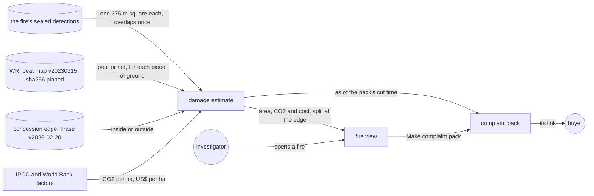

# Damage estimate

**Version:** v1 · **Status:** Draft · **Type:** Feature · **Project type:** Web UI

**Shape doc:** docs/specs/fire-watch/shape.md
**Depends on:** fire-record, fire-origin, complaint-pack

Each fire gets an estimate of the ground it burned, the CO2 it released and what that cost, split
at the concession's edge. The fire view and the complaint pack show it. It comes last because the
shape marks it the first slice to cut, and the user chose to build it (O1).

## Problem

A buyer reading a grievance asks how much damage the fire did. Today the fire view and the pack say
where and when a fire was seen, and on whose side of the edge. They say nothing about how much
ground burned, or what it released.

The ground under a fire changes the answer about 9 times. Burned drained peat releases about 601 t
of CO2 per hectare. Burned secondary forest releases about 67 t. The ID-WOOD-CONCESSION-0332 fire of
fire-origin scenario 1 sits almost all on peat: 203.5 of the 209.8 ha in its detections' pixels.

The shape keeps this slice for the hackathon's economic-impact ask. The World Bank put Indonesia's
2015 fires at US$16.1 billion over 2.6 million ha, about US$6,192 per hectare.

## Slice test

| Check                         | Result |
| ----------------------------- | ------ |
| Cuts every layer it needs     | yes: a pinned peat map loaded into the database, the estimate in the API's fire and pack answers, and both screens in `web/` |
| One e2e test walks it         | yes: open the 0332 fire from the existing e2e fixture, read its estimate, make a pack, and read the same estimate in the pack |
| Worth shipping alone          | yes: an investigator can tell a buyer how much ground a fire covered, on whose side, and what it released |
| Fits (≤5 scenarios, ≤2 areas) | yes: 5 scenarios; two areas: the API with its peat data (`api/`) and the fire view and pack (`web/`) |

**Path:** full. The slice adds a new pinned input, new numbers in two screens and a change to the API.

## User story

As a watchdog investigator, I want each fire to come with an estimate of the ground it burned, the
CO2 it released and its cost, split at the concession's edge, so that a grievance says how much
damage happened on the supplier's land.

## Flow



The estimate draws a 375 m square around each detection and joins them. It splits the ground at the
concession's edge and by the peat map, then applies the factors. The fire view and the pack show it.

How each number is made:

| Number | Peat ground | Other ground |
| ------ | ----------- | ------------ |
| Area   | The joined squares, each piece counted once | The same |
| CO2    | 353 t dry matter per ha at 464 g CO2-C per kg: 600.6 t CO2 per ha. Likely 289.2 to 911.9, from the 95% interval of 170 to 536 t | 42.2 t dry matter per ha at 1,580 g CO2 per kg: 66.7 t CO2 per ha |
| Cost   | US$16.1 billion over 2.6 million ha: US$6,192 per ha | The same |

## Acceptance criteria

```gherkin
Scenario: The fire view gives a peat fire's damage, split at the edge
  Given the ID-WOOD-CONCESSION-0332 fire of fire-origin scenario 1: 19 VIIRS NOAA-20 detections
    on 4 passes, 2026-10-13 17:37 to 2026-10-15 18:43 UTC
  And their 375 m squares join into 209.8 ha: 59.2 ha inside the concession, all on peat, and
    150.6 ha outside, 144.3 ha of it on peat
  When the investigator opens the fire
  Then it reads "Ground in its detections' pixels: about 210 ha, 59 ha of it inside
    ID-WOOD-CONCESSION-0332"
  And "CO2 released: about 120,000 t, likely 59,000 to 190,000 t. 36,000 t of it inside"
  And "At the 2015 fires' average cost: about US$1.3 million, US$370,000 of it inside"
  And "An estimate, not a measurement. A detection means fire somewhere in its 375 m pixel, so
    less ground may have burned."

Scenario: A fire off peat counts as burned vegetation
  Given hotspot B of fire-record scenario 1, 2026-10-14 06:18 UTC at 3.67525°S, 115.35328°E,
    370 m outside ID-WOOD-CONCESSION-0377, where the peat map has no peat
  When the investigator opens its fire from ID-WOOD-CONCESSION-0377
  Then it reads "Ground in its detections' pixels: about 14 ha, none of it inside
    ID-WOOD-CONCESSION-0377"
  And "CO2 released: about 940 t", with no range, since none of the ground is peat
  And "At the 2015 fires' average cost: about US$87,000"

Scenario: The pack holds the damage as of its cut time
  Given the pack for the 0332 fire made at 2026-10-17 09:00 UTC, as in complaint-pack scenario 1
  And a NOAA-20 pass at 2026-10-17 18:20 UTC adds 3 detections to the fire
  When anyone opens the pack
  Then it still reads "about 210 ha, 59 ha of it inside" and "about 120,000 t"
  And the fire view gives the estimate from all 22 detections

Scenario: Anyone can redo the estimate
  Given the pack from scenario 3
  When a reader opens "How this is worked out"
  Then it gives the ground in four parts: 59.22 ha inside on peat, 0 ha inside off peat,
    144.32 ha outside on peat and 6.31 ha outside off peat
  And each factor with its source: IPCC 2013 Wetlands Supplement Tables 2.6 and 2.7, IPCC 2006
    Volume 4 Tables 2.4 and 2.5, and the World Bank's "The Cost of Fire" (2016)
  And the peat map: WRI Global Peatlands, gfw_peatlands v20230315, CC BY 4.0, each tile's sha256
  And "Methane and carbon monoxide are left out."
  And "This estimate is not sealed. Its detections are sealed, and the map and the factors are
    pinned, so anyone can redo it."

Scenario: A fire that never spread carries its caveat on the estimate
  Given the ID-WOOD-CONCESSION-0540 fire of fire-origin scenario 4: 6 detections on 5 passes,
    none more than 483 m from the first, joining into 58.2 ha inside the concession, all on peat
  When the investigator opens the fire
  Then the estimate reads "about 58 ha, all of it inside" and "about 35,000 t, likely 17,000 to
    53,000 t"
  And above the estimate: "Seen on 5 passes without spreading. If this is a fixed heat source,
    such as a mill, little or nothing here burned."
```

The numbers in scenarios 1, 2 and 5 come from the real detections, the Trase map v2026-02-20 and
peat tiles 00N_100E and 00N_110E.

## Scope

**In:**

- An estimate for every fire, worked out from its stored detections on each request, as fires are
  (D31). The fire view and the pack show it. The pack holds it as of its cut time (D33, D37).
- Area: a 375 m square around each detection, north up. Joined squares count each piece of ground
  once (O5). The ground is split at the concession's edge (O6).
- Peat: WRI's Global Peatlands map, gfw_peatlands v20230315, CC BY 4.0, about 28 m pixels (O3). Its
  10-degree tiles cover all of Indonesia, Papua included. For Sumatra and Borneo it uses Miettinen et
  al. 2016. Each tile is pinned by sha256.
- CO2 on peat: IPCC 2013 Wetlands Supplement, tropical wildfire on drained peat. 353 t dry matter per
  ha, 95% interval 170 to 536 (Table 2.6), at 464 g CO2-C per kg (Table 2.7).
- CO2 off peat: IPCC 2006 Volume 4, all secondary tropical forests, 42.2 t dry matter per ha (Table
  2.4), at 1,580 g CO2 per kg for tropical forest (Table 2.5) (O8).
- The CO2 range comes from the peat factor's 95% interval. The off-peat factor is used at its mean.
  A fire with no peat ground gets no range.
- Cost: US$6,192 per ha, the World Bank's US$16.1 billion over 2.6 million ha in 2015 (O2).
- The page rounds to two significant figures. "How this is worked out" gives the exact parts, the
  factors and the sources.
- No new seal (O7). Every input is sealed or pinned, as for fire origin (D24).
- A fire flagged as never spread keeps its estimate, with the fixed-heat-source caveat on top (O9).

**Out:**

- Totals per concession: not planned (O4).
- Burned area measured from imagery: not planned. MODIS burned area arrives months late, and
  Sentinel-2 needs a pipeline of its own.
- The real size of each VIIRS pixel: not planned. It grows toward the edge of the scan, and the
  recorder neither stores nor seals scan and track.
- Methane and carbon monoxide: not planned (O10). "How this is worked out" says they are left out.
- Haze, smoke and health effects, other than through the World Bank's average cost: not planned.
- Damage in the 2023 replay: not planned.
- Company names: never (shape O10).

## Open items

| ID | What | Type | Raised at | Owner | Status | Answer |
| -- | ---- | ---- | --------- | ----- | ------ | ------ |
| O1 | Four days remain to 2026-10-24, the demo video and the submission are not done, and the shape marks this slice first to cut | flag | spec p1 | user | Resolved | 2026-10-20: go ahead, with no time cap |
| O2 | What the estimate gives: area, CO2 and cost at the World Bank's 2015 average; area and CO2 only; cost at EPA's US$190 per t CO2; or area only | question | spec p1 | user | Resolved | 2026-10-20: area, CO2 and cost at the World Bank's 2015 average, US$6,192 per ha (D61) |
| O3 | How the estimate tells peat from other ground: a pinned peat map, Trase's peat share per concession, or every detection as peat | question | spec p1 | user | Resolved | 2026-10-20: WRI's Global Peatlands map, pinned by sha256 (D62) |
| O4 | Where the estimate shows: fire view and pack, fire view only, or also a total per concession | question | spec p1 | user | Resolved | 2026-10-20: the fire view and the complaint pack (D64) |
| O5 | How area is counted: the joined 375 m squares, or detections times 14.06 ha | question | spec p1 | user | Resolved | 2026-10-20: the joined squares. The 0332 fire covers 209.8 ha, not 267.2 (D63) |
| O6 | Whether the estimate splits the ground inside the concession from the ground outside | question | spec p1 | user | Resolved | 2026-10-20: split at the edge (D64) |
| O7 | Whether the estimate is sealed on the chain | question | spec p1 | user | Resolved | 2026-10-20: no. It comes from sealed detections and pinned inputs, as fire origin does (D24, D65) |
| O8 | What fuel counts for ground off peat: IPCC secondary forest, nothing, or IPCC primary forest | question | spec p1 | user | Resolved | 2026-10-20: IPCC 2006 secondary tropical forest, 42.2 t dry matter per ha (D66) |
| O9 | A fire that never spread may be a mill, where nothing burned. The 0540 fire of fire-origin scenario 4 would read about 35,000 t CO2 | question | spec p1 | user | Resolved | 2026-10-20: show the estimate, with the caveat on top. It may also be peat smouldering in place, which is real damage (D67) |
| O10 | Whether the estimate counts methane: IPCC gives 21 g CH4 per kg for peat, about 200 t CO2-equivalent per ha more | question | spec p1 | user | Resolved | 2026-10-20: CO2 only. The page says methane and carbon monoxide are left out (D68) |

_Never delete this section or its rows. See references/ledger.md._

## Glossary

- **VIIRS** — the satellite sensor whose fire detections FIRMS publishes. Each detection stands for
  a pixel about 375 m across.
- **Peat** — soil made of old plant matter. Once drained, it burns deep and for weeks.
- **Dry matter** — fuel weighed without its water.
- **CO2-C** — the carbon in CO2. Times 44/12 gives the CO2 itself.
- **95% interval** — the range IPCC expects the true value to fall in 95 times out of 100.
- **IPCC Tier 1** — IPCC's simplest method: area times default factors from its tables.
- **WRI, GFW** — World Resources Institute, which publishes Global Forest Watch and its maps.
- **CC BY 4.0** — a licence that lets anyone reuse the data if they credit the source.
- **sha256** — a fingerprint of a file. Any change to the file changes it.
- **Pinned** — fixed to one exact version, checked by its sha256.
- **e2e** — end-to-end: one test that walks the whole slice as a user would.
