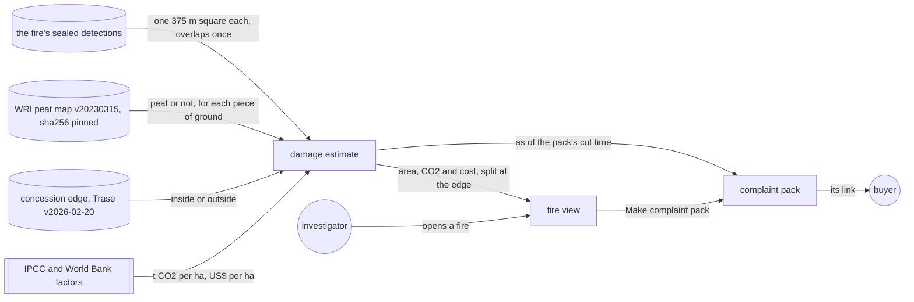
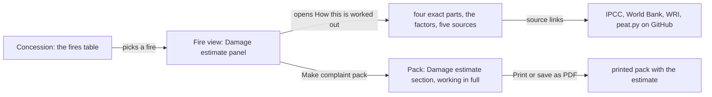
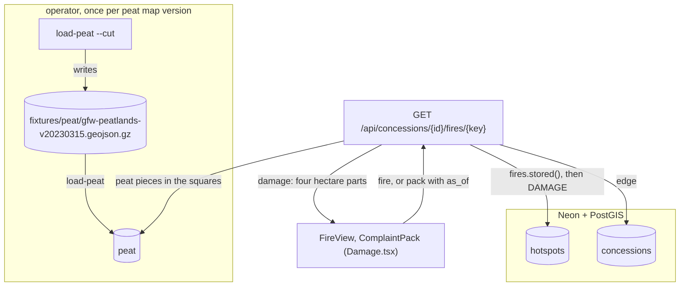
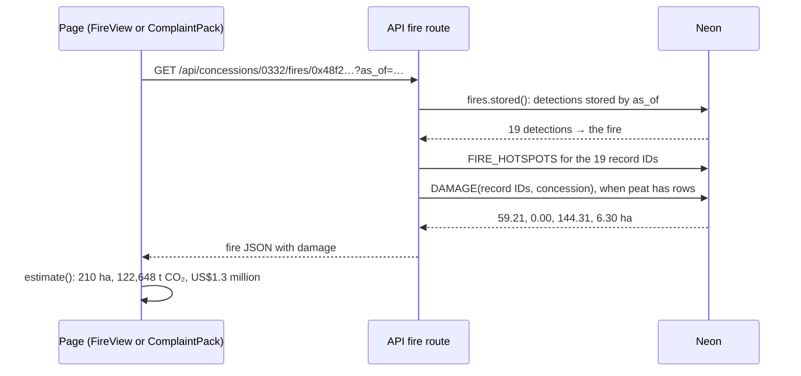
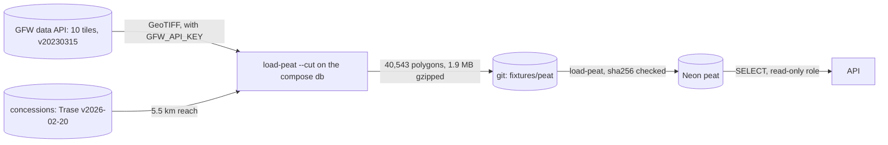
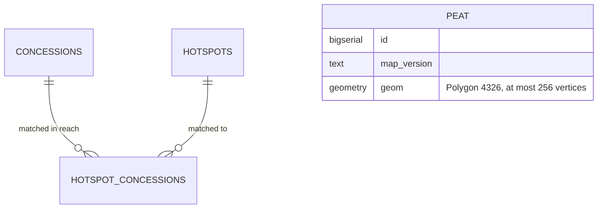

# Damage estimate

**Version:** v1 · **Status:** Built · **Type:** Feature · **Project type:** Web UI

**Shape doc:** docs/specs/fire-watch/shape.md
**Depends on:** fire-record, fire-origin, complaint-pack

Each fire gets an estimate of the ground it burned, the CO2 it released and what that cost, split
at the concession's edge. The fire view and the complaint pack show it. It comes last because the
shape marks it the first slice to cut, and the user chose to build it (O1).

## Problem

A buyer reading a grievance asks how much damage the fire did. Today the fire view and the pack say
where and when a fire was seen, and on whose side of the edge. They say nothing about how much
ground burned, or what it released.

The ground under a fire changes the answer about 9 times. Burned drained peat releases about 601 t
of CO2 per hectare. Burned secondary forest releases about 67 t. The ID-WOOD-CONCESSION-0332 fire of
fire-origin scenario 1 sits almost all on peat: 203.5 of the 209.8 ha in its detections' pixels.

The shape keeps this slice for the hackathon's economic-impact ask. The World Bank put Indonesia's
2015 fires at US$16.1 billion over 2.6 million ha, about US$6,192 per hectare.

## Slice test

| Check                         | Result |
| ----------------------------- | ------ |
| Cuts every layer it needs     | yes: a pinned peat map loaded into the database, the estimate in the API's fire and pack answers, and both screens in `web/` |
| One e2e test walks it         | yes: open the 0332 fire from the existing e2e fixture, read its estimate, make a pack, and read the same estimate in the pack |
| Worth shipping alone          | yes: an investigator can tell a buyer how much ground a fire covered, on whose side, and what it released |
| Fits (≤5 scenarios, ≤2 areas) | yes: 5 scenarios; two areas: the API with its peat data (`api/`) and the fire view and pack (`web/`) |

**Path:** full. The slice adds a new pinned input, new numbers in two screens and a change to the API.

## User story

As a watchdog investigator, I want each fire to come with an estimate of the ground it burned, the
CO2 it released and its cost, split at the concession's edge, so that a grievance says how much
damage happened on the supplier's land.

## Flow



The estimate draws a 375 m square around each detection and joins them. It splits the ground at the
concession's edge and by the peat map, then applies the factors. The fire view and the pack show it.

How each number is made:

| Number | Peat ground | Other ground |
| ------ | ----------- | ------------ |
| Area   | The joined squares, each piece counted once | The same |
| CO2    | 353 t dry matter per ha at 464 g CO2-C per kg: 600.6 t CO2 per ha. Likely 289.2 to 911.9, from the 95% interval of 170 to 536 t | 42.2 t dry matter per ha at 1,580 g CO2 per kg: 66.7 t CO2 per ha |
| Cost   | US$16.1 billion over 2.6 million ha: US$6,192 per ha | The same |

## Acceptance criteria

```gherkin
Scenario: The fire view gives a peat fire's damage, split at the edge
  Given the ID-WOOD-CONCESSION-0332 fire of fire-origin scenario 1: 19 VIIRS NOAA-20 detections
    on 4 passes, 2026-10-13 17:37 to 2026-10-15 18:43 UTC
  And their 375 m squares join into 209.8 ha: 59.2 ha inside the concession, all on peat, and
    150.6 ha outside, 144.3 ha of it on peat
  When the investigator opens the fire
  Then its damage estimate reads "Ground in its pixels: About 210 ha" and "59 ha of it inside
    the concession."
  And "CO₂ released: About 120,000 t" and "Likely 59,000 to 190,000 t. 36,000 t of it inside the
    concession."
  And "Cost: About US$1.3 million" and "At Indonesia's 2015 average of US$6,192 a hectare.
    US$370,000 of it inside the concession."
  And "An estimate, not a measurement. A detection means fire somewhere in its 375 m pixel, so
    less ground may have burned."

Scenario: A fire off peat counts as burned vegetation
  Given hotspot B of fire-record scenario 1, 2026-10-14 06:18 UTC at 3.67525°S, 115.35328°E,
    370 m outside ID-WOOD-CONCESSION-0377, where the peat map has no peat
  When the investigator opens its fire from ID-WOOD-CONCESSION-0377
  Then its damage estimate reads "Ground in its pixels: About 14 ha"
  And "CO₂ released: About 940 t", with no range, since none of the ground is peat
  And "Cost: About US$87,000"
  And "None of this ground is inside the concession."

Scenario: The pack holds the damage as of its cut time
  Given the pack for the 0332 fire made at 2026-10-17 09:00 UTC, as in complaint-pack scenario 1
  And a NOAA-20 pass at 2026-10-17 18:20 UTC adds 3 detections to the fire
  When anyone opens the pack
  Then its damage estimate still reads "About 210 ha", "59 ha of it inside the concession." and
    "About 120,000 t"
  And the fire view gives the estimate from all 22 detections

Scenario: Anyone can redo the estimate
  Given the pack from scenario 3
  When a reader reads the damage estimate's "How this is worked out"
  Then it gives the ground in four parts: 59.21 ha inside on peat, 0.00 ha inside off peat,
    144.31 ha outside on peat and 6.30 ha outside off peat
  And each factor with its source: IPCC 2013 Wetlands Supplement Tables 2.6 and 2.7, IPCC 2006
    Volume 4 Tables 2.4 and 2.5, and the World Bank's "The Cost of Fire" (2016)
  And the peat map: WRI Global Peatlands, gfw_peatlands v20230315, CC BY 4.0, each tile's sha256
  And "Methane and carbon monoxide are left out."
  And "This estimate is not sealed. Its detections are sealed, and the map and the factors are
    pinned, so anyone can redo it."

Scenario: A fire that never spread carries its caveat on the estimate
  Given the ID-WOOD-CONCESSION-0540 fire of fire-origin scenario 4: 6 detections on 5 passes,
    none more than 483 m from the first, joining into 58.25 ha inside the concession, all on peat
  When the investigator opens the fire
  Then the estimate reads "About 58 ha", "About 35,000 t" and "Likely 17,000 to 53,000 t."
  And "All of this ground is inside the concession."
  And above the figures: "This fire never spread. If it is a fixed heat source, such as a mill,
    little or nothing here burned."
```

The numbers in scenarios 1, 2 and 5 come from the real detections, the Trase map v2026-02-20 and
the peat cut, worked out by the plan's query on the compose PostGIS.

## Scope

**In:**

- An estimate for every fire, worked out from its stored detections on each request, as fires are
  (D31). The fire view and the pack show it. The pack holds it as of its cut time (D33, D37).
- Area: a 375 m square around each detection, north up. Joined squares count each piece of ground
  once (O5). The ground is split at the concession's edge (O6).
- Peat: WRI's Global Peatlands map, gfw_peatlands v20230315, CC BY 4.0, about 28 m pixels (O3). Its
  10-degree tiles cover all of Indonesia, Papua included. For Sumatra and Borneo it uses Miettinen et
  al. 2016. Each tile is pinned by sha256.
- CO2 on peat: IPCC 2013 Wetlands Supplement, tropical wildfire on drained peat. 353 t dry matter per
  ha, 95% interval 170 to 536 (Table 2.6), at 464 g CO2-C per kg (Table 2.7).
- CO2 off peat: IPCC 2006 Volume 4, all secondary tropical forests, 42.2 t dry matter per ha (Table
  2.4), at 1,580 g CO2 per kg for tropical forest (Table 2.5) (O8).
- The CO2 range comes from the peat factor's 95% interval. The off-peat factor is used at its mean.
  A fire with no peat ground gets no range.
- Cost: US$6,192 per ha, the World Bank's US$16.1 billion over 2.6 million ha in 2015 (O2).
- The page rounds to two significant figures. "How this is worked out" gives the exact parts, the
  factors and the sources.
- No new seal (O7). Every input is sealed or pinned, as for fire origin (D24).
- A fire flagged as never spread keeps its estimate, with the fixed-heat-source caveat on top (O9).

**Out:**

- Totals per concession: not planned (O4).
- Burned area measured from imagery: not planned. MODIS burned area arrives months late, and
  Sentinel-2 needs a pipeline of its own.
- The real size of each VIIRS pixel: not planned. It grows toward the edge of the scan, and the
  recorder neither stores nor seals scan and track.
- Methane and carbon monoxide: not planned (O10). "How this is worked out" says they are left out.
- Haze, smoke and health effects, other than through the World Bank's average cost: not planned.
- Damage in the 2023 replay: not planned.
- Company names: never (shape O10).

## Interface

The fire view gets a "Damage estimate" panel after the reading and before the forecasts. The pack
gets a "Damage estimate" section between Dates and Basis. Both show the same three figures as a
key-value list. In the fire view the working sits behind "How this is worked out". In the pack it
is shown in full, so a printed pack carries it. The record still comes first (D2).



The investigator opens a fire and reads its damage after where it was first seen. The working is
one click away in the fire view, and always shown in the pack.

| Part | What shows |
| ---- | ---------- |
| Title | "Damage estimate" |
| Never spread, above the figures | "This fire never spread. If it is a fixed heat source, such as a mill, little or nothing here burned." (D67) |
| Figures, a key-value list | "Ground in its pixels": "About 210 ha". "CO₂ released": "About 120,000 t". "Cost": "About US$1.3 million". Each value is medium weight, with a grey line under it |
| The grey lines | The ground: "59 ha of it inside the concession." The CO₂: "Likely 59,000 to 190,000 t. 36,000 t of it inside the concession." The cost: "At Indonesia's 2015 average of US$6,192 a hectare. US$370,000 of it inside the concession." |
| A fire wholly on one side | No "of it inside" parts. One line under the figures: "All of this ground is inside the concession." or "None of this ground is inside the concession." |
| No peat ground | No "Likely … to …" range on the CO₂ line |
| Under the figures | "An estimate, not a measurement. A detection means fire somewhere in its 375 m pixel, so less ground may have burned." |
| How this is worked out | The method in one paragraph. A table of the four parts to two decimals, rows "Inside the concession" and "Outside", columns "On peat" and "Other ground". The three factors as a key-value list, with their per-hectare values. "Methane and carbon monoxide are left out. This estimate is not sealed. Its detections are sealed, and the map and the factors are pinned, so anyone can redo it." Then five links |
| Links | "IPCC 2013 Wetlands Supplement, Tables 2.6 and 2.7", "IPCC 2006 Guidelines, Volume 4, Tables 2.4 and 2.5", "World Bank, The Cost of Fire (2016)", "WRI Global Peatlands, v20230315, CC BY 4.0", "The peat map's tiles and their sha256" |

All figures round to two significant figures, and a number keeps its unit on its line.

| State | What shows |
| ----- | ---------- |
| A fire on both sides of the edge | The three figures, each with its part inside |
| A fire wholly inside or outside | The three figures, then the one "All" or "None" line |
| A fire flagged as never spread | The caveat above the figures, in the fire view and the pack |
| The fire loading, or the server not answering | The fire view's and the pack's own states. The estimate comes with the fire, so it has no state of its own |
| An answer without `damage` | No panel and no section |

**The page expects:** a `Damage` type in `web/src/api.ts` with four numbers: `inside_peat_ha`,
`inside_other_ha`, `outside_peat_ha` and `outside_other_ha`, to two decimals. `FireDetail`, and so
`PackDetail`, carry an optional `damage`. The fire route and the pack route fill it from the
detections stored by the answer's `as_of_unix`. The page holds the factors and does the arithmetic
in `web/src/Damage.tsx`. The last link points at `api/src/firewatch/peat.py` on GitHub, which pause
3 places.

**Motion tier:** 1. The panel enters with the fire view (`--fw-dur`), and the disclosure opens as
the reading's does. There is no motion of its own.

**Components used:** `fw-panel`, `fw-kv` with `sub` lines, `fw-help`, `table-box` with `fw-table`
and row headers as in the 2023 block, the disclosure from the reading panel, `fw-link` with the
external icon, and `pack-section` with its `h2` and `h3`. There is no new component and no new
token. `app.css` adds `.damage` rules and `.damage-value` from existing tokens.

**Design system:** Fire Watch, `docs/design/design-system/` (D2, D4).

**Preview:** real components in `web/src`: `Damage.tsx` (new), `FireView.tsx`, `ComplaintPack.tsx`
and `api.ts`. Run `cd web && pnpm dev` and open `http://localhost:5173/?preview=damage-estimate`.
Pickers switch between 6 states and the themes, and `&state=offPeat&theme=dark` links straight to
one. "Make complaint pack" in the fire view opens the same fire's pack state. Each fire's four parts
come from its real detections, the Trase map and WRI's peat tiles 00N_100E and 00N_110E. Seals,
transactions and forecasts are made up. The drift check passed over the 7 files written. All 17
tokens the new CSS uses exist in `docs/design/design-system/tokens/`. `tsc -b` is clean, and the 161
web unit tests pass. At 390 px, in both themes and with the disclosure open, no state has a
sideways scroll. On a touch phone the disclosure and the five links are each 44 px tall.

## Technical plan

### Approach

WRI's peat map goes into Neon once, as polygons cut to the concessions' reach. The cut is made once
from the pinned tiles and committed (D70), and `load-peat` loads it (D69). The fire route already
groups the fire from the stored detections (D31). It now also runs one PostGIS query over those
detections. The query draws each detection's 375 m square, joins the squares, and splits them at
the concession's edge and by the peat polygons. It sends four hectare figures, and the page applies
the factors (D71).

Relies on: D13, D18, D24, D31, D33, D37, D58, D61, D62, D63, D64, D65, D66, D67, D68, D69, D70, D71



The operator loads the peat once. On each fire or pack request, the API reads the detections, the
edge and the peat pieces, and sends four hectare parts that the page turns into the figures.



The page asks for the fire. The API groups it, reads its records and its damage parts in the same
connection, and the page does the arithmetic.



The peat crosses two boundaries. It comes from GFW with a key that stays in the operator's `.env`,
and it reaches Neon only through the committed, sha256-checked cut.

**The estimate, so anyone can redo it** (written into `peat.py`'s docstring):

1. Take the fire's detections, as the fire route groups them.
2. Draw each detection's square in its own UTM zone: 187.5 m each way from the point, along the
   zone's grid. Zone `floor((lon + 180) / 6) + 1`, EPSG 326xx north of the equator, 327xx south.
3. Join the squares. Split the result at the concession's edge into inside and outside.
4. Intersect each part with the peat pieces. Areas are on the WGS 84 ellipsoid. "Other ground" is
   a part's area less its peat.
5. Round each of the four parts to 0.01 ha.

The peat cut, so anyone can redo it: every peat pixel of the 10 pinned tiles inside 5.5 km of a
concession (D13's 5 km, plus half a square's diagonal), vectorized by tile in 4,000-pixel blocks.

### Changes

| File | What changes | Why |
| ---- | ------------ | --- |
| `api/migrations/004_peat.up.sql` (new) | `peat (id bigserial, map_version text, geom geometry(Polygon, 4326))`, a GiST index, and the reader grant inside the `DO` block, as `003_forecasts.up.sql` does | Scenarios 1, 2, 5 |
| `api/migrations/004_peat.down.sql` (new) | `DROP TABLE peat` | The reverse path |
| `api/src/firewatch/peat.py` (new) | The method docstring. `TILES`: the 10 tile IDs with their sha256. `MAP_VERSION`, the committed cut's path and sha256. `DAMAGE`, the query. `load()`: copies the cut into a temporary table, then fills `peat` with `ST_Subdivide(geom, 256)` in one transaction, replacing the old rows. `cut()`: downloads each tile through `concessions.download()` with its sha256, reads the reach from PostGIS, vectorizes with rasterio, and writes the gzip with mtime 0 and the polygons in a fixed order. `main()`: `load-peat [path]` and `load-peat --cut` | Scenarios 1–5, D69, D70 |
| `api/src/firewatch/app.py:251` | After `ids` (`:275`), run `peat.DAMAGE` when `peat` has rows. Add `damage` to the answer (`:299`), for the fire view and for a pack. Add `damage_ms` to the "served fire" log line (`:288`) | Scenarios 1–3 |
| `api/pyproject.toml`, `api/uv.lock` | Script `load-peat`. Dependency group `cut = ["rasterio"]`, and rasterio in `dev` for the tests. The API image installs neither (`uv sync --no-dev`) | D70 |
| `fixtures/peat/gfw-peatlands-v20230315.geojson.gz` (new) | The full cut: 40,543 polygons, 1.9 MB. It loads as 44,308 pieces, 16 MB | D70 |
| `fixtures/peat/peat-cut.geojson.gz` (new) | The full cut's polygons within 0.1° of the detections in `fire-record.csv` and `fire-origin.csv`: 924 polygons, 147 KB | Tests and the e2e load it in seconds |
| `infra/neon-reader.sql:6` | Add `peat` to the reader's grant | A new database's reader can read it |
| `api/tests/test_peat.py` (new) | Load a path; reload replaces; a changed file is refused; `--cut` on a small GeoTIFF that the test writes gives the same bytes twice | Scenario 4 |
| `api/tests/test_app.py` | The 0332 fire's damage, hotspot B's, a pack cut before a later detection, and no `damage` while `peat` is empty | Scenarios 1–3 |
| `api/tests/test_migrations.py:69` | `peat` in the reader-role test | The grant |
| `web/src/Damage.test.tsx` (new) | `twoFigures`, `estimate`, and the panel's text for scenarios 1, 2, 5, with the disclosure's parts and links | Scenarios 1, 2, 4, 5 |
| `web/src/ComplaintPack.test.tsx` | The pack's damage section, with the working shown | Scenarios 3, 4 |
| `web/e2e/global-setup.ts:136` | `load-peat ../fixtures/peat/peat-cut.geojson.gz` after `load-concessions` | The e2e |
| `web/e2e/damage-estimate.spec.ts` (new) | The e2e below, and a tap check on a touch screen with the disclosure open | All scenarios' path |
| `web/src/Damage.tsx` (pause 2) | `twoFigures()` is `toPrecision(2)`, so 6.31 gives 6.3 with no float tail | `Damage.test.tsx` |
| `web/e2e/fire-record.spec.ts`, `web/e2e/spread-forecast.spec.ts` | The tap checks skip a control that `checkVisibility()` says is hidden | The damage links sit in a closed disclosure (O14) |
| `README.md`, `docs/ARCHITECTURE.md`, `CHANGELOG.md` | `load-peat` in "Run it locally", "First deploy" and "Updating"; WRI's CC BY 4.0 credit; the component row; one changelog line | Operators |

Reusing: `concessions.download()` for each tile's sha256 check, `fires.stored()` and
`FIRE_HOTSPOTS` for the detections, `migrate.up()` and `migrate.down()`, and the e2e's `run()`.
`Damage.tsx`, its CSS and the preview exist from pause 2.

### Data



`peat` stands alone. The damage query joins it to a fire's squares by `ST_Intersects`, not by a key.

**Migration:** expand only. `004` adds `peat`. The backfill is `load-peat` on Neon, before the
merge. The switch is the API change, which sends no `damage` while `peat` is empty. There is no
contract step.
**Reverse:** `004_peat.down.sql` drops the table. `test_up_down_up` runs it. Reverting the merge
alone also works, and `peat` stays unread.

### Earn-it

| Added | Triggered by |
| ----- | ------------ |
| `peat` table and migration 004 | Scenarios 1, 2 and 5 need peat or not for each piece of ground (D62) |
| `load-peat` | The table is filled once per map version, from the pinned cut (D69) |
| `--cut`, and rasterio in the `cut` and `dev` groups | Anyone can redo the committed cut from the pinned tiles (scenario 4, D70) |
| The committed full cut, 2.0 MB | GFW serves tiles only with a key, and no key goes in the repo (D70) |
| The small test cut | The API tests and the e2e need peat in seconds, not the 9 minutes the full cut took in the spike |
| `DAMAGE` in `peat.py` | Scenarios 1–5 |
| `damage` in the fire route | Scenarios 1–3 |

### Non-functionals

|                      |                                                                               |
| -------------------- | ----------------------------------------------------------------------------- |
| **Load**             | A few fire and pack requests an hour. On the compose database the query took 0.9 ms for hotspot B, 4.7 ms for the 19-detection 0332 fire, and 121 ms for the 188-detection fire. Neon's 0.25 CU may be about 2 to 3 times slower |
| **Breaks first**     | A fire with thousands of detections: the union and the intersections grow with it. At 10 times the largest fire, expect about a second. Then work out the squares' union once per pass, not per request |
| **Security surface** | The same public, read-only API. The concession ID and the key are already checked and passed as parameters. The reader role gets `SELECT` on `peat`. `GFW_API_KEY` is used only by `--cut`, from the operator's untracked `.env`. `peat` holds public CC BY 4.0 polygons |
| **Proof it works**   | `served fire id=ID-WOOD-CONCESSION-0332 key=0x… detections=19 … damage_ms=19` in the API log, and `load-peat` printing `Loaded 44,308 peat pieces from gfw_peatlands v20230315`. In the e2e, the 0332 fire's query took 16 to 21 ms, each request on a new connection |
| **Rollout**          | No flag: the page shows no estimate while the answer has no `damage`. Before the merge, run migration 004 and `load-peat` on Neon. The merge deploys the API, then the page (D21). Rollback: revert the merge |

### Test plan

| Scenario | Test | Command |
| -------- | ---- | ------- |
| 1. Peat fire, split at the edge | `test_app.py::test_fire_damage_splits_at_the_edge`, `Damage.test.tsx` | `cd api && PATH=$HOME/.foundry/bin:$PATH uv run pytest tests/test_app.py -k damage`; `cd web && pnpm test Damage` |
| 2. Off peat | `test_app.py::test_fire_damage_off_peat`, `Damage.test.tsx` | the same |
| 3. Pack as of its cut | `test_app.py::test_pack_damage_holds_at_its_cut`, `ComplaintPack.test.tsx` | the same, and `pnpm test ComplaintPack` |
| 4. Anyone can redo it | `test_peat.py`, `Damage.test.tsx` | `cd api && uv run pytest tests/test_peat.py` |
| 5. Never spread | `Damage.test.tsx` | `cd web && pnpm test Damage` |
| No peat loaded | `test_app.py::test_no_damage_without_peat` | `cd api && uv run pytest tests/test_app.py -k damage` |

**E2E:** `web/e2e/damage-estimate.spec.ts`. It opens the ID-WOOD-CONCESSION-0332 fire from
`fire-origin.csv`, reads "About 210 ha", "59 ha of it inside the concession." and "About 120,000 t".
It opens "How this is worked out" and reads "59.21 ha". It makes a complaint pack and reads the same
figures and parts in it. `cd web && pnpm e2e`.

Run one API suite at a time, because every worktree shares `firewatch_test`.

### Chunks

| Chunk | Scenarios | Files owned |
| ----- | --------- | ----------- |
| A | 1–5, API side | `api/migrations/004_peat.*`, `api/src/firewatch/peat.py`, `api/src/firewatch/app.py`, `api/pyproject.toml`, `api/uv.lock`, `api/tests/test_peat.py`, `api/tests/test_app.py`, `api/tests/test_migrations.py`, `fixtures/peat/`, `infra/neon-reader.sql`, `README.md`, `docs/ARCHITECTURE.md`, `CHANGELOG.md` |
| B | 1–5, page side, and the e2e | `web/src/Damage.tsx`, `web/src/Damage.test.tsx`, `web/src/ComplaintPack.test.tsx`, `web/src/preview/DamageEstimatePreview.tsx`, `web/e2e/damage-estimate.spec.ts`, `web/e2e/global-setup.ts` |

Chunk A owns the lockfile and the shared docs. Chunk B's e2e runs after chunk A is in, because it
needs `load-peat` and the test cut.

### Risks

| Risk | Mitigation |
| ---- | ---------- |
| The figures read as a measured loss. One peat pixel counts as about 8,400 t CO₂ | The caveat under the figures, the range, the never-spread line (D67), and the exact parts under "How this is worked out" |
| Neon's GEOS 3.11 and PROJ 9.1 differ from the compose image's GEOS 3.9 and PROJ 7.2, so an exact part can differ by about 0.01 ha between them | The page rounds to two figures. Tests run on the compose image. The parts in the pack are Neon's |
| `load-peat` is slow over the network: the spike's row-by-row load of the full cut took 540 s on the compose database | One `COPY` into a temporary table, then one `INSERT … ST_Subdivide`. It runs once, before the merge |
| Someone forgets `load-peat` on Neon | The API sends no `damage` while `peat` is empty, so the page shows no estimate rather than a wrong one. "First deploy" and "Updating" in the README list it |
| GFW withdraws the key or the tiles | The committed cut still loads. Only `--cut` needs GFW |

### Decisions to record

Recorded as D69, D70, D71.

## Open items

| ID | What | Type | Raised at | Owner | Status | Answer |
| -- | ---- | ---- | --------- | ----- | ------ | ------ |
| O1 | Four days remain to 2026-10-24, the demo video and the submission are not done, and the shape marks this slice first to cut | flag | spec p1 | user | Resolved | 2026-10-20: go ahead, with no time cap |
| O2 | What the estimate gives: area, CO2 and cost at the World Bank's 2015 average; area and CO2 only; cost at EPA's US$190 per t CO2; or area only | question | spec p1 | user | Resolved | 2026-10-20: area, CO2 and cost at the World Bank's 2015 average, US$6,192 per ha (D61) |
| O3 | How the estimate tells peat from other ground: a pinned peat map, Trase's peat share per concession, or every detection as peat | question | spec p1 | user | Resolved | 2026-10-20: WRI's Global Peatlands map, pinned by sha256 (D62) |
| O4 | Where the estimate shows: fire view and pack, fire view only, or also a total per concession | question | spec p1 | user | Resolved | 2026-10-20: the fire view and the complaint pack (D64) |
| O5 | How area is counted: the joined 375 m squares, or detections times 14.06 ha | question | spec p1 | user | Resolved | 2026-10-20: the joined squares. The 0332 fire covers 209.8 ha, not 267.2 (D63) |
| O6 | Whether the estimate splits the ground inside the concession from the ground outside | question | spec p1 | user | Resolved | 2026-10-20: split at the edge (D64) |
| O7 | Whether the estimate is sealed on the chain | question | spec p1 | user | Resolved | 2026-10-20: no. It comes from sealed detections and pinned inputs, as fire origin does (D24, D65) |
| O8 | What fuel counts for ground off peat: IPCC secondary forest, nothing, or IPCC primary forest | question | spec p1 | user | Resolved | 2026-10-20: IPCC 2006 secondary tropical forest, 42.2 t dry matter per ha (D66) |
| O9 | A fire that never spread may be a mill, where nothing burned. The 0540 fire of fire-origin scenario 4 would read about 35,000 t CO2 | question | spec p1 | user | Resolved | 2026-10-20: show the estimate, with the caveat on top. It may also be peat smouldering in place, which is real damage (D67) |
| O10 | Whether the estimate counts methane: IPCC gives 21 g CH4 per kg for peat, about 200 t CO2-equivalent per ha more | question | spec p1 | user | Resolved | 2026-10-20: CO2 only. The page says methane and carbon monoxide are left out (D68) |
| O11 | WRI's peat polygons within the concessions' reach fit Neon Free, and PostGIS works out a fire's parts on each request fast enough. Neon's PostGIS can transform to UTM | unproven | spec p3 | spike | Resolved | 2026-10-20, measured: 38,537 polygons, 767,181 vertices, 2.0 MB gzipped; 42,121 pieces and 14 MB in PostGIS; Neon holds 36 MB. The query took 0.9 to 7.2 ms, and 121 ms for a 188-detection fire, on the compose database. Read-only on Neon: PostGIS 3.5.7, PROJ 9.1.1, `ST_Transform` to EPSG:32749 works (D69) |
| O12 | GFW serves the peat tiles only with an API key, which `load-peat --cut` needs. Whose key goes in the untracked `.env` as `GFW_API_KEY` | question | spec p3 | user | Resolved | 2026-10-20: the key GFW publishes in its own Global Peatlands layer. `/build` adds it to `.env` for the one cut; it is never committed (D70) |
| O13 | O12 said `/build` adds GFW's published key to `.env` for the one cut. The build could not read the key | flag | build | user | Decided alone | Chose: make the committed cut from the 10 tiles the spike fetched with GFW's key on 2026-10-20, served to `load-peat --cut` from disk. Each tile matched its pinned sha256, and two runs gave the same bytes, sha256 `a6c9c48f…82b9`. Other: put the key in `.env` and fetch the tiles again. Undo: add `GFW_API_KEY` to `.env`, run `load-peat --cut`, and check that `git diff` is empty. 2026-10-20 |
| O14 | The fire record and forecast tap checks failed on the five damage links. The links sit in the closed "How this is worked out", and Chromium gives them an `offsetParent`. Open, each is 44 px tall | flag | build | user | Decided alone | Chose: both checks skip a control that `checkVisibility()` says is hidden (87ba2dc). A new tap check opens the damage disclosure first. Other: open the damage disclosure in both older checks. Undo: `git revert 87ba2dc`, and open the disclosure in both checks. 2026-10-20 |

_Never delete this section or its rows. See references/ledger.md._

## Glossary

- **VIIRS** — the satellite sensor whose fire detections FIRMS publishes. Each detection stands for
  a pixel about 375 m across.
- **Peat** — soil made of old plant matter. Once drained, it burns deep and for weeks.
- **Dry matter** — fuel weighed without its water.
- **CO2-C** — the carbon in CO2. Times 44/12 gives the CO2 itself.
- **95% interval** — the range IPCC expects the true value to fall in 95 times out of 100.
- **IPCC Tier 1** — IPCC's simplest method: area times default factors from its tables.
- **WRI, GFW** — World Resources Institute, which publishes Global Forest Watch and its maps.
- **CC BY 4.0** — a licence that lets anyone reuse the data if they credit the source.
- **sha256** — a fingerprint of a file. Any change to the file changes it.
- **Pinned** — fixed to one exact version, checked by its sha256.
- **e2e** — end-to-end: one test that walks the whole slice as a user would.
- **Backfill** — filling a new table from data that already exists, before the code reads it.
- **Lockfile** — the file that pins the exact version of every dependency (`api/uv.lock`).
- **UTM zone** — one of 60 north-south strips of the earth, each with a flat metre grid.
- **GeoTIFF** — an image file whose pixels carry map positions; GFW's peat tiles are GeoTIFFs.
- **rasterio** — a Python library that reads GeoTIFFs and turns pixels into polygons.
- **GiST index** — the PostGIS index that finds shapes overlapping a given area quickly.
- **GEOS, PROJ** — the geometry and projection libraries under PostGIS; versions can differ by host.
- **CU** — Neon's compute unit; the free plan runs at 0.25 CU.
