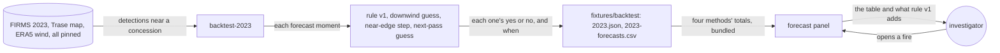
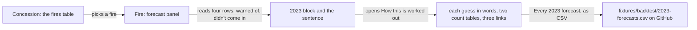

# Fair baseline

**Version:** v1 · **Status:** Draft · **Type:** Enhancement · **Project type:** Web UI

**Shape doc:** docs/specs/judge-review/shape.md
**Depends on:** season-backtest

The 2023 replay adds two guesses beside the downwind guess: rule version 1's near-edge step alone,
and a guess that every fire comes in by the next pass. The forecast panel shows all four and says in
one sentence what rule version 1 adds. It comes now because forecast-v2 needs fair numbers to beat.

## Problem

A judge-style review on 2026-10-22 found that the 2023 replay's only baseline can't show what rule
version 1 adds. The downwind guess said yes at 293 forecast moments, and rule version 1 said yes at
all 293. So it can only ever warn of less. Beside it, rule version 1's 3,751 of 3,874 warnings that
didn't come in read as bad, but nobody can say how bad.

A scratch rerun of the committed replay on 2026-10-22 gave the same totals. It then scored two
plainer guesses on the same 19,995 counted forecasts, 135 of them arrivals:

| Method | Arrivals warned of | Warnings that didn't come in | Median hours off |
| ------ | ------------------ | ---------------------------- | ---------------- |
| Rule version 1 | 123 of 135 | 3,751 of 3,874 | 11.7 |
| Near-edge step alone | 117 of 135 | 3,193 of 3,310 | 11.7 |
| Every fire, by the next pass | 135 of 135 | 19,860 of 19,995 | 11.7 |
| Downwind guess | 20 of 135 | 264 of 284 | 12.4 |

- Rule version 1's advance-rate step warned of 6 arrivals the near-edge step missed. It added 558
  warnings that didn't come in.
- Every method that warns at 12 hours after the pass is a median 11.7 hours off. Rule version 1's
  timing does no better than "the next pass".
- 0.7% of forecast moments came in at all: 135 of 19,995.

## Slice test

| Check                         | Result |
| ----------------------------- | ------ |
| Cuts every layer it needs     | yes: the `backtest-2023` command in `api/`, its committed totals and CSV, and the forecast panel in `web/`. No table, no route, no seal |
| One e2e test walks it         | yes: season-backtest's e2e runs the command on the cut and checks the two new guesses on the 0263, 0332 and 0264 rows. Then it opens the 0332 fire and sees all four methods and the sentence |
| Worth shipping alone          | yes: anyone reading a forecast sees what rule version 1 adds over the plainest guesses, with numbers |
| Fits (≤5 scenarios, ≤2 areas) | yes: 5 scenarios; two areas: the replay (`api/`) and the forecast panel (`web/`) |

**Path:** full. The slice adds two methods to the replay, new CSV columns and a change to the panel.

## User story

As a watchdog investigator, I want to see rule version 1 next to the plainest guesses on 2023, so
that I can tell a buyer what its warnings add.

## Flow



The replay makes all four methods' forecasts at each moment the recorder would have forecast. It
writes the totals and every forecast to the repo. The forecast panel shows the four, and one sentence
says what rule version 1 adds over the near-edge step.

How each method decides, at the same moments:

| Method | Says seen inside when | By about |
| ------ | --------------------- | -------- |
| Rule version 1 (D48) | Its advance rate reaches 375 m inside within 48 hours (step 4), or its newest pass is at most 375 m from the edge (step 5) | Step 4's hours, rounded to 12, or 12 hours after the newest pass |
| Downwind guess (D60) | Its path downwind, at the advance rate, reaches 375 m inside within 48 hours | Those hours, rounded as rule version 1 rounds them |
| Near-edge step | Its newest pass is at most 375 m from the edge, as rule version 1 step 2 measures it | 12 hours after the newest pass |
| Next-pass guess | Always | 12 hours after the newest pass |

Every method is counted as season-backtest counts it (D44, D53, D56). The forecasts not checked and
not counted are the same for all four.

## Acceptance criteria

```gherkin
Scenario: The near-edge step alone is judged on the same moments
  Given the ID-WOOD-CONCESSION-0263 fire's 2023-09-27 06:05 UTC pass, 539 m outside the edge
  And the ID-WOOD-CONCESSION-0264 fire's 2023-09-28 18:28 UTC pass, 1,334 m outside
  When the replay runs the near-edge step alone
  Then for 0263 it says "Not forecast to be seen inside"
  And it misses the 2023-09-28 05:46 UTC arrival that rule version 1 warned of
  And for 0264 it says "Not forecast to be seen inside", and no pass sees the fire inside
  And that is a right "no", where rule version 1's warning did not come in

Scenario: The next-pass guess warns of an arrival the others missed
  Given the ID-WOOD-CONCESSION-0332 fire seen once, on 2023-10-14 05:46 UTC, 2,168 m outside
  When the replay runs the next-pass guess
  Then it says "Forecast to be seen inside by about 14 Oct 17:46 UTC"
  And the 2023-10-16 05:08 UTC pass sees the fire inside
  And that is an arrival warned of, 35.4 hours off, which rule version 1 and the near-edge step missed
  And for the 0264 pass of 2023-09-28 18:28 UTC it says "by about 29 Sep 06:28 UTC"
  And that is a warning that did not come in

Scenario: The totals give all four methods on all of 2023
  Given the full replay of 2023: 19,995 forecasts counted, 135 of them arrivals
  When the replay writes its totals
  Then the near-edge step warned of 117 of 135, and 3,193 of its 3,310 warnings did not come in
  And the next-pass guess warned of 135 of 135, and 19,860 of its 19,995 warnings did not come in
  And each is a median 11.7 hours off
  And rule version 1's and the downwind guess's totals don't change
  And the CSV gives each forecast's near-edge and next-pass time beside the other two methods'

Scenario: The forecast panel says what rule version 1 adds
  Given the committed 2023 result
  When anyone opens the ID-WOOD-CONCESSION-0332 fire of spread-forecast's scenario 1
  Then the 2023 block gives the three numbers for rule version 1 and for each of the three guesses
  And one sentence says "Rule version 1's advance step warned of 6 arrivals the near-edge step
    missed, and added 558 warnings that didn't come in."
  And "How this is worked out" gives each guess in full and every count
  And it says that the downwind guess and the near-edge step say yes only where rule version 1 does

Scenario: Anyone redoes the replay and gets the same result
  Given a fresh checkout, the pinned FIRMS file, the pinned Trase map and the pinned wind
  When anyone runs backtest-2023
  Then it writes the same totals and CSV, with both new guesses, byte for byte as the committed ones
```

Scenarios 1 to 3 come from the scratch rerun of 2026-10-22. The tests check scenarios 1 and 2 on
season-backtest's cut.

The sentence in scenario 4 is worked out from the committed totals. The page has no number in it
that the totals file doesn't hold.

## Scope

**In:**

- The near-edge step alone: rule version 1 step 5 with no step 4. A fire whose newest pass is at most
  375 m from the edge is forecast to be seen inside 12 hours after that pass. Otherwise it says no.
- The next-pass guess: every forecast moment says the fire is seen inside 12 hours after its newest
  pass. The 12 hours are rule version 1 step 5's, not tuned on 2023.
- Both at the same moments as rule version 1, counted with the same three numbers (D53).
- The downwind guess stays as it is (D60).
- `2023.json` gains both guesses' totals. `2023-forecasts.csv` gains a column for each guess's time.
- The forecast panel's 2023 block shows all four methods.
- One sentence, worked out from the totals, says what rule version 1's advance step adds over the
  near-edge step.
- "How this is worked out" gives each guess in full and every count. It says that the downwind guess
  and the near-edge step say yes only where rule version 1 does.
- `backtest-2023` redoes it all byte for byte from the pinned inputs.

**Out:**

- The bar a rule version 2 must clear to replace version 1: forecast-v2 sets it (O4).
- A rule version 2: forecast-v2.
- A single score, such as CSI: not planned here. forecast-v2 may add one with its bar (O4).
- Guesses beside a live forecast: not planned. The guesses measure the rule on 2023, not one fire.
- A change to rule version 1, the recorder or the API: not planned.
- A seal of the result: not planned (D55).
- Other years: not planned (D52).

## Interface

The forecast panel's 2023 block turns on its side. Rule version 1 and the three guesses are the
rows, and each number is a column, so the methods compare down a column. The disclosure holds the
rest of the counts. The concession view and the pack don't change (D43, D46).



The investigator opens a fire and compares rule version 1 with three guesses in one table. The
sentence under it says what the rule's advance step adds. The disclosure gives the other counts.

| Part | What shows |
| ---- | ---------- |
| Block title | "How this rule did on 2023, replayed", as now |
| Block table | Columns: "In 2023", "Arrivals warned of, out of 135", "Warnings that didn't come in". Rows: "Rule version 1" (123, "3,751 of 3,874"), "Near-edge step" (117, "3,193 of 3,310"), "Downwind guess" (20, "264 of 284"), "Next-pass guess" (135, "19,860 of 19,995"). Numbers are right-aligned |
| Under the table | "Rule version 1's advance step warned of 6 arrivals the near-edge step missed, and added 558 warnings that didn't come in." Then "A replay of 2023, run in 2026. Nothing in it was sealed in 2023." |
| "How this is worked out", after the two existing paragraphs | "The 2023 replay runs this rule, and three guesses, at every moment the recorder would have forecast in 2023. It reads FIRMS's 2023 VIIRS NOAA-20 archive for Indonesia and the same concession map." |
| | "The near-edge step is this rule's step 5 alone: a fire at most 375 m from the edge is forecast to be seen inside 12 hours after its newest pass. The next-pass guess says that of every fire. The downwind guess moves the fire with ERA5's hourly wind, from Open-Meteo, at the rate it advanced since the pass before. A fire seen on one pass has no rate, so the downwind guess says no." |
| | "The near-edge step is part of this rule, and in 2023 the downwind guess said yes only where this rule did. So neither warned of an arrival this rule missed." |
| | "All four forecast at the same moments, and only passes after a forecast was made count. A warning is a forecast that the fire is seen inside." |
| Counts table, "The rest of the 2023 replay" | Columns: "Forecasts", "Arrivals missed", "Said no, stayed out", "Median hours off". The same four rows: 12, 16,109, 11.7 h · 18, 16,667, 11.7 h · 115, 19,596, 12.4 h · 0, 0, 11.7 h |
| Shared table, "The same for all four" | "Not checked: joined another fire first" 246 · "Not checked: seen inside before it was made" 21 · "Not counted: its 48 hours end after 2023" 15 · "Forecasts made" 20,277 |
| Links | "Every 2023 forecast, as CSV", "Redo the 2023 replay", "Forecast rule, version 1, in full", as now |

Median hours off moves from the block to the counts table (O5). On a 390 px phone the block's table
has 303 px. Three columns of "123 of 135" and "19,860 of 19,995" need 368 px at the system's cell
padding. The two columns left need 293 px. The hours off differ least across the four methods:
11.7, 11.7, 12.4 and 11.7.

The states are season-backtest's, unchanged:

| State | What shows |
| ----- | ---------- |
| A forecast by rule version 1, in any state | The block and the additions to "How this is worked out" |
| A forecast changed after its seal | The same. The block is about the rule, not this forecast |
| A forecast by a rule version with no replay | No block and no additions |
| No forecasts | One line, no block |
| Checking, or couldn't reach the chain | The same as the first row. The replay needs no chain read |

The page bundles the totals, so the block has no loading or error state (D59). A method that warned
of none reads "None warned of" for hours off.

**The page expects:** `near_edge` and `next_pass` on `Backtest` in `web/src/api.ts`, each a
`BacktestTotals`, in `fixtures/backtest/2023.json`.

**Motion tier:** pending (O6).

**Components used:** `fw-panel`, the section `h3`, `table-box` with `fw-table` and its `num` columns,
`fw-help`, `fw-link` with the external icon, and the disclosure from the record panel. There is no
new component and no new token. `app.css` adds two rules: the forecast tables' column heads wrap, and
a method's name keeps to one line above 720 px.

**Design system:** Fire Watch, `docs/design/design-system/` (D2).

**Preview:** real components in `web/src`, at `http://localhost:5173/?preview=season-backtest` after
`cd web && pnpm dev`. `&state=none&theme=dark` links straight to one state. `fixtures/backtest/2023.json`
holds the scratch rerun's near-edge and next-pass totals until `/build` redoes the replay. The 2026
forecasts are the spread-forecast preview's, which are made up. The drift check passed over the 5
files written. `tsc -b` is clean, 216 web unit tests pass, and `season-backtest.spec.ts` passes with
its page checks moved to the four methods. At 390 px and 360 px, with the disclosure open, neither
table nor the page scrolls sideways.

**Craft checks:** a one-line prompt would rank the methods and colour a winner. This table states
counts a reader can check against the CSV, and the sentence names the trade-off in numbers. Next to
Stripe's documentation, the reference for D2, it keeps the same order: the answer in the block, every
count one click away.

## Decisions to record

Drafted at pause 1. `/build` appends them to `DECISIONS.md` and flips D51's Status line.

```markdown
## D99 · 2026-10-22 · Measure the forecast against the downwind, near-edge and next-pass guesses

Why: the downwind guess said yes only where rule version 1 did, 293 of 293 in 2023, so it can't
show what rule version 1 adds. The near-edge step alone shows what the advance-rate step adds: 6
more arrivals warned of, and 558 more warnings that didn't come in. The next-pass guess gives the
floor: 135 of 19,995 forecast moments came in. Its 12 hours are rule version 1 step 5's, not tuned.
The downwind guess stays because it tests wind, which D48 kept out of the rule. A fire seen on one
pass has no rate, so the downwind guess says no.
Rejected: the downwind guess alone (it can only warn of less than rule version 1), dropping the
downwind guess (it still tests wind), "never comes in" (warns of nothing, D51's reason), rule
version 1's yes with a fixed 12 hours (the same false alarms as rule version 1), every fire within
1 km (the distance is picked by hand).
Supersedes: D51
Source: docs/specs/fair-baseline.md
Status: active

## D100 · 2026-10-22 · Say in one sentence, worked out from the totals, what rule version 1's advance step adds

Why: the reader of a forecast can't easily take 6 and 558 out of a table of four methods. The
sentence holds only numbers the committed totals hold, so it can't claim more than the replay shows.
Rejected: the numbers only (the reader works out what the rule adds alone).
Source: docs/specs/fair-baseline.md
Status: active

## D101 · 2026-10-22 · Leave the bar a rule version 2 must clear to forecast-v2

Why: no rule version 2 exists yet, and on 2023 neither rule version 1 nor the near-edge step does
better on both counts. forecast-v2 picks the bar with a candidate rule in hand.
Rejected: setting it here as "no worse on both counts" (no candidate to test it on yet), one score
such as CSI here (a fourth row on the panel before anything needs it).
Source: docs/specs/fair-baseline.md
Status: active
```

## Open items

| ID | What | Type | Raised at | Owner | Status | Answer |
| -- | ---- | ---- | --------- | ----- | ------ | ------ |
| O1 | fair-baseline supersedes D51's rejection of the near-edge step as a baseline (from shape O8) | flag | shape | user | Resolved | 2026-10-22: supersede D51 with one entry naming all three guesses, the downwind guess kept (D99) |
| O2 | What the shape's "fixed-lead guess" is: every fire by the next pass, rule version 1's yes at a fixed 12 hours, every fire within 1 km, or none | question | spec p1 | user | Resolved | 2026-10-22: every forecast moment says seen inside 12 hours after the newest pass, rule version 1 step 5's lead (D99) |
| O3 | Whether the panel says in words what the comparison shows, or gives only the numbers | question | spec p1 | user | Resolved | 2026-10-22: one sentence worked out from the totals, and "How this is worked out" says which guesses say yes only where rule version 1 does (D100) |
| O4 | Who sets what "beat" means for a rule version 2: this slice, as "no worse on both counts" or as CSI, or forecast-v2 | question | spec p1 | user | Resolved | 2026-10-22: forecast-v2 sets it. This slice shows the counts (D101) |
| O5 | Scenario 4 said the block gives three numbers for each method. On a 390 px phone the three need 368 px of a 303 px table | question | spec p2 | user | Open | — |
| O6 | Which motion tier the block uses | question | spec p2 | user | Open | — |

_Never delete this section or its rows. See references/ledger.md._

## Glossary

- **Baseline**: the plainest guess that a forecast must beat to be worth showing.
- **Near-edge step**: rule version 1 step 5 on its own: a fire at most 375 m from the edge comes in
  by the next pass.
- **Next-pass guess**: a guess that every fire comes in 12 hours after its newest pass.
- **Advance-rate step**: rule version 1 step 4, which times a fire by how fast it moved since the pass
  before.
- **Arrival**: a forecast moment after which a pass saw the fire inside within 48 hours.
- **Seen inside**: a detection inside the concession, more than 375 m from its edge (D26).
- **CSI**: critical success index: warned arrivals out of all warnings plus missed arrivals.
- **e2e**: end-to-end: one test that walks the whole slice as a user would.
- **Bundled**: built into the page's JavaScript, so it loads with the page and needs no request.
