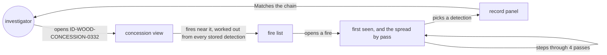
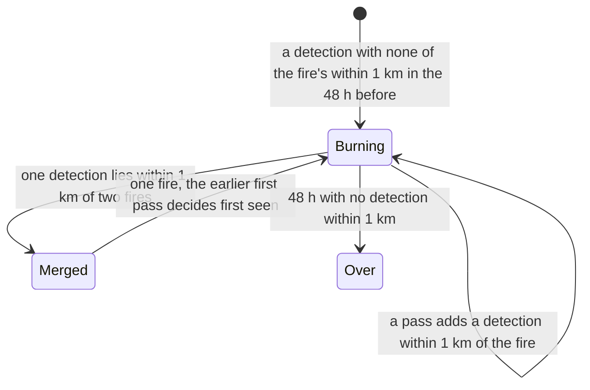

# Fire origin

**Version:** v1 · **Status:** Draft · **Type:** Feature · **Project type:** Web UI

**Shape doc:** docs/specs/fire-watch/shape.md
**Depends on:** fire-record

The investigator opens a concession and sees its nearby detections grouped into fires. For each
fire it says where the satellite first saw it against the boundary, and in what order it spread,
pass by pass, built only from detections already sealed. It comes now because "the fire started
outside and spread in" is the answer companies give (shape O3), and complaint-pack needs it.

## Problem

Companies answer fire grievances by saying the fire started outside their concession and spread
in (KLK, Sept 2026, shape O3). Fire Watch today lists single detections on or near a concession.
It doesn't group them into fires or say where a fire was first seen, so the investigator can't
answer that claim from it.

The fires are there. From 2026-10-12 03:32 to 2026-10-15 18:43 UTC, the 6,608 recorded detections
form 1,451 fires (same fire when within 1 km and 48 hours, O4), and 400 of them were seen on two
or more passes. A fire had detections on both sides of a concession's edge 65 times. In 15 of
those, every first detection sat more than 375 m from the edge on one side, so the record can say
which side it was first seen on. In the other 50 it can't (O5).

## Slice test

| Check                         | Result |
| ----------------------------- | ------ |
| Cuts every layer it needs     | yes — fires worked out in the API from the stored records, a fire view on the page, shipped by the existing deploy. The recorder and the chain don't change (O3) |
| One e2e test walks it         | yes — record the real ID-WOOD-CONCESSION-0332 fire on anvil, open 0332, open the fire, see "First seen outside, 954 m from the edge", step through 4 passes, see the first detection match the chain |
| Worth shipping alone          | yes — when a company says a fire started outside, the investigator can show where the satellite first saw it, from sealed detections, or know the record can't settle it |
| Fits (≤5 scenarios, ≤2 areas) | yes — 5 scenarios; two areas: the API's fire grouping and the page's fire view |

**Split.** The shaped fire-origin also forecast where each fire goes next. That fails "Fits": the
forecast brings a wind source, a model, a new kind of seal and a check against where the fire
really went, a third area and at least three more scenarios. It becomes its own slice:

- **fire-origin** (this spec): fires, where each was first seen, and the spread order.
- **spread-forecast** (new): where a fire goes next, sealed before it arrives. Takes shape O12.
  season-backtest now depends on it rather than on fire-origin.

**Path:** full — a new interface and new logic over the stored records.

## User story

As a watchdog investigator, I want to see where each fire near a concession was first seen
against its boundary and how it spread, pass by pass, from sealed detections, so that when the
company says it started outside, I can show what the satellite recorded, or know the record
can't settle it.

## Flow



The investigator opens a concession, opens one of its fires, reads where it was first seen,
steps through its passes, and checks any detection against the chain as before.

## States



Fires are worked out again on each request, so a new pass grows a fire, and a detection that
links two fires changes what the joined fire reads (O4).

How the first pass is read, per concession:

| First pass | Reads |
| ---------- | ----- |
| Every detection inside, each more than 375 m from the edge | First seen inside, at the nearest one's distance |
| Every detection outside, each more than 375 m from the edge | First seen outside, at the nearest one's distance |
| Any detection within 375 m of the edge, or detections on both sides | Too close to the edge to tell which side it started on |

375 m is half the widest VIIRS pixel: fire-record's fixture has scan widths from 0.33 to 0.76 km.
A detection farther than that from the edge has its whole pixel on one side. Geolocation error
is not counted.

## Acceptance criteria

```gherkin
Scenario: A fire first seen outside a concession, then seen inside
  Given recording started 2026-10-12 03:32 UTC
  And these VIIRS NOAA-20 detections near ID-WOOD-CONCESSION-0332 are recorded and sealed:
    | pass (UTC)       | detections | against ID-WOOD-CONCESSION-0332                  |
    | 2026-10-13 17:37 | 3          | outside, 954 to 1,258 m from the edge            |
    | 2026-10-14 06:18 | 6          | outside, 731 to 1,575 m                          |
    | 2026-10-14 17:20 | 4          | outside, 32 to 761 m                             |
    | 2026-10-15 18:43 | 6          | 4 inside, 194 to 804 m; 2 outside, 7 and 283 m   |
  When the investigator opens ID-WOOD-CONCESSION-0332 for 2026-10-12 to 2026-10-15
  And opens this fire
  Then it reads "First seen outside, 954 m from the edge" and "2026-10-13 17:37 UTC"
  And "Seen inside from 2026-10-15 18:43 UTC"
  And it lists the 4 passes in time order, 19 detections, each checkable against the chain
  And it says recording had started 38 hours before, so the fire may have been burning earlier

Scenario: A fire first seen inside a concession
  Given these detections are recorded and sealed:
    | pass (UTC)       | detections | against ID-WOOD-CONCESSION-0356              | against ID-WOOD-CONCESSION-0372 |
    | 2026-10-14 06:20 | 1          | inside, 409 m from the edge                  | outside, 4,182 m               |
    | 2026-10-14 17:20 | 3          | 2 inside, 217 and 304 m; 1 outside, 211 m    | outside, 3,976 to 4,399 m      |
  When the investigator opens this fire from ID-WOOD-CONCESSION-0356
  Then it reads "First seen inside, 409 m from the edge" and "2026-10-14 06:20 UTC"
  And it has no "Seen outside from" line, since the one outside detection is within 375 m
  And it has no recording-start note, since recording had run 51 hours
  When they open the same fire from ID-WOOD-CONCESSION-0372
  Then it reads "First seen outside, 4,182 m from the edge"

Scenario: A fire first seen too close to the edge to tell
  Given these detections near ID-WOOD-CONCESSION-0540 are recorded and sealed:
    | pass (UTC)       | detections | against ID-WOOD-CONCESSION-0540          |
    | 2026-10-14 06:18 | 1          | inside, 158 m from the edge              |
    | 2026-10-14 19:02 | 3          | 1 inside, 88 m; 2 outside, 64 and 108 m  |
    | 2026-10-15 05:59 | 2          | inside, 360 and 408 m                    |
    | 2026-10-15 18:41 | 2          | inside, 235 and 302 m                    |
  When the investigator opens this fire
  Then it reads "First seen 158 m inside the edge, within one satellite pixel of it"
  And "The satellite record can't say which side this fire started on"
  And "Seen inside from 2026-10-15 05:59 UTC"

Scenario: A heat source that never spreads is flagged
  Given 6 detections inside ID-WOOD-CONCESSION-0540, 1,106 to 1,661 m from the edge, on 5 passes
    from 2026-10-12 06:57 to 2026-10-15 18:41 UTC, none more than 483 m from the first
  When the investigator opens this fire
  Then it says "Seen on 5 passes without spreading. This can be a fixed heat source, such as a
    mill, or peat smouldering in place."

Scenario: The chosen dates don't move where a fire was first seen
  Given the ID-WOOD-CONCESSION-0332 fire from the first scenario
  When the investigator picks 2026-10-15 to 2026-10-15
  Then the fire is listed
  And it still reads "First seen outside, 954 m from the edge" and "2026-10-13 17:37 UTC"
  And all 4 passes show
```

## Scope

**In:**
- A concession's fires, worked out from every stored version 2 detection inside or within 5 km of
  it: same fire when a detection is within 1 km and 48 hours of one already in it (O4). Rule
  version 1, written out on the page and in the repo, so anyone can redo it.
- The dates pick which fires show, those with any detection in the range. They never cut a fire:
  first seen and the passes come from all its detections (scenario 5).
- Per fire and concession: the first pass read as in the table above; the first pass seen on the
  other side, using the same 375 m rule; every pass in time order with its detections; each
  detection opens the record panel and its chain check, unchanged from fire-record.
- Wording says "first seen", never "started". Help text says NOAA-20 passes about twice a day,
  so a fire can burn for hours, or under cloud, before it is seen (O2).
- A fire first seen within 48 hours of recording starting (2026-10-12 03:32 UTC) says it may have
  been burning before recording began.
- A fire seen on 4 or more passes with no detection more than 750 m from its first carries the
  never-spread note of scenario 4 (O6). 5 fires met that on 2026-10-12 to 15.
- No new seals. Each detection was sealed when recorded; the fire is worked out from them (O3).

**Out:**
- Where a fire goes next — spread-forecast (new slice).
- Other satellites (VIIRS S-NPP, NOAA-21, MODIS) — not planned yet. They would add passes about
  50 minutes apart on the same afternoon and night orbits, not shrink the 375 m doubt, and would
  triple the seals (fire-record put them here; moved out).
- Settling "too close to tell" with sharper imagery such as Sentinel-2 — not planned.
- Fires that start more than 5 km from every concession: their detections out there are never
  recorded (D13), so they read as first seen where they came within 5 km.
- A link to each fire, and the pack for a buyer — complaint-pack.
- Past seasons — season-backtest.
- Company names — not planned (shape O10).

## Open items

| ID | What | Type | Raised at | Owner | Status | Answer |
| -- | ---- | ---- | --------- | ----- | ------ | ------ |
| O1 | A spread forecast built in about 3 days beats a naive baseline (fire moves downwind at its recent speed) on 2023 fires (from shape O12) | unproven | shape | user | Open | Proposed: not this slice. The forecast moves to spread-forecast (Split above); shape O12 becomes Handed to spread-forecast |
| O2 | First detection is close enough to the real start to say "started inside" or "started outside". Satellites pass a few times a day and can miss small fires (from shape O13) | unproven | shape | user | Open | Proposed: no "started" claims. The page says "first seen", calls a side only beyond 375 m (15 of 65 crossings on 2026-10-12 to 15), and notes the twice-a-day passes and the recording start |
| O3 | Whether a fire's first-seen reading gets its own seal, or is worked out from the sealed detections. The shape said "each step is written on-chain as detections arrive"; every detection already is, within the hour | question | spec p1 | user | Open | — |
| O4 | Same fire when within 1 km and 48 h of a detection already in it. Measured on 2026-10-12 to 15: 750 m gives 1,634 fires, 1 km 1,451, 1.5 km and 72 h 1,236. Of 737 gaps between passes of one fire, 9 were over 50 h. A chain of detections can join two fires, and a fire lit inside within 1 km of one burning outside reads as one fire first seen outside | question | spec p1 | user | Open | — |
| O5 | The headline answer is often "can't tell": of 65 fires with detections on both sides of an edge, 50 were first seen within 375 m of it or on both sides at once. Calling the side by where the first detections fall, ignoring the pixel, would call 39 | flag | spec p1 | user | Open | — |
| O6 | Whether to flag fires that never spread (fire-record O4 promised this slice would). A smouldering peat fire can also stay put | question | spec p1 | user | Open | — |
| O7 | The seals prove each detection hasn't changed, not that none is missing. A record left out could change where a fire reads as first seen. Anyone can compare against FIRMS's public archive | flag | spec p1 | user | Open | — |

_Never delete this section or its rows. See references/ledger.md._

## Glossary

- **Hotspot / detection** — a point where a satellite saw unusual heat, usually a fire.
- **Pass** — one satellite overhead; NOAA-20 sees a given spot about twice a day.
- **Fire** — here, detections grouped by the rule in O4, not a fire anyone confirmed on the ground.
- **First seen** — the earliest pass with a detection of the fire. The fire may have started earlier.
- **Pixel** — the patch of ground one detection stands for, 0.33 to 0.76 km wide for VIIRS.
- **Concession** — land the government has licensed to a company, here for pulpwood plantations.
- **Seal** — writing a record's fingerprint to the chain once, so later changes show.
- **FIRMS** — NASA's free service publishing satellite fire detections, live and archived.
- **Peat** — waterlogged soil made of old plant matter; when dry it can smoulder for weeks.
- **Sentinel-2** — a European satellite with 10–20 m images, sharper than VIIRS but no fire alerts.
- **e2e** — end-to-end: one test that walks the whole slice as a user would.
