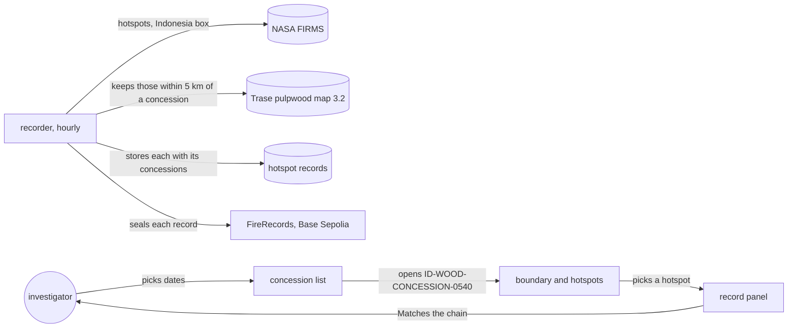
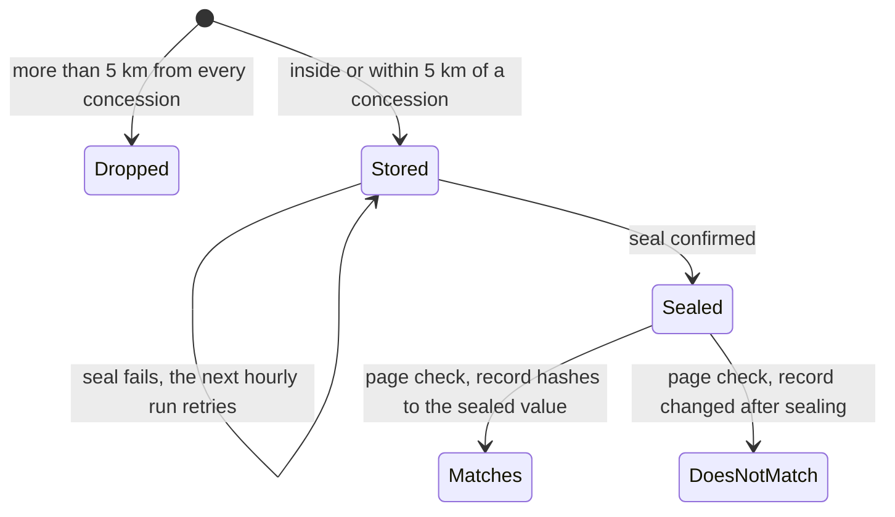

# Fire record

**Version:** v1 · **Status:** Draft · **Type:** Feature · **Project type:** Web UI

**Shape doc:** docs/specs/fire-watch/shape.md
**Depends on:** walking-skeleton

Every hour, each hotspot that falls inside or within 5 km of an Indonesian pulpwood
concession is stored with the concessions it touches and sealed on Base Sepolia. The
investigator picks dates, sees which concessions burned, and checks any hotspot's record
against the chain. It comes now because fire-origin, complaint-pack and damage-estimate all
need sealed records tied to concessions, and on-chain time only counts from the day
recording starts.

## Problem

Watchdog investigators file grievances with buyers over fires on plantation land. Companies
answer that the complaint names no specific site, date or basis, or that the fire started
outside their concession (shape O3). Fire Watch today shows one hotspot, tied to no
concession, so it can't answer either point.

The fires are there to record. On 2026-10-14, 1,108 VIIRS NOAA-20 hotspots fell inside
Indonesia's 298 mapped pulpwood concessions, and another 1,040 fell within 5 km of one.
Between 2026-10-11 and 2026-10-14, 178 concessions had a hotspot inside or within 5 km.

## Slice test

| Check                         | Result                                                                                                  |
| ----------------------------- | ------------------------------------------------------------------------------------------------------- |
| Cuts every layer it needs     | yes — scheduled recorder, concession map in Postgres, records and seals, read API, home page, deploy of the job |
| One e2e test walks it         | yes — record a FIRMS fixture against a cut-down concession map on anvil, open the page, pick dates, open ID-WOOD-CONCESSION-0540, pick a hotspot, see "Matches the chain" |
| Worth shipping alone          | yes — an investigator sees which pulpwood concessions burned this week and can point a buyer at a sealed record for each hotspot |
| Fits (≤5 scenarios, ≤2 areas) | yes — 5 scenarios; two areas: recording and viewing                                                      |

**Path:** full — new interface, new data (concession map, matches), a new scheduled job.

## User story

As a watchdog investigator, I want to pick dates and see which pulpwood concessions had
hotspots, each sealed when it was detected, so that my grievance names a specific site, date
and basis a buyer can check for themselves.

## Flow



Every hour the recorder keeps the hotspots on or near a concession, stores them and seals
them. The investigator picks dates, opens a concession, picks a hotspot and sees it checked
against the chain.

## States



`Matches` and `DoesNotMatch` are worked out in the browser each time, as in walking-skeleton.

## Acceptance criteria

```gherkin
Scenario: Hourly run records hotspots on and near pulpwood concessions
  Given the recorder matches against "Trase pulpwood concessions 2023–2024, v2026-02-20"
  And FIRMS reports three VIIRS NOAA-20 hotspots acquired 2026-10-14 06:18 UTC:
    | hotspot | latitude | longitude | where                                                                    |
    | A       | -3.58175 | 105.71567 | inside ID-WOOD-CONCESSION-0540, 3.1 km from its edge                     |
    | B       | -3.67525 | 115.35328 | outside: 0.37 km from ID-WOOD-CONCESSION-0377, 1.02 km from ID-WOOD-CONCESSION-0275 |
    | C       |  1.34800 | 104.17600 | 127 km from the nearest concession                                       |
  When the hourly recorder runs
  Then A and B are stored, and C is not
  And A's record lists ID-WOOD-CONCESSION-0540, inside, 3.1 km from the edge
  And B's record lists ID-WOOD-CONCESSION-0377 outside at 0.37 km and ID-WOOD-CONCESSION-0275 outside at 1.02 km
  And both records name the map version and are sealed on Base Sepolia, one seal each
  And the next hourly run stores and seals nothing new for A or B

Scenario: Investigator lists the concessions that burned in a date range
  Given today is 2026-10-15 and hotspots from 2026-10-11 onwards are recorded
  When the investigator opens the home page
  Then the dates read 2026-10-09 to 2026-10-15
  When they change the dates to 2026-10-11 to 2026-10-14
  Then 178 concessions are listed, ranked by hotspots inside
  And the first row reads "ID-WOOD-CONCESSION-0345", "Kalimantan Barat", "1,015 inside", "254 within 5 km"

Scenario: Investigator opens a concession and checks a hotspot
  Given hotspot A is recorded and sealed
  When the investigator opens ID-WOOD-CONCESSION-0540 for 2026-10-11 to 2026-10-14
  Then the map shows its boundary, its 930 hotspots inside and 334 within 5 km, inside and outside told apart
  When they pick hotspot A
  Then the panel shows "2026-10-14 06:18 UTC", "VIIRS NOAA-20", "5.2 MW", "Inside, 3.1 km from the edge"
  And it names the map "Trase pulpwood concessions 2023–2024, v2026-02-20"
  And it shows when the record was sealed
  And it says "Matches the chain"

Scenario: A record's concession match changed after sealing
  Given hotspot B is sealed listing ID-WOOD-CONCESSION-0377 outside at 0.37 km
  And its stored record was later edited to say inside ID-WOOD-CONCESSION-0377
  When the investigator picks hotspot B
  Then the panel says "Does not match the chain"

Scenario: No hotspots in the chosen dates
  Given the first recorded hotspot was acquired on 2026-10-11
  When the investigator picks 2026-10-01 to 2026-10-07
  Then the list says "No hotspots on or near a pulpwood concession between 2026-10-01 and 2026-10-07"
  And it says "Recording started 2026-10-11"
```

## Scope

**In:**
- One map: Trase's Indonesia wood pulp concessions 2023–2024 (model 3.2, file v2026-02-20),
  298 concessions from Ministry of Forestry licence maps, CC BY 4.0, credited on the page.
- One source: VIIRS NOAA-20 near real-time, the Indonesia box from walking-skeleton.
- Keep each hotspot inside or within 5 km of a concession. Its record lists every concession
  within 5 km, inside or outside, with the distance to that concession's edge, plus the map
  version. One record and one seal per hotspot.
- Within 375 m of an edge, one VIIRS pixel, the distance carries "within one satellite pixel
  of the edge", since the fire could sit on either side.
- Recording runs hourly on Azure. The first run takes the 5 days FIRMS offers. Each record
  shows when it was sealed next to when it was detected, so a late seal is visible.
- A seal that fails leaves the record "Not on chain yet", and the next run seals it, as in
  walking-skeleton scenario 4.
- The home page becomes: dates (default the last 7 days, at most 31), the concession list
  ranked by hotspots inside, the concession view with boundary and hotspots, and the record
  panel with the chain check.
- Concessions are named by Trase ID and province only. No company names (shape O10).
- `record-latest` and the latest-hotspot screen go. Skeleton rows stay in the database.
- The chain check proves a record hasn't changed since it was sealed. Whether the match itself
  is right, anyone can redo with the public Trase file; the page draws the boundary.

**Out:**
- Oil palm concessions — a new slice, palm-concessions, once a downloadable Indonesian source
  turns up. GFW's is view only (O1).
- Other satellites (VIIRS S-NPP, NOAA-21, MODIS) — fire-origin, where more passes sharpen the
  first-detection time (shape O13).
- Grouping hotspots into fires, first detection, spread — fire-origin.
- Filtering fixed heat sources such as mill boilers — see O4.
- A public page to check a record by its ID, and the pack for a buyer — complaint-pack.
- Past seasons — season-backtest.
- Company names — not planned (shape O10).

## Decisions to record

Drafted at pause 1. They move under Technical plan at pause 3, and `/build` appends them to
DECISIONS.md.

```markdown
## D12 · 2026-10-16 · Match against Trase's pulpwood concession map, not GFW's

Why: a match is only checkable if anyone can get the same boundaries. Trase publishes 298
Indonesian pulpwood concessions as GeoJSON under CC BY 4.0. GFW's Indonesia layers are view
only and can't be downloaded, its CC BY licence excludes Indonesia, and its oil palm data is
from 2012 (checked 2026-10-16).
Rejected: GFW view-only layers (polygons only reachable by scraping map tiles; a checker can't
legally get the same ones), waiting for a downloadable oil palm source (days; fire-origin must
run live by about 2026-10-19).
Source: docs/specs/fire-record.md
Status: active

## D13 · 2026-10-16 · Record hotspots within 5 km of a concession, each listing every concession in reach

Why: fire-origin argues "started outside, spread in", so detections outside the boundary must
be sealed when they happen; a seal added later can't show they weren't made up after a
dispute. 1,722 of 8,301 kept hotspots (2026-10-11 to 15) were within 5 km of two or more
concessions, so naming only one would hide them from the neighbour's page.
Rejected: inside only (no sealed outside detections before fire-origin ships), every hotspot in
the Indonesia box (about 8,600 a day, 5 times the seals, mostly nowhere near a concession),
nearest concession only (drops a hotspot from the neighbouring concession's page), one seal per
hotspot and concession pair (about 25% more seals, the same detection sealed twice).
Source: docs/specs/fire-record.md
Status: active

## D14 · 2026-10-16 · The home page is dates, then a concession list

Why: a grievance names one supplier's land, so the investigator looks up a concession, not a
patch of map. 178 concessions had hotspots on 2026-10-11 to 14; a ranked list puts the worst
first.
Rejected: map view as the area (thousands of dots when zoomed out, needs clustering), province
picker (up to 50 concessions in one province), keeping the latest-hotspot screen beside it (two
screens to explain; the latest hotspot is often far from any concession).
Source: docs/specs/fire-record.md
Status: active

## D15 · 2026-10-16 · Record hourly from a scheduled Azure job

Why: a seal is stronger evidence the closer it is to detection, and a run by hand leaves gaps
whenever nobody runs it. The recorder wallet key and database owner login move into Container
Apps secrets; whoever holds them can add seals but can't change one.
Rejected: running the recorder by hand on the operator's machine (gaps, and seal times days
after detection).
Source: docs/specs/fire-record.md
Status: active
```

## Open items

| ID | What | Type | Raised at | Owner | Status | Answer |
| -- | ---- | ---- | --------- | ----- | ------ | ------ |
| O1 | GFW concession maps are good enough to match fires to companies; GFW warns some are missing or misplaced (from shape O5) | unproven | shape | user | Resolved | 2026-10-16: GFW's Indonesia oil palm and pulpwood layers are view only, can't be downloaded, and its CC BY licence excludes Indonesia; the oil palm data is from 2012 (GFW Data API metadata). Switched to Trase's pulpwood map, CC BY 4.0 per its methods note, 298 concessions (D12). Pulpwood only |
| O2 | Region: assuming Indonesia, where public concession maps look densest (from shape O7) | assumption | shape | user | Resolved | 2026-10-16: Indonesia. The chosen map covers Indonesia only (D12) |
| O3 | Trase's 2023–2024 map includes 4 proposed, not yet licensed, concessions, with no field marking them. The 4 with permit year 2024 (ID-WOOD-CONCESSION-0666 to 0669, Kalimantan Timur and Gorontalo) are the likely ones; unconfirmed. A hotspot "on" a proposed concession names land nobody holds yet. 11 hotspots fell inside them on 2026-10-11 to 15 | question | spec p1 | user | Open | — |
| O4 | A fixed heat source inside a concession, such as a mill's boilers, shows up on every pass and would read as fires on that concession. VIIRS near-real-time has no type column to filter it (walking-skeleton O1). The two busiest concessions on 2026-10-11 to 14 spread over 100+ separate 1 km cells each, so those are real fires | flag | spec p1 | user | Open | — |
| O5 | Trase's boundaries come from Ministry of Forestry licence maps published 2022 to 2025. A concession licensed or redrawn since is missing or wrong (carries on walking-skeleton O9, "real boundaries") | flag | spec p1 | user | Open | — |
| O6 | Neon free gives 1 GB (walking-skeleton O5). The Trase file is 25 MB as GeoJSON, plus about 1,600 records a day | unproven | spec p1 | spec p3 | Open | — |
| O7 | Neon free gives 100 compute-hours a month (walking-skeleton O6). An hourly job wakes the database 720 times a month | unproven | spec p1 | spec p3 | Open | — |
| O8 | About 1,600 seals a day (541 to 2,495) from a wallet that started with 0.05 Base Sepolia ETH. At 0.006 gwei (2026-10-16) and an assumed 60,000 gas each, that is about 0.0006 ETH a day; the gas price can rise | unproven | spec p1 | spec p3 | Open | — |

_Never delete this section or its rows. See references/ledger.md._

## Glossary

- **Hotspot** — a point where a satellite detected unusual heat, usually a fire.
- **Concession** — land the government has licensed to a company, here for pulpwood plantations.
- **Pulpwood concession (HTI)** — a licence to grow fast-growing trees for paper pulp.
- **Trase** — a research group that maps commodity supply chains and publishes concession maps.
- **GFW** — Global Forest Watch, publishes forest and concession maps.
- **CC BY 4.0** — a licence that lets anyone reuse data if they credit the source.
- **VIIRS NOAA-20** — the fire-detecting sensor on the NOAA-20 satellite, about 375 m per pixel.
- **Seal** — writing a record's fingerprint to the chain, once, so later changes show.
- **Base Sepolia** — a free test network for Base, an Ethereum-compatible blockchain.
- **Gwei** — a billionth of an ETH, the unit gas prices are quoted in.
- **Neon** — the hosted Postgres service the project uses, on its free plan.
- **e2e** — end-to-end: one test that walks the whole slice as a user would.
