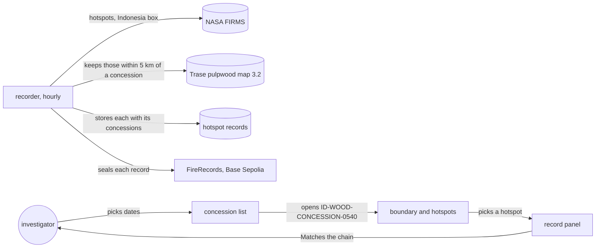
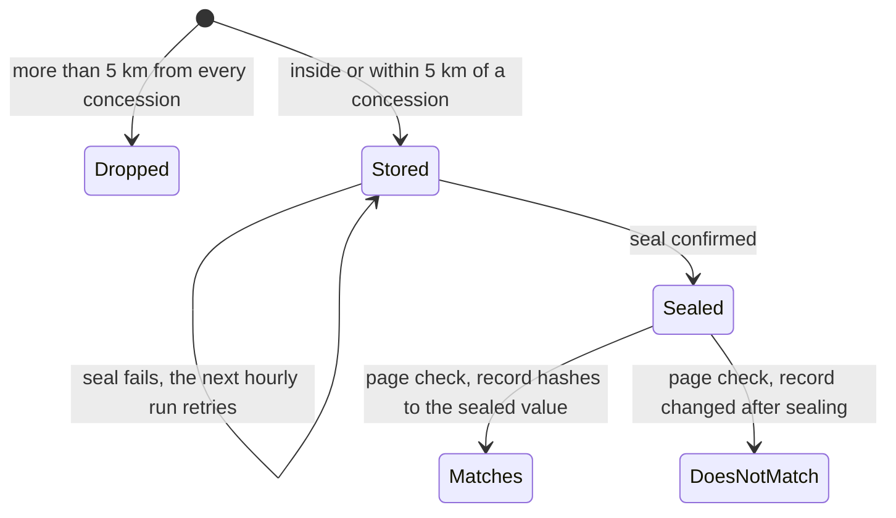
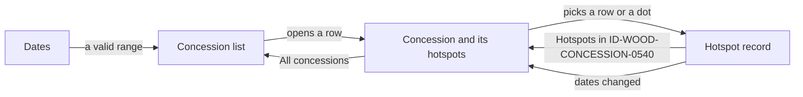
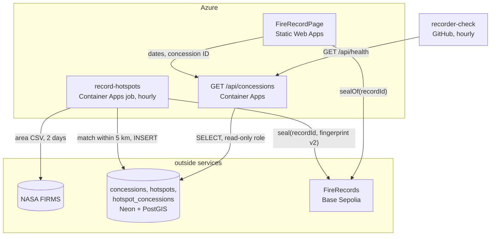
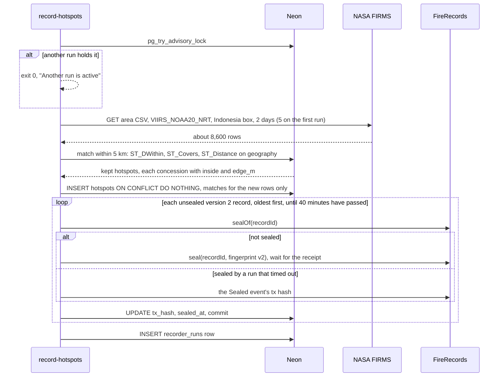
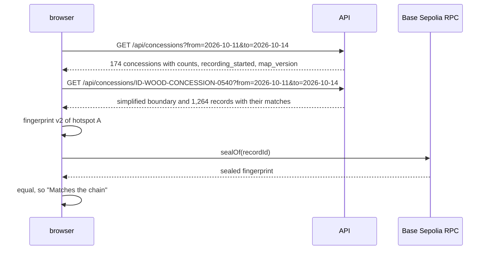
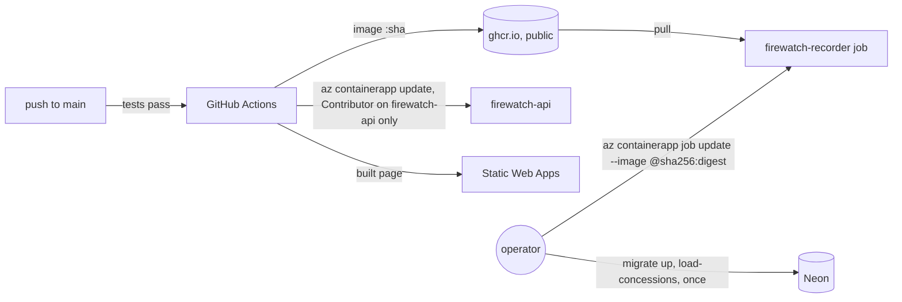
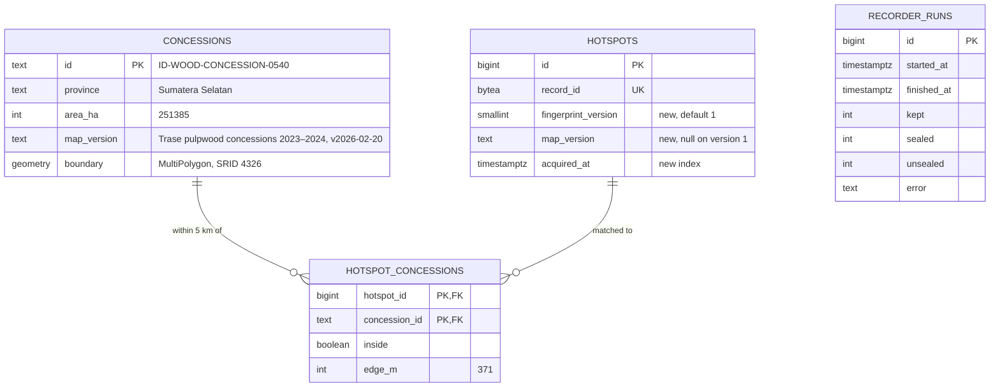

# Fire record

**Version:** v1 · **Status:** Built · **Type:** Feature · **Project type:** Web UI

**Shape doc:** docs/specs/fire-watch/shape.md
**Depends on:** walking-skeleton
**Page:** https://claude.ai/artifact/9pxgRqTB2T1YYnMgak2rPr

Every hour, each hotspot that falls inside or within 5 km of an Indonesian pulpwood
concession is stored with the concessions it touches and sealed on Base Sepolia. The
investigator picks dates, sees which concessions burned, and checks any hotspot's record
against the chain. It comes now because fire-origin, complaint-pack and damage-estimate all
need sealed records tied to concessions, and on-chain time only counts from the day
recording starts.

## Problem

Watchdog investigators file grievances with buyers over fires on plantation land. Companies
answer that the complaint names no specific site, date or basis, or that the fire started
outside their concession (shape O3). Fire Watch today shows one hotspot, tied to no
concession, so it can't answer either point.

The fires are there to record. On 2026-10-14, 1,104 VIIRS NOAA-20 hotspots fell inside
Indonesia's 294 mapped, licensed pulpwood concessions, and another 1,040 fell within 5 km of
one. Between 2026-10-11 and 2026-10-14, 174 concessions had a hotspot inside or within 5 km.

## Slice test

| Check                         | Result                                                                                                  |
| ----------------------------- | ------------------------------------------------------------------------------------------------------- |
| Cuts every layer it needs     | yes — scheduled recorder, concession map in Postgres, records and seals, read API, home page, deploy of the job |
| One e2e test walks it         | yes — record a FIRMS fixture against a cut-down concession map on anvil, open the page, pick dates, open ID-WOOD-CONCESSION-0540, pick a hotspot, see "Matches the chain" |
| Worth shipping alone          | yes — an investigator sees which pulpwood concessions burned this week and can point a buyer at a sealed record for each hotspot |
| Fits (≤5 scenarios, ≤2 areas) | yes — 5 scenarios; two areas: recording and viewing                                                      |

**Path:** full — new interface, new data (concession map, matches), a new scheduled job.

## User story

As a watchdog investigator, I want to pick dates and see which pulpwood concessions had
hotspots, each sealed when it was detected, so that my grievance names a specific site, date
and basis a buyer can check for themselves.

## Flow



Every hour the recorder keeps the hotspots on or near a concession, stores them and seals
them. The investigator picks dates, opens a concession, picks a hotspot and sees it checked
against the chain.

## States



`Matches` and `DoesNotMatch` are worked out in the browser each time, as in walking-skeleton.

## Acceptance criteria

```gherkin
Scenario: Hourly run records hotspots on and near pulpwood concessions
  Given the recorder matches against "Trase pulpwood concessions 2023–2024, v2026-02-20"
  And FIRMS reports three VIIRS NOAA-20 hotspots acquired 2026-10-14 06:18 UTC:
    | hotspot | latitude | longitude | where                                                                    |
    | A       | -3.58175 | 105.71567 | inside ID-WOOD-CONCESSION-0540, 3.1 km from its edge                     |
    | B       | -3.67525 | 115.35328 | outside: 0.37 km from ID-WOOD-CONCESSION-0377, 1.02 km from ID-WOOD-CONCESSION-0275 |
    | C       |  1.34800 | 104.17600 | 127 km from the nearest concession                                       |
  When the hourly recorder runs
  Then A and B are stored, and C is not
  And A's record lists ID-WOOD-CONCESSION-0540, inside, 3.1 km from the edge
  And B's record lists ID-WOOD-CONCESSION-0377 outside at 0.37 km and ID-WOOD-CONCESSION-0275 outside at 1.02 km
  And both records name the map version and are sealed on Base Sepolia, one seal each
  And the next hourly run stores and seals nothing new for A or B

Scenario: Investigator lists the concessions that burned in a date range
  Given today is 2026-10-15 and hotspots from 2026-10-11 onwards are recorded
  When the investigator opens the home page
  Then the dates read 2026-10-09 to 2026-10-15
  When they change the dates to 2026-10-11 to 2026-10-14
  Then 174 concessions are listed, ranked by hotspots inside
  And the first row reads "ID-WOOD-CONCESSION-0345", "Kalimantan Barat", "1,015 inside", "254 within 5 km"

Scenario: Investigator opens a concession and checks a hotspot
  Given hotspot A is recorded and sealed
  When the investigator opens ID-WOOD-CONCESSION-0540 for 2026-10-11 to 2026-10-14
  Then the map shows its boundary, its 930 hotspots inside and 334 within 5 km, inside and outside told apart
  When they pick hotspot A
  Then the panel shows "2026-10-14 06:18 UTC", "VIIRS NOAA-20", "5.2 MW", "Inside, 3.1 km from the edge"
  And it names the map "Trase pulpwood concessions 2023–2024, v2026-02-20"
  And it shows when the record was sealed
  And it says "Matches the chain"

Scenario: A record's concession match changed after sealing
  Given hotspot B is sealed listing ID-WOOD-CONCESSION-0377 outside at 0.37 km
  And its stored record was later edited to say inside ID-WOOD-CONCESSION-0377
  When the investigator picks hotspot B
  Then the panel says "Does not match the chain"

Scenario: No hotspots in the chosen dates
  Given the first recorded hotspot was acquired on 2026-10-11
  When the investigator picks 2026-10-01 to 2026-10-07
  Then the list says "No hotspots on or near a pulpwood concession between 2026-10-01 and 2026-10-07"
  And it says "Recording started 2026-10-11"
```

## Scope

**In:**
- One map: Trase's Indonesia wood pulp concessions 2023–2024 (model 3.2, file v2026-02-20),
  from Ministry of Forestry licence maps, CC BY 4.0, credited on the page. 294 of its 298
  concessions: the 4 with permit year 2024 are left out as likely proposed (O3).
- The page says the boundaries come from Trase's 2023–2024 map and may be incomplete (O5).
- One source: VIIRS NOAA-20 near real-time, the Indonesia box from walking-skeleton.
- Keep each hotspot inside or within 5 km of a concession. Its record lists every concession
  within 5 km, inside or outside, with the distance to that concession's edge, plus the map
  version. One record and one seal per hotspot.
- Within 375 m of an edge, one VIIRS pixel, the distance carries "within one satellite pixel
  of the edge", since the fire could sit on either side.
- Recording runs hourly on Azure. The first run takes the 5 days FIRMS offers. Each record
  shows when it was sealed next to when it was detected, so a late seal is visible.
- A seal that fails leaves the record "Not on chain yet", and the next run seals it, as in
  walking-skeleton scenario 4.
- The home page becomes: dates (default the last 7 days, at most 31), the concession list
  ranked by hotspots inside, the concession view with boundary and hotspots, and the record
  panel with the chain check.
- Concessions are named by Trase ID and province only. No company names (shape O10).
- `record-latest` and the latest-hotspot screen go. Skeleton rows stay in the database.
- The chain check proves a record hasn't changed since it was sealed. Whether the match itself
  is right, anyone can redo with the public Trase file; the page draws the boundary.

**Out:**
- Oil palm concessions — a new slice, palm-concessions, once a downloadable Indonesian source
  turns up. GFW's is view only (O1).
- Other satellites (VIIRS S-NPP, NOAA-21, MODIS) — fire-origin, where more passes sharpen the
  first-detection time (shape O13).
- Grouping hotspots into fires, first detection, spread — fire-origin.
- Filtering fixed heat sources such as mill boilers — fire-origin, which groups hotspots into
  fires and can flag one that never spreads (O4).
- A public page to check a record by its ID, and the pack for a buyer — complaint-pack.
- Past seasons — season-backtest.
- Company names — not planned (shape O10).
- A link to each view, and Back stepping out of a record — complaint-pack (O10).

## Interface

One screen, the home page. The left column steps from the list to a concession to one hotspot's
record; the map sits on the right. Record first, map second, in reading and focus order (D2).
The column is 400–480 px wide, wider than walking-skeleton's 360–440, so a concession ID stays on
one line. Under 720 px wide the map moves below the column, as before.



The investigator sets dates, opens a concession from the ranked list, then picks one of its
hotspots by row or by dot; back links step out one level at a time.

| Step       | Left column | Map |
| ---------- | ----------- | --- |
| List       | Title, intro, dates, "174 concessions, ranked by hotspots inside.", then a table: Concession (ID, province under it), Inside, Within 5 km. The whole row opens it; the ID button is the one keyboard stop | The watch area, nothing drawn. 174 dashed outlines at that zoom merge into dark clumps, so the list carries this step |
| Concession | "All concessions", the ID, then Province, Area ("251,385 ha"), Hotspots ("930 inside, 334 within 5 km"), Boundaries (the map version). A table: Detected (UTC), Fire power, Where ("Inside, 3.1 km"), newest first, 100 rows at a time with "Show 100 more" | Fitted to the boundary plus 5 km. The dashed boundary, every hotspot as a fire dot sized by fire power with a surface-coloured edge, and the legend |
| Record     | "Hotspots in ID-WOOD-CONCESSION-0540", then the record panel: status, Detected, Sealed (with "2 h 47 min after detection"), Satellite, Location, Fire power, Confidence, Concession or Concessions (each ID with "Inside, 3.1 km from the edge"), Boundaries, Fingerprint, Transaction, the raw record | Zoom 11 on the hotspot, about 1,450 px per degree, with the selected ring: 3 km from the edge is about 40 px |

| State | What shows |
| ----- | ---------- |
| Loading the list | Skeleton rows in the table's shape; after 3 s the walking-skeleton note "Starting the server after a quiet spell…", ending "the list loads on its own." |
| Couldn't load the list | "Couldn't load the concessions", "The server didn't answer. Try again in a moment." and Try again |
| No hotspots in the dates | "No hotspots in these dates", then scenario 5's two lines |
| Dates not valid | Both inputs outlined in the error colour with one of "Pick both dates.", "The end date is before the start date.", "Pick 31 days or fewer. This range is 76 days." The last valid list stays |
| Loading or couldn't load a concession | A skeleton of the detail rows; or "Couldn't load this concession" with Try again |
| Record states | As walking-skeleton: Checking, Matches the chain, Does not match the chain (with Sealed fingerprint and Fingerprint now), Not on chain yet, Couldn't check the chain with Check again |
| Within 375 m of an edge | "Outside, 370 m from the edge, within one satellite pixel of it" |

**Fixed copy.** Title "Pulpwood concessions with hotspots". Intro: "NASA FIRMS fire detections on or
within 5 km of Indonesia's licensed pulpwood concessions. Each is sealed on a public blockchain
so anyone can check it hasn't changed since." Under the column: "Concession boundaries from Trase,
Indonesia wood pulp concessions 2023–2024, CC BY 4.0. They may miss concessions licensed or
redrawn since." with the Trase name linking to its dataset page (O5).

**Motion tier:** 1. Panels and tables enter with the existing 4 px rise over `--fw-dur`; nothing
new moves. The map changes view at once, and the selected ring is drawn, not animated. Reduced
motion sets every duration to 0.

**Components used:** `fw-panel`, `fw-kv`, `fw-table` (with the selected row), `fw-chip`,
`fw-help`, `fw-error`, `fw-field`, `fw-input` (dates), `fw-btn` (primary and secondary), `fw-link`,
`fw-mono`, `fw-empty`, `fw-skeleton`, and the detections guideline's fire dots, selected ring and
concession boundary. No new components or tokens; layout lives in `web/src/styles/app.css`.

**Design system:** Fire Watch, `docs/design/design-system/` (D2, D4).

**Preview:** real components in `web/src`: `FireRecordPage`, `ConcessionList`, `ConcessionView`,
`DateRange`, `FireMap`, and `RecordPanel` with the new rows. Run `cd web && pnpm dev` and open
`http://localhost:5173/?preview=fire-record`; pickers at the top switch state and theme, and
`&state=mismatch` or `&theme=dark` link straight to one. The data is real VIIRS NOAA-20 detections
from 2026-10-11 to 14 matched to the Trase map (`web/src/preview/fire-record.fixture.json`, no
company names); seal times, fingerprints and transactions are made up. It needs the development
Maps key in `web/.env.local`. Drift check passed over the 14 files written; all 36 tokens used
exist in `docs/design/design-system/tokens/`.

## Technical plan

### Approach

An hourly Container Apps job, `record-hotspots`, replaces `record-latest`. It fetches two days of
FIRMS hotspots, asks PostGIS which concessions lie within 5 km of each one and how far it is from
each edge, stores the kept hotspots with those matches, and seals each new record on the
deployed FireRecords contract with a version 2 fingerprint that covers the matches and the map
version (D17). The read-only API serves the concession list and one concession with its
boundary and records. The page checks each record against the chain in the browser, as before
(D7). The contract doesn't change.

Relies on: D2, D4, D5, D6, D7, D9, D10, D11, and D12–D22 drafted below. D17 supersedes D8.



Only the job writes, and only it holds the owner login and the wallet key. The API reads, the
browser checks the chain itself, and a GitHub workflow watches that the job keeps running.



Records are stored before anything touches the chain and committed one seal at a time, so a crash
or an empty wallet leaves rows that the next run seals (walking-skeleton scenario 4).



The page gets the list, then one concession, and checks a picked record against the chain.



Deploy ships the API and the page as before. The job's image is updated by hand after recorder
changes, so GitHub can never reach the job or its secrets (D21).

### Changes

| File | What | Why |
| ---- | ---- | --- |
| `api/migrations/002_fire_record.up.sql` | `CREATE EXTENSION IF NOT EXISTS postgis`; tables `concessions`, `hotspot_concessions`, `recorder_runs`; on `hotspots` add `fingerprint_version smallint NOT NULL DEFAULT 1`, `map_version text` and an index on `acquired_at`; a GiST index on `(boundary::geography)`; `GRANT SELECT` on the new tables to `firewatch_reader` when that role exists | Scenarios 1–5; D18 |
| `api/migrations/002_fire_record.down.sql` | Drops the three tables, the index and the two columns, then the extension | Reverse path |
| `api/src/firewatch/concessions.py` (new), entry `load-concessions` | Downloads `indonesia_wood_pulp_concessions_2023_2024_v2026_02_20.geo.json` from Trase (or reads a path), checks sha256 `42a7006431f56b676dfc6f282e4cf477eff490347590c3d8370803b595614043` (24,995,960 bytes), skips permit year 2024 (D16), upserts 294 rows with ID, title-cased province, area and boundary; drops company names (shape O10) | Scenario 1; D12, D16 |
| `api/src/firewatch/firms.py:63`, `:72` | `latest()` and `fetch_latest()` give way to `fetch(base_url, key, days)` returning every parsed hotspot; `DAYS` becomes 2, plus `BACKFILL_DAYS = 5`. `parse()` (`:53`) and its range checks (`:37`) stay | Scenario 1 |
| `api/src/firewatch/record_hotspots.py` (new, replaces `record_latest.py`), entry `record-hotspots` | Advisory lock; fetch 5 days when no version 2 record exists yet, else 2; one match query over `unnest()` arrays of points; insert hotspots and matches in one transaction; seal oldest-first for at most 40 minutes, committing each; write `recorder_runs`; log one line; exit 1 on any error after saving the run row | Scenario 1; D15, D19 |
| `api/src/firewatch/chain.py:57` | Reused unchanged: `sealed()`, `seal()`, `seal_tx_hash()` and the lagging-node retries. Adds `balance_eth()` for the log line | Scenario 1 |
| `api/src/firewatch/fingerprint.py:21` | Adds `fingerprint_v2()` and `record_fields_v2(row, matches)`; version 1 stays for skeleton rows | Scenario 4; D17 |
| `api/src/firewatch/app.py:34`, `:61` | `GET /api/hotspots/latest` gives way to `GET /api/concessions` and `GET /api/concessions/<id>` (shapes below); `/api/health` adds `recorder`; Starlette's `GZipMiddleware` | Scenarios 2, 3, 5; D20 |
| `api/pyproject.toml` | Scripts `record-hotspots` and `load-concessions`; `record-latest` goes. No new dependencies | — |
| `api/tests/` | `test_record_hotspots.py` replaces `test_record_latest.py` and keeps its `anvil`, `firms` and `public_rpc` fixtures; new `test_concessions.py`; `test_app.py`, `test_fingerprint.py` and `test_migrations.py` extended | Test plan |
| `api/scripts/measure_match.py` (new) | Loads the real Trase file and this week's FIRMS CSV into local PostGIS, times the match query and prints table sizes after 30 simulated days; the numbers go into O6 and O11 | O6, O11 |
| `fixtures/concessions/trase-cut.geojson` (new) | The real boundaries of ID-WOOD-CONCESSION-0540, 0377 and 0275, no company names | Scenarios 1, 3, 4 at real distances |
| `fixtures/firms/fire-record.csv` (new) | Hotspots A, B and C from scenario 1 plus 0540 rows for the list | Scenarios 1–4 |
| `fixtures/fingerprint-vectors.json` | Version 2 vectors, including A and B | D17 parity |
| `compose.yaml:6` | `postgres:17` becomes `postgis/postgis:17-3.5`, matching Neon's PostGIS 3.5.7 on Postgres 17 | D18 |
| `web/src/fingerprint.ts:15` | Adds version 2; picks the version from `fingerprint_version` | Scenarios 3, 4; D17 |
| `web/src/api.ts` | `concessions()` and `concession()` fetchers and `apiSource: FireRecordSource` (fetchers, `sealOf` from `chain.ts`, fingerprint); `latestHotspot()` goes | Scenarios 2, 3, 5 |
| `web/src/main.tsx` | The home page is `FireRecordPage` on `apiSource`, today's UTC date, and the list's `recording_started` and `map_version`. The preview route loads only when `import.meta.env.DEV`, so its made-up hashes never reach the public site | Scope |
| `web/src/maps.ts` (new) | `loadMaps`, `themeColour`, `mapStyles`, `fitView` and `WATCH_AREA` move here from `HotspotMap.tsx:5-74`; `HotspotMap.tsx`, `HomePage.tsx` and their tests go | Scope: the latest-hotspot screen goes |
| `web/src/FireMap.tsx` | Below zoom 12 every detection is a 3 px dot with no edge and the legend reads "Fire detection. Zoom in for fire power"; from zoom 12 the fire-power sizes and legend row as today (`guidelines/detections.html`) | O9; D22 |
| `web/src/*.test.ts(x)` | `FireRecordPage.test.tsx` (default dates, list, empty, couldn't load, slow note, date errors), `ConcessionView.test.tsx`, `RecordPanel.test.tsx` (new rows, the one-pixel note), `fingerprint.test.ts` (version 2 vectors), `format.test.ts` | Test plan |
| `web/e2e/fire-record.spec.ts` (replaces `skeleton.spec.ts`), `global-setup.ts:29,109-112`, `fake-google-maps.js` | The setup loads `trase-cut.geojson` and runs `record-hotspots` against `fire-record.csv` on anvil; the fake map gains `getBounds`, `addListener` and `LatLngBounds.contains`. Keeps the 44 px touch test | Scenarios 2–4 |
| `.github/workflows/ci.yml:30`, `:80` | Postgres service image becomes `postgis/postgis:17-3.5` | D18 |
| `.github/workflows/recorder-check.yml` (new) | Cron `30 * * * *`: fetch `/api/health`, fail when the last good run is over 2 hours old, or when the last run sealed nothing while records wait unsealed | D20 |
| `infra/setup.sh` | Creates job `firewatch-recorder`: schedule `0 * * * *`, parallelism 1, no retries, replica timeout 3,000 s, 0.25 vCPU and 0.5 GiB, command `record-hotspots`, secrets for the owner database URL, wallet key and FIRMS key. Replaces GitHub's Contributor on the resource group with Contributor on `firewatch-api` plus Reader on the group, removing the old assignment when present | D15, D21 |
| `infra/neon-reader.sql` | `GRANT SELECT` on the new tables, for fresh setups | Scope "visitors can only read" |
| `README.md` | `load-concessions`, `record-hotspots`, the job image update command, and recreating the local database container on the PostGIS image; `record-latest` goes | Rollout |

Reusing: `firms.parse()` and its range checks, `Chain` with its retries for lagging nodes,
`connect()`, the migration runner (D10), the walking-skeleton pytest fixtures, the e2e harness
and its FIRMS fixture server, and every pause 2 component.

**The match query.** One statement per run over `unnest()` arrays of longitude and latitude,
looping over concessions rather than hotspots so PostGIS reuses each boundary's cached distance
tree (O11): each concession's geography and edge are cast once, a 0.05° envelope test runs first,
then `ST_DWithin(c.boundary::geography, p::geography, 5000)` picks the hotspots,
`ST_Covers(c.boundary, p)` gives `inside`, and
`round(ST_Distance(ST_Boundary(c.boundary)::geography, p::geography))` gives `edge_m`, measured on
the WGS84 spheroid.

**Fingerprint, version 2** (D17), the same in `fingerprint.py` and `fingerprint.ts`:
`keccak256(abi.encode(uint8 2, string source, int32 lat_e5, int32 lon_e5, uint64 acquired_unix,
uint32 frp_e2, string confidence, string map_version, string[] concession_ids, bool[] inside,
uint32[] edge_m))`, with the concessions sorted by ID. Hotspot B gives
`"VIIRS_NOAA20_NRT", -367525, 11535328, 1791958680, 303, "n", "Trase pulpwood concessions
2023–2024, v2026-02-20", ["ID-WOOD-CONCESSION-0275", "ID-WOOD-CONCESSION-0377"], [false, false],
[1019, 371]`.

**API.**

| Route | Answers |
| ----- | ------- |
| `GET /api/concessions?from=<date>&to=<date>` | 200 with `recording_started`, `map_version` and `concessions`, each with `id`, `province`, `area_ha`, `inside` and `near`, ranked by inside, then near, then ID. Counts cover version 2 records acquired from `from` 00:00 UTC up to the end of `to`. 422 when a date is missing or malformed, `to` is before `from`, or the range is over 31 days |
| `GET /api/concessions/<id>?from=<date>&to=<date>` | 200 with `id`, `province`, `area_ha`, `inside`, `near`, `boundary` and `hotspots`. `boundary` is the outer rings as longitude and latitude pairs, simplified at 0.0005° (about 50 m) by `ST_SimplifyPreserveTopology`. `hotspots` are records newest first, each with `concessions`, `map_version` and `fingerprint_version`. 404 for an unknown ID, 422 as above |
| `GET /api/health` | Adds `recorder` with `last_run_at`, `last_run_ok`, `last_ok_at`, `last_sealed` and `unsealed` (O14) |

### Data



`hotspot_concessions` cascades on hotspot delete; `concession_id` is indexed for the list query.

**Migration:** expand only: three new tables and two new columns with defaults. No backfill: the
walking-skeleton row stays version 1 with no matches, so no concession page shows it. Switch: the
API reads only version 2 records. Contract step: none needed; the old row does no harm.
**Reverse:** `002_fire_record.down.sql` as above. `test_migrations.py::test_up_down_up` runs 001
and 002 up, down, up.

### Earn-it

| Added | Triggered by |
| ----- | ------------ |
| PostGIS | Scenario 1: every concession within 5 km and the ground distance to its edge (D18) |
| `concessions` table and `load-concessions` | Scenario 1 matching; scenario 3 draws the boundary |
| `hotspot_concessions` table | Scenario 1 lists every concession in reach (D13); scenario 2 counts per concession |
| Fingerprint version 2 | Scenario 4: an edited match must read "Does not match" (D17) |
| `recorder_runs` table | The stale-recorder check (D20) and proof it works |
| Advisory lock | A run that passes the hour must not seal beside the next one: nonce clashes and double sends |
| 40-minute seal budget | The 5-day backfill, about 8,000 seals, must not run into the next hour (D19) |
| `GZipMiddleware` | 31 days at the busiest concession is about 10,000 records, about 1.5 MB as JSON |
| Container Apps job | Hourly recording (D15) |
| `recorder-check.yml` | D20 |
| Scoped role assignment | O12 (D21) |
| Preview route only in development | Its made-up hashes must not reach the public site |
| `trase-cut.geojson` fixture | pytest and e2e need real boundaries to give 3.1 km and 0.37 km |

Cut: shapely and pyproj (D18), a batch-seal contract (D19), an Azure Monitor alert (D20), a stored
simplified boundary (simplified per request instead), a link per view (O10).

### Non-functionals

|                      |                                                                               |
| -------------------- | ----------------------------------------------------------------------------- |
| **Load**             | About 1,600 records a day (541 to 2,495), one run an hour, about 70 seals an hour. Tens of visits a day during judging: one list call, one to three concession calls, one RPC call per opened record |
| **Breaks first**     | The wallet: 0.04 ETH lasts about 40 days at the busiest day's rate, about 4 days at 10×. Then sealing: at 10× (about 670 an hour) a 40-minute run seals at most about 960 at an estimated 2.5 s a seal, so it keeps up, but only just. Past that, send transactions without waiting on each receipt, or batch seals in a new contract |
| **Security surface** | Public: two GET routes taking dates and a concession ID (parsed as dates, range at most 31 days, ID as a bound parameter), CORS for the site only, the read-only role. The job holds the owner login, wallet key and FIRMS key as Container Apps secrets, out of GitHub's reach (D21). Trusts: the FIRMS CSV (range checks, `firms.py:37`), the Trase file (sha256 pinned), RPC answers. Stores public satellite data and concession IDs; no company names, nothing personal |
| **Proof it works**   | The job logs `recorded fetched=8650 kept=1612 new=71 sealed=71 unsealed=0 balance_eth=0.0393`; `/api/health` returns `"recorder": {"last_run_ok": true, "unsealed": 0}`; `recorder-check` is green every hour; the live page shows "Matches the chain" on a hotspot sealed that day |
| **Rollout**          | No flag: the page swap is the release, and nothing depends on the old screen. Order: `migrate up`, `load-concessions`, merge (Deploy ships the API and page), `setup.sh` creates the job, and its first run backfills. Rollback: API image to the previous sha; page by redeploying the previous commit; stop recording with `az containerapp job delete -g firewatch -n firewatch-recorder` (`setup.sh` recreates it); schema with `migrate down`. Seals stay on chain, harmless |

### Test plan

| Scenario | Test | Command |
| -------- | ---- | ------- |
| 1. Hourly run records | `api/tests/test_record_hotspots.py::test_keeps_a_and_b_drops_c`, `::test_rerun_adds_nothing`, `::test_unfunded_keeps_records_then_next_run_seals`, `::test_stops_sealing_after_40_minutes`, `::test_second_run_exits_while_first_holds_lock`, `::test_first_run_takes_five_days` | `cd api && uv run pytest` |
| 2. List | `web/e2e/fire-record.spec.ts` "investigator lists the concessions"; `api/tests/test_app.py::test_concessions_ranked_by_inside`, `::test_range_over_31_days_is_422`; `FireRecordPage.test.tsx` "defaults to the last 7 days" | `cd web && pnpm e2e`; `cd api && uv run pytest`; `cd web && pnpm test` |
| 3. Open and check | `web/e2e/fire-record.spec.ts` "opens 0540 and hotspot A matches the chain" | `cd web && pnpm e2e` |
| 4. Edited match | `web/e2e/fire-record.spec.ts` "an edited match reads Does not match" | `cd web && pnpm e2e` |
| 5. No hotspots | `FireRecordPage.test.tsx` "no hotspots in the dates"; `test_app.py::test_empty_range_still_gives_recording_started` | `cd web && pnpm test`; `cd api && uv run pytest` |
| Fingerprint parity | `api/tests/test_fingerprint.py`, `web/src/fingerprint.test.ts`, both on `fixtures/fingerprint-vectors.json` | both commands |
| Loader | `api/tests/test_concessions.py::test_skips_permit_2024`, `::test_rejects_a_changed_file` | `cd api && uv run pytest` |
| Health | `test_app.py::test_health_reports_last_run` | `cd api && uv run pytest` |
| Reverse migration | `api/tests/test_migrations.py::test_up_down_up` | `cd api && uv run pytest` |
| Pause 2 states | `FireRecordPage.test.tsx`, `ConcessionView.test.tsx`, `RecordPanel.test.tsx` | `cd web && pnpm test` |

pytest and e2e need `docker compose up -d --wait db` on the PostGIS image, and anvil on the path.

**E2E:** `web/e2e/fire-record.spec.ts` "opens 0540 and hotspot A matches the chain". It loads the
three fixture concessions, records the fixture CSV on anvil, opens the page, sets 2026-10-11 to
2026-10-14, opens ID-WOOD-CONCESSION-0540, picks hotspot A and sees "Matches the chain".

### Chunks

| Chunk | Scenarios | Files owned |
| ----- | --------- | ----------- |
| A | 1, 4 (data), 2, 3, 5 (API) | `api/`, `fixtures/`, `compose.yaml` |
| B | 2–5 (page), e2e | `web/` |
| C | Deploy, job, alert | `.github/`, `infra/`, `README.md` |

A, B and C run in parallel. B builds against the API shapes above and the vectors A writes; the e2e
passes only once A is in. The crowded-detections rule (O9) is in the design system (D22).
Each lockfile sits inside its chunk's directory.

### Risks

| Risk | Mitigation |
| ---- | ---------- |
| fire-origin must run live by about 2026-10-19 (shape O9), and it builds on this slice | Three chunks in parallel; deploy as soon as review passes |
| Python and TypeScript hash version 2 differently, so every record reads "Does not match" | Shared vectors on both sides; the e2e asserts "Matches the chain" |
| The public RPC rate-limits or lags at about 70 transactions an hour | `Chain` already retries lagging nodes; `RPC_URL` is one setting if a provider key is needed |
| The wallet runs dry if gas prices rise | `recorder-check` fails when a run seals nothing with records waiting; refill by the Google faucet and Base bridge (learnings) |
| Trase moves or changes the file | The loader pins URL and sha256; a new file is a new `map_version`, and old records keep theirs |
| Scoped role breaks `az containerapp update` (O13) | Tested on the first deploy; fallback is Reader plus Contributor on the managed environment only, still nothing on the job |

### Decisions to record

Recorded as D12 to D22.

## Open items

| ID | What | Type | Raised at | Owner | Status | Answer |
| -- | ---- | ---- | --------- | ----- | ------ | ------ |
| O1 | GFW concession maps are good enough to match fires to companies; GFW warns some are missing or misplaced (from shape O5) | unproven | shape | user | Resolved | 2026-10-16: GFW's Indonesia oil palm and pulpwood layers are view only, can't be downloaded, and its CC BY licence excludes Indonesia; the oil palm data is from 2012 (GFW Data API metadata). Switched to Trase's pulpwood map, CC BY 4.0 per its methods note, 298 concessions (D12). Pulpwood only |
| O2 | Region: assuming Indonesia, where public concession maps look densest (from shape O7) | assumption | shape | user | Resolved | 2026-10-16: Indonesia. The chosen map covers Indonesia only (D12) |
| O3 | Trase's 2023–2024 map includes 4 proposed, not yet licensed, concessions, with no field marking them. The 4 with permit year 2024 (ID-WOOD-CONCESSION-0666 to 0669, Kalimantan Timur and Gorontalo) are the likely ones; unconfirmed. A hotspot "on" a proposed concession names land nobody holds yet. 11 hotspots fell inside them on 2026-10-11 to 15 | question | spec p1 | user | Resolved | 2026-10-16: leave out ID-WOOD-CONCESSION-0666 to 0669; match against the other 294 (D16) |
| O4 | A fixed heat source inside a concession, such as a mill's boilers, shows up on every pass and would read as fires on that concession. VIIRS near-real-time has no type column to filter it (walking-skeleton O1). The two busiest concessions on 2026-10-11 to 14 spread over 100+ separate 1 km cells each, so those are real fires | flag | spec p1 | user | Accepted risk | 2026-10-16: record them like any hotspot; every record says it is a satellite heat detection. fire-origin groups hotspots into fires and flags one that never spreads. A repeat filter now could also hide a long-burning peat fire |
| O5 | Trase's boundaries come from Ministry of Forestry licence maps published 2022 to 2025. A concession licensed or redrawn since is missing or wrong (carries on walking-skeleton O9, "real boundaries") | flag | spec p1 | user | Accepted risk | 2026-10-16: every record names the map and its version, and the page says the boundaries may be incomplete. Nothing newer and downloadable turned up |
| O6 | Neon free gives 1 GB (walking-skeleton O5). The Trase file is 25 MB as GeoJSON, plus about 1,600 records a day | unproven | spec p1 | spec p3 | Resolved | 2026-10-16: estimated under 100 MB for 30 days (records about 150 bytes, about 1.25 matches each, boundaries about 25 MB). `api/scripts/measure_match.py` measures it in chunk A and the number goes here. 2026-10-16, /build, `measure_match.py` on local PostGIS with the real Trase file and 5 days of FIRMS: 17.3 MiB now (concessions 13.1 MiB), 37.4 MiB after 30 simulated days (47,832 records, 59,502 matches) |
| O7 | Neon free gives 100 compute-hours a month (walking-skeleton O6). An hourly job wakes the database 720 times a month | unproven | spec p1 | spec p3 | Accepted risk | 2026-10-16: estimated about 27 CU-hours a month from the job (about 9 minutes awake an hour) plus API visits. Check Neon's usage page a day after deploy; run every 2 hours if it runs high |
| O8 | About 1,600 seals a day (541 to 2,495) from a wallet that started with 0.05 Base Sepolia ETH. At 0.006 gwei (2026-10-16) and an assumed 60,000 gas each, that is about 0.0006 ETH a day; the gas price can rise | unproven | spec p1 | spec p3 | Resolved | 2026-10-16: the real seal used 68,329 gas at 0.006 gwei, 0.00000041 ETH, with a negligible L1 fee (tx 0x9c2a0edb…f665e3ab). The wallet holds 0.039998 ETH: about 40 days at 2,495 seals a day, about 60 at 1,600 (D19) |
| O9 | Big fires draw as a solid patch of fire colour: around hotspot A at zoom 11, hundreds of detections overlap. The design system says fire colour never fills large areas | question | spec p2 | user | Resolved | 2026-10-16: add a rule for crowded detections to the design system through `/design-system` before `/build` (for example smaller dots below zoom 12); `FireMap` follows it. 2026-10-16, `/design-system`: 3 px dots below zoom 12, fire-power sizes from zoom 12 (D22) |
| O10 | The browser's Back button leaves the page instead of stepping back from a record to its concession, and no view has its own link | flag | spec p2 | user | Resolved | 2026-10-16: leave for complaint-pack, which gives each record a public link; on-page back links cover moving around |
| O11 | PostGIS matches about 8,600 hotspots a run against 294 concessions within seconds on Neon's smallest compute | unproven | spec p3 | user | Accepted risk | 2026-10-16: measured in chunk A by `api/scripts/measure_match.py`; if slow, match only the hotspots not already stored. 2026-10-16, /build, local PostGIS, not Neon: the planned query took 67 to 92 s on 42,871 hotspots (5 days); looping over concessions instead takes 4.5 s with identical matches. Neon's smallest compute is unmeasured; check the job's run time after the first backfill |
| O12 | With the wallet key in Azure (D15), GitHub's deploy identity has Contributor on the resource group, so a compromised deploy could reach the job's secrets | flag | spec p3 | user | Resolved | 2026-10-16: GitHub gets Contributor on firewatch-api only, plus Reader on the group; the operator updates the job image by hand (D21). Blocking secret reads alone wouldn't help: an identity that can swap the job's image can read the key |
| O13 | Whether `az containerapp update --image` works with Contributor on the app plus Reader on the group | unproven | spec p3 | chunk C | Accepted risk | 2026-10-16: tested on the first deploy; fallback is Contributor on `firewatch-env` too, still nothing on the job |
| O14 | `/api/health`'s `recorder` as planned (`last_run_at`, `last_run_ok`, `unsealed`) can't tell `recorder-check` when the last good run was, or whether the last run sealed anything, so D20's rule can't be checked | assumption | build | user | Resolved | 2026-10-16, /build: `recorder` also carries `last_ok_at` (when the newest run without an error finished) and `last_sealed` (seals in the newest run). `recorder-check` fails when `last_ok_at` is missing or over 2 hours old, or, once this hour's run has finished, when `last_sealed` is 0 while `unsealed` is above 0. 2026-10-16, /review: a run writes its row when it ends, so before then the newest row is an earlier run's and a run still sealing at :30 read as sealing nothing |

_Never delete this section or its rows. See references/ledger.md._

## Glossary

- **Hotspot** — a point where a satellite detected unusual heat, usually a fire.
- **Concession** — land the government has licensed to a company, here for pulpwood plantations.
- **Pulpwood concession (HTI)** — a licence to grow fast-growing trees for paper pulp.
- **Trase** — a research group that maps commodity supply chains and publishes concession maps.
- **GFW** — Global Forest Watch, publishes forest and concession maps.
- **CC BY 4.0** — a licence that lets anyone reuse data if they credit the source.
- **VIIRS NOAA-20** — the fire-detecting sensor on the NOAA-20 satellite, about 375 m per pixel.
- **Seal** — writing a record's fingerprint to the chain, once, so later changes show.
- **Base Sepolia** — a free test network for Base, an Ethereum-compatible blockchain.
- **Gwei** — a billionth of an ETH, the unit gas prices are quoted in.
- **Neon** — the hosted Postgres service the project uses, on its free plan.
- **e2e** — end-to-end: one test that walks the whole slice as a user would.
- **PostGIS** — the Postgres extension for maps and shapes; here it finds concessions near a point.
- **Geography distance** — a distance measured on the Earth's curved surface, in metres.
- **GiST index** — the kind of database index that makes "what's near this point" fast.
- **Advisory lock** — a named lock in Postgres; a second run that can't take it knows one is already going.
- **Container Apps job** — an Azure container that runs on a schedule, finishes, and stops.
- **Nonce** — a wallet's transaction counter; two sends with the same nonce clash.
- **Receipt** — the chain's confirmation that a transaction landed in a block.
- **Gzip** — compressing the API's answer so less data crosses the network.
- **CU-hour** — Neon's unit of database running time: one compute unit for one hour.
- **sha256** — a fingerprint of a file; if one byte changes, it changes.
- **Backfill** — filling in records for days before recording started, from data the source still offers.
- **Lockfile** — the file that pins the exact version of every dependency.
