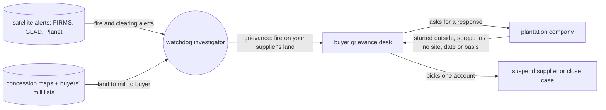
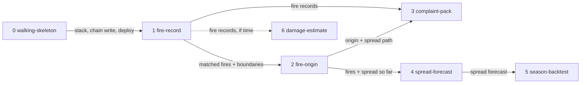

# Fire watch: where it started

**Project type:** web UI · **Status:** Shaped

Entry for the IEEE ClimateChain Global Hackathon, track Climate Data & Environmental
Monitoring. Built solo, most days, until 2026-10-24.

## Problem

Watchdog groups that file grievances over fires on plantation land get pushed back on
attribution: the company says the fire started outside its concession and spread in, or
that the complaint names no specific site, date or basis. The buyer weighing the
grievance has to pick between two accounts of the same fire, while fires keep returning
to the same concessions.

## Today

The watchdog and the company describe the same fire differently, and the buyer has to
choose between them. Sources for each step are in O3 and O4.

## Slices

| # | Slice | What ships | Why this order |
|---|-------|-----------|----------------|
| 0 | walking-skeleton | One page shows one real hotspot on a map; its record is written on-chain and read back; one e2e test; deployed. | Empty repo. Proves the stack, the chain write and the host before anything real. |
| 1 | fire-record | The investigator picks an area and dates and sees fires matched to the concession they fall on. Each match is written on-chain with the map version used, and anyone can check it. | Smallest thing a watchdog can use alone. Builds the matching and chain write that 2, 3 and 6 reuse. |
| 2 | fire-origin | For a fire on or near a concession: where and when it was first seen relative to the boundary, and the order it spread in, worked out from the sealed detections. | Answers the dispute companies actually raise ("started outside, spread in"). Needs slice 1's sealed, matched detections, recorded live since 2026-10-16 (O9). The forecast split out to slice 4 at spec (D23). |
| 3 | complaint-pack | For one fire, a pack with the site, the dates and the basis for attribution (first detection, spread path, map version), plus a public page where anyone checks it against the chain. | Joins 1 and 2 into what the investigator hands to a buyer. The spine of the demo video. |
| 4 | spread-forecast | For a fire near a concession: where it goes next and when it reaches the boundary, sealed before it arrives. | Needs slice 2's fires. After complaint-pack, which needs only origin and spread. Split from fire-origin (D23). A sealed forecast only counts from when it starts running. |
| 5 | season-backtest | Replay the 2023 season: for fires that crossed into a concession, how close the spread forecast's arrival time was to the real one, next to a naive baseline. | The credibility number for judges. Needs slice 4's forecast. |
| 6 | damage-estimate | For a recorded fire, estimate burned area and carbon released. | Covers the economic-impact ask. First to cut if the days run out. |

## Not doing

- **Broad disaster prediction across hazard types.** Devpost has about 611 past "disaster
  prediction" projects, and a forecast gives blockchain no job.
- **Psychological impact prediction.** No data to check a prediction against in 12 days.
- **Risk flags before fires.** The first version of slice 2. No evidence a prior warning
  helps a complaint, and Indonesian courts already apply strict liability (O4).
- **Community air evidence pack.** Overlaps PlanetWatch and generic sensor dashboards.
- **EUDR deforestation-free plot proof.** At least 5 near-identical past projects
  (PlotProof is almost the same idea).
- **Flood relief claim checks.** About 6 close past projects.
- **Detecting fires from raw satellite images ourselves.** NASA FIRMS already publishes
  detections; we filter and confirm them.

## Open items

| ID | What | Type | Raised at | Owner | Status | Answer |
| -- | ---- | ---- | --------- | ----- | ------ | ------ |
| O1 | Eligibility: the overview says "Students only" and excludes companies; the rules page admits independent developers and professionals | question | shape | user | Accepted risk | Going by the rules page, which lists independent developers and professionals as open. The overview tag is unexplained. 2026-10-13 |
| O2 | Submission window: Devpost schedule says 2026-10-05 04:00 UTC to 2026-10-25 14:00 UTC; the rules say not before 8 AM PT on Oct 25, an hour after the deadline. Organizers haven't answered the forum thread | flag | shape | user | Accepted risk | Devpost's deadline is the hard one because the form closes then. Save an editable draft early, finalize by 2026-10-24. 2026-10-13 |
| O3 | Assuming watchdogs today match hotspots to concession maps by hand, and companies dispute complaints on data grounds (false alarm, old map) | assumption | shape | research | Resolved | Partly wrong. Watchdogs run satellite systems: [Mighty Earth](https://mightyearth.org/rapid-response-palm-oil/) monitors 3,500+ concessions, traces them to buyers through public mill lists and files grievances with the buyers. Companies dispute attribution, not data quality: [KLK](https://weirdkaya.com/indonesian-media-claims-msian-sporean-companies-linked-to-fires-in-indonesia/) says the fires "originated outside" its concession; [Wilmar](https://business-humanrights.org/en/latest-news/wilmar-international-group-respond-to-transboundary-hazes-allegation) says the allegation gives no "specific sites, dates or the basis" (both Sept 2026). Fires recur on the same concessions ([Mongabay 2019](https://news.mongabay.com/2019/10/indonesia-forest-fires-palm-oil-pulp-paper-concession-greenpeace/)). Problem rewritten to match |
| O4 | Assuming a public flag made before a fire makes a complaint stronger | assumption | shape | research | Resolved | Not supported. Indonesian courts hold concession holders liable for fires on their land without proof they started them ([2019](https://news.mongabay.com/2019/10/palm-oil-indonesia-arjuna-utama-sawit-musim-mas-forest-fires/), [2023](https://news.mongabay.com/2023/08/indonesian-oil-palm-firm-slapped-with-61m-fine-for-fires-on-its-plantation/)). Singapore's haze law presumes cause from satellite images; the defence is natural cause or third parties ([RSIS](https://rsis.edu.sg/rsis-publication/nts/co15021-singapores-transboundary-haze-pollution-act-silver-bullet-or-silver-lining/)). Nothing found showing a prior warning helps a grievance. Risk flags dropped; slice 2 is fire-origin (D1) |
| O5 | GFW concession maps are good enough to match fires to companies; GFW warns some are missing or misplaced | unproven | shape | fire-record | Handed to fire-record | — |
| O6 | NASA FIRMS free key and archive cover the region and seasons needed; exact endpoints unchecked | unproven | shape | walking-skeleton | Handed to walking-skeleton | — |
| O7 | Region: assuming Indonesia, where public concession maps look densest | assumption | shape | fire-record | Handed to fire-record | — |
| O8 | A fire-risk model built in about 3 days beats a naive baseline on a past season | unproven | shape | — | Resolved | Moot: risk flags dropped (O4) |
| O9 | On-chain timestamps only count going forward: a replay of 2023 cannot carry 2023 timestamps | flag | shape | user | Resolved | Record a live fire before 2026-10-24; fall back to a 2023 replay labelled as a replay. Indonesia had fires in Sept 2026 ([Palm Oil Magazine](https://www.palmoilmagazine.com/hot-news/2026/10/02/84-of-indonesias-september-fire-hotspots-found-in-open-access-areas-expert-says/)), but activity may drop as the rains start |
| O10 | Naming real companies in a public video and repo: a wrong match is a public accusation | flag | shape | user | Resolved | Concession IDs and the source map only. No company names in the demo or the repo |
| O11 | Which idea to build | question | shape | user | Resolved | Fire watch on fire origin and spread, in the climate data track (D1) |
| O12 | A spread forecast built in about 3 days beats a naive baseline (fire moves downwind at its recent speed) on 2023 fires | unproven | shape | poc | Handed to spread-forecast | — |
| O13 | First detection is close enough to the real start to say "started inside" or "started outside". Satellites pass a few times a day and can miss small fires | unproven | shape | poc | Handed to fire-origin | — |

## Glossary

- **Hotspot** — a point where a satellite detected unusual heat, usually a fire.
- **NASA FIRMS** — NASA's free service publishing satellite fire hotspots, live and archived.
- **GLAD, Planet** — other satellite alert and imagery sources watchdogs use.
- **Concession** — land a government has licensed to a company, here for plantations.
- **GFW** — Global Forest Watch, publishes forest and concession maps.
- **Mill list** — the list of palm oil mills a buyer publishes, which links plantations to brands.
- **Grievance desk** — the process big palm oil buyers run to take complaints about their suppliers.
- **Strict liability** — being liable without anyone proving you were at fault.
- **On-chain** — written to a blockchain, so its content and time can't be changed later.
- **Spread forecast** — a prediction of where and when a fire reaches next.
- **Backtest** — running a model over a past period to see how it would have done.
- **Naive baseline** — the simplest possible guess, used to prove a model adds something.
- **Walking skeleton** — the thinnest working path through every layer, deployed, before features.
- **e2e** — one test that drives the product the way a user does, end to end.
