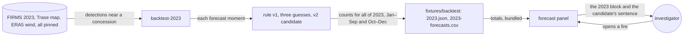

# Forecast v2

**Version:** v1 · **Status:** Draft · **Type:** Enhancement · **Project type:** Web UI

**Shape doc:** docs/specs/judge-review/shape.md
**Depends on:** fair-baseline

Rule version 1 stays. The 2023 replay adds the rule version 2 candidate that missed its bar on
months it was not picked on, and the forecast panel says so in one sentence (O1, O5).

## Problem

In the 2023 replay, 3,751 of rule version 1's 3,874 warnings did not come in. The near-edge step
alone, which is part of the rule, did better on that count: 3,193 of 3,310. Rule version 1's
advance step warned of 6 more arrivals and added 558 warnings that didn't come in (D100).

A company can say the forecast is no better than a plain guess, and the page's own numbers support
it. An investigator who watches each warned fire makes about 30 wasted watches for each one that
comes in.

| 2023, replayed | Arrivals warned of, of 135 | Warnings that didn't come in | CSI |
| -------------- | -------------------------- | ---------------------------- | --- |
| Rule version 1 | 123 | 3,751 of 3,874 | 3.2% |
| Near-edge step | 117 | 3,193 of 3,310 | 3.5% |
| Downwind guess | 20 | 264 of 284 | 5.0% |
| Next-pass guess | 135 | 19,860 of 19,995 | 0.7% |

D101 left the bar for a rule version 2 to this slice. Rule version 1 was chosen on the week it was
first measured on (D48). A rule version 2 chosen on 2023 and judged on 2023 has the same weakness.

The O1 spike tried for a rule version 2 on 23 Oct 2026. It picked one candidate on forecasts made
January to September 2023 and judged it once on October to December (O4). The candidate missed the
bar (O3) by 2 arrivals:

| 2023, replayed | Jan–Sep, picked on: arrivals warned of | Didn't come in | Oct–Dec, judged on: arrivals warned of | Didn't come in |
| -------------- | -------------------------------------- | -------------- | -------------------------------------- | -------------- |
| Rule version 2 candidate | 52 of 56 | 1,871 of 1,923 | 63 of 79 | 1,022 of 1,085 |
| Near-edge step | 52 of 56 | 2,091 of 2,143 | 65 of 79 | 1,102 of 1,167 |
| Rule version 1 | 53 of 56 | 2,395 of 2,448 | 70 of 79 | 1,356 of 1,426 |

The candidate is the near-edge step, except that a lone detection gets no warning. A lone
detection is the only detection within 5 km of the concession in the 48 hours to its pass. Both
arrivals that it missed came from lone detections: ID-WOOD-CONCESSION-0273's on 2023-10-23 17:19
UTC and ID-WOOD-CONCESSION-0349's on 2023-11-02 04:50 UTC.

## Slice test

| Check                         | Result |
| ----------------------------- | ------ |
| Cuts every layer it needs     | yes: the `backtest-2023` command (`api/`), its committed totals and CSV (`fixtures/backtest`), and the forecast panel (`web/`). The recorder, the API, the schema and the chain don't change |
| One e2e test walks it         | yes: season-backtest's e2e runs the command on the cut and checks the candidate's column on the 0263, 0332 and 0264 rows. It then opens the 0332 fire and reads the new sentence and the candidate under "How this is worked out" |
| Worth shipping alone          | yes: a reader sees that rule version 1 stays after a fair attempt to beat its near-edge step, with the numbers from months the attempt was not picked on |
| Fits (≤5 scenarios, ≤2 areas) | yes: 4 scenarios; two areas: the replay (`api/`, `fixtures/`) and the forecast panel (`web/`) |

**Path:** full. It adds a method to the replay, new CSV columns and totals, and copy on the panel.

## User story

As a watchdog investigator, I want to see that a better forecast rule was tried, and how it did on
months it was not picked on, so that I can tell a buyer why the forecast still uses rule version 1.

## Flow



The replay times the candidate at every moment the recorder would have forecast. It splits the
counts at 1 October. The panel bundles the totals and says in one sentence that the candidate missed
the bar.

## Acceptance criteria

```gherkin
Scenario: The replay judges the candidate on months it was not picked on
  Given the pinned 2023 FIRMS file, the Trase map and the pinned wind
  When anyone runs backtest-2023
  Then it times the rule version 2 candidate at the same 20,277 forecast moments as rule version 1
  And on forecasts made January to September the candidate warned of 52 of 56 arrivals,
    and 1,871 of its 1,923 warnings did not come in
  And on October to December it warned of 63 of 79, and 1,022 of its 1,085 did not come in
  And there the near-edge step warned of 65 of 79, and 1,102 of its 1,167 did not come in
  And the totals say that the candidate missed the bar

Scenario: The candidate gives no warning for a lone detection
  Given the ID-WOOD-CONCESSION-0273 fire's 2023-10-23 17:19 UTC pass, inside the edge and within
    375 m of it
  And no other detection within 5 km of the concession in the 48 hours to that pass
  When the replay runs the candidate
  Then it says "Not forecast to be seen inside"
  And a pass saw the fire inside within 48 hours, which the near-edge step warned of

Scenario: The forecast panel says the candidate missed the bar
  Given the committed 2023 result
  When anyone opens the ID-WOOD-CONCESSION-0332 fire of spread-forecast scenario 1
  Then the 2023 block keeps its four rows and its sentence about rule version 1's advance step
  And one more sentence says that one rule version 2 was tried: picked on January to September,
    it warned of 63 of October to December's 79 arrivals against the near-edge step's 65, so rule
    version 1 stays
  And "How this is worked out" gives the candidate in full, and says it was picked from more than
    3,400 variants tried on January to September only
  And it gives both parts' counts for the candidate, the near-edge step and rule version 1
  And it links the candidate's time for every 2023 forecast, in the CSV

Scenario: Anyone redoes the replay and gets the same result
  Given a fresh checkout, the pinned FIRMS file, the pinned Trase map and the pinned wind
  When anyone runs backtest-2023
  Then it writes the same totals and CSV, with the candidate's column, byte for byte as the committed ones
```

The numbers in scenarios 1 to 3 come from the O1 spike. Its replay matched the committed totals
exactly. Scenario 3's sentence takes its counts from the committed totals, as D100's does. The
3,400 variants are the spike's record, in O1; the command does not redo the search.

## Scope

**In:**

- The rule version 2 candidate, written out in `backtest.py` as O1 defines it, and timed at every
  2023 forecast moment.
- Counts for all of 2023, for forecasts made January to September, and for those made October to
  December. The split is by the time each forecast was made.
- `2023.json` gains the candidate's totals and each part's counts. `2023-forecasts.csv` gains a
  column for the candidate's time.
- One sentence in the 2023 block, worked out from the totals, says the candidate missed the bar and
  rule version 1 stays (O5).
- "How this is worked out" gives the candidate in full, how it was picked, and both parts' counts
  for the candidate, the near-edge step and rule version 1 (O4).
- `backtest-2023` redoes it all byte for byte from the pinned inputs.

**Out:**

- Shipping the candidate: it missed the bar (O1, O3).
- A second candidate judged on October to December: it spends the hold-out (O4).
- A change to the recorder, the API, the schema or the seals: not planned.
- A fifth row in the 2023 block: not planned. One sentence carries the candidate (O5).
- Wind, rain or any input the chain doesn't seal: not planned (D48).
- Another year's replay: not planned (D52).
- A change to the complaint pack: not planned (D43).

## Open items

| ID | What | Type | Raised at | Owner | Status | Answer |
| -- | ---- | ---- | --------- | ----- | ------ | ------ |
| O1 | A rule version 2 can beat the near-edge baseline on 2023 (from shape O11) | unproven | shape | spike | Resolved | 2026-10-23, measured: no. The candidate, picked on January to September, warned of 63 of October to December's 79 arrivals; the near-edge step warned of 65. It had 1,022 warnings that didn't come in there, against 1,102. Method: the replay ran `backtest.replay()` unchanged and matched the committed totals. On forecasts made before 1 Oct only, it tried 17 hand-written rules and 2,482 one-step exclusions from the near-edge step over 13 features: passes, detections, FRP, spread, age, depth inside, detections inside, and activity near the concession. The best that lost no arrival is the candidate: the near-edge step, but no warning when the newest pass's first detection is the only detection matched to the concession acquired in the 48 hours up to and including its time. Further steps (944 second, about as many third) only trimmed 2023's own extremes, such as 375 m to 337 m, and were rejected. The advance step was dropped: on January to September it added 1 arrival for 304 false warnings. The candidate was then judged once on October to December. Its two missed arrivals: ID-WOOD-CONCESSION-0273's pass of 2023-10-23 17:19 UTC and ID-WOOD-CONCESSION-0349's of 2023-11-02 04:50 UTC, both lone detections |
| O2 | Two days remain to the 2026-10-25 deadline, and the video and written deliverables are not done. A rule version 2 also changes the live recorder, which the operator repoints by hand (D21) | flag | spec p1 | user | Resolved | 2026-10-23: go ahead, spike first, up to 2 hours. When nothing clears the bar, stop there and O5 applies |
| O3 | What bar a rule version 2 must clear to replace version 1 (D101) | question | spec p1 | user | Resolved | 2026-10-23: beat the near-edge step. Warn of at least as many arrivals, with fewer warnings that didn't come in. Rule version 1 fails this bar |
| O4 | How a rule version 2 is kept from being picked on the same forecasts that judge it | question | spec p1 | user | Resolved | 2026-10-23: pick it on forecasts made January to September 2023, 56 arrivals. Judge it once on October to December, 79 arrivals. The page gives both parts |
| O5 | What ships when no candidate clears the bar | question | spec p1 | user | Resolved | 2026-10-23: the recorder keeps rule version 1. The panel says in one sentence how many rules were tried and that none cleared the bar, and links their scores |
| O6 | What the 2023 block shows on a forecast once two rule versions exist | question | spec p1 | user | Resolved | 2026-10-23: every forecast's block lists rule version 2, rule version 1 and the three guesses, and names the rule that made it. Not used while no rule version 2 ships (O1) |

_Never delete this section or its rows. See references/ledger.md._

## Glossary

- **Arrival**: a forecast moment after which a pass saw the fire inside within 48 hours.
- **Warning**: a forecast that the fire is seen inside.
- **Near-edge step**: rule version 1 step 5 alone: a fire at most 375 m from the edge is forecast
  to be seen inside 12 hours after its newest pass.
- **Bar**: the result on 2023 that a rule version 2 must reach to replace version 1.
- **Candidate**: the one rule version 2 the spike picked and judged.
- **Lone detection**: the only detection within 5 km of a concession in the 48 hours to its pass.
- **Hold-out**: forecasts kept aside while a rule is picked, then used once to judge it.
- **CSI**: critical success index: arrivals warned of, divided by arrivals plus warnings that didn't
  come in.
- **FRP**: fire radiative power, the heat FIRMS measures in a detection, in megawatts.
- **Spike**: a short, throwaway test that answers one question before the plan relies on it.
- **e2e**: end-to-end: one test that walks the whole slice as a user would.
