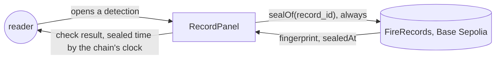
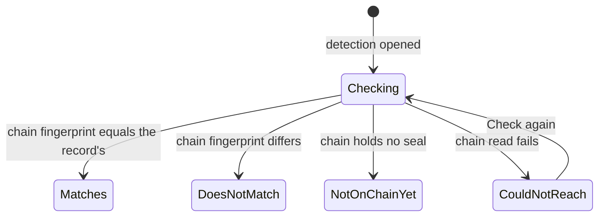
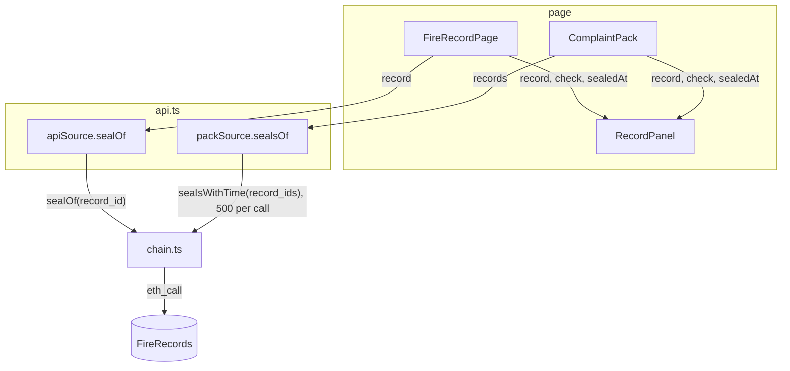
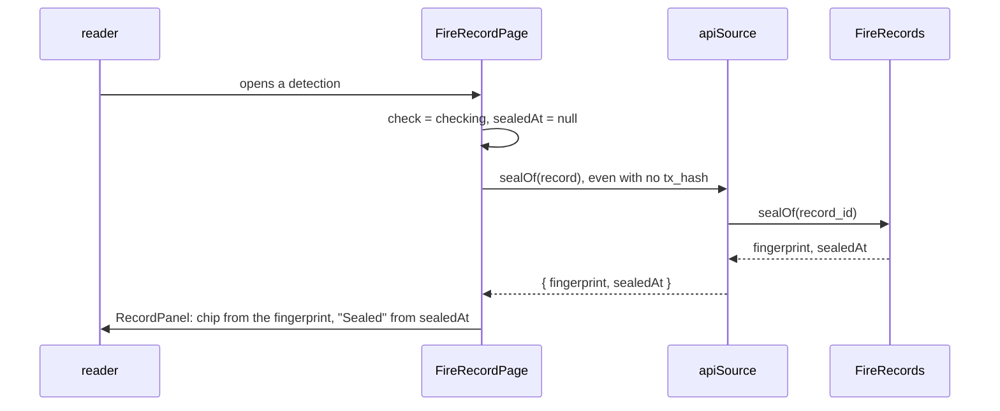
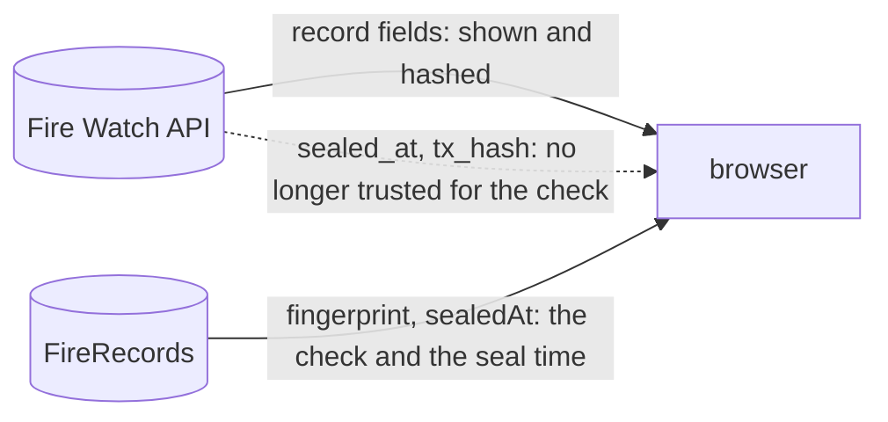

# honest-claims

**Version:** v1 · **Status:** Built · **Type:** Enhancement · **Project type:** Web UI

**Shape doc:** docs/specs/judge-review/shape.md
**Depends on:** None

Each detection's seal time comes from the chain, and the page reads the chain even when the API
says a record is unsealed. Six lines of copy stop claiming more than the chain or the data show.

## Problem

The judge review on 2026-10-22 found claims on the page that only Fire Watch's server stands
behind. A company can point at any one of them to cast doubt on a whole pack.

- A detection's "Sealed" time is the API's `sealed_at` (`web/src/RecordPanel.tsx:113`). The page
  reads only the fingerprint from the chain (`web/src/api.ts:188`).
- The tool reads the chain only when the API sends a `tx_hash` (`web/src/FireRecordPage.tsx:170`).
  Without one, it shows "Not on chain yet" and never asks the chain.
- The landing's heading says "Show where a plantation fire started" (`web/src/Landing.tsx:43`).
  D26 says the page says "first seen", never "started".
- The concession list says "Recording started 2026-10-12" (`web/src/ConcessionList.tsx:64`). That
  date is the earliest stored detection, from the 5-day backfill. The first seal was on
  16 Oct 2026 at 02:37 UTC.
- The fire view and the pack say "Recording had started 1 hour before this fire was first seen"
  (`web/src/FireView.tsx:166`, `web/src/ComplaintPack.tsx:442`), on the same wrong basis.
- The pack says "It never changes" (`web/src/ComplaintPack.tsx:393`), and the fire view says "The
  pack never changes" (`web/src/FireView.tsx:213`). The API picks the pack's rows again on each
  open, so nothing proves that.
- The forecast panel says each forecast is sealed "in the run that makes it"
  (`web/src/ForecastPanel.tsx:117`, `:239`). The recorder stops sealing at its 40-minute deadline
  (`api/src/firewatch/record_hotspots.py:239`), so a forecast can be sealed in a later run.

## Slice test

| Check                         | Result                                                                            |
| ----------------------------- | --------------------------------------------------------------------------------- |
| Cuts every layer it needs     | yes — the page and its chain reads; the API and the recorder don't change          |
| One e2e test walks it         | yes — open 0332's pack on the e2e anvil, open a detection, read its seal and copy |
| Worth shipping alone          | yes — a buyer sees no claim that the chain or the data doesn't support            |
| Fits (≤5 scenarios, ≤2 areas) | yes — 5 scenarios, one area: the page                                             |

**Path:** full — it changes how the page checks a record, across more than three files.

## User story

As a buyer reading a complaint pack, I want each claim to rest on the chain or say plainly what it
rests on, so that one overclaim can't discredit the pack.

## Flow



The reader opens a detection, the page always asks the chain for its seal, and the page shows the
chain's verdict and the chain's seal time.

## States



Today the page goes straight to "Not on chain yet" when the API sends no `tx_hash`. After
this slice, only the chain decides each state.

## Acceptance criteria

```gherkin
Scenario: A detection's seal time comes from the chain
  Given the first detection of 0332's fire, seen 12 Oct 2026 at 05:16 UTC
  And Base Sepolia sealed it at 16 Oct 2026 02:37:38 UTC
  And the API sends 17 Oct 2026 00:00 UTC as its sealed_at
  When the reader opens it in the tool, or in the fire's complaint pack
  Then "Sealed" shows 2026-10-16 02:37 UTC and its gap after detection

Scenario: The page asks the chain even when the API says a detection is unsealed
  Given the API sends a detection of 0332's fire with no tx_hash
  And Base Sepolia holds a seal for its record ID that matches its fingerprint
  When the reader opens it in the tool
  Then it reads "Matches the chain", with the chain's seal time
  And "Not on chain yet" shows only when the chain holds no seal for that record ID

Scenario: The chain can't be reached
  Given Base Sepolia doesn't answer
  When the reader opens a detection of 0332's fire
  Then the panel reads "Couldn't reach Base Sepolia to check this record." with Check again
  And no "Sealed" row shows

Scenario Outline: The page claims only what it can show
  Given Fire Watch's earliest stored detection is from 12 Oct 2026, an hour before 0332's fire was first seen
  When the reader opens <place>
  Then it reads <new>
  And it doesn't read <old>

  Examples:
    | place | old | new |
    | the landing | "Show where a plantation fire started, on records anyone can check." | "Show where satellites first saw a plantation fire, on records anyone can check." |
    | the tool's concession list | "Recording started 2026-10-12." | "Detections from 2026-10-12." |
    | 0332's fire view and its pack | "Recording had started 1 hour before this fire was first seen" | "Fire Watch's records begin 1 hour before this fire was first seen" |
    | a fire's forecast panel | "Each forecast is sealed in the run that makes it" | "Each forecast is sealed in the run that makes it, or a later run if that one runs out of time" |
    | a forecast not sealed yet | "The recorder seals each forecast in the run that makes it." | "The recorder seals each forecast in the run that makes it, or a later one." |

Scenario: A pack says who chose its records
  Given the complaint pack of 0332's fire, cut at 17 Oct 2026 09:00 UTC
  When the reader opens it
  Then the check note says that Fire Watch's server chose which records to send
  And it says that NASA FIRMS's public archive shows whether one is missing
  And neither the pack nor the fire view's Make complaint pack note says the pack never changes
```

## Scope

**In:**

- The seal time of a detection, read from the chain, in the tool's record panel and in the pack.
- The tool always reads the chain for an opened detection.
- The six lines of copy in the scenarios.

**Out:**

- Proof that a pack's list of records is complete — complete-packs.
- A weak first sighting, satellite position error and boundary accuracy — origin-confidence.
- How good the forecast is — fair-baseline.
- The landing's sentence on when 0332's passes were sealed (`web/src/RealCase.tsx:21`). It matches
  the chain already: the first detection's seal is 16 Oct 2026 02:37:38 UTC.
- A forecast's outcome, checked again in the browser — no slice yet.

## Interface

No layout, token, component or motion changes. The slice changes one row's source and the
wording below, so no preview was built: each string is fixed here and in the scenarios. The design
system's two craft checks have nothing new to judge.

**Motion tier:** 0 — nothing new moves. The check chip keeps its existing `enter`.

**Components used:** `RecordPanel`, `Chip`, `fw-kv`, `fw-help` — all existing.

**Preview:** none. After `/build`, `/?preview=complaint-pack` and `/?preview=fire-origin` show the
new copy on fixtures.

### The "Sealed" row of a detection

| Chain answer | Chip | "Sealed" row |
| --- | --- | --- |
| not yet | Checking | left out |
| fingerprint equals the record's | Matches the chain | the chain's time, then the gap after detection |
| fingerprint differs | Does not match | the chain's time of the seal it holds, then the gap |
| no seal | Not on chain yet | left out |
| read failed | none: "Couldn't reach Base Sepolia to check this record." and Check again | left out |

The row appears when the chain answers, as the chip and the note already change then.

### Copy

| Where | Today | After |
| --- | --- | --- |
| `Landing.tsx:43`, heading | Show where a plantation fire started, on records anyone can check. | Show where satellites first saw a plantation fire, on records anyone can check. |
| `ConcessionList.tsx:64` | Recording started 2026-10-12. | Detections from 2026-10-12. |
| `FireView.tsx:166`, `ComplaintPack.tsx:442` | Recording had started 1 hour before this fire was first seen, so it may have been burning earlier. | Fire Watch's records begin 1 hour before this fire was first seen, so it may have been burning earlier. |
| `FireView.tsx:213`, Make complaint pack note | Opens this fire as it stands now on a page with its own link, to put in a grievance. The pack never changes, and anyone with the link can check it against the chain. | Opens this fire as it stands now on a page with its own link, to put in a grievance. Anyone with the link can check each record against the chain. |
| `ComplaintPack.tsx:216`, check note | Your browser worked out each detection's fingerprint and read its seal from FireRecords on Base Sepolia, a test network. Fire Watch's server only sent the records. | Your browser worked out each detection's fingerprint and read its seal from FireRecords on Base Sepolia, a test network. Fire Watch's server chose which records to send. NASA FIRMS's public archive shows whether one is missing. |
| `ComplaintPack.tsx:393`, footer | This pack holds every detection of this fire that Fire Watch had stored by 17 Oct 2026 09:00 UTC. It never changes, so passes after that are not in it. | This pack holds every detection of this fire that Fire Watch had stored by 17 Oct 2026 09:00 UTC. Passes after that are not in it. |
| `ForecastPanel.tsx:117`, a forecast not sealed yet | Not on the chain yet. The recorder seals each forecast in the run that makes it. | Not on the chain yet. The recorder seals each forecast in the run that makes it, or a later one. |
| `ForecastPanel.tsx:239` | Each forecast is sealed in the run that makes it, and every one stays listed here, right or wrong. | Each forecast is sealed in the run that makes it, or a later run if that one runs out of time. Every one stays listed here, right or wrong. |

Under an hour, the records line keeps today's "less than an hour".

## Technical plan

### Approach

The page already reads each seal's time from the chain: `sealOf` and `sealsWithTime` return
`sealedAt` (`web/src/chain.ts:19`, `:35`). The two sources drop it (`web/src/api.ts:188`,
`:200`). The plan keeps that time beside each check, as forecast checks already do, and shows it
in `RecordPanel` in place of the API's `sealed_at`. The tool stops using `tx_hash` to decide
whether to read the chain. The copy changes are string edits.

Relies on: D7, D24, D26, D37, D38, and D97 and D98, drafted below.



`FireRecordPage` and `ComplaintPack` ask their source for seals. Each source now returns the
fingerprint and the chain's time, and both reach `RecordPanel`.





After this slice, the API supplies the record and the chain supplies everything about its seal.
`tx_hash` stays only as the Basescan link, which the reader can follow to the chain.

### Changes

| File | What changes | Why |
| --- | --- | --- |
| `web/src/api.ts:188` | `apiSource.sealOf` returns `{ fingerprint, sealedAt }`, with `sealedAt` as a number, as `forecastSeals` does at `:190` | Scenarios 1, 2 |
| `web/src/api.ts:200` | `packSource.sealsOf` reads `sealsWithTime` and returns `{ fingerprint, sealedAt }[]` | Scenario 1 |
| `web/src/FireRecordPage.tsx:21` | `FireRecordSource.sealOf` takes the new return type | Scenario 1 |
| `web/src/FireRecordPage.tsx:170` | The read no longer waits for `tx_hash`. The check comes from `checkOf`, and the page keeps `sealedAt` beside it | Scenarios 1, 2 |
| `web/src/FireRecordPage.tsx:300` | `check={check}`, without the `tx_hash` test, and the new `sealedAt` prop | Scenario 2 |
| `web/src/RecordPanel.tsx:80`, `:113` | A `sealedAt: number \| null` prop. The "Sealed" row shows only when it is set: `detected(sealedAt)` and `gap(record.acquired_unix, ISO of sealedAt)` | Scenarios 1, 3 |
| `web/src/ComplaintPack.tsx:17`, `:96`, `:373` | `PackSource.sealsOf` takes the new type. The pack keeps each record's time beside its check and passes it to `RecordPanel` | Scenario 1 |
| `web/src/ComplaintPack.tsx:216`, `:393`, `:442` | Copy, as the Interface table says | Scenarios 4, 5 |
| `web/src/FireView.tsx:166`, `:213` | Copy | Scenarios 4, 5 |
| `web/src/Landing.tsx:43` | Heading | Scenario 4 |
| `web/src/ConcessionList.tsx:64` | Copy | Scenario 4 |
| `web/src/ForecastPanel.tsx:117`, `:239` | Copy | Scenario 4 |
| `web/src/preview/FireOriginPreview.tsx:106`, `SpreadForecastPreview.tsx:210`, `ComplaintPackPreview.tsx:75`, `DamageEstimatePreview.tsx:128` | Fake sources return a seal time with each fingerprint | The type change |

A time of zero from the chain means no seal, so `sealedAt` is `null` then.

Reusing: `sealsWithTime` and `sealOf` in `chain.ts`, which already return the time; `checkOf` in
`RecordPanel.tsx:42`; the `{ check, sealedAt }` pair that forecast checks use
(`FireRecordPage.tsx:150`); and `gap` with an ISO string, as `ForecastPanel.tsx:102` calls it.

### Earn-it

| Added | Triggered by |
| --- | --- |
| `sealedAt` prop on `RecordPanel` | Scenario 1: the time must come from the chain, and the panel has no chain access of its own |

Nothing else is new. The API, the recorder, the contract and the database don't change.

### Non-functionals

|                      |                                                                               |
| -------------------- | ----------------------------------------------------------------------------- |
| **Load**             | No new reads for a sealed record: the same `eth_call` already returned the time. An opened detection with no `tx_hash` now costs one `eth_call`; the recorder seals within the hour, so these are rare. |
| **Breaks first**     | The public RPC's rate limit, as today. The pack still reads 500 seals per call (D38). |
| **Security surface** | No new caller or input. The page trusts the chain over the API for the check and the seal time (D97). No secrets. Nothing stored. |
| **Proof it works**   | The page has no server log. After deploy, open 0332's pack and its first detection: "Sealed" reads 16 Oct 2026 02:37 UTC, the block time on Basescan. The e2e proves it on every push. |
| **Rollout**          | No flag, as with the landing (D81). Deploy ships the page on the merge to main. Rollback: `git revert` the merge, and Deploy ships the old page. |

### Test plan

| Scenario | Test | Command |
| --- | --- | --- |
| 1 · seal time from the chain | `RecordPanel.test.tsx`: the row reads `sealedAt`, not `sealed_at`. `FireRecordPage.test.tsx` and `ComplaintPack.test.tsx`: the API sends 17 Oct 00:00, the fake chain sends 16 Oct 02:37:38, and the page shows 16 Oct 02:37. `api.test.ts`: both sources pass the time through | `cd web && pnpm test` |
| 2 · chain read without `tx_hash` | `FireRecordPage.test.tsx`: no `tx_hash` and a matching seal reads "Matches the chain"; a zero seal reads "Not on chain yet". `e2e/fire-record.spec.ts`: set one hotspot's `tx_hash` to NULL in the e2e database, open it, and read "Matches the chain" | `cd web && pnpm test`; `cd web && pnpm e2e` |
| 3 · chain unreachable | `FireRecordPage.test.tsx` and `RecordPanel.test.tsx`: a failed read shows the error and Check again, with no "Sealed" row | `cd web && pnpm test` |
| 4 · copy | `Landing.test.tsx`, `FireRecordPage.test.tsx:242`, `FireView.test.tsx`, `ComplaintPack.test.tsx`, `ForecastPanel.test.tsx` take the new strings. `e2e/landing-page.spec.ts` reads the new heading | `cd web && pnpm test`; `cd web && pnpm e2e` |
| 5 · who chose the records | `ComplaintPack.test.tsx` and `FireView.test.tsx`: the new notes, and no "never changes" | `cd web && pnpm test` |

**E2E:** a new test in `web/e2e/complaint-pack.spec.ts`. It makes 0332's pack, sets the API's
`sealed_at` of its first detection to 17 Oct 2026 00:00 UTC, and opens the pack as a buyer. Then
it opens that detection. It reads the chain's seal time, the "chose which records to send" note,
and a footer with no "never changes". It restores the row after. The e2e needs `docker compose up
-d --wait db` and `~/.foundry/bin` on PATH.

### Chunks

Single chunk. The type change runs through both sources, both pages, `RecordPanel` and four
previews, so splitting it would share files.

### Risks

| Risk | Mitigation |
| --- | --- |
| A test pins an old string that this plan missed, and CI fails | `grep` for each old string in `web/src` and `web/e2e` before the commit. The list in Test plan came from that grep. |
| The public RPC is slow, so the "Sealed" row arrives late in the tool | It arrives with the chip, as the check already does. Scenario 3 covers a read that fails. |
| The e2e's change to `sealed_at` leaks into a later test | The test restores the row in a `finally`, as `complaint-pack.spec.ts:145` does with `CHANGED`. |

### Decisions to record

Recorded as D97, D98.

## Open items

| ID | What | Type | Raised at | Owner | Status | Answer |
| -- | ---- | ---- | --------- | ----- | ------ | ------ |
| O1 | What does the landing's heading say in place of "started"? | question | spec p1 | user | Resolved | "Show where satellites first saw a plantation fire, on records anyone can check." It matches the tool's "where the satellite first saw it". 2026-10-22 |
| O2 | Does the pack say now that Fire Watch's server chose its records, or wait for complete-packs? | question | spec p1 | user | Resolved | Say it now, with FIRMS's public archive as the way to find a missing record (D24). complete-packs changes the line again. 2026-10-22 |
| O3 | When the chain can't be reached, what does the "Sealed" row show? | question | spec p1 | user | Resolved | Nothing: the row is left out until the chain answers. 2026-10-22 |
| O4 | What does the concession list say in place of "Recording started"? | question | spec p1 | user | Resolved | "Detections from 2026-10-12." No new data from the API. 2026-10-22 |
| O5 | Scenario 1 said `Then "Sealed" shows 16 Oct 2026 02:37 UTC and its gap after detection`. The "Sealed" row writes every time as `2026-10-16 02:37 UTC`, and the Interface changes no format. | flag | build | user | Decided alone | Chose: keep the row's format, and write scenario 1 as `2026-10-16 02:37 UTC`. Other: write the seal time as "16 Oct 2026 02:37 UTC", unlike "Detected" beside it. Undo: put back the old scenario 1, and change `detected(sealedAt)` in `web/src/RecordPanel.tsx`. 2026-10-22 |
| O6 | The plan didn't name `web/src/preview/fixture.ts`. The four preview fakes each need a record's seal and time. | flag | build | user | Decided alone | Chose: add `chainSeal` to `fixture.ts`, which returns the fingerprint and `sealed_at` as the fake chain's time, or zeros for an unsealed record. All four previews use it. Other: the same three lines in each preview. Undo: inline `chainSeal` in each preview; part of commit `ac51477`. 2026-10-22 |

_Never delete this section or its rows. See references/ledger.md._

## Glossary

- **Seal** — a record's fingerprint, written once on the blockchain, with the block's time.
- **Base Sepolia** — the free test blockchain that holds Fire Watch's seals.
- **Record ID** — the random 32-byte key that a detection's seal is stored under (D9).
- **Backfill** — the recorder's first run, which took the 5 days of detections that FIRMS offers.
- **e2e** — end-to-end: one test that walks the whole slice as a user would.
- **Anvil** — a local blockchain the tests run against.
