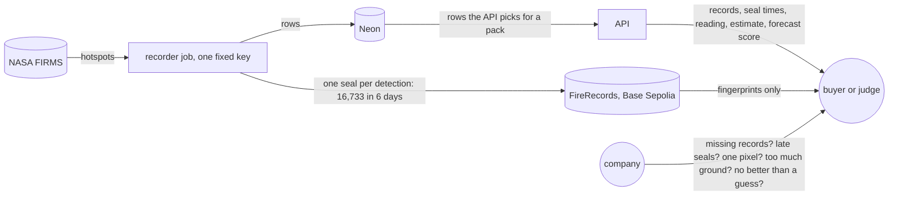
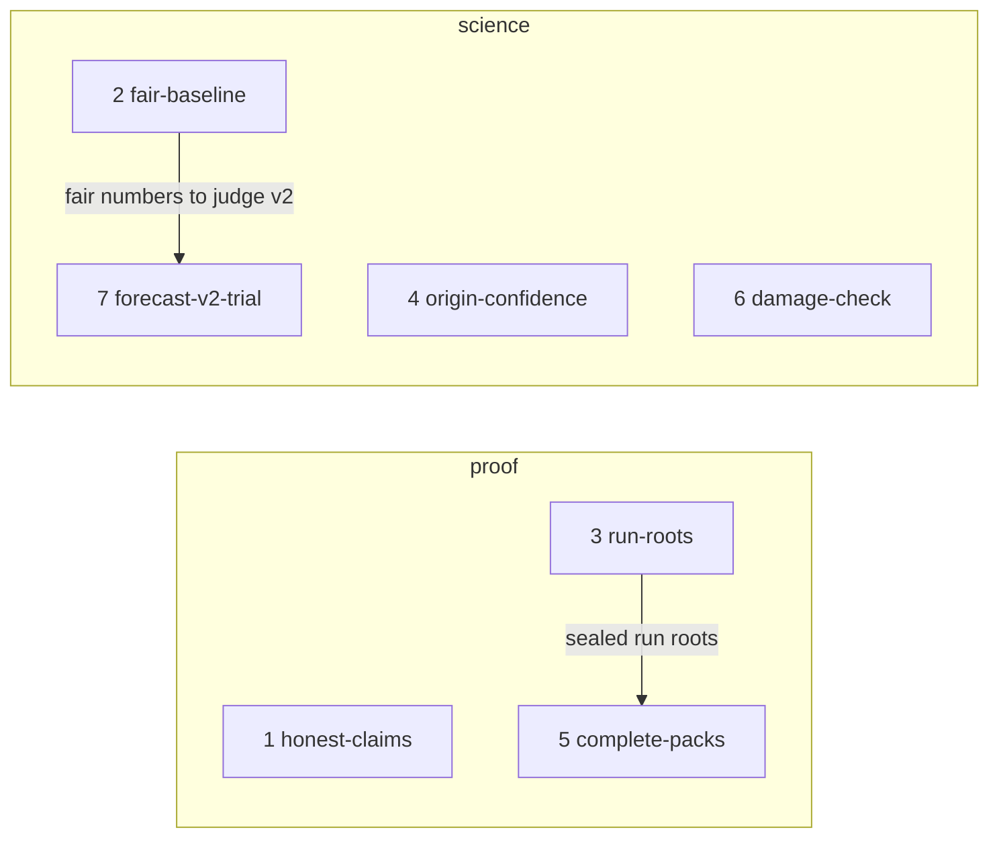

# Judge review fixes

**Project type:** web UI · **Status:** Shaped

## Problem

A company or a judge can pick holes in five things Fire Watch shows: pack contents, seal times,
first sightings, burned area and forecast skill. Recording also costs one transaction per
detection from one fixed key, which will not scale or survive a leaked key.

## Today

Only Fire Watch's own server stands behind five of the claims the buyer sees. A judge-style review
on 2026-10-22 found each hole:

- A pack's link names only the concession, the fire and a time (`web/src/api.ts:171`). The API
  picks the rows again on each open, so a deleted detection still reads "N of N match".
- A detection's seal time comes from the API (`web/src/RecordPanel.tsx:113`). The page keeps
  only the fingerprint from the chain (`web/src/api.ts:188`).
- The landing says "Show where a plantation fire started" (`web/src/Landing.tsx:43`). D26 says the
  page says "first seen", never "started".
- "Recording had started" is the earliest stored detection (`api/src/firewatch/fires.py:48`). That
  is the start of the 5-day backfill, not the day recording began.
- 0332's first sighting is one nominal-confidence pixel, 3.1 km outside. The next detection is
  25.35 hours later.
- In 2023, 3,751 of rule version 1's 3,874 warnings did not come in. All 293 downwind yeses are
  also rule yeses.
- `FireRecords` has an `immutable recorder`, and each seal is its own transaction (D19).

## Slices

| # | Slice | What ships | Why this order |
|---|-------|-----------|----------------|
| 1 | honest-claims | Each detection shows its seal time as read from the chain. The landing says "first seen", not "started". The fire view and the pack say when recording began. Forecasts stop promising a seal in the same run. | Smallest. It closes the holes a re-review finds first, with no new data or contract. |
| 2 | fair-baseline | The 2023 replay adds two baselines: the near-edge step alone, and a fixed-lead guess. The forecast panel shows the false-alarm rate of each. | Science, after a proof slice. It is small, and forecast-v2 needs it as the judge. It supersedes D51 if its spec agrees (O8). |
| 3 | run-roots | The recorder seals one Merkle root per run, on a new contract whose recorder key can be replaced. The browser checks each new detection's proof against its run's root. Old seals still check on FireRecords. | One transaction per run instead of one per detection, and a way out for a leaked key. complete-packs needs it. It supersedes D19 if its spec agrees (O6, O12). |
| 4 | origin-confidence | The fire view and the pack flag a weak first sighting, such as one low-confidence pixel and then a long gap. They name VIIRS position error, Trase boundary accuracy and fire merging. | Science again. It can change the landing's example fire (O9). |
| 5 | complete-packs | A pack proves that no stored detection of its fire was left out, against the sealed run roots in its window. | It closes the review's worst hole. It needs run-roots. It supersedes D24 if its spec agrees (O7). |
| 6 | damage-check | The estimate's method shows how the joined-squares area compares with MODIS burned area for 2023. If the gap is real, the estimate is corrected. | It starts with a spike (O10), so it goes after the slices whose work is known. |
| 7 | forecast-v2-trial | A rule version 2 replaces version 1 for new forecasts, but only if a spike shows it beats slice 2's baselines on 2023. | It depends on a spike (O11), and fair-baseline's numbers judge it. |

## Not doing

- **The written deliverables.** The video, the security and impact assessments, the adoption
  strategy, the roadmap, the problem statement, and README and LICENSE polish. They are documents,
  not slices. They are written after the slices they describe ship (O2).
- **Base mainnet.** The hackathon allows a test network, and the roadmap write-up names the move
  (O13).
- **User testing.** No watchdog or buyer has seen Fire Watch, and that risk is accepted (O3).
- **Taking the forecast off the page.** It is measured fairly first, then a version 2 is tried (O5).
- **Sealing derived readings,** such as a first sighting or an estimate. D24's reason still holds: a
  reading changes as a fire grows, so it would need sealing again.

## Open items

| ID | What | Type | Raised at | Owner | Status | Answer |
| -- | ---- | ---- | --------- | ----- | ------ | ------ |
| O1 | What is this round of improvements for? | question | shape | user | Resolved | Both, equally: hold up for real use, and score higher with judges. 2026-10-22 |
| O2 | Do the written deliverables belong in this shape? | question | shape | user | Resolved | No. They are documents, written separately after the slices they describe ship. 2026-10-22 |
| O3 | No watchdog or buyer has seen Fire Watch, so "user testing results" can't be written honestly | flag | shape | user | Accepted risk | Go ahead on the public record of disputes (fire-watch shape O3, O4). The write-ups say that no user has tested it. 2026-10-22 |
| O4 | How would we know this round worked? | question | shape | user | Resolved | Both: the same hostile review, run again, finds no claim that the chain or the data doesn't support, and the rubric score reaches 8/10. 2026-10-22 |
| O5 | What do we do about a forecast whose 2023 warnings were 97% false (3,751 of 3,874)? | question | shape | user | Resolved | Measure it against fair baselines first (fair-baseline), then spike a rule version 2 (forecast-v2). 2026-10-22 |
| O6 | run-roots supersedes D19, which rejected a batch-seal contract, and splits old and new seals across two contracts | flag | shape | run-roots | Handed to run-roots | — |
| O7 | complete-packs supersedes D24's rejection of sealing each run's record list | flag | shape | complete-packs | Handed to complete-packs | — |
| O8 | fair-baseline supersedes D51's rejection of the near-edge step as a baseline | flag | shape | fair-baseline | Handed to fair-baseline | — |
| O9 | A stricter origin rule may stop calling 0332's fire "first seen outside", and the landing is built on it (D78, D84) | unproven | shape | origin-confidence | Handed to origin-confidence | — |
| O10 | Joined 375 m squares overstate burned ground. A rough union gave about 2.5 Mha for 2023, against the ministry's 1.16 Mha; nobody has checked it | unproven | shape | damage-check | Handed to damage-check | — |
| O11 | A rule version 2 can beat the near-edge baseline on 2023 | unproven | shape | forecast-v2-trial | Handed to forecast-v2-trial | — |
| O12 | Who holds the power to replace the recorder key on the new contract? | question | shape | run-roots | Handed to run-roots | — |
| O13 | Base Sepolia is a test network that can be shut down, and a grievance needs evidence that lasts | flag | shape | user | Accepted risk | Stay on the test network; the hackathon allows it. The roadmap write-up names Base mainnet and its cost after run-roots. 2026-10-22 |

## Glossary

- **Merkle root** — one hash that stands for a whole list. A change to any item changes it, and a
  short proof shows that one item is in the list.
- **Run** — one hourly start of the recorder job.
- **Backfill** — the recorder's first run, which took the 5 days of detections that FIRMS offers.
- **Baseline** — the simplest guess that a forecast must beat to be worth showing.
- **False-alarm rate** — the share of "yes" forecasts whose fire never came in.
- **VIIRS** — the satellite instrument behind FIRMS's 375 m detections.
- **MODIS burned area** — NASA's monthly map of burned ground (MCD64A1), at 500 m.
- **Multisig** — a wallet that needs more than one key to act.
- **Rubric** — the hackathon's six weighted judging criteria.
