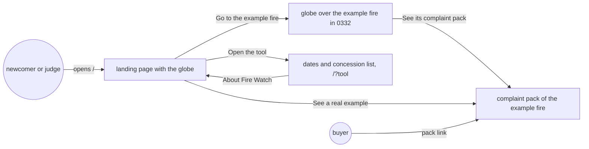
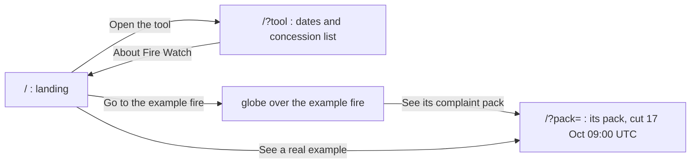
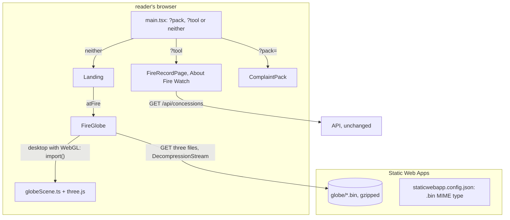
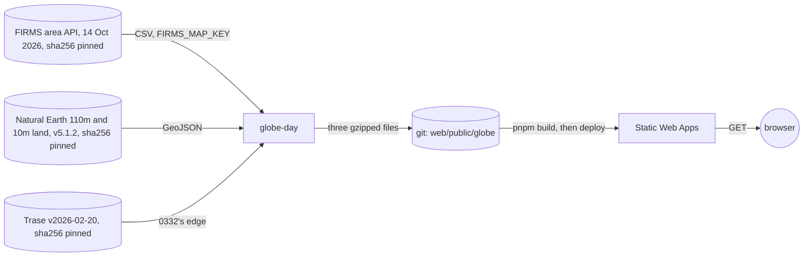

# Landing page

**Version:** v1 · **Status:** Shipped · **Type:** Feature · **Project type:** Web UI

**Shape doc:** docs/specs/fire-watch/shape.md
**Depends on:** complaint-pack

A page that says what Fire Watch is, for someone who has never heard of a concession, with a globe
of one day's fires that flies to a real fire. It comes now because the judges are newcomers, and the
site opens straight into dates and a list of concession IDs.

## Problem

The site opens on "Pulpwood concessions with hotspots", one sentence and a date picker. A reader
who doesn't know what a concession, a hotspot or a seal is can't tell what the site is for, or
why the blockchain matters. The hackathon judges are that reader, and so is a new investigator.

The home page was built for an investigator who already knows the field (D14). Nothing on the
site says what problem it solves: companies answer a fire grievance with "it started outside our
concession" or "the complaint has no site, date or basis" (shape, Problem).

## Slice test

| Check                         | Result |
| ----------------------------- | ------ |
| Cuts every layer it needs     | yes: the page, and one day of FIRMS detections fetched once and committed. The landing reads nothing from the API, so the API and the database don't change |
| One e2e test walks it         | yes: open the site, read the landing, fly to the example fire, open its pack, come back, open the tool |
| Worth shipping alone          | yes: a judge or a new investigator learns what the site is for before using it |
| Fits (≤5 scenarios, ≤2 areas) | yes: 5 scenarios, one area (`web/`, with its committed data file) |

**Path:** full. The slice adds a new screen and the tier 3 globe.

## User story

As someone new to plantation fires, I want to read what Fire Watch does and why before I use it,
so that the concession list and the "Matches the chain" check make sense to me.

## Flow



A newcomer reads the landing, flies to a real fire and opens its pack, then opens the tool. A
returning investigator bookmarks the tool's link, and a buyer's pack link opens the pack straight
away.

## Acceptance criteria

Exact wording is set at pause 2. The scenarios fix what each part must say.

```gherkin
Scenario: A newcomer learns what Fire Watch is
  Given someone who has never heard of a concession opens the site's address
  And the API has scaled to zero after a quiet hour
  When the page loads
  Then the landing shows at once, since it needs nothing from the server
  And its first line says what Fire Watch does and for whom
  And it gives the problem in plain words: a company answers a fire grievance with "it started
    outside our concession" or "the complaint has no site, date or basis"
  And four steps say how it works: satellites spot fires; each record is sealed on a public
    blockchain; an investigator finds the fire and where it started; a buyer gets a pack they can
    check
  And dated facts give the scale: 62,489 NOAA-20 fire detections worldwide on 14 Oct 2026, 9,923
    of them in the box around Indonesia
  And a short list explains "concession", "hotspot", "seal" and "peat" in one line each
  And no company is named (shape O10)

Scenario: The globe shows a day of fires and flies to a real one
  Given the landing on a desktop browser
  When the globe has loaded on its own
  Then it shows the NOAA-20 fire detections of 14 Oct 2026, and turns slowly
  And the reader can drag it to turn it
  When the reader presses "Go to the example fire"
  Then it flies to Indonesia and the fire in ID-WOOD-CONCESSION-0332 seen at 06:18 and 17:20 UTC
    that day
  And the caption reads that the satellite first saw the fire on 12 Oct, outside the concession and
    3,100 m from its edge, and that by 13 Oct it was inside
  And it offers "See its complaint pack"

Scenario: On a phone, with reduced motion, or without 3D, nothing turns on its own
  Given the landing on a phone
  Then the same fires show on a flat world map, and no 3D code downloads
  Given a desktop browser set to reduce motion
  Then the globe doesn't turn on its own, and "Go to the example fire" jumps straight there
  Given a desktop browser that can't draw 3D
  Then the flat map stays in its place, and nothing on the page shifts

Scenario: A real example pack opens from the landing
  Given the landing page
  When the reader presses "See a real example", or "See its complaint pack" after the flight
  Then the complaint pack of that fire opens, cut at 17 Oct 2026 09:00 UTC: 283 detections on 8
    passes, first seen on 12 Oct at 05:16 UTC, outside the concession and 3,100 m from its edge
  And their browser checks each of its detections against Base Sepolia, as any pack does

Scenario: Each address opens its own page
  Given the site's address, the landing opens
  When the reader presses "Open the tool"
  Then the date picker and the ranked concession list show, as the home page does today, at the
    tool's own link, which they can bookmark
  And "About Fire Watch" in the tool's header goes back to the landing
  Given the tool's link opened directly, the tool opens with no landing in front of it
  Given the link of a complaint pack, the pack opens with no landing in front of it
```

## Scope

**In:**

- A landing page at the site's address with the one-line summary, the problem, the four steps,
  the dated facts, the four terms, "See a real example" and "Open the tool".
- The fire globe of D3: 14 Oct 2026's NOAA-20 detections, loaded on its own on desktop, turning
  slowly, dragged by the reader, with one flight to the 0332 fire. A flat world map of the same
  fires on phones, with reduced motion, and where 3D can't run.
- The day's detections, fetched once from FIRMS and committed.
- The tool at its own link, and "About Fire Watch" in its header.
- Light and dark themes, phone and desktop widths, from the existing design system (D2, D4).

**Out:**

- Live counts from the API, such as detections sealed so far (O3): not planned.
- The latest day's fires on the globe (O5): not planned; the day is fixed.
- Zoom, and a card for each fire on the globe (O7): not planned.
- Help for each term inside the tool's own screens: not planned.
- Any language but English: the design brief settles English only.
- Company names: never (shape O10).

## Interface

The landing is one page that scrolls, on the design system's tokens (D2, D4). It opens with a plain
question beside the globe of 14 Oct 2026's fires, the one tier 3 piece (D3). One real fire then
carries the explanation, instead of a list of features. The tool gets "About Fire Watch" in its
header.



A reader goes from the landing to the tool and back, or to the example fire's pack, by the globe or
straight from the hero.

| Part | What shows |
| ---- | ---------- |
| Header | "Fire Watch", and "Open the tool" as a link |
| Headline | "Where did the fire start?" |
| Lede | "Fire Watch records every satellite fire detection on or near Indonesia's pulpwood plantations, and seals each record on a public blockchain. Watchdog investigators use it to show a company's buyers where a fire started and how it spread, on records anyone can check." |
| Actions | "Open the tool" (primary button) and "See a real example" (secondary), both links |
| Globe, beside the text on desktop | The fire globe primitive, in a square box; under it on a phone, as the flat map |
| Caption, before the flight | "Every dot is a fire the NOAA-20 satellite saw on 14 Oct 2026: 62,489 worldwide, 9,923 of them in and around Indonesia." and the button "Go to the example fire" |
| Caption, after the flight | "A fire in ID-WOOD-CONCESSION-0332, Central Kalimantan, on 14 Oct 2026. The satellite first saw it on 12 Oct, outside the concession and 3,100 m from its edge. By 13 Oct it was inside." and the link "See its complaint pack" |
| "Two accounts of the same fire" | "When a fire burns on plantation land, a watchdog files a grievance with the buyers of the company that holds the land. The company often answers that the fire started outside its concession and spread in, or that the complaint has no site, date or basis. The buyer then has to pick one account." Then: "Fire Watch gives the grievance its site, dates and basis from satellite records, each sealed when it came in. The buyer can check them instead of picking." |
| "How it works", numbered | 1 "Satellites spot fires." 2 "Each record is sealed." 3 "An investigator finds where it started." 4 "The buyer checks it.", each with two plain sentences |
| "Words used here", a key-value list | Concession, Hotspot, Seal, Peat, one line each |
| Footer | The sources: NASA FIRMS, Trase, WRI Global Peatlands (CC BY 4.0), Natural Earth; Base Sepolia as a test network; the hackathon |
| The tool's header | "About Fire Watch", a link to the landing, after "Records are sealed on Base Sepolia, a test network" |

| State | What shows |
| ----- | ---------- |
| Loading | The text at once; a skeleton block holds the globe's space |
| Desktop with WebGL | The flat map, then the globe fading in over it, opening on Indonesia |
| Phone, touch screen or no WebGL | The flat map in its own 18:7 box; no 3D code downloads |
| After "Go to the example fire" | The flight, then the second caption; reduced motion jumps straight there |
| The globe's data didn't load | A help line in its place; the rest of the page works |

**Motion tier:** 3 for the globe alone, within the brief's budget: 242 kB on desktop of the 250 kB
ceiling, and 102 kB for the flat map. Tier 1 for the rest: the buttons' hover. Nothing else on the
page moves.

**Components used:** `app-top`, `fw-btn`, `fw-btn--secondary`, `fw-link`, `fw-kv`, `fw-help`, and
the fire globe (`FireGlobe`), added to the system by `/design-system` for this slice. No new token.
`app.css` adds the `.landing` composition, the `.globe` box and `.app-top-end`.

**Design system:** Fire Watch, `docs/design/design-system/`, with its new guideline
`guidelines/globe.html` (D2, D3, D4, D76).

**Preview:** `cd web && pnpm dev`, then `http://localhost:5173/?preview=landing-page` for the landing
and the tool's header, and `?preview=fire-globe` for the globe's states. The globe's dots are FIRMS's
NOAA-20 detections of 14 Oct 2026; land is Natural Earth 110m, and 10m around the example fire. The
example pack link is the production pack. The data files were made by a scratch script; pause 3 plans
the committed one. The drift check passed over the 9 files written, every token used exists, `tsc -b`
is clean and the 171 web unit tests pass. At 390 px, in both themes, no page has a sideways scroll.

**The page expects:** no API change. `web/public/globe/` holds three gzipped files: land, the day's
fire cells, and the full detail near the example fire. Routes: `/` the landing, `/?tool` the tool
(D74), `/?pack=` a pack, as today.

## Technical plan

### Approach

The page decides what to show from its address: a pack link opens the pack, `?tool` opens the tool,
and anything else opens the landing (D72, D74). The landing and the globe are static. The globe's
data is three gzipped files under `web/public/globe/`, made by a `globe-day` command from pinned
sources (D79), and served beside the page by Static Web Apps. three.js loads only on a desktop with
WebGL. When the globe runs under 30 fps over its first 2 s, it fades back to the flat map (D80). The
API, the recorder and the database don't change.

Relies on: D2, D3, D4, D29, D36, D37, D72, D73, D74, D75, D76, D77, D78, D79, D80, D81



The address picks the page. The landing's globe reads three static files, and loads three.js only
where it can draw it.

```mermaid
sequenceDiagram
    participant R as Reader
    participant L as Landing
    participant G as FireGlobe
    participant W as Static Web Apps
    R->>L: opens /
    L->>G: mount
    G->>W: land-110m.bin, fires-2026-10-14.bin, near-0332.bin
    W-->>G: 100 kB, gzipped as committed
    G->>G: flat map drawn
    G->>W: globeScene chunk with three.js, desktop only
    G->>G: globe fades in; first 2 s at 30 fps or more, else back to flat
    R->>L: Go to the example fire
    G-->>L: arrived, after 2.4 s or at once
    L->>R: caption and See its complaint pack
```

The text shows at once. The flat map follows the data, and the globe follows three.js, where the
machine can hold 30 fps.



The data crosses from FIRMS to git once, through an operator who holds the FIRMS key. After that it
is a committed static file.

### Changes

| File | What changes | Why |
| ---- | ------------ | --- |
| `web/src/main.tsx:32` | `Page` is the preview, else the pack for `?pack`, else the tool for `?tool` with `aboutHref="/"`, else the landing, each lazily loaded as now | Scenarios 1, 5; D72, D74 |
| `web/src/Landing.tsx` (pause 2) | As built at pause 2 | Scenarios 1, 2, 4 |
| `web/src/globe.ts` (pause 2) | `loadGlobe()` reads the three files through `DecompressionStream`; `drawFlat()` draws the flat map; `canDraw3d()` asks whether WebGL runs | Scenarios 2, 3; D75 |
| `web/src/globeScene.ts:90` | `startGlobe()` takes `onSlow`. It counts frames over the globe's first 2 s of frame time, each frame's time capped at 100 ms, and calls `onSlow` when there are fewer than 60 (O13) | Scenario 3; D80 |
| `web/src/FireGlobe.tsx:80` | On `onSlow`, disposes the scene, removes the 3D canvas and keeps the flat map in the square box. It does the same when the reader arrives before the globe's first frame (O15). It asks `canDraw3d()` once for the page's life | Scenario 3; D80. Each ask made a WebGL context. Past the browser's limit the globe's own was dropped, and the box shrank from 537 px to 209 px after the flight |
| `web/src/FireRecordPage.tsx` (pause 2) | `aboutHref` puts "About Fire Watch" in the header | Scenario 5 |
| `web/public/staticwebapp.config.json` (new) | `{"mimeTypes": {".bin": "application/octet-stream"}}`; Vite copies it to the root of `dist`, where the deploy reads it | O10 |
| `web/public/globe/*.bin` (pause 2) | Rewritten by `globe-day`, the same bytes | D79 |
| `api/src/firewatch/globe_day.py` (new) | `globe-day [--out <dir>]`. Downloads the 14 Oct FIRMS file with `FIRMS_MAP_KEY`, Natural Earth 110m and 10m land, and Trase, each through `concessions.download()` with its sha256. Writes the three files, gzipped with mtime 0 by `GzipFile`: `gzip.compress` writes another OS byte, so other bytes. The docstring gives the method: 0.01° cells outside the box, every detection inside it, land clipped 0.1° beyond the box. A refusal leaves the key out of its message. Run here, it gave the committed bytes | D79 |
| `api/pyproject.toml` | Script `globe-day` | D79 |
| `api/tests/test_globe_day.py` (new) | On small inputs written by the test: the same bytes twice; a detection in the box comes out in full and one outside as its cell; land is clipped to the box | D79 |
| `web/src/globe.test.ts` (new) | `loadGlobe()` on the committed files: 41,380 dots, 128 land rings, the box, 0332's two edge rings. A Node types reference, since the page's tsconfig has none | D75 |
| `web/src/globeScene.test.ts` (new, review) | Runs the real `tick()` with the WebGL renderer stood in for: 20 fps calls `onSlow` once, 30 fps doesn't, a 10 s gap counts 100 ms | Scenario 3; D80, O13 |
| `web/package.json`, `web/pnpm-lock.yaml` | `three` at exactly 0.186.1, and `@types/three` for development (O14) | Scenario 2; D3 |
| `web/src/FireGlobe.test.tsx` (new) | The skeleton while loading, the "didn't load" line, the flat map when `flat`, `onArrive` at once on the flat map, the arrow keys | Scenarios 2, 3 |
| `web/src/Landing.test.tsx` (new) | The headline, the lede, both links and their addresses, the dated facts, the four steps and four words, the caption after arriving | Scenarios 1, 2, 4 |
| `web/src/FireRecordPage.test.tsx` | "About Fire Watch" with `aboutHref`, none without | Scenario 5 |
| `web/e2e/landing-page.spec.ts` (new) | The e2e below, and a phone check: the flat map, no 3D chunk, 44 px taps | All scenarios' path |
| `web/e2e/fire-record.spec.ts:34`, `:55`, `:141`, `complaint-pack.spec.ts:29`, `damage-estimate.spec.ts:23`, `:52`, `fire-origin.spec.ts:33`, `spread-forecast.spec.ts:33`, `:68`, `season-backtest.spec.ts:99` | Open `/?tool` where they opened `/` | Scenario 5 |
| `README.md`, `docs/ARCHITECTURE.md`, `CHANGELOG.md` | The landing and the tool's link; `globe-day` in "Run it locally" and a "Redo the globe's data" section; Natural Earth's credit; the component rows; one changelog line | Operators |

Reusing: `concessions.download()` for every pinned source, `firms.parse()`'s field names for the
CSV, `format.count()`, `maps.themeFill()`, the design system's `fw-*` primitives, and the e2e's
fake Google Maps.

### Earn-it

| Added | Triggered by |
| ----- | ------------ |
| three.js, in the page's dependencies | Scenario 2: the globe of D3, D76 |
| `staticwebapp.config.json` | O10: `.bin` may not be served without a MIME type |
| `globe-day` | D79: anyone with a FIRMS key can redo the committed files |
| The frame-rate fallback | D80: the brief's "never below 30", on machines no one measured |
| `aboutHref` | Scenario 5: the tool links back to the landing |

### Non-functionals

|                      |                                                                               |
| -------------------- | ----------------------------------------------------------------------------- |
| **Load**             | Static. A first visit on desktop downloads 242 kB for the globe after the text shows; a phone 102 kB. The browser caches the files |
| **Breaks first**     | A desktop with a weak GPU: the globe falls back to the flat map (D80). Visitors don't matter: Static Web Apps serves the files from its edge |
| **Security surface** | No input and no new endpoint. The links stay on the site. three.js is a new runtime dependency, checked by CI's `pnpm audit --prod`. `globe-day` reads `FIRMS_MAP_KEY` from the operator's untracked `.env`. The files hold public data: FIRMS detections, Natural Earth land and one Trase edge |
| **Proof it works**   | After the deploy, the site's `/` reads "Where did the fire start?", and `/globe/fires-2026-10-14.bin` answers 200 with `content-type: application/octet-stream` and 71,256 bytes |
| **Rollout**          | No flag (D81). The merge deploys the page. Rollback: revert the merge, and Deploy ships the old home page |

### Test plan

| Scenario | Test | Command |
| -------- | ---- | ------- |
| 1. A newcomer learns what it is | `Landing.test.tsx` | `cd web && pnpm test Landing` |
| 2. The globe flies to a real fire | `FireGlobe.test.tsx`, `Landing.test.tsx`, the e2e | `cd web && pnpm test FireGlobe` |
| 3. Phone, reduced motion, no 3D | `FireGlobe.test.tsx`, `globeScene.test.ts`; the preview at 390 px | `cd web && pnpm test FireGlobe globeScene` |
| 4. The example pack | `Landing.test.tsx` (its address), the e2e | `cd web && pnpm test Landing` |
| 5. Each address opens its own page | `FireRecordPage.test.tsx`, the e2e, the six e2e files at `/?tool` | `cd web && pnpm e2e` |
| The committed data | `globe.test.ts`, `test_globe_day.py` | `cd web && pnpm test globe`; `cd api && uv run pytest tests/test_globe_day.py` |

**E2E:** `web/e2e/landing-page.spec.ts`. It opens `/` and reads the headline, "62,489 worldwide" and
the four words. It presses "Go to the example fire" and reads "first saw it on 12 Oct", and checks
that "See its complaint pack" points at the example pack. The globe's box keeps its height through
the flight, and the landing asks nothing of the API. It presses "Open the tool", lands on `/?tool`
with the concession list, and comes back through "About Fire Watch". On a 375 px touch
screen, every link and button on the landing is at least 44 px to tap. The e2e's API has no example
fire, so it checks the pack link's address, not the pack. `cd web && pnpm e2e`.

### Chunks

Single chunk. The web and API changes are small, and the six e2e files move with the routing.

### Risks

| Risk | Mitigation |
| ---- | ---------- |
| Static Web Apps doesn't serve `.bin` (O10) | The declared MIME type; if it still fails, the landing shows its "didn't load" line and the rest works. `/ship` checks the file after the deploy |
| The example pack's link stops working | A pack cut keeps its key after a join (`test_pack_keeps_its_key_after_a_join_to_an_older_fire`). The e2e checks the address |
| A busy machine misses 30 fps in the first 2 s and keeps the flat map | The flat map shows the same fires and the same flight. The reader loses only the 3D |
| FIRMS changes the 14 Oct file, so `globe-day` refuses it | The committed files still stand. The sha256 in the refusal says what changed |
| three.js grows past the budget on a later version | `three` is pinned at exactly 0.186.1, so only a deliberate change moves it; the budget's numbers are in the brief to check against |
| The slice competes with the demo video for the days left (O2) | Single chunk, no new screens beyond pause 2 |

### Decisions to record

Recorded as D79, D80, D81.

## Review

2026-10-21 · 8 raw findings, 7 survived, 7 fixed.

- A09 Security Logging and Alerting Failures · `api/src/firewatch/globe_day.py:157` · redact the FIRMS key from HTTP errors too, not only from a changed file · `826be0a`
- A03 Software Supply Chain Failures · `web/package.json:17` · pin three.js at exactly 0.186.1 · `46a720a`
- correctness · `web/src/FireGlobe.tsx:103` · arrive at the example fire when the globe's data fails, so the caption and pack link show · `f933740`
- correctness · `web/src/FireGlobe.tsx:105` · keep the flat map once the reader arrives on it before the globe shows · `9d9b3f2`
- coverage · `web/src/globeScene.ts:230` · tests that run the real 30 fps check at 20 fps, 30 fps and across a 10 s gap · `371abcf`
- quality · `docs/design/system-brief.md:78` · the dot count as the committed files hold it, 41,380 · `16ebda1`
- quality · `docs/design/system-brief.md:77` · near-0332.bin as 13 kB, and the totals with it · `2bb8e1d`

## Open items

| ID | What | Type | Raised at | Owner | Status | Answer |
| -- | ---- | ---- | --------- | ----- | ------ | ------ |
| O1 | Where the explanation goes: a landing page at the site's address with the tool one click away, which supersedes D14 ("the home page is dates, then a concession list"), or an explainer block above the date picker, which keeps D14 | question | spec p1 | user | Resolved | 2026-10-20: a landing page at the site's address, the tool one click away (D72, superseding D14) |
| O2 | Whether the landing carries the 3D fire globe that D3 and the design brief planned for the public intro (three.js, a 250 kB budget, a flat map on phones), or ships plain now with the globe as a later slice | question | spec p1 | user | Resolved | 2026-10-20: the globe is in this slice. It competes with the demo video for the days left before 2026-10-24 |
| O3 | Whether the landing shows numbers: live counts from the API (a new endpoint, a second area), dated facts written into the text, such as the 4,172 detections in the Indonesia box on 12 Oct 2026, or none | question | spec p1 | user | Resolved | 2026-10-20: dated facts in the text (D73) |
| O4 | How an investigator who comes back reaches the tool: a link of its own they can bookmark, the browser remembering they have seen the landing, or one click through the landing every time | question | spec p1 | user | Resolved | 2026-10-20: the tool gets its own link (D74, superseding D34) |
| O5 | Which day of fires the globe shows: 14 Oct 2026, when the 0332 fire burns; 12 Oct 2026, the day the brief measured; or the latest day, fetched live | question | spec p1 | user | Resolved | 2026-10-20: 14 Oct 2026, fixed and committed. FIRMS gives 62,489 NOAA-20 detections worldwide that day, 9,923 in the box around Indonesia (D75) |
| O6 | When the 3D globe loads: on a press, as the design brief's tier 3 budget says ("nothing downloads until asked"), or on its own on desktop | question | spec p1 | user | Resolved | 2026-10-20: on its own on desktop. The flat map shows first and holds the space; phones keep the flat map (D76) |
| O7 | What the reader can do with the globe: drag it and take one flight to the example fire, watch a fixed sequence, or explore freely with zoom and a card per fire | question | spec p1 | user | Resolved | 2026-10-20: drag to turn, and one flight to the 0332 fire (D77) |
| O8 | Which fire the landing flies to and opens as its example pack. The spec named the fire of fire-origin scenario 1. On the full production record that fire reads "first seen on both sides of the edge", since the scenario used a 19-row cut | question | spec p2 | user | Resolved | 2026-10-20: 0332's fire first seen on 12 Oct 2026 at 05:16 UTC, outside the concession and 3,100 m from its edge, inside from 13 Oct. Its pack is cut at 17 Oct 2026 09:00 UTC: 283 sealed detections (D78) |
| O9 | How the globe's committed data files can be redone: a `globe-day` command and its test, or the files with their sources described in the README | question | spec p3 | user | Resolved | 2026-10-20: a `globe-day` command in `api/`, from sources pinned by sha256, with a test (D79) |
| O10 | Azure Static Web Apps may not serve a `.bin` file without a declared MIME type. The docs describe `mimeTypes` but don't say what happens without it | unproven | spec p3 | user | Accepted risk | 2026-10-20: declare `.bin` in `web/public/staticwebapp.config.json` and check the file after the deploy, rather than a spike on a staging app. If it still fails, the landing shows its "didn't load" line |
| O11 | The globe's frame rate is unmeasured: this machine draws WebGL in software and its browser stops at 20 fps | question | spec p3 | user | Resolved | 2026-10-20: fall back to the flat map when the first 2 s after the globe shows run under 30 fps (D80) |
| O12 | Whether the landing ships behind a flag | question | spec p3 | user | Resolved | 2026-10-20: no flag; a revert rolls it back (D81) |
| O13 | The plan said `startGlobe()` "counts frames for 2 s after the first frame and calls `onSlow` when there are fewer than 60". By the clock, a tab sent to the background in those 2 s pauses its frames and reads as slow | flag | build | user | Decided alone | Chose: count over 2 s of frame time, each frame's time capped at 100 ms, as the turning already is (a03f65e). Below 10 fps the check takes longer than 2 s. Other: 2 s by the clock. Undo: in `tick()`, compare `now` with the first frame's time instead of summing `dt`. 2026-10-20 |
| O14 | The Risks row said "`^0.186.1` stays within 0.186". Review A03: three.js is a new runtime dependency, and a range lets any 0.186 release in | flag | review | user | Decided alone | Chose: pin `three` at exactly 0.186.1 in `web/package.json`. Other: keep `^0.186.1`; the frozen lockfile and CI's `pnpm audit --prod` still hold it. Undo: revert the pin commit. 2026-10-21 |
| O15 | Review: on desktop, a press of "Go to the example fire" before the globe's first frame arrived on the flat map. The globe then faded in on the world and flew to the fire a second time | flag | review | user | Decided alone | Chose: once the reader arrives on the flat map, it stays for good, as under 30 fps. Other: start the globe already over the fire. Undo: revert the fix commit, and give `startGlobe()` a starting view. 2026-10-21 |
| O16 | The `fix` commits `7f9a40e`, `81afef4`, `826be0a`, `46a720a`, `f933740` and `9d9b3f2` get no CHANGELOG line | flag | ship | user | Decided alone | Chose: no line; each fixes code that this branch adds and no user has run, and the Added line covers the landing and `globe-day`. Other: a Fixed or Security line for each. Undo: add the lines under `## [Unreleased]`. 2026-10-21 |
_Never delete this section or its rows. See references/ledger.md._

## Glossary

- **Concession** — land the Indonesian government licenses to a company; here, to grow trees for
  paper pulp.
- **Hotspot** — one spot where a satellite saw fire on one pass overhead.
- **Seal** — a record's fingerprint written on a public blockchain, so any later change shows.
- **Landing page** — the first page a visitor sees, saying what the site is before they use it.
- **FIRMS** — NASA's service that publishes satellite fire detections within hours.
- **NOAA-20** — the satellite whose VIIRS sensor gives each detection; it passes over twice a day.
- **three.js** — the JavaScript library that draws the 3D globe in the browser.
- **Reduced motion** — a setting in the reader's system asking sites not to animate.
- **WebGL** — the browser feature that draws 3D; a few old machines and locked-down browsers lack it.
- **fps** — frames per second: how many times a second the globe is redrawn.
- **Static Web Apps** — the Azure service that hosts the page's files.
- **MIME type** — the label a server sends with a file to say what kind of file it is.
- **Natural Earth** — a public-domain map of the world's land, at 1:110 million and 1:10 million here.
- **e2e** — end-to-end: one test that walks the whole slice as a user would.
