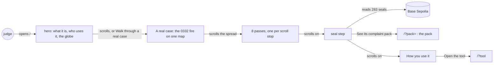
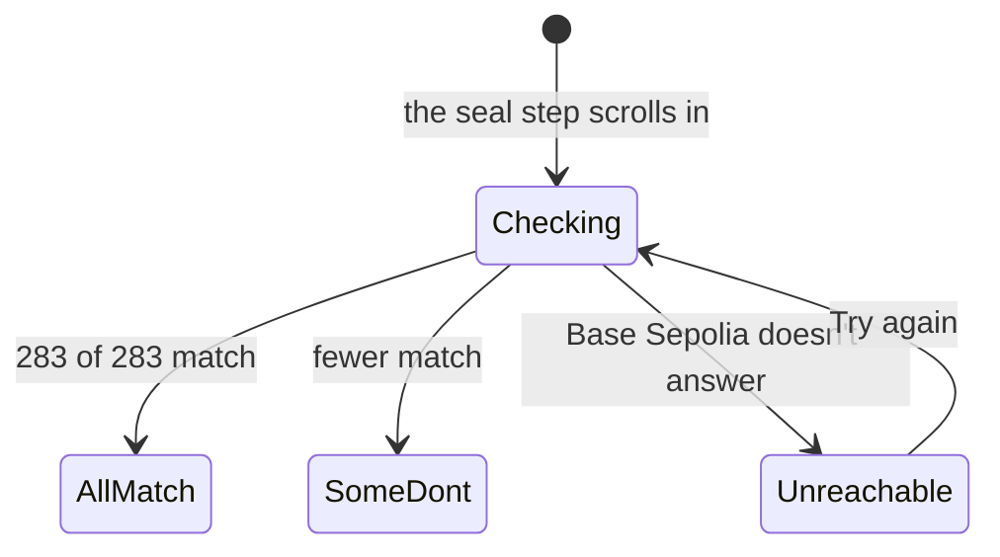

# Newcomer walkthrough

**Version:** v1 · **Status:** Draft · **Type:** Enhancement · **Project type:** Web UI

**Shape doc:** docs/specs/fire-watch/shape.md
**Depends on:** landing-page

The landing walks a judge through one real fire, from the company's claim to a seal check in the
judge's own browser, and then says how to use the tool. It comes now because the builder, reading
the site as a newcomer, couldn't tell what it is, what it's for or how to use it.

## Problem

Fire Watch's own builder read the landing as a newcomer on 2026-10-21 and could not say what the
product is, what it is for, or how to use it. The judges read it once, before 2026-10-25.

The landing opens on a question, "Where did the fire start?", and a 45-word lede that holds three
ideas: satellite records, a blockchain and watchdog investigators. The one real fire is a caption
after a globe flight. Nothing shows the tool or says what a person does with it. The problem section
also says each record was "sealed when it came in". That isn't true of the example fire: its first
six passes, 12 to 15 Oct, were sealed on 16 Oct, when recording began.

The globe shows 62,489 fires worldwide on 14 Oct 2026, and the text reads as if Indonesia is all
there is. Indonesia's pulpwood concessions are the first map loaded, not the limit of the method.

## Slice test

| Check                         | Result |
| ----------------------------- | ------ |
| Cuts every layer it needs     | yes: the landing, and one committed copy of the example fire's pack. The browser reads the seals from Base Sepolia itself (D7). The API, the recorder and the database don't change |
| One e2e test walks it         | yes: open `/`, read the hero, scroll the case through its 8 passes, see the seal count, follow the pack link, open the tool |
| Worth shipping alone          | yes: a judge leaves knowing the problem, the proof and how to use the tool |
| Fits (≤5 scenarios, ≤2 areas) | yes: 5 scenarios, one area (`web/`, with its committed data file) |

**Path:** full. The slice adds a new part to the landing and new committed data.

The request held four things. Three are sibling slices (O1):

| Slice | What it does | When |
| ----- | ------------ | ---- |
| replay-pace | The tool's play button goes slow enough to follow, one pass at a time | next, light path |
| palette | More colour on every screen, through `/design-system`, superseding D4 | after replay-pace |
| world-recording | Record and seal fires beyond Indonesia's pulpwood concessions | after the hackathon |

## User story

As a judge with two minutes who has never heard of a concession, I want to follow one real fire from
the company's claim to the proof, so that I know what Fire Watch is for and how someone uses it.

## Flow



A judge reads the hero, scrolls one real fire from claim to seal check, and then reads how to use the
tool. The pack and the tool are one link away from the end of the case.

## States

The seal step has its own states.



## Acceptance criteria

Exact wording is set at pause 2. The scenarios fix what each part must say. The example fire's
passes, from its pack cut at 17 Oct 2026 09:00 UTC:

| Pass | Time (UTC)   | Detections | Inside | Sealed |
| ---- | ------------ | ---------- | ------ | ------ |
| 1    | 12 Oct 05:16 | 1          | 0      | 16 Oct 02:37 |
| 2    | 13 Oct 06:37 | 35         | 6      | 16 Oct 05:29 to 05:36 |
| 3    | 13 Oct 17:37 | 43         | 27     | 16 Oct 07:12 to 07:17 |
| 4    | 14 Oct 06:18 | 37         | 16     | 16 Oct 10:40 to 11:07 |
| 5    | 14 Oct 17:20 | 66         | 43     | 16 Oct 13:08 to 13:14 |
| 6    | 15 Oct 18:43 | 6          | 0      | 16 Oct 17:29 to 17:30 |
| 7    | 16 Oct 18:21 | 62         | 46     | 16 Oct 21:04 to 21:10 |
| 8    | 17 Oct 05:23 | 33         | 26     | 17 Oct 08:08 to 08:12 |

```gherkin
Scenario: A judge knows what Fire Watch is from the first screen
  Given a judge opens the site's address on a 1366 by 768 laptop
  And the API has scaled to zero after a quiet hour
  When the page loads
  Then the first screen, before any scroll, gives one plain headline that says what Fire Watch does
  And the lede says who uses it: watchdog groups that file fire complaints with a plantation
    company's buyers
  And it says what they hand over: a pack of records that the buyer can check
  And one line says that Indonesia's pulpwood concessions are the first map loaded, and that the
    method works wherever a public map says who holds the land
  And "Walk through a real case" and "Open the tool" are both on that screen
  And the globe still shows 62,489 fires worldwide on 14 Oct 2026
  And no company is named (shape O10)

Scenario: The judge scrolls through one real fire
  Given the landing
  When the judge scrolls into "A real case", or presses "Walk through a real case"
  Then a map holds still beside the text, with ID-WOOD-CONCESSION-0332's dashed edge
  And the steps say, in this order:
    | Step       | Says |
    | The fire   | 283 detections near ID-WOOD-CONCESSION-0332, Central Kalimantan, 12 to 17 Oct 2026 |
    | The claim  | A watchdog files a grievance with the company's buyers. The company can answer that the fire started outside and spread in |
    | First seen | The satellite first saw it on 12 Oct at 05:16 UTC, outside the concession and 3,100 m from its edge |
    | The spread | The 8 passes, one at a time |
    | The seals  | Each record's seal on Base Sepolia, checked now in the judge's browser |
    | The pack   | What the buyer gets, and "See its complaint pack" |
  And the case says that the record agrees with the company on where the fire started, and shows it
    burning inside from 13 Oct: Fire Watch shows the record, not a side
  And the case needs nothing from the API

Scenario: Each scroll stop in the spread adds one satellite pass
  Given the judge at the spread step
  When they scroll to pass 2, 13 Oct 06:37 UTC
  Then the map adds that pass's 35 detections, 6 of them inside, and they stand apart from pass 1's
  When they scroll on to pass 8, 17 Oct 05:23 UTC
  Then the map shows all 283 detections, 164 of them inside
  When they scroll back to pass 5, 14 Oct 17:20 UTC
  Then the map shows passes 1 to 5 only, 182 detections
  Given a browser set to reduce motion
  Then each pass shows without animation

Scenario: The judge's browser checks the seals
  Given the judge at the seal step
  Then their browser reads the 283 seals from Base Sepolia and shows "283 of 283 records match
    their seal"
  And it says when they were sealed: passes 1 to 6 on 16 Oct, when recording began, 23 hours to 4
    days after the satellite; passes 7 and 8 about 3 hours after it
  Given someone changed one record in the committed copy
  Then the step shows 282 of 283 match, and names the record that doesn't
  Given Base Sepolia doesn't answer
  Then the step says it couldn't reach Base Sepolia and offers "Try again"
  And the rest of the page still works

Scenario: The landing says how to use the tool
  Given the landing, below the case
  Then "How you use it" gives the tool's four steps: pick dates; pick a concession from the list,
    most hotspots inside first; open a fire to see where it started and how it spread; make a pack
    and send its link to the buyer
  And "Open the tool" opens /?tool
  And "Words used here" gives concession, hotspot, seal and peat, one line each
  And "Two accounts of the same fire" is gone, because the case tells it
  Given a phone 390 px wide
  Then the case's map sits above its captions and stays in view as they scroll
  And no page scrolls sideways, and every link and button is at least 44 px to tap
```

## Scope

**In:**

- The hero rewritten: a plain headline, a short lede that says who uses Fire Watch and what they
  hand over, and one line on Indonesia as the first map loaded (D86, D88).
- "A real case": a scroll story of the 0332 fire, six steps on one map that holds still, with one
  scroll stop for each of its 8 passes (D82).
- The seal step: the judge's browser checks all 283 seals on Base Sepolia, and the step says when
  they were sealed (D83, D84).
- A committed copy of the example fire's pack, cut at 17 Oct 2026 09:00 UTC (D85).
- "How you use it" in place of "How it works", "Words used here" kept, "Two accounts of the same
  fire" removed (D87).
- The globe, its flight and its caption, as shipped (D75 to D77).
- Light and dark themes, phone and desktop widths, from the existing design system (D2, D4).

**Out:**

- A slower play button in the tool's fire view: replay-pace, next.
- More colour on every screen: palette, through `/design-system`, after replay-pace.
- Recording and sealing fires beyond Indonesia: world-recording, after the hackathon (D86).
- Opening any fire on the globe to see its raw record: not planned (D86).
- A next-step guide inside the tool: not planned.
- A before-and-after demo of a tampered record: not planned.
- Company names: never (shape O10).

## Open items

| ID | What | Type | Raised at | Owner | Status | Answer |
| -- | ---- | ---- | --------- | ----- | ------ | ------ |
| O1 | The request held four things: more colour, not only Indonesia, a newcomer can't tell what it is or how to use it, and the play button is too fast. Together they fail the Fits check | question | spec p1 | user | Resolved | 2026-10-21: split into newcomer-walkthrough, replay-pace, palette and world-recording. Spec newcomer-walkthrough first |
| O2 | What "not only Indonesia" means: say the method works wherever a land-holder map exists, open any globe fire's raw record, or record the world now. The world is 62,489 detections a day against the busiest day's 2,495 seals, and no public concession map exists outside Trase's Indonesian pulpwood map (D12, D19) | question | spec p1 | user | Resolved | 2026-10-21: say it plainly; Indonesia's pulpwood concessions are the first map loaded (D86) |
| O3 | What would make the site click for a newcomer | question | spec p1 | user | Resolved | 2026-10-21: walk one real case, plainer first lines, and say on the home page what it is and how to use it, as a real product |
| O4 | Who the landing speaks to first: a judge reading once, an investigator, or anyone curious about fires near them | question | spec p1 | user | Resolved | 2026-10-21: a judge reading once (D88) |
| O5 | How the judge moves through the case: Back and Next, a scroll story, or a sequence that plays on its own | question | spec p1 | user | Resolved | 2026-10-21: a scroll story (D82) |
| O6 | Whether the case checks the seals live on the landing, or links to the pack for the check | question | spec p1 | user | Resolved | 2026-10-21: live, in the judge's browser (D83) |
| O7 | 0332's first six passes, 12 to 15 Oct, were sealed on 16 Oct, 23 hours to 4 days after the satellite. Passes 7 and 8 were sealed about 3 hours after it. The landing says each record was "sealed when it came in" | flag | spec p1 | user | Resolved | 2026-10-21: keep 0332 and say when each pass was sealed (D84). 0363's fire, sealed live from its first pass, is rejected: 29 detections, and not on the globe's day |
| O8 | Where the case's 283 records come from: a committed copy of the live pack, or the API on each visit | question | spec p1 | user | Resolved | 2026-10-21: a committed copy, public records only. The user approved committing data read from the live database (D85) |
| O9 | How the scroll story shows the 8 passes: one scroll stop each, or one stop that plays them on its own | question | spec p1 | user | Resolved | 2026-10-21: one pass per scroll stop (D82) |
| O10 | Which sections stay on the landing | question | spec p1 | user | Resolved | 2026-10-21: hero, the case, "How you use it", "Words used here"; "Two accounts of the same fire" goes (D87) |
| O11 | This slice is about a day of build, replay-pace about an hour and palette about half a day, with the demo video due by 2026-10-24 | flag | spec p1 | user | Resolved | 2026-10-21: this slice, then replay-pace, then palette |

_Never delete this section or its rows. See references/ledger.md._

## Glossary

- **Concession** — land the Indonesian government licenses to a company; here, to grow trees for
  paper pulp.
- **Hotspot** — one spot where a satellite saw fire on one pass overhead.
- **Pass** — one trip of the NOAA-20 satellite over the area; it passes about twice a day.
- **Seal** — a record's fingerprint written on a public blockchain, so any later change shows.
- **Base Sepolia** — the public test blockchain that holds Fire Watch's seals.
- **Scroll story** — a page where a picture holds still and changes as the reader scrolls the text
  past it.
- **Complaint pack** — one fire's records at their own link, which the buyer's browser checks
  against the seals.
- **FIRMS** — NASA's service that publishes satellite fire detections within hours.
- **e2e** — end-to-end: one test that walks the whole slice as a user would.
