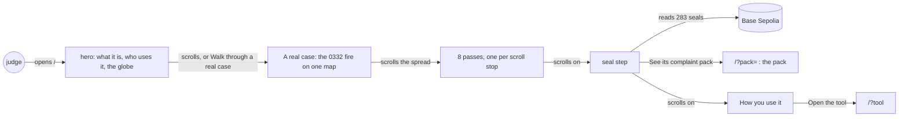
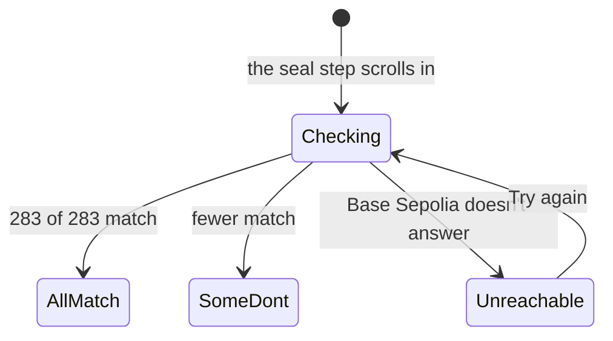
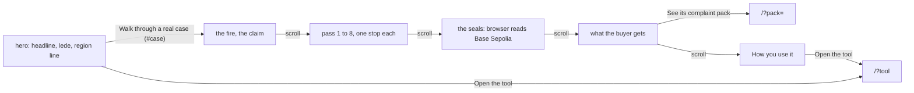
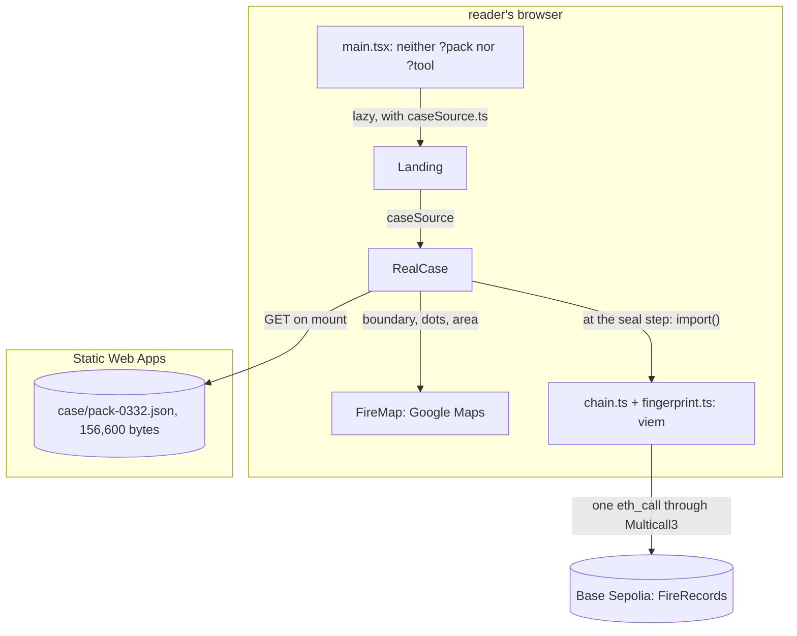
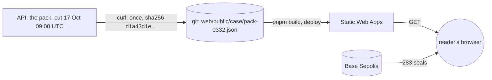

# Newcomer walkthrough

**Version:** v1 · **Status:** Shipped · **Type:** Enhancement · **Project type:** Web UI

**Shape doc:** docs/specs/fire-watch/shape.md
**Depends on:** landing-page

The landing walks a judge through one real fire, from the company's claim to a seal check in the
judge's own browser, and then says how to use the tool. It comes now because the builder, reading
the site as a newcomer, couldn't tell what it is, what it's for or how to use it.

## Problem

Fire Watch's own builder read the landing as a newcomer on 2026-10-21 and could not say what the
product is, what it is for, or how to use it. The judges read it once, before 2026-10-25.

The landing opens on a question, "Where did the fire start?", and a 45-word lede that holds three
ideas: satellite records, a blockchain and watchdog investigators. The one real fire is a caption
after a globe flight. Nothing shows the tool or says what a person does with it. The problem section
also says each record was "sealed when it came in". That isn't true of the example fire: its first
six passes, 12 to 15 Oct, were sealed on 16 Oct, when recording began.

The globe shows 62,489 fires worldwide on 14 Oct 2026, and the text reads as if Indonesia is all
there is. Indonesia's pulpwood concessions are the first map loaded, not the limit of the method.

## Slice test

| Check                         | Result |
| ----------------------------- | ------ |
| Cuts every layer it needs     | yes: the landing, and one committed copy of the example fire's pack. The browser reads the seals from Base Sepolia itself (D7). The API, the recorder and the database don't change |
| One e2e test walks it         | yes: open `/`, read the hero, scroll the case through its 8 passes, see the seal count, follow the pack link, open the tool |
| Worth shipping alone          | yes: a judge leaves knowing the problem, the proof and how to use the tool |
| Fits (≤5 scenarios, ≤2 areas) | yes: 5 scenarios, one area (`web/`, with its committed data file) |

**Path:** full. The slice adds a new part to the landing and new committed data.

The request held four things. Three are sibling slices (O1):

| Slice | What it does | When |
| ----- | ------------ | ---- |
| replay-pace | The tool's play button goes slow enough to follow, one pass at a time | next, light path |
| palette | More colour on every screen, through `/design-system`, superseding D4 | after replay-pace |
| world-recording | Record and seal fires beyond Indonesia's pulpwood concessions | after the hackathon |

## User story

As a judge with two minutes who has never heard of a concession, I want to follow one real fire from
the company's claim to the proof, so that I know what Fire Watch is for and how someone uses it.

## Flow



A judge reads the hero, scrolls one real fire from claim to seal check, and then reads how to use the
tool. The pack and the tool are one link away from the end of the case.

## States

The seal step has its own states.



## Acceptance criteria

Exact wording is set at pause 2. The scenarios fix what each part must say. The example fire's
passes, from its pack cut at 17 Oct 2026 09:00 UTC:

| Pass | Time (UTC)   | Detections | Inside | Sealed |
| ---- | ------------ | ---------- | ------ | ------ |
| 1    | 12 Oct 05:16 | 1          | 0      | 16 Oct 02:37 |
| 2    | 13 Oct 06:37 | 35         | 6      | 16 Oct 05:29 to 05:36 |
| 3    | 13 Oct 17:37 | 43         | 27     | 16 Oct 07:12 to 07:17 |
| 4    | 14 Oct 06:18 | 37         | 16     | 16 Oct 10:40 to 11:07 |
| 5    | 14 Oct 17:20 | 66         | 43     | 16 Oct 13:08 to 13:14 |
| 6    | 15 Oct 18:43 | 6          | 0      | 16 Oct 17:29 to 17:30 |
| 7    | 16 Oct 18:21 | 62         | 46     | 16 Oct 21:04 to 21:10 |
| 8    | 17 Oct 05:23 | 33         | 26     | 17 Oct 08:08 to 08:12 |

```gherkin
Scenario: A judge knows what Fire Watch is from the first screen
  Given a judge opens the site's address on a 1366 by 768 laptop
  And the API has scaled to zero after a quiet hour
  When the page loads
  Then the first screen, before any scroll, gives one plain headline that says what Fire Watch does
  And the lede says who uses it: watchdog groups that file fire complaints with a plantation
    company's buyers
  And it says what they hand over: a pack of records that the buyer can check
  And one line says that Indonesia's pulpwood concessions are the first map loaded, and that the
    method works wherever a public map says who holds the land
  And "Walk through a real case" and "Open the tool" are both on that screen
  And the globe still shows 62,489 fires worldwide on 14 Oct 2026
  And no company is named (shape O10)

Scenario: The judge scrolls through one real fire
  Given the landing
  When the judge scrolls into "A real case", or presses "Walk through a real case"
  Then a map holds still beside the text, with ID-WOOD-CONCESSION-0332's dashed edge
  And the steps say, in this order:
    | Step       | Says |
    | The fire   | 283 detections near ID-WOOD-CONCESSION-0332, Central Kalimantan, 12 to 17 Oct 2026 |
    | The claim  | A watchdog files a grievance with the company's buyers. The company can answer that the fire started outside and spread in |
    | First seen | The satellite first saw it on 12 Oct at 05:16 UTC, outside the concession and 3,100 m from its edge |
    | The spread | The 8 passes, one at a time |
    | The seals  | Each record's seal on Base Sepolia, checked now in the judge's browser |
    | The pack   | What the buyer gets, and "See its complaint pack" |
  And the case says that the record agrees with the company on where the fire started, and shows it
    burning inside from 13 Oct: Fire Watch shows the record, not a side
  And the case needs nothing from the API

Scenario: Each scroll stop in the spread adds one satellite pass
  Given the judge at the spread step
  When they scroll to pass 2, 13 Oct 06:37 UTC
  Then the map adds that pass's 35 detections, 6 of them inside, and they stand apart from pass 1's
  When they scroll on to pass 8, 17 Oct 05:23 UTC
  Then the map shows all 283 detections, 164 of them inside
  When they scroll back to pass 5, 14 Oct 17:20 UTC
  Then the map shows passes 1 to 5 only, 182 detections
  Given a browser set to reduce motion
  Then each pass shows without animation

Scenario: The judge's browser checks the seals
  Given the judge at the seal step
  Then their browser reads the 283 seals from Base Sepolia and shows "283 of 283 detections match
    the chain", as a pack does
  And it says when they were sealed: passes 1 to 6 on 16 Oct, when recording began, 23 hours to 4
    days after the satellite; passes 7 and 8 about 3 hours after it
  Given someone changed one record in the committed copy
  Then the step shows "282 of 283 detections match the chain. 1 does not.", and names the
    detection that doesn't by its time and place
  Given Base Sepolia doesn't answer
  Then the step says it couldn't reach Base Sepolia and offers "Check again", as a pack does
  And the rest of the page still works

Scenario: The landing says how to use the tool
  Given the landing, below the case
  Then "How you use it" gives the tool's four steps: pick dates; pick a concession from the list,
    most hotspots inside first; open a fire to see where it started and how it spread; make a pack
    and send its link to the buyer
  And "Open the tool" opens /?tool
  And "Words used here" gives concession, hotspot, seal and peat, one line each
  And "Two accounts of the same fire" is gone, because the case tells it
  Given a phone 390 px wide
  Then the case's map sits above its captions and stays in view as they scroll, without its legend
  And no page scrolls sideways, and every link and button is at least 44 px to tap
```

## Scope

**In:**

- The hero rewritten: a plain headline, a short lede that says who uses Fire Watch and what they
  hand over, and one line on Indonesia as the first map loaded (D86, D88).
- "A real case": a scroll story of the 0332 fire, six steps on one map that holds still, with one
  scroll stop for each of its 8 passes (D82).
- The seal step: the judge's browser checks all 283 seals on Base Sepolia, and the step says when
  they were sealed (D83, D84).
- A committed copy of the example fire's pack, cut at 17 Oct 2026 09:00 UTC (D85).
- "How you use it" in place of "How it works", "Words used here" kept, "Two accounts of the same
  fire" removed (D87).
- The globe, its flight and its caption, as shipped (D75 to D77). The hero's "See a real example" goes:
  the case ends on the same pack link.
- Light and dark themes, phone and desktop widths, from the existing design system (D2, D4).

**Out:**

- A slower play button in the tool's fire view: replay-pace, next.
- More colour on every screen: palette, through `/design-system`, after replay-pace.
- Recording and sealing fires beyond Indonesia: world-recording, after the hackathon (D86).
- Opening any fire on the globe to see its raw record: not planned (D86).
- A next-step guide inside the tool: not planned.
- A before-and-after demo of a tampered record: not planned.
- Company names: never (shape O10).

## Interface

The landing keeps its hero and globe, with new words. Below them, "A real case" is a scroll story: one
map holds still on the left, on top on a phone, and the captions scroll beside it. Each caption
changes one thing on the map. "How you use it" and "Words used here" follow.



The hero leads to the case by a link or by scrolling. The case ends on the pack, and the page ends on
the tool.

Reference: Stripe's documentation-grade clarity, with the raw record one link away (D2). For the case,
the newspaper graphics desk's sticky-map scroll story: one map that holds still, short captions that
each change one thing on it, and the reader's scroll as the clock.

| Part | What shows |
| ---- | ---------- |
| Headline | "Show where a plantation fire started, on records anyone can check." |
| Lede | "Watchdog groups use Fire Watch to report a fire on plantation land to the companies that buy from it. It shows where satellites first saw the fire and how it spread, and the buyer checks every record in their own browser." |
| Actions | "Walk through a real case" (primary, to `#case`) and "Open the tool" (secondary) |
| Region line, help text | "Today it watches Indonesia's pulpwood concessions, the first map loaded. The same method works wherever a public map shows who holds the land." |
| Globe and its caption | As shipped |
| "A real case": the fire | "A fire near a pulpwood plantation". 283 detections from 12 Oct to 17 Oct 2026 near ID-WOOD-CONCESSION-0332, in Central Kalimantan; the dashed line is the concession's edge, and the company that holds the land answers for fires inside it. The map frames the whole concession, every detection shown |
| The claim | "Two accounts of one fire". A watchdog reports the fire to the companies that buy the concession's wood; the company can answer that it started outside and spread in; without a record the buyer picks one account |
| First seen, pass 1 | "Where it was first seen". 12 Oct 05:16 UTC, outside the concession and 3,100 m from its edge. "On this point the record agrees with the company." The map frames the fire, with the one first-seen diamond |
| Passes 2 to 8 | "Pass 2 of 8", then the time in mono and "35 detections, 6 inside the concession. The fire has crossed the edge." Pass 6 reads "6 detections, all outside." Pass 8 adds "In all, 164 of the 283 detections were inside." The map shows passes up to this one, newest in full fire colour, older faded (detections guideline), with "Pass 2 of 8 · 13 Oct 06:37 UTC" over its top left |
| The seals | "Every record is sealed". The status label and the pack's count line, such as "283 of 283 detections match the chain". Then: "Your browser reads each detection's seal from Base Sepolia, a public test blockchain, and compares it with the record. A record changed after its seal no longer matches." Then, as help text, when each pass was sealed (D84) |
| What the buyer gets | A complaint pack: the site, the dates, where it was first seen, how it spread, an estimate of the ground it burned, and all 283 sealed records at one link. The button "See its complaint pack" |
| "How you use it", numbered | 1 "Pick dates." 2 "Pick a concession." 3 "Open a fire." 4 "Make a pack and send its link.", each with one or two plain sentences, then "Open the tool" |
| "Words used here" | As shipped. Seal now reads "A record's fingerprint, written on a public blockchain, so any later change to the record shows." The old line said "when the record comes in" (D84) |

| State | What shows |
| ----- | ---------- |
| Case loading | A skeleton block, 60% of the screen high, in the case's place |
| Case didn't load | "The example fire didn't load. Its complaint pack has the same records." with the pack link; the rest of the page works |
| Before the seal step | The status label reads Checking, muted with the rest of the step |
| Checking | Starts when the seal step first reaches the reading line; scrolling back doesn't restart it. "Checking 283 detections against the chain" |
| All match | "Matches the chain" label and "283 of 283 detections match the chain" |
| One changed | "Does not match the chain" label, "282 of 283 detections match the chain. 1 does not.", and the changed detection's time and place in mono, in the bad colour |
| Base Sepolia doesn't answer | "Couldn't reach Base Sepolia to check the 283 detections." and "Check again" |
| Phone, 720 px and under | The map on top, 45% of the screen high, sticky, without its legend; the captions scroll under it |
| Step on the reading line | In ink; the other steps in muted. The line sits 60% down the screen |

**Motion tier:** 1 (O12). The map changes at once at each stop, and the step on the reading line turns
from muted to ink with no transition. The reader's scroll is the only motion. The globe stays tier 3
within its budget (D3).

**Components used:** `app-top`, `fw-btn`, `fw-btn--secondary`, `fw-link`, `fw-help`, `fw-mono`,
`fw-panel`, `fw-kv`, the status label (`Chip`) and the count line (`checkTitle`, moved from the pack
to `RecordPanel.tsx` so both use it), the map markers on `FireMap` (3 px dots, fire-power sizes,
first-seen diamond, older to newer, dashed edge over the tint), and the fire globe. No new token and
no new primitive. `app.css` adds the `.case` composition. `RealCase.tsx` composes them.

**Design system:** Fire Watch, `docs/design/design-system/` (D2, D4). The palette slice recolours this
page with the rest, through the tokens.

**Preview:** `cd web && pnpm dev`, then `http://localhost:5173/?preview=newcomer-walkthrough`. Its states
are every seal matches, checking, one record changed, Base Sepolia doesn't answer, the case loading, and
the case not loading, in light, dark or the system theme. The case is the real 0332 fire. The chain is
stood in for: each seal is the record's own fingerprint. The drift check passed over the 9 files
written, and all 17 tokens the case uses exist. `tsc -b` is clean and the 194 web unit tests pass. In a
390 px frame the page is 375 px wide, so nothing scrolls sideways. The e2e was not run; pause 3 plans
its changes.

**The page expects:** `web/public/case/pack-0332.json`, the API's pack answer for the example fire cut at
17 Oct 2026 09:00 UTC, 156,600 bytes, fetched once with curl at pause 2. Pause 3 plans how it is made and
committed. The landing reads it and Base Sepolia, and nothing from the API.

## Technical plan

### Approach

The landing fetches the committed copy `case/pack-0332.json` when it mounts. It is served beside the
page by Static Web Apps, and `RealCase` draws it on the tool's `FireMap`. When the reader first reaches
the seal step, the page loads the chain code. It then reads the 283 seals from Base Sepolia in one
Multicall3 call (D38), in the reader's browser (D7). Nothing touches the API, the recorder or the
database.

Relies on: D2, D3, D4, D5, D7, D22, D29, D33, D37, D38, D72, D73, D75, D78, D81, D82, D83, D84, D85, D86,
D87, D88, D89, D90, D91, D92



The landing reads one static file, and the chain only at the seal step. The API is not in the
picture.

```mermaid
sequenceDiagram
    participant U as Reader
    participant R as RealCase
    participant W as Static Web Apps
    participant B as Base Sepolia
    U->>R: opens /, the case mounts
    R->>W: GET case/pack-0332.json
    W-->>R: 283 detections, 8 passes
    U->>R: scrolls; each step crosses the reading line
    R->>R: map shows that step's dots and frame
    U->>R: reaches the seal step
    R->>W: chain code chunk, 79 kB gzipped
    R->>B: sealOf x 283 in one Multicall3 call
    B-->>R: 283 fingerprints
    R->>U: "283 of 283 detections match the chain"
```

The text and the map follow the scroll at once. The check is the only network wait the reader sees,
and it happens once.



Data crosses from the live database to git once, through an operator. The reader's browser then
checks it against the chain, so a changed file shows as a changed record.

### Changes

| File | What changes | Why |
| ---- | ------------ | --- |
| `web/src/RealCase.tsx:10` (pause 2) | `CaseSource` becomes `pack()` and `check(records)`, which answers each record's `Check`. The effect at `:79` calls `source.check()` once the seal step is reached | Scenario 4; D91 |
| `web/src/caseSource.ts` (new) | `caseSource`: `pack()` fetches `case/pack-0332.json`; `check()` imports `./chain` and `./fingerprint` when called, reads the seals with `sealsOf()` and maps them through `checkOf()` | Scenarios 2, 4; D85, D91 |
| `web/src/api.ts:206` (pause 2) | Remove `caseSource`; it moves to `caseSource.ts`, so the landing doesn't load the API module | D91 |
| `web/src/main.tsx:11` (pause 2) | The landing's lazy import takes `./caseSource` instead of `./api` | D91 |
| `web/src/RecordPanel.tsx:42` | Add `checkOf(sealed, fingerprint)`: zero is pending, equal is matches, else mismatch. `checkTitle()` and `overall()` moved here at pause 2 | Scenario 4; one rule for the pack and the case |
| `web/src/ComplaintPack.tsx:102` | Use `checkOf()` | The same rule |
| `web/src/Landing.tsx` (pause 2) | As built at pause 2 | Scenarios 1, 5 |
| `web/src/styles/app.css` (pause 2) | As built at pause 2 | Scenarios 2, 3, 5 |
| `web/public/case/pack-0332.json` (pause 2) | As fetched: 156,600 bytes, sha256 `d1a43d1e71fb51bd…` | D85, D90 |
| `web/src/preview/NewcomerWalkthroughPreview.tsx` (pause 2) | `check()` in place of `sealsOf` and `fingerprint` | The preview's seal states |
| `web/src/preview/LandingPagePreview.tsx` (pause 2) | Passes the case's preview source to `Landing`, which now needs one | The landing-page preview keeps working |
| `docs/design/system-brief.md` (pause 2) | A row for the landing's real case: a scroll story over one still map, at tier 1 | D82, D89 |
| `web/src/case.test.ts` (new) | The committed copy: 283 detections; the 8 passes' counts and inside counts as in the table above; first seen outside, 3,100 m; inside from 13 Oct 06:37 UTC; cut 1792227600 and the key in `EXAMPLE_PACK_HREF`; passes 1 to 6 sealed on 16 Oct and passes 7 and 8 within 3 hours, as the seal step says; no company name | D84, D85, D90 |
| `web/src/RealCase.test.tsx` (new) | With `FireMap` and `IntersectionObserver` stood in for: the steps in order with their words; pass 2 gives 35 dots and pass 5 gives 182; the check runs once, only from the seal step; all match, one changed with its time and place, and unreachable with "Check again" | Scenarios 2, 3, 4 |
| `web/src/Landing.test.tsx` (pause 2) | As updated at pause 2 | Scenarios 1, 5 |
| `web/src/RecordPanel.test.tsx` | `checkOf()` for zero, equal and different | Scenario 4 |
| `web/e2e/global-setup.ts:150` | After the recorder runs, seal the copy's 283 records on anvil as the recorder wallet, with viem's wallet client, awaited one after another: no `spawnSync` while the FIRMS server must answer | Scenario 4; D92 |
| `web/e2e/landing-page.spec.ts:26`, `:34`, `:42`, `:54` | The new headline; "Walk through a real case" to `#case` in place of "See a real example"; the globe's "See its complaint pack" found inside the globe's figure, since the case has one too | Scenarios 1, 5 |
| `web/e2e/landing-page.spec.ts` | The walk below | All scenarios |
| `README.md` | "Redo the real case's data": the curl line and the sha256 | D90 |
| `docs/ARCHITECTURE.md:51` | The landing reads `case/pack-0332.json` and Base Sepolia, still nothing from the API | Operators |
| `CHANGELOG.md` | One Added line | Ship |

Reusing: `FireMap`, `fireDots()`, `fireArea()` and `passTimes()` from `FireView.tsx`, `sealsOf()` from
`chain.ts`, `fingerprint()`, `checkTitle()`, `overall()` and `Chip`, the format helpers, the e2e's fake
Google Maps and its Multicall3 on anvil.

### Earn-it

| Added | Triggered by |
| ----- | ------------ |
| `case/pack-0332.json` | D85: the case shows while the API sleeps |
| `caseSource.ts` and the lazy chain import | D91: the landing's first load stays without 79 kB of chain code |
| `checkOf()` | Scenario 4: the pack and the case judge a seal by one rule, not two copies |
| The e2e's 283 seals | D92: scenario 4's count, read as production reads it |
| `RealCase.tsx` | Scenarios 2 to 4: it composes the system's map and labels; no new primitive |

### Non-functionals

|                      |                                                                               |
| -------------------- | ----------------------------------------------------------------------------- |
| **Load**             | Static. Each landing visit fetches the copy (31 kB gzipped, 157 kB if the host doesn't compress JSON, O16) and Google Maps, one map load of D5's 10,000 free a month. A reader who reaches the seals adds 79 kB of chain code and one `eth_call` |
| **Breaks first**     | The public RPC `sepolia.base.org` limits by rate. At 10 times the visits the case still makes one call per reader. A refused call shows "Couldn't reach Base Sepolia" and "Check again" |
| **Security surface** | No input and no new endpoint. The copy holds public FIRMS detections, their seals, a concession ID and the damage parts; no company name (shape O10, checked by `case.test.ts`). The chain read is a view call with no key. No secret is involved |
| **Proof it works**   | After the deploy, `curl -s -D - <site>/case/pack-0332.json` answers 200 with `content-type: application/json`, and its body has sha256 `d1a43d1e71fb51bd…`. In a browser, the site's `/` reads "283 of 283 detections match the chain" at the seal step |
| **Rollout**          | No flag, as for the landing (D81). The merge deploys it. Rollback: revert the merge, and Deploy ships the shipped landing |

### Test plan

| Scenario | Test | Command |
| -------- | ---- | ------- |
| 1. First screen | `Landing.test.tsx`, the e2e | `cd web && pnpm test Landing` |
| 2. The case | `RealCase.test.tsx`, `case.test.ts`, the e2e | `cd web && pnpm test RealCase case` |
| 3. One pass per stop | `RealCase.test.tsx`, the e2e | `cd web && pnpm test RealCase` |
| 4. The seals | `RealCase.test.tsx`, `RecordPanel.test.tsx`, the e2e against anvil | `cd web && pnpm test RealCase RecordPanel` |
| 5. How you use it, phone | `Landing.test.tsx`, the e2e's phone test | `cd web && pnpm e2e` |
| The real chain | Read once on 2026-10-21 (O17): 283 of 283 match | none; `/ship` checks it in a browser after the deploy |

**E2E:** `web/e2e/landing-page.spec.ts`. It opens `/` and reads the new headline and the region line.
It presses "Walk through a real case" and scrolls step by step. At "Pass 2 of 8" it reads "35
detections, 6 inside the concession" and the map's "Pass 2 of 8 · 13 Oct 06:37 UTC". At the seal step
it reads "283 of 283 detections match the chain", from the seals that setup wrote on anvil. It
checks that "See its complaint pack" in the case points at the example pack. It checks that the
landing asked nothing of the API, then opens the tool and comes back. The phone test keeps its
44 px check over every link and button on the landing. `cd web && pnpm e2e`.

### Chunks

Single chunk. Pause 2 built the screens, and what remains touches the same few files.

### Risks

| Risk | Mitigation |
| ---- | ---------- |
| `sepolia.base.org` is down or limits the check during judging | The error state and "Check again"; the pack link still opens the pack, which checks the same way |
| Static Web Apps doesn't compress JSON (O16) | 157 kB, fetched after the hero shows. `/ship` checks the header |
| Google Maps fails to load on the landing | The map frame stays empty and the captions still tell the case, as on the tool's map |
| The copy goes stale against the API | It can't: a pack is cut at its time and holds its fire as it stood (D33, D37). A changed file fails its own seals on the page |
| On a short laptop screen, a step's 50% height leaves long gaps | The heights are in `vh`, so they scale with the screen; pass stops are 30% |
| The slice competes with the demo video for the days left (O11) | Single chunk. The screens were built at pause 2 |

### Decisions to record

Recorded as D90, D91, D92.

## Review

2026-10-21 · 2 raw findings, 1 survived, 1 fixed.

- correctness · `web/src/styles/app.css:298` · the case's map left of its captions on desktop, so Tab order follows the screen · `583dfb5`

## Open items

| ID | What | Type | Raised at | Owner | Status | Answer |
| -- | ---- | ---- | --------- | ----- | ------ | ------ |
| O1 | The request held four things: more colour, not only Indonesia, a newcomer can't tell what it is or how to use it, and the play button is too fast. Together they fail the Fits check | question | spec p1 | user | Resolved | 2026-10-21: split into newcomer-walkthrough, replay-pace, palette and world-recording. Spec newcomer-walkthrough first |
| O2 | What "not only Indonesia" means: say the method works wherever a land-holder map exists, open any globe fire's raw record, or record the world now. The world is 62,489 detections a day against the busiest day's 2,495 seals, and no public concession map exists outside Trase's Indonesian pulpwood map (D12, D19) | question | spec p1 | user | Resolved | 2026-10-21: say it plainly; Indonesia's pulpwood concessions are the first map loaded (D86) |
| O3 | What would make the site click for a newcomer | question | spec p1 | user | Resolved | 2026-10-21: walk one real case, plainer first lines, and say on the home page what it is and how to use it, as a real product |
| O4 | Who the landing speaks to first: a judge reading once, an investigator, or anyone curious about fires near them | question | spec p1 | user | Resolved | 2026-10-21: a judge reading once (D88) |
| O5 | How the judge moves through the case: Back and Next, a scroll story, or a sequence that plays on its own | question | spec p1 | user | Resolved | 2026-10-21: a scroll story (D82) |
| O6 | Whether the case checks the seals live on the landing, or links to the pack for the check | question | spec p1 | user | Resolved | 2026-10-21: live, in the judge's browser (D83) |
| O7 | 0332's first six passes, 12 to 15 Oct, were sealed on 16 Oct, 23 hours to 4 days after the satellite. Passes 7 and 8 were sealed about 3 hours after it. The landing says each record was "sealed when it came in" | flag | spec p1 | user | Resolved | 2026-10-21: keep 0332 and say when each pass was sealed (D84). 0363's fire, sealed live from its first pass, is rejected: 29 detections, and not on the globe's day |
| O8 | Where the case's 283 records come from: a committed copy of the live pack, or the API on each visit | question | spec p1 | user | Resolved | 2026-10-21: a committed copy, public records only. The user approved committing data read from the live database (D85) |
| O9 | How the scroll story shows the 8 passes: one scroll stop each, or one stop that plays them on its own | question | spec p1 | user | Resolved | 2026-10-21: one pass per scroll stop (D82) |
| O10 | Which sections stay on the landing | question | spec p1 | user | Resolved | 2026-10-21: hero, the case, "How you use it", "Words used here"; "Two accounts of the same fire" goes (D87) |
| O11 | This slice is about a day of build, replay-pace about an hour and palette about half a day, with the demo video due by 2026-10-24 | flag | spec p1 | user | Resolved | 2026-10-21: this slice, then replay-pace, then palette |

| O12 | How much motion the case gets as the reader scrolls: tier 1, where the map changes at once, or tier 2, where the map glides between framings and new dots fade in | question | spec p2 | user | Resolved | 2026-10-21: tier 1; the reader's scroll is the only motion, as the brief sets for the landing outside the globe |
| O13 | How the committed copy is made and kept: the API's JSON with a curl line, a command like globe-day, or a gzipped .bin | question | spec p3 | user | Resolved | 2026-10-21: the API's own JSON, redone by one curl line, pinned by a test (D90) |
| O14 | When the seal-check code, viem at 79 kB gzipped, loads on the landing | question | spec p3 | user | Resolved | 2026-10-21: at the seal step (D91) |
| O15 | The e2e's anvil has none of the copy's 283 seals | question | spec p3 | user | Resolved | 2026-10-21: global setup seals them as the recorder wallet (D92) |
| O16 | Static Web Apps compresses the live site's JS with Brotli, checked 2026-10-21. Nobody has checked JSON; without it the copy costs 157 kB, not 31 kB | unproven | spec p3 | user | Accepted risk | 2026-10-21: `/ship` checks the deployed file's content-encoding. At worst the case loads 157 kB after the hero shows |
| O17 | Pause 2 stood in for the chain, so "283 of 283" on Base Sepolia was unchecked | unproven | spec p3 | — | Resolved | 2026-10-21: one Multicall3 read from `sepolia.base.org` of the copy's 283 record IDs against FireRecords `0x6A55…Eb2a`: 283 match, 0 changed, 0 unsealed |
| O18 | The Interface said "the captions scroll on the left and one map holds still on the right". Review: the map comes first in the page, so Tab reached its zoom buttons before the captions' controls on their left | flag | review | user | Decided alone | Chose: the map on the left on desktop and on top on phones, so the page order and the screen agree (`583dfb5`). Other: the captions first in the page, which puts the zoom buttons last while a phone shows the map on top. Undo: revert `583dfb5`. 2026-10-21 |
| O19 | The `fix` commit `583dfb5` gets no CHANGELOG line | flag | ship | user | Decided alone | Chose: no line; it fixes the case's layout, which this branch adds and no user has run, and the Added line covers the case. Other: a Fixed line. Undo: add the line under `## [Unreleased]`. 2026-10-21 |
_Never delete this section or its rows. See references/ledger.md._

## Glossary

- **Concession** — land the Indonesian government licenses to a company; here, to grow trees for
  paper pulp.
- **Hotspot** — one spot where a satellite saw fire on one pass overhead.
- **Pass** — one trip of the NOAA-20 satellite over the area; it passes about twice a day.
- **Seal** — a record's fingerprint written on a public blockchain, so any later change shows.
- **Base Sepolia** — the public test blockchain that holds Fire Watch's seals.
- **Scroll story** — a page where a picture holds still and changes as the reader scrolls the text
  past it.
- **Complaint pack** — one fire's records at their own link, which the buyer's browser checks
  against the seals.
- **Reading line** — the line across the screen, 60% down; the step crossing it is the one the map shows.
- **FIRMS** — NASA's service that publishes satellite fire detections within hours.
- **Multicall3** — a contract that bundles many chain reads into one call.
- **viem** — the JavaScript library the page uses to read the blockchain.
- **anvil** — a local test blockchain the e2e runs.
- **e2e** — end-to-end: one test that walks the whole slice as a user would.
