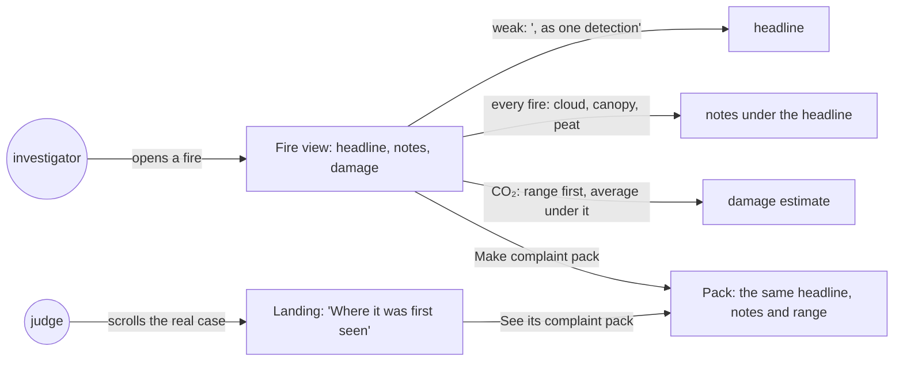
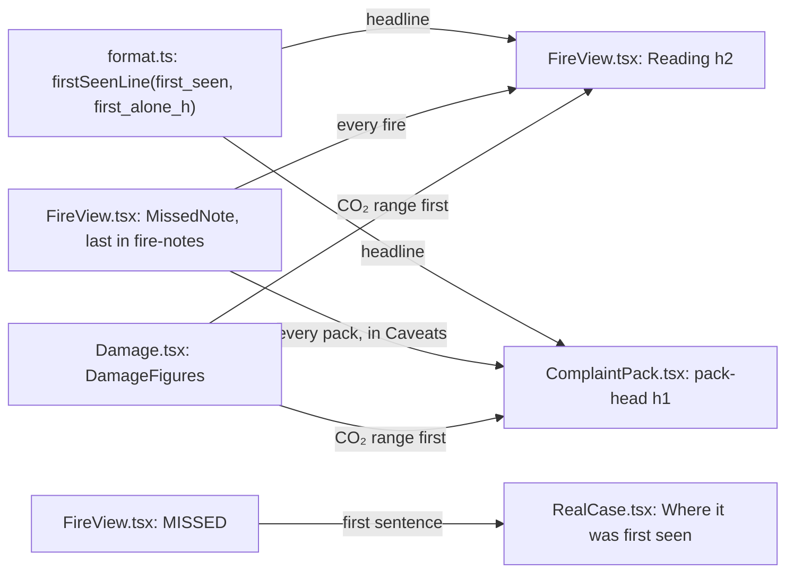
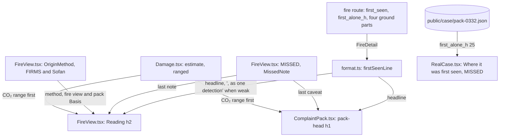
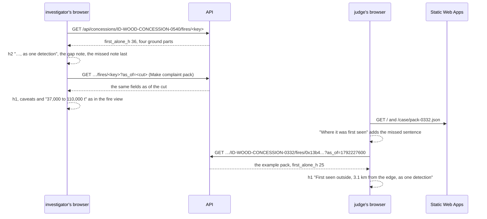

# Origin and range

**Version:** v1 · **Status:** Refined · **Type:** Enhancement · **Project type:** Web UI

**Shape doc:** docs/specs/judge-review/shape.md
**Depends on:** origin-confidence, damage-check, claim-fixes

A weak first sighting says "as one detection" in its headline. Every fire names what the satellite
can miss, and the CO₂ figure leads with its range. claim-fixes left these to this slice (its O2), so
a reader's last three points stop holding.

## Problem

A reader of the live site on 2026-10-23 made three points that the page doesn't answer yet:

- **The headline rests on one detection.** The example pack's headline reads "First seen outside,
  3.1 km from the edge". Its first pass, 12 Oct 05:16 UTC, is one detection, and the satellite next
  saw the fire 25 hours later. The note under the headline says so (D113), but the headline alone
  doesn't. The detection's FIRMS grade, nominal, is not the weak part: 251 of the pack's 283
  detections are nominal.
- **The satellite misses fire, and the page says so only once.** NASA FIRMS names cloud, heavy
  smoke and tree canopy among the reasons a fire goes unseen. Smouldering peat is hard to see from
  space, as its heat is low and its area small (Sofan et al., Remote Sensing 11:465, 2019). So a
  fire may burn unseen before it is first seen, on either side of a concession's edge. Only "How
  this is worked out" names cloud, behind a disclosure (`web/src/FireView.tsx:129`).
- **The CO₂ figure reads as one number.** The fire view reads "About 76,000 t" for the e2e's 0332
  fire, with "Likely 37,000 to 110,000 t." in the grey line under it (`web/src/Damage.tsx:94`). The
  range is there, but it comes second.

IPCC's tables, read on 2026-10-24, give the range its limits:

| Factor | Value | Interval |
| ------ | ----- | -------- |
| Peat fuel burned, tropical drained peat wildfire (2013 Wetlands Supplement, Table 2.6) | 353 t dry matter a hectare | 95%: 170 to 536 |
| Peat's gas factor (Table 2.7) | 464 g CO₂-C a kg | none: one study, Christian et al. 2003 |
| Other ground's fuel burned, all secondary tropical forests (2006 Guidelines, Vol. 4, Table 2.4) | 42.2 t dry matter a hectare | standard error 23.6, so a 95% interval reaches zero |
| Other ground's gas factor, tropical forest (Table 2.5) | 1,580 g CO₂ a kg | ± 90, one standard deviation |

## Slice test

| Check                         | Result |
| ----------------------------- | ------ |
| Cuts every layer it needs     | yes: the fire view, the pack, the landing's real case and the damage estimate in `web/src`. The API already sends `first_alone_h` and the four ground parts, so the API, the recorder and the chain don't change |
| One e2e test walks it         | yes: open the weak and the firm fire near ID-WOOD-CONCESSION-0540 and read their headlines and notes, open the 0332 fire and read its CO₂ range, make its pack and read the same, then read the landing's first-sighting step |
| Worth shipping alone          | yes: a judge who opens the example pack reads "as one detection" in its headline, and every reader sees what the satellite can miss and the CO₂ as a range |
| Fits (≤5 scenarios, ≤2 areas) | yes: 5 scenarios; two areas, the first-sighting reading (fire view, pack and landing) and the damage estimate |

**Path:** full. New copy in three places and a changed figure in two, across more than three files.

## User story

As a watchdog investigator, I want the headline, the first sighting and the CO₂ figure to show how
sure each one is, so that a company can't say the grievance hides its weak points.

## Flow



An investigator reads the weak point in the headline, the satellite's limits under it, and the CO₂
as a range, and the pack carries all three. A judge meets the limits on the landing and the
headline in the example pack.

## Acceptance criteria

```gherkin
Scenario: A weak first sighting says so in its headline
  Given the fire near ID-WOOD-CONCESSION-0540 first seen on 13 Oct 2026 06:37 UTC as one detection,
    3.1 km outside the concession
  And the satellite next saw it 36 hours later
  When the investigator opens this fire
  Then its heading reads "First seen outside, 3.1 km from the edge, as one detection"
  And the note under it says "The satellite didn't see this fire again for 36 hours, so that detection
    may be a separate fire."
  And its complaint pack's heading and note read the same

Scenario: Every fire names what the satellite can miss
  Given the fire near ID-WOOD-CONCESSION-0540 first seen on 13 Oct 2026 06:37 UTC as one detection,
    3.4 km inside the concession, and seen again 12.7 hours later
  When the investigator opens this fire
  Then its heading reads "First seen inside, 3.4 km from the edge", with no "as one detection"
  And under it: "The satellite can miss fire under cloud, heavy smoke or thick tree canopy, and peat
    that smoulders with too little heat to show. This fire may have burned unseen before it was first
    seen, inside or outside the concession."
  And its complaint pack carries the same two sentences on top, with the other caveats

Scenario: The CO₂ figure leads with its range
  Given the ID-WOOD-CONCESSION-0332 fire of damage-check scenario 1: 19 VIIRS NOAA-20 detections
    whose squares join into 59.21 ha inside on peat, 144.31 ha outside on peat and 6.30 ha outside
    on other ground
  When the investigator opens the fire
  Then "CO₂ released" reads "37,000 to 110,000 t"
  And the line under it says "About 76,000 t at IPCC's average. 11,000 to 33,000 t of it inside
    the concession."
  And its complaint pack reads the same

Scenario: A fire with no peat keeps one CO₂ figure
  Given hotspot B of fire-record scenario 1, 2026-10-14 06:18 UTC, 370 m outside
    ID-WOOD-CONCESSION-0377, whose square is 14.06 ha with no peat
  When the investigator opens its fire from ID-WOOD-CONCESSION-0377
  Then "CO₂ released" reads "About 400 t", with no range
  And "How this is worked out" says "The CO₂ range is IPCC's 95% interval for the peat a fire burns.
    Other ground is at IPCC's average, since its interval reaches zero."

Scenario: The landing's first sighting names what the satellite can miss
  Given the landing's real case, read from the committed pack of the ID-WOOD-CONCESSION-0332 fire,
    cut at 17 Oct 2026 09:00 UTC
  When a judge scrolls to "Where it was first seen"
  Then after "It didn't see the fire again for 25 hours, so that detection may be a separate fire."
    it says "The satellite can miss fire under cloud, heavy smoke or thick tree canopy, and peat that
    smoulders with too little heat to show."
  And "See its complaint pack" opens a pack whose heading reads "First seen outside, 3.1 km from
    the edge, as one detection"
```

The fires in scenarios 1, 2 and 4 are the e2e's own records in `fixtures/firms/fire-record.csv`,
and the fire in scenario 3 is in `fixtures/firms/fire-origin.csv`. The CO₂ figures use the 2023
shares, 61.8% of peat and 42.2% of other ground (D126, D127).

## Scope

**In:**

- A weak first sighting (D112) adds ", as one detection" to its headline: the fire view's `h2` and
  the pack's `h1`. The reading stays (D113). The weak note under it no longer repeats "one
  detection" (O1).
- Every fire carries two sentences on what the satellite can miss under its headline, in the fire
  view and on top of the pack (D36). The landing's "Where it was first seen" step adds the first
  sentence (O2). They take the words of NASA FIRMS and Sofan et al. 2019, which the method cites (O4).
- "CO₂ released" leads with the range from peat fuel's 95% interval. The average moves to the grey
  line. The part inside the concession is a range when it holds peat (O3).
- A fire with no peat keeps one figure. "How this is worked out" says why other ground and peat's
  gas factor have no interval.
- Every pack, old or new, shows the new copy (D129).

**Out:**

- "as one detection" on a first pass that isn't weak: not planned. Most fires are first seen as one
  detection, so the words would stop standing out (D112, O1).
- The concession list's "Where first seen" cell: not planned (D116).
- A range on the ground, the likely burned ground or the cost: not planned. D126 rejected a range
  from the MODIS share, and the World Bank's cost has no interval.
- Other ground's interval in the CO₂ range: not planned (O3).
- The FIRMS confidence grade in the headline: not planned. 251 of the example pack's 283 detections
  are nominal, so the grade doesn't mark the weak point.
- The landing's hero caption: it already says "as one detection", so it stays.

## Interface

Copy changes in the real components, and one figure leads with its range. Nothing is added, moved or
restyled.



The missed note and the method's sources take their final words at `/build` (O4); pause 2's code
still has "cloud or thick tree canopy, and peat that smoulders below the surface".
`firstSeenLine` adds the words when `first_alone_h` is set, so the fire view and the pack read the
same headline. `MissedNote` sits last in the notes, after the notes on the fire's own record.

| Where | Was | Now |
| ----- | --- | --- |
| Fire view `h2`, pack `h1`, weak first sighting | First seen outside, 3.1 km from the edge | First seen outside, 3.1 km from the edge, as one detection |
| The weak note | First seen as one detection, then not seen for 25 hours. That detection may be a separate fire. | The satellite didn't see this fire again for 25 hours, so that detection may be a separate fire. |
| Fire view notes and pack caveats, every fire, last | (none) | The satellite can miss fire under cloud, heavy smoke or thick tree canopy, and peat that smoulders with too little heat to show. This fire may have burned unseen before it was first seen, inside or outside the concession. |
| Fire view and pack Basis, "How this is worked out" | NOAA-20 passes about twice a day and cloud can hide a fire, so it may burn for hours before it is first seen. | NOAA-20 passes about twice a day, so a fire may burn for hours before it is first seen. NASA FIRMS names cloud, heavy smoke and tree canopy among the reasons a fire goes unseen. Smouldering peat is hard to see from space, as its heat is low and its area small (Sofan and others, 2019, doi 10.3390/rs11040465). |
| Landing, "Where it was first seen" | …so that detection may be a separate fire. Scroll on… | …so that detection may be a separate fire. The satellite can miss fire under cloud, heavy smoke or thick tree canopy, and peat that smoulders with too little heat to show. Scroll on… |
| "CO₂ released", with peat | About 76,000 t / Likely 37,000 to 110,000 t. 22,000 t of it inside the concession. | 37,000 to 110,000 t / About 76,000 t at IPCC's average. 11,000 to 33,000 t of it inside the concession. |
| "CO₂ released", no peat | About 400 t | About 400 t |
| Damage, "How this is worked out", before "Methane…" | (none) | The CO₂ range is IPCC's 95% interval for the peat a fire burns. Other ground is at IPCC's average, since its interval reaches zero. IPCC gives no interval for peat's 464 g, which comes from one study. |

The fire view's notes and the pack's caveats now always show, since every fire has the missed note.
A range whose ends round to the same two figures shows as one figure, "About …", so a fire with a
sliver of peat never reads "400 to 400 t". The part inside follows the same rule. "Likely" leaves
the CO₂ line: the range says it.

**Motion tier:** none new. The notes and the damage panel enter with the fire view as they do now
(tier 1).

**Components used:** the fire view's `h2` and `fire-notes`, the pack's `pack-head` `h1` and
`pack-caveats`, `fw-help`, the real case's step, and the damage panel's `fw-kv` with
`damage-value` and `sub`. There is no new component, no new token and no CSS change.

**Design system:** Fire Watch, `docs/design/design-system/` (D2).

**Preview:** real components in `web/src`, after `cd web && pnpm dev`:
`http://localhost:5173/?preview=origin-confidence` (states: the 0332 fire, the firm 0356 fire, its
pack, the landing) and `?preview=damage-estimate` (the peat, off-peat and never-spread fires). The
drift check passed over the 5 files changed. `tsc -b` is clean, and all 328 web unit tests pass. At
390 px the pack, the fire view, the landing and the damage panel don't scroll sideways once the
preview's own State picker is removed; the picker alone is 588 px wide.

**Craft checks:** a one-line prompt would add a "Confidence: low" badge and an info icon with a
tooltip. This puts the weak point in the headline's own words, and the satellite's limits in a
sentence the reader can't miss, with no new component. Next to Stripe's documentation, the
reference for D2, the figure leads with what is known and the working stays one disclosure away.

## Technical plan

### Approach

The page changed at pause 2 in `format.ts`, `FireView.tsx`, `ComplaintPack.tsx`, `RealCase.tsx` and
`Damage.tsx`, with their unit tests. This plan adds the rest. The missed note takes the sources'
words, and the method cites them (O4). A unit test holds the one-figure rule for a sliver of peat. A
new e2e walks the slice, and two older e2e specs take the new copy. The API, the recorder and the
chain don't change.

Relies on: D26, D36, D81, D112, D113, D115, D116, D126, D127, D129, D137, D138, D139, D140.



The API already sends every field this needs. The page words the headline from `first_alone_h`,
adds the same missed note in three places, and leads the CO₂ with the peat range.



An investigator reads the weak headline, the missed note and the CO₂ range in the fire view, then
the same in the pack. A judge reads the missed sentence on the landing and the weak headline in the
example pack. In the e2e, the example pack's API call is answered from the committed copy (D137).

### Changes

| File | What | Why |
| ---- | ---- | --- |
| `web/src/FireView.tsx:88` | `MISSED` becomes "The satellite can miss fire under cloud, heavy smoke or thick tree canopy, and peat that smoulders with too little heat to show." | Scenarios 2 and 5; O4 |
| `web/src/FireView.tsx:141` | `OriginMethod`'s last paragraph adds, after its first sentence: "NASA FIRMS names cloud, heavy smoke and tree canopy among the reasons a fire goes unseen. Smouldering peat is hard to see from space, as its heat is low and its area small (Sofan and others, 2019, doi 10.3390/rs11040465)." The pack's Basis shows the same, as it uses `OriginMethod` | O4 |
| `web/src/FireView.test.tsx`, `web/src/ComplaintPack.test.tsx`, `web/src/RealCase.test.tsx` | The `MISSED` strings take the new words. The method test reads the sources sentence | Scenarios 2 and 5 |
| `web/src/Damage.test.tsx:100` | A test after "scales a fire off peat…": 14.06 ha of other ground outside and 0.01 ha of peat read "About 400 t", with no range and no "at IPCC's average" | The earn-it for `ranged` |
| `web/e2e/origin-and-range.spec.ts` (new) | The slice's walk, below | E2E |
| `web/e2e/origin-confidence.spec.ts:6`, `:53` | `WEAK_NOTE` becomes "The satellite didn't see this fire again for 36 hours, so that detection may be a separate fire." The pack's `h1` reads `${WEAK}, as one detection` | The old walk on the new copy |
| `web/e2e/damage-estimate.spec.ts:18` | `readFigures` reads "37,000 to 110,000 t" in place of "About 76,000 t" | The old walk on the new copy |
| `docs/ARCHITECTURE.md:61` | The fire record page row says the headline names a weak first sighting, every fire names what the satellite can miss, and the CO₂ leads with IPCC's range for burned peat | Scenarios 1 to 3 |

Done at pause 2 and kept: `web/src/format.ts`, `FireView.tsx`, `ComplaintPack.tsx`, `RealCase.tsx`,
`Damage.tsx`, their unit tests, and the origin-confidence preview's state label.

Reusing: `firstSeenLine`, `OriginNotes` and the pack's `Caveats`, `OriginMethod` (shared by the
fire view and the pack's Basis), `estimate()` and `twoFigures()`, the e2e's records in
`fixtures/firms/fire-record.csv` and `fire-origin.csv`, the landing e2e's `EXAMPLE_PACK` and its
`route.fulfill` from `public/case/pack-0332.json` (D137), the `toStep` helper and the fake Google
Maps file.

### Earn-it

| Added | Triggered by |
| ----- | ------------ |
| `MISSED` and `MissedNote` in `FireView.tsx` | Scenarios 2 and 5: the fire view, the pack and the landing say the same sentence |
| `co2InsideLow` and `co2InsideHigh` in `estimate()` | Scenario 3: the part inside is a range |
| `ranged()` in `Damage.tsx` | Risk: a fire with a sliver of peat would read "400 to 400 t" |
| `web/e2e/origin-and-range.spec.ts` | The slice test: one e2e walks the slice |

Cut: a confidence badge or a tooltip (a new component, and the headline's own words do it), links in
the note itself (the method holds sources, as for position error, D115), other ground's interval
(O3), and a range on the ground or the cost (D126).

### Non-functionals

|                      |                                                                               |
| -------------------- | ----------------------------------------------------------------------------- |
| **Load**             | None new. One more paragraph in each fire view and pack |
| **Breaks first**     | Nothing at 10×. An API answer without `first_alone_h` reads no extra words, as before |
| **Security surface** | No new route, input or secret. Copy and arithmetic on data the page already has |
| **Proof it works**   | After Deploy, the lazy chunks hold "peat that smoulders with too little heat to show", "as one detection" and "at IPCC's average" (lesson `live-bundle-lazy-chunks`). The live example pack's `h1` reads "First seen outside, 3.1 km from the edge, as one detection" |
| **Rollout**          | No flag, as D81. Merge to main; Deploy ships the page. Rollback: revert the merge |

### Test plan

| Scenario | Test | Command |
| -------- | ---- | ------- |
| 1. A weak headline | `format.test.ts` "says in the headline when the first pass was one detection…"; `FireView.test.tsx` "says in the heading that the example fire's first pass is one detection…"; `ComplaintPack.test.tsx` "puts one detection in the heading…" and "gives a weak first sighting its note…"; the e2e | `cd web && pnpm test && pnpm e2e origin-and-range` |
| 2. The missed note | `FireView.test.tsx` "gives a firm fire that never joined another only what the satellite can miss" and "puts the notes after can't tell…"; `ComplaintPack.test.tsx` "too close to tell" and "names joins, position error…"; the e2e | as above |
| 3. The CO₂ range | `Damage.test.tsx` "gives a peat fire's damage, split at the edge" and "puts the never-spread caveat…"; `ComplaintPack.test.tsx` "holds the damage estimate…"; the e2e | as above |
| 4. No peat, one figure | `Damage.test.tsx` "scales a fire off peat…", "shows how the estimate is worked out…" and the new sliver test | `cd web && pnpm test` |
| 5. The landing | `RealCase.test.tsx` "tells the fire, the claim, where it was first seen…"; the e2e | `cd web && pnpm test && pnpm e2e origin-and-range` |
| Earlier slices | the full suites | `cd api && uv run pytest`; `cd web && pnpm test && pnpm e2e` |

The e2e needs `docker compose up -d --wait db` and `~/.foundry/bin` on `PATH`. The unit tests
changed at pause 2 passed on their first run, so `/build` breaks the code once for each and watches
it fail (lesson `pause-2-code-needs-mutants`).

**E2E:** `web/e2e/origin-and-range.spec.ts` "an investigator reads a weak first sighting, what the
satellite can miss and the CO₂ range, and a judge reads them on the landing and the example pack":

1. Open `/?tool` for 11 to 15 Oct, then ID-WOOD-CONCESSION-0540, then its fire first seen 13 Oct
   06:37 "Outside, 3.1 km". Its heading is exactly "First seen outside, 3.1 km from the edge, as one
   detection", with the gap note and the missed note.
2. Click "Fires in ID-WOOD-CONCESSION-0540", then the "Inside, 3.4 km" fire. Its heading is exactly
   "First seen inside, 3.4 km from the edge", with the missed note.
3. Open ID-WOOD-CONCESSION-0332 and its fire first seen 13 Oct 17:37. "CO₂ released" reads
   "37,000 to 110,000 t" and the line under it.
4. Make its pack. The pack's figures `dl` reads the same, and its caveats end with the missed note.
5. Open `/` and scroll to "Where it was first seen". It reads the missed sentence.
6. Answer the example pack's API call from the committed copy, open `EXAMPLE_PACK`, and read its
   `h1`.

Headings are checked with `exact: true`, since Playwright matches a role's name as a substring.

### Chunks

Single chunk. The page is done; the rest is two sentences, one unit test, one new e2e and two edited
ones.

### Risks

| Risk | Mitigation |
| ---- | ---------- |
| A reader takes "may have burned unseen … inside or outside the concession" as Fire Watch doubting every fire | The reading stays (D113). The note says what the satellite can't see, and the method gives its sources |
| A reader takes the CO₂ range as doubt about the fire, not the factor | The line under it says "at IPCC's average", and the method says the range is IPCC's interval for the peat a fire burns |
| An old e2e passes on the new heading by a substring match, and proves nothing | The new spec checks each heading with `exact: true`; origin-confidence's pack `h1` uses `toHaveText`, which matches in full |

### Decisions to record

`/build` appends these to `DECISIONS.md`. None supersedes an entry.

#### D138 · 2026-10-24 · Say "as one detection" in a weak first sighting's headline

Why: the example pack's headline "First seen outside, 3.1 km from the edge" rests on one detection
that the satellite next saw 25 hours later. The reading stays (D113), and the headline now carries
the weak point. It applies to 380 of 4,445 readings on 12 to 22 Oct 2026.
Rejected: on any one-detection first pass (true of most fires, so the words stop standing out,
D112), the headline as it is (the weak point stays only in the note under it).
Source: docs/specs/origin-and-range.md
Status: active

#### D139 · 2026-10-24 · Name cloud, smoke, canopy and smouldering peat under every fire's headline, with sources

Why: NASA FIRMS names cloud, heavy smoke and tree canopy among the reasons a fire goes unseen, and
Sofan et al. (2019) find smouldering peat hard to see for its low heat and small size. So any fire
may have burned unseen before it was first seen, on either side of the edge. Only the method,
behind a disclosure, named cloud.
Rejected: only fires read as inside or outside (the limit holds for every first sighting), only in
"How this is worked out" (a reader of the headline may not open it), "peat that smoulders below the
surface" (no source read says so).
Source: docs/specs/origin-and-range.md
Status: active

#### D140 · 2026-10-24 · Lead the CO₂ figure with IPCC's 95% interval for burned peat

Why: one figure claims more than the factors know. IPCC gives a 95% interval only for peat fuel, 170
to 536 t of dry matter a hectare (2013 Wetlands Supplement, Table 2.6). Peat's gas factor comes from
one study with no interval, and other ground's standard error, 23.6 on 42.2, puts its interval at
zero. A fire with no peat keeps one figure.
Rejected: peat and other ground, with other ground from its standard error floored at zero (a fire
with no peat would read "0 to 830 t").
Source: docs/specs/origin-and-range.md
Status: active

## Open items

| ID | What | Type | Raised at | Owner | Status | Answer |
| -- | ---- | ---- | --------- | ----- | ------ | ------ |
| O1 | What does the headline do when it rests on one detection that the satellite next saw 25 hours later? | question | spec p1 | user | Resolved | 2026-10-24: add ", as one detection" to a weak first sighting's headline only (D112). The reading stays (D113), and the note under it drops its repeated words |
| O2 | Where does the line on what the satellite can miss go: cloud, tree canopy and peat that smoulders below the surface? | question | spec p1 | user | Resolved | 2026-10-24: under every fire's headline in the fire view and the pack, and in the landing's "Where it was first seen" step |
| O3 | What does the CO₂ range cover? IPCC gives a 95% interval only for peat fuel | question | spec p1 | user | Resolved | 2026-10-24: peat fuel only. A fire with no peat keeps one figure, and the method says why. The part inside is a range too |
| O4 | The note says "peat that smoulders below the surface". NASA FIRMS lists cloud, heavy smoke and tree canopy; Sofan et al. 2019 say smouldering peat is hard to see for its low heat and small size. No source read says "below the surface" | flag | spec p3 | user | Resolved | 2026-10-24: match the sources and cite them. The note reads "under cloud, heavy smoke or thick tree canopy, and peat that smoulders with too little heat to show", and the method cites FIRMS and Sofan et al. 2019 |

_Never delete this section or its rows. See references/ledger.md._

## Glossary

- **Detection**: one spot where the satellite saw fire on one pass, about 375 m across.
- **Pass**: one trip of the NOAA-20 satellite over the area. It sees a place about twice a day.
- **Weak first sighting**: the first pass is one detection, and the satellite next saw the fire
  more than 14 hours later (D112).
- **95% interval**: the span that IPCC expects the true value to fall in 95 times out of 100.
- **Standard error**: how far a table's average may be from the true one. About two of them each
  side make a 95% interval.
- **Canopy**: the closed roof of tree crowns, which can hide a fire below it from the satellite.
- **FIRMS**: NASA's Fire Information for Resource Management System, which publishes the satellite
  fire detections.
- **Lazy chunk**: a part of the page's code that the browser loads only when that page needs it.
- **Mutant**: a deliberate break in the code, made to check that a test fails on it.
- **e2e**: end-to-end: one test that walks the whole slice as a user would.
