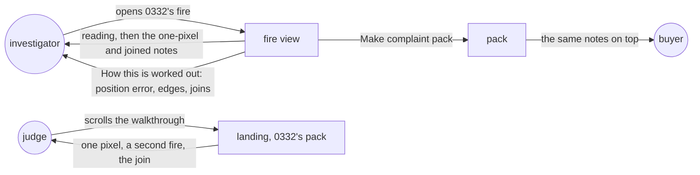
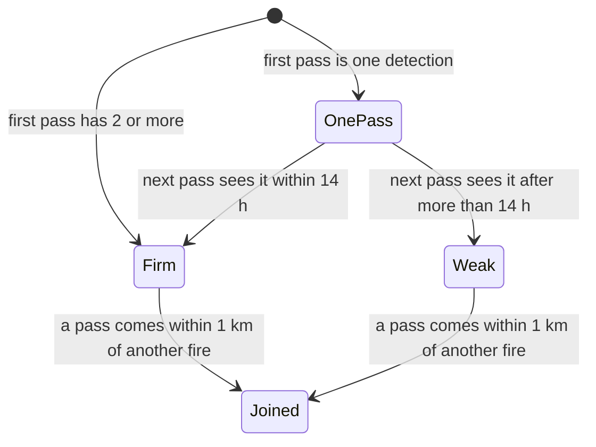
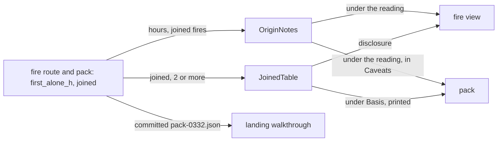

# Origin confidence

**Version:** v1 · **Status:** Draft · **Type:** Enhancement · **Project type:** Web UI

**Shape doc:** docs/specs/judge-review/shape.md
**Depends on:** fire-origin, complaint-pack, newcomer-walkthrough

The fire view, the pack and the landing say when a fire's first sighting is one detection with a
long gap after it, and when one fire is several that the satellite first saw apart. It comes now
because the landing's example fire rests on both, and a hostile review found it.

## Problem

"First seen outside" is the reading a company can attack first. Two facts behind a reading are
not on the page today:

- **One pixel, then a long gap.** On 12 to 22 Oct 2026 the record holds 4,445 fire readings
  (3,660 fires, some near two concessions). 1,230 were seen on two or more passes. In 380 of all
  readings, the first pass is one detection and the satellite next saw the fire more than 14 hours
  later, so it missed at least one pass in between.
- **Joined fires.** A pass that comes within 1 km of two fires joins them (D25), and the joined
  fire keeps the older one's first sighting (fire-origin rule 3). 127 of the 1,230 multi-pass
  readings joined fires that the satellite first saw apart.

The landing's example fire has both. As its pack stands at 17 Oct 09:00 UTC, with 283 detections
on 8 passes:

- Its first pass, 12 Oct 05:16 UTC, is one nominal-confidence detection, 3,100 m outside
  ID-WOOD-CONCESSION-0332. The satellite next saw it 25 hours later.
- Until 14 Oct 17:20 UTC it was two fires more than 1 km apart. The second was first seen on
  13 Oct 06:37 UTC, 2 m from the edge, with 6 of its 16 detections inside.
- Before the join, the first fire's 3 detections inside were all within 129 m of the edge.

So the landing's "By 13 Oct it was inside" (`web/src/Landing.tsx:65`) and "The fire has crossed the
edge" at pass 2 (`web/src/RealCase.tsx:157`) rest on the second fire. "On this point the record
agrees with the company" (`web/src/RealCase.tsx:140`) rests on one pixel.

Two limits are not named anywhere:

- **VIIRS position error.** NOAA-20's VIIRS positions are within 400 m at nadir (3-sigma), most
  within 200 m (Blonski, Wang and Cao, J. Appl. Remote Sens. 17(3) 034506). D26's 375 m margin
  counts half the widest pixel and no position error.
- **Concession edges.** Trase draws them from the Ministry of Forestry's permit maps and states no
  position accuracy. Gaveau et al. (2017) found that land use often does not match the permit
  lines.

## Slice test

| Check                         | Result |
| ----------------------------- | ------ |
| Cuts every layer it needs     | yes — the API's fire reading (`fires.py`) adds the weak-sighting and joined facts; the fire view, the pack and the landing show them. No schema, recorder or contract change |
| One e2e test walks it         | yes — on anvil with the example pack's 283 records sealed (D92), open 0332's fire and read both notes, open its pack and read them on top, then read the landing's pass 1 and pass 5 steps |
| Worth shipping alone          | yes — an investigator sees the weak point before a company does, and a judge no longer finds a landing claim that rests on a second fire |
| Fits (≤5 scenarios, ≤2 areas) | yes — 5 scenarios; two areas: the API's fire reading, and the page that shows it in three places from the same fields |

**Path:** full — new logic in the fire reading and new copy on three screens.

## User story

As a watchdog investigator, I want the fire view and the pack to say when a fire's first sighting
is weak or the fire is several joined, so that I don't send a grievance whose "first seen outside"
a company can pick apart.

## Flow



The investigator reads the notes before making a pack, the buyer gets them on top of the pack, and
the judge reads the same facts in the walkthrough.

## States



Fires are worked out again on each request, so the notes appear as passes arrive. A one-pass fire
gets no weak note: its Passes line already says "1, with 1 detection". Joined and Weak can both
hold, as on 0332.

## Acceptance criteria

```gherkin
Scenario: A first sighting of one detection, then a long gap
  Given 0332's fire as stored by 17 Oct 2026 09:00 UTC: 283 detections on 8 passes
  And its first pass, 12 Oct 05:16 UTC, is one nominal-confidence detection 3,100 m outside
  And the satellite next saw the fire on 13 Oct 06:37 UTC
  When the investigator opens this fire
  Then it still reads "First seen outside, 3.1 km from the edge"
  And it says "First seen as one detection, then not seen for 25 hours. That detection may be a
    separate fire."

Scenario: A fire joined from two first seen apart
  Given the same fire
  And until 14 Oct 17:20 UTC it was two fires more than 1 km apart
  And the second was first seen on 13 Oct 06:37 UTC, 2 m from the edge, 6 of its 16 detections inside
  When the investigator opens this fire
  Then it says "Fire Watch joined two fires here on 14 Oct 17:20 UTC, when they came within 1 km.
    First seen above is the older fire's. The other was first seen on 13 Oct 06:37 UTC, on both
    sides of the edge."
  And "Seen inside from 13 Oct 06:37 UTC" stays, as the joined fire's

Scenario: A firm, unjoined fire gets no note, and the method names its limits
  Given the ID-WOOD-CONCESSION-0356 fire first seen on 14 Oct 06:20 UTC as one detection, 409 m inside
  And the satellite saw it again 11 hours later, and it never joined another fire
  When the investigator opens this fire
  Then it reads "First seen inside, 410 m from the edge" with no one-detection or joined note
  And "How this is worked out" says "Straight below the satellite, NOAA-20 places almost every
    detection within 400 m of the fire, and most within 200 m"
  And it says "Concession edges come from Trase's map, which gives no accuracy for its lines."
  And it says "one fire here can be several that the satellite first saw apart"

Scenario: The pack carries the notes
  Given the investigator makes a pack of 0332's fire, cut at 17 Oct 09:00 UTC
  When the buyer opens the pack link
  Then both notes from the first two scenarios sit on top with the other caveats
  And they print on the PDF

Scenario: The landing tells 0332's fire as the record shows it
  Given the landing's example, 0332's pack cut at 17 Oct 09:00 UTC
  When a judge scrolls the walkthrough
  Then the hero caption says "The satellite first saw it on 12 Oct as one detection, 3,100 m
    outside the concession. On 14 Oct it joined a second fire, first seen the day before on both
    sides of the edge."
  And the pass 1 step says "It didn't see the fire again for 25 hours, so that detection may be a
    separate fire."
  And the pass 2 step says "These include another fire, first seen on this pass more than 1 km from
    the first, on both sides of the edge."
  And the pass 5 step says "On this pass the fires came within 1 km of each other, so Fire Watch
    counts them as one."
  And no step says "On this point the record agrees with the company" or "The fire has crossed the
    edge"
```

## Scope

**In:**
- A weak first sighting: the first pass is one detection, and the satellite next saw the fire
  more than 14 hours later (D112). A one-pass fire gets no note.
- A weak first sighting keeps its reading. The note says the detection may be a separate fire
  (D113).
- A joined fire: a note says when it was joined and where each other fire was first seen (D114).
  Pause 2 sets how a long list is cut short; the live 0332 fire has 7 joins.
- "How this is worked out" names the VIIRS position error with its numbers and source, the
  concession edges' source and its missing accuracy, and joining. The 375 m margin stays (D115).
- The notes show in the fire view and the pack, on top with the other caveats (D36). The
  concession list stays as it is (D116).
- 0332's fire stays the landing's example. The hero caption and the walkthrough steps say what the
  record shows: one pixel, a second fire on both sides of the edge, then the join (D111).
- No new seals (D24). The notes are worked out from sealed detections, as first seen is.

**Out:**
- Splitting joined fires apart, or a new join rule — not planned; D25 stays.
- Each detection's own pixel size from its scan width — the record does not store scan width; not
  planned.
- Proving no detection is missing from a pack — complete-packs.
- A wider margin for position error — forecast-v2 can take it with the forecast's own 375 m step
  (D115).
- Marking weak and joined fires in the concession list — not planned (D116).

## Interface

The fire view and the pack get two notes under the reading, the same sentences in both. A fire
joined from more than two gets its list: behind a disclosure in the fire view, under Basis in the
pack, which prints. The method text names joins, position error and the concession edges, in both.
The landing's hero caption and three walkthrough steps tell 0332's fire as the record shows it.



Each place reads the same two fields, so the fire view, the pack and the landing say the same
thing.

| Where | When | Copy |
| ----- | ---- | ---- |
| Fire view, pack | `first_alone_h` is set | First seen as one detection, then not seen for 25 hours. That detection may be a separate fire. |
| Fire view, pack | one fire joined | Fire Watch joined two fires here on 14 Oct 17:20 UTC, when they came within 1 km. First seen above is the older fire's. The other was first seen on 13 Oct 06:37 UTC, on both sides of the edge. |
| Fire view, pack | 2 or more joined | Fire Watch joined 8 fires here, the first time on 14 Oct 17:20 UTC, as they came within 1 km. First seen above is the oldest fire's. The 7 others are listed below. (Pack: "listed under Basis.") |
| Fire view disclosure, pack Basis | 2 or more joined | "The 7 fires joined to this one", then a table: Joined (UTC), First seen (UTC), Where first seen ("Both sides of the edge", "Outside, 2.6 km") |
| Method, both | always | A fire that comes within 1 km of another is joined to it, so one fire here can be several that the satellite first saw apart. First seen is the oldest one's. |
| Method, both | always | A detection's position can be off as well. Straight below the satellite, NOAA-20 places almost every detection within 400 m of the fire, and most within 200 m (Blonski and others, 2023, doi 10.1117/1.JRS.17.034506). The 375 m margin doesn't allow for this. Concession edges come from Trase's map, which gives no accuracy for its lines. |
| Landing hero caption | at the example fire | A fire in ID-WOOD-CONCESSION-0332, Central Kalimantan, on 14 Oct 2026. The satellite first saw it on 12 Oct as one detection, 3,100 m outside the concession. On 14 Oct it joined a second fire, first seen the day before on both sides of the edge. |
| Walkthrough, pass 1 | `first_alone_h` is set | The satellite first saw it on 12 Oct 05:16 UTC as one detection, outside the concession and 3,100 m from its edge. It didn't see the fire again for 25 hours, so that detection may be a separate fire. Scroll on to see what came next, one satellite pass at a time. |
| Walkthrough, a pass | a joined fire was first seen on it | 13 Oct 06:37 UTC · 35 detections, 6 inside the concession. These include another fire, first seen on this pass more than 1 km from the first, on both sides of the edge. |
| Walkthrough, a pass | a join happened on it | 14 Oct 17:20 UTC · 66 detections, 43 inside the concession. On this pass the fires came within 1 km of each other, so Fire Watch counts them as one. |

The notes sit after "The satellite record can't say which side this fire started on" and before
the never-spread and records-begin notes. A one-pass fire and a fire with nothing joined show
nothing new. The two dropped lines are "On this point the record agrees with the company" and
"The fire has crossed the edge".

**The page expects** (pause 3 settles it): the fire route and the pack add `first_alone_h`, whole
hours or null (D112), and `joined`, oldest join first, each `{at_unix, first_seen_unix,
first_seen}` with `first_seen` read from that fire's own first pass (`JoinedFire` in
`web/src/api.ts`). The concession list gets neither (D116). The committed `pack-0332.json` gets
both from the redone curl line (D90).

**Phone.** At 390 px the joined table's headers and times wrap, so the fire panel and the pack stay
inside the screen; on wider screens the two times stay on one line. The new disclosure's summary
takes the existing `.fire-reading summary` touch padding.

**Motion tier:** 1, and nothing new moves. The notes enter with the panel's `enter`; the new
disclosure opens with the fire panel's existing details animation, which reduced motion already
stops (O7).

**Components used:** `fw-panel`, `fw-help`, `fw-kv`, `fw-table` in `table-box`, and the
disclosure from the fire panel. No new token. One layout rule in `web/src/styles/app.css`,
`.joined`, keeps the two times unwrapped on wide screens, as `.forecast .table-box th.method` does.

**Design system:** Fire Watch, `docs/design/design-system/` (D2, D4, D94).

**Preview:** real components in `web/src`: `OriginNotes`, `JoinedTable` and `OriginMethod` in
`FireView.tsx`, used by `ComplaintPack.tsx`; captions in `RealCase.tsx` and `Landing.tsx`. Run
`cd web && pnpm dev` and open `http://localhost:5173/?preview=origin-confidence`. Six states, with
themes: 0332's fire as its pack stands; the same with the live list of 8 joined fires (O8); 0356's
firm fire; 0332's pack, with and without the long list; and the landing. The 0332 data is the
committed `pack-0332.json` plus the two new fields; 0356's is fire-origin's fixture. Seals stand
in. Drift check passed over the 9 files written. Two unit tests fail on the old copy until
`/build` rewrites them: `RealCase.test.tsx` "tells the fire, the claim, …" and `Landing.test.tsx`
"goes to the example fire, …".

## Decisions to record

Approved with pause 1. `/build` appends them to `DECISIONS.md` and flips D78's Status line.

## D111 · 2026-10-22 · Keep 0332's fire as the landing's example, told as two fires joined on 14 Oct

Why: on the full record its first sighting is one detection on 12 Oct 05:16 UTC, 3,100 m outside
ID-WOOD-CONCESSION-0332, not seen again for 25 hours. Until 14 Oct 17:20 UTC it was two fires; the
second, first seen 13 Oct 06:37 UTC 2 m from the edge, holds every detection more than 129 m
inside before the join. So the landing says that, not "started outside, spread in". Its 283
detections to the 17 Oct 09:00 UTC cut are all sealed, and it is the globe's fire on 14 Oct (D75).
Rejected: another example (3 fires are first seen outside, unjoined, not weak and later inside;
the largest, in 0341, crossed on 22 Oct and is not on the globe's day), the fire of fire-origin
scenario 1 (on the full record it reads "first seen on both sides").
Supersedes: D78
Source: docs/specs/origin-confidence.md
Status: active

## D112 · 2026-10-22 · A first sighting is weak when it is one detection and the next pass to see the fire is more than 14 hours later

Why: NOAA-20 passes about every 12 hours, so more than 14 hours means the satellite missed the
fire at least once. 380 of 4,445 readings on 12 to 22 Oct 2026. A one-pass fire gets no note: its
Passes line already says "1, with 1 detection".
Rejected: more than 24 hours (129 readings, and 0332's 25.35 hours sits next to the line), any
one-detection first pass (490 of the 993 multi-pass readings that name a side, so the note stops
standing out).
Source: docs/specs/origin-confidence.md
Status: active

## D113 · 2026-10-22 · A weak first sighting keeps its reading and adds a note

Why: the detection was where the reading says, and the page says "first seen", never "started"
(D26). The note says why it may not be where the fire started.
Rejected: reading it as "can't say which side" (321 readings lose a side that the detection itself
supports).
Source: docs/specs/origin-confidence.md
Status: active

## D114 · 2026-10-22 · Say on each joined fire when it was joined and where each other fire was first seen

Why: 127 of 1,230 multi-pass readings on 12 to 22 Oct 2026 joined fires the satellite first saw
apart (D25), and the joined fire keeps the oldest one's first sighting. On 0332's, "Seen inside
from 13 Oct" comes from the second fire.
Rejected: a line in "How this is worked out" only (an investigator can't tell which fires are
joined).
Source: docs/specs/origin-confidence.md
Status: active

## D115 · 2026-10-22 · Name VIIRS position error on the page, and keep the 375 m margin

Why: NOAA-20's VIIRS positions are within 400 m at nadir (3-sigma), most within 200 m (Blonski,
Wang and Cao, J. Appl. Remote Sens. 17(3) 034506), and D26 counts none of it. The forecast uses the
same margin (`forecast.py:98`, `:101`), so widening it changes the sealed forecast rule and the
2023 replay.
Rejected: 575 m for first seen alone (249 readings lose their side, and the fire view and the
forecast could disagree on "seen inside").
Source: docs/specs/origin-confidence.md
Status: active

## D116 · 2026-10-22 · Show the weak and joined notes in the fire view and the pack, not the concession list

Why: the list's "Where first seen" cell already holds the reading and one line under it, and the
notes need a sentence each. It keeps the slice to the shape's scope.
Rejected: a short line under "Where first seen" in the list.
Source: docs/specs/origin-confidence.md
Status: active

## Open items

| ID | What | Type | Raised at | Owner | Status | Answer |
| -- | ---- | ---- | --------- | ----- | ------ | ------ |
| O1 | A stricter origin rule may stop calling 0332's fire "first seen outside", and the landing is built on it (D78, D84) (from shape O9). Checked on 2026-10-22: the reading stays "outside" unless a weak first pass is skipped, which gives "both". The landing's "By 13 Oct it was inside" rests on a second fire, joined on 14 Oct. Only 3 fires in the record are first seen outside, unjoined, not weak and later inside; the largest, in 0341, crossed on 22 Oct and is not on the globe's day | unproven | shape | user | Resolved | 2026-10-22: keep 0332's fire, and retell it on the landing as the record shows it: one pixel, a second fire on both sides of the edge, then the join on 14 Oct (D111) |
| O2 | What makes a first sighting weak? | question | spec p1 | user | Resolved | 2026-10-22: the first pass is one detection, and the satellite next saw the fire more than 14 hours later, so it missed at least one pass. 380 readings (D112) |
| O3 | Does a weak first sighting change the reading, or only add a note? | question | spec p1 | user | Resolved | 2026-10-22: keep the reading and add a note. The detection was where the reading says; the note says it may be a separate fire (D113) |
| O4 | What does the page say about a fire joined from fires first seen apart? | question | spec p1 | user | Resolved | 2026-10-22: a note on each joined fire says when it was joined and where each other fire was first seen (D114) |
| O5 | VIIRS positions can be off by up to 400 m, and D26's 375 m margin counts none of it. Widening it also moves the forecast, which uses the same margin (`api/src/firewatch/forecast.py:98`, `:101`), its sealed rule and the 2023 replay | flag | spec p1 | user | Resolved | 2026-10-22: name it in "How this is worked out" with its numbers and source, and keep 375 m. The forecast, its sealed rule and the 2023 replay don't change (D115) |
| O6 | Does the concession list mark weak and joined fires? | question | spec p1 | user | Resolved | 2026-10-22: no. The notes show in the fire view and the pack; the list stays as it is (D116) |
| O7 | Which motion tier the notes and the joined list use | question | spec p2 | user | Resolved | 2026-10-22: tier 1, nothing new. The notes take the panel's `enter`; the disclosure takes the fire panel's existing details animation |
| O8 | The preview's long joined list is 7 rows read from the live database on 22 Oct: times, readings and edge distances of 0332's fire, no company names. Commit it? | question | spec p2 | user | Resolved | 2026-10-22: yes, in `web/src/preview/OriginConfidencePreview.tsx`. The landing already commits this fire's pack |

_Never delete this section or its rows. See references/ledger.md._

## Glossary

- **VIIRS** — the instrument on the NOAA-20 satellite behind FIRMS's 375 m fire detections.
- **Pass** — one time the satellite flies over and sees the fire; NOAA-20 passes about every 12 hours.
- **Nominal confidence** — FIRMS's middle grade of three (low, nominal, high) for how sure a
  detection is a fire.
- **Nadir** — straight below the satellite, where its pixels are smallest.
- **3-sigma** — a bound that about 997 of 1,000 errors fall within.
- **Join** — fire-origin's rule that puts two detections in one fire when they are within 1 km and
  48 hours of each other.
- **e2e** — end-to-end: one test that walks the whole slice as a user would.
