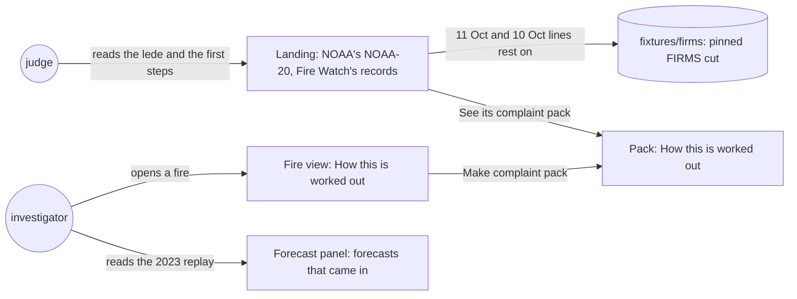
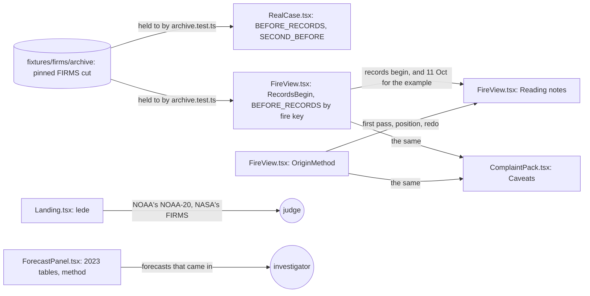
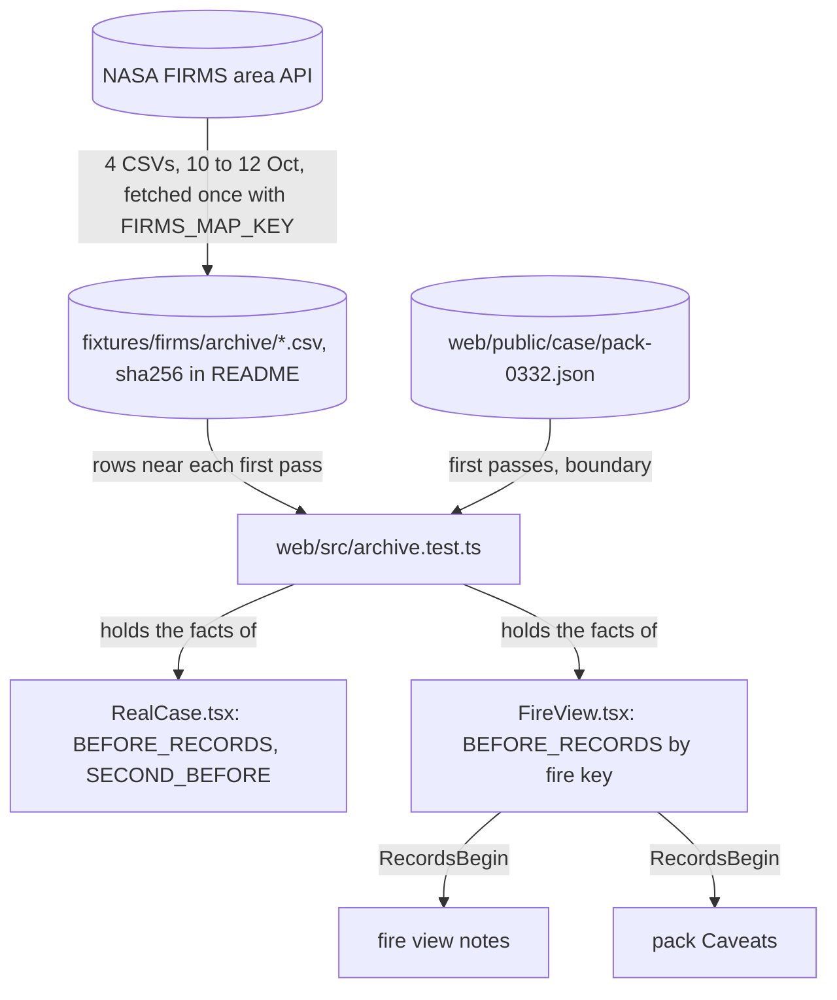

# Pack claims

**Version:** v1 · **Status:** Refined · **Type:** Bug · **Project type:** Web UI

**Shape doc:** docs/specs/judge-review/shape.md
**Depends on:** source-claims

The fire view, the complaint pack, the landing and the forecast panel stop making five claims that
the chain or the data doesn't support. The landing's earlier sightings rest on a committed copy of
NASA's archive, as every other figure on the page does.

## Problem

The hostile review run again on 2026-10-24, after source-claims shipped, scored the site 6.9/10. It
still found five claims that a company's lawyer could use:

- **"The first pass is the earliest satellite pass that saw the fire."** Every fire view and pack
  says this (`web/src/FireView.tsx:141`). For the example fire it is false: NOAA-20 saw fire 680 m
  away on 11 Oct, 11 hours before the first detection in Fire Watch's records. The landing now says
  so (`web/src/RealCase.tsx:24`), but the pack, which is what a buyer gets, doesn't. The landing's
  first step also says "the NOAA-20 satellite saw this fire" from 12 Oct (`web/src/RealCase.tsx:119`).
- **"Anyone can redo this from the chain and NASA FIRMS's public archive."** (`web/src/FireView.tsx:158`)
  The chain holds fingerprints, or one root per run, under random record IDs. Nothing on the chain
  ties to a FIRMS row without the records that Fire Watch's API sends.
- **The 11 Oct and 10 Oct sightings have no source a reader can check.** They are two dated
  constants (`web/src/RealCase.tsx:22-26`), read from FIRMS by hand on 2026-10-24. No data file,
  sha256 or command backs them, unlike every other figure on the landing.
- **"NOAA-20 places almost every detection within 400 m of the fire."** (`web/src/FireView.tsx:150`)
  Blonski and others (2023) measured where NOAA-20 places its image pixels, not how far a detection
  sits from the fire. A detection can sit anywhere in its 375 m pixel as well.
- **Two smaller ones.** The lede says "NASA's NOAA-20 satellite" (`web/src/Landing.tsx:48`).
  NOAA-20 is NOAA's satellite, and its detections come through NASA FIRMS. The 2023 table heads its
  column "Arrivals warned of, out of 135" (`web/src/ForecastPanel.tsx:55`). The 135 are forecasts
  whose fire came in, from 103 fires (`fixtures/backtest/2023-forecasts.csv`).

## Slice test

| Check                         | Result |
| ----------------------------- | ------ |
| Cuts every layer it needs     | yes: the fire view, the pack, the landing and the forecast panel in `web/src`, and a committed FIRMS cut in `fixtures/`. The API, the recorder and the chain don't change |
| One e2e test walks it         | yes: read the landing's lede and first steps, open the example pack's method, then open the e2e's 0332 fire and its forecast panel in the tool |
| Worth shipping alone          | yes: a lawyer loses five lines to quote, and a judge can check the earlier sightings |
| Fits (≤5 scenarios, ≤2 areas) | yes: 5 scenarios; two areas, the landing and the tool with its pack |

**Path:** full. Copy changes in four files, and a new committed data file.

## Flow



A judge reads the satellite and the records' start on the landing, whose earlier sightings rest on
a committed FIRMS cut. An investigator reads the same method in the fire view and the pack, and the
2023 table in the forecast panel.

## Acceptance criteria

```gherkin
Scenario: The fire view and the pack say the first pass is the earliest in Fire Watch's records
  Given the example pack of the ID-WOOD-CONCESSION-0332 fire, first detected on 12 Oct 05:16 UTC,
    1 hour after Fire Watch's records begin
  When a reader opens how the reading is worked out, in the pack or in the fire view
  Then it says the first pass is the earliest that Fire Watch's records hold, not the earliest the
    satellite made
  And the note on when the records begin says NASA's archive may hold earlier detections
  And the example pack names NOAA-20's 11 Oct detections under 1 km away, from the committed FIRMS
    cut of scenario 3

Scenario: The method claims only what a reader can check
  Given any fire's view or pack
  When a reader opens how the reading is worked out
  Then it says the reader's browser checks each record it was sent against the chain
  And it says a record matches a row of NASA FIRMS's archive by its time and place
  And it no longer says anyone can redo the reading from the chain and FIRMS's archive

Scenario: The landing's earlier sightings rest on a committed copy of NASA's archive
  Given FIRMS's NOAA-20, S-NPP, NOAA-21 and MODIS files for 10 to 12 Oct 2026 around the example
    fire, committed with their sha256 and the commands that fetched them
  When a test reads them against the example pack's first passes
  Then NOAA-20 saw fire under 1 km from the first fire's first detection on 11 Oct, outside the
    concession
  And other satellites saw fire under 1 km from the second fire's first pass on 10 Oct, on both
    sides of the edge

Scenario: The position-error note says what the study measured
  Given any fire's view or pack
  When a reader opens how the reading is worked out
  Then it says Blonski and others (2023) measured where NOAA-20 places its pixels
  And it says a detection can sit anywhere in its 375 m pixel as well

Scenario: The landing and the forecast panel say what they name and count
  Given the landing, and the 2023 replay in the forecast panel of the 0332 fire
  When a judge reads them
  Then the lede says NOAA-20 is NOAA's satellite, read through NASA FIRMS
  And the real case's first step says Fire Watch's records hold the fire from 12 Oct to 17 Oct, on
    8 passes and 283 detections
  And the 2023 table's column says its 135 are forecasts whose fire came in
```

The exact words come at pause 2. Scenarios 1 and 3 read the committed example pack, as the landing
e2e does (D137). Scenarios 2, 4 and 5's panel read the e2e's own 0332 fire in
`fixtures/firms/fire-origin.csv`.

## Scope

**In:**

- The method in the fire view and the pack: the first pass, the redo line and the position-error
  line (`OriginMethod`).
- The note on when the records begin, in the fire view and the pack, and the example pack's 11 Oct
  sightings, read from the committed FIRMS cut (O1).
- The landing's lede, its first step, and the 11 Oct and 10 Oct lines, which now rest on a
  committed FIRMS cut with a sha256 and a redo command (O2).
- The 2023 table's column head in the forecast panel.

**Out:**

- Looking up NASA's archive for every pack, to list earlier sightings of any fire: not planned.
  It puts the FIRMS key on the public API, spends FIRMS quota on each open, and a pack would change
  when FIRMS's answer does, against D33 (O1).
- Record IDs and fingerprints in the printed pack: not planned (O3). The roadmap names it.
- Swapping the example for a fire recorded after FireRuns went live: not planned. It needs a new
  pack, 283 new seals and the landing's copy again, which doesn't fit the deadline.
- Raising the 375 m margin for position error: not planned (D115).
- The written deliverables: on the `docs/submission` branch, not in this slice (judge-review O2).

## Interface

Copy changes in the real components, one note shared by the fire view and the pack, and a definition
in the forecast panel's method. Nothing is added to the layout, moved or restyled.



`RecordsBegin` replaces the two copies of the records-begin note in `FireView.tsx` and
`ComplaintPack.tsx`. It adds the example fire's 11 Oct sentence by its fire key, so the tool's view
of the same fire and its pack say the same.

| Where | Was | Now |
| ----- | --- | --- |
| Method, first pass (fire view and pack) | The first pass is the earliest satellite pass that saw the fire. | The first pass is the earliest NOAA-20 pass in Fire Watch's records that saw the fire. Other satellites, or NOAA-20 before the records begin, may have seen it earlier. |
| Method, position error | Straight below the satellite, NOAA-20 places almost every detection within 400 m of the fire, and most within 200 m (Blonski…). The 375 m margin doesn't allow for this. | Straight below the satellite, NOAA-20 places almost every pixel within 400 m of where it belongs, and most within 200 m (Blonski…). A fire can also sit anywhere in its 375 m pixel. The 375 m margin allows for neither. |
| Method, last line | Each detection is sealed, so anyone can redo this from the chain and NASA FIRMS's public archive. | Each detection is sealed: your browser checks each record Fire Watch sends against the chain, and a record matches a row of NASA FIRMS's public archive by its time and place. |
| Records-begin note (fire view and pack) | Fire Watch's records begin 1 hour before this fire was first seen, so it may have been burning earlier. | The same, then: NASA's archive may hold detections from before then. |
| Records-begin note, the example fire | — | The same, then: In NASA's FIRMS archive, NOAA-20 saw fire under 1 km from this fire's first detection on 11 Oct, also outside the concession. |
| Landing lede | It shows where NASA's NOAA-20 satellite first saw a fire and how it spread, on records the buyer checks in their own browser. | It reads NOAA's NOAA-20 satellite through NASA's FIRMS service. It shows where the satellite first saw a fire and how it spread, on records the buyer checks in their own browser. |
| Real case, first step | From 12 Oct to 17 Oct 2026, the NOAA-20 satellite saw this fire on 8 passes, 283 detections in all… | From 12 Oct to 17 Oct 2026, Fire Watch's records hold this fire on 8 passes of the NOAA-20 satellite, 283 detections in all… |
| Real case, "Where it was first seen" | …and read only NASA's NOAA-20 satellite. In NASA's archive, NOAA-20 saw fire under 1 km from here on 11 Oct, before recording began, also outside the concession. | …and hold only the NOAA-20 satellite's detections. In NASA's FIRMS archive, NOAA-20 saw fire under 1 km from here on 11 Oct, before the records begin, also outside the concession. |
| Real case, pass 2 of 8 | In NASA's archive, other satellites saw fire on that ground on 10 Oct… | In NASA's FIRMS archive, other satellites saw fire on that ground on 10 Oct… |
| 2023 tables' column | Arrivals warned of, out of 135 | Warned of, out of 135 forecasts that came in |
| Forecast method | …A warning is a forecast that the fire is seen inside. | The same, then: An arrival is a forecast whose fire was then seen inside within 48 hours, so a fire forecast after several passes counts once for each. |

"Before recording began" becomes "before the records begin": the recorder began on 16 Oct
(`SEALED_WHEN`), and its records reach back to 12 Oct. The pinned cut, read on 2026-10-24, gives
NOAA-20 at 965 m and 680 m from the first detection on 11 Oct, both outside the concession; and S-NPP,
NOAA-21 and MODIS within 1 km of the second fire's first pass on 10 Oct, two inside and six outside.

**Motion tier:** none new.

**Components used:** the fire view's and the pack's `fire-notes` `fw-help` notes and the method's
`fw-help`, the landing's `landing-lede`, the real case's steps, and the forecast panel's `fw-table`
and `fw-help`. There is no new component, no new token and no CSS change. The longer column head
wraps, as `.forecast .fw-table thead th` sets `white-space: normal`.

**Design system:** Fire Watch, `docs/design/design-system/` (D2).

**Preview:** real components in `web/src`, after `cd web && pnpm dev`:
`http://localhost:5173/?preview=origin-confidence` (the 0332 fire and its pack, with the records-begin
note and the method), `?preview=season-backtest` (the 2023 tables and method) and `/` (the lede and
the real case). The drift check passed over the 5 files changed. `tsc -b` is clean, and all 341 web
unit tests pass on the new words.

**Craft checks:** a one-line prompt would hedge with a "data limitations" box. This puts each limit
in the sentence it qualifies, with no new component. Next to Stripe's documentation, the reference
for D2, each figure says where it comes from at the point of use.

## Technical plan

### Approach

The page changed at pause 2 in `FireView.tsx`, `ComplaintPack.tsx`, `Landing.tsx`, `RealCase.tsx`
and `ForecastPanel.tsx`, with their unit tests. This plan commits the FIRMS cut that the 11 Oct and
10 Oct lines rest on, adds a unit test that holds the lines to it, walks the slice in one e2e, puts
the old e2e specs on the new words, and gives the cut's sha256 and redo line in the README. The API,
the recorder, the chain and the committed example pack don't change.

Relies on: D33, D73, D81, D84, D85, D90, D111, D115, D137, D141, D145, D146.



The cut is fetched once by an operator and committed. Only a test reads it; the page carries its
facts as dated lines, as the landing does for every figure of the committed copy (D73, D85).

```mermaid
sequenceDiagram
    participant J as judge's browser
    participant S as Static Web Apps
    participant A as API
    J->>S: GET / and /case/pack-0332.json
    J-->>J: lede names NOAA's NOAA-20 and NASA's FIRMS; step 1: what the records hold
    J->>A: GET …/ID-WOOD-CONCESSION-0332/fires/0x13b4…?as_of=1792227600
    A-->>J: the example pack, recorded_before_h 1, key 0x13b4…
    J-->>J: Caveats: records begin 1 hour before, and NOAA-20 on 11 Oct; Basis: the new method
```

A judge reads the landing, then opens the example pack. Its caveats name the 11 Oct sighting by the
fire's key, and its method says what the records and the chain hold.

### Changes

| File | What | Why |
| ---- | ---- | --- |
| `fixtures/firms/archive/VIIRS_NOAA20_NRT.csv`, `VIIRS_SNPP_NRT.csv`, `VIIRS_NOAA21_NRT.csv`, `MODIS_NRT.csv` (new) | FIRMS's area files for `112.75,-3.17,112.90,-3.00`, 3 days from 2026-10-10, as fetched on 2026-10-24: 25, 44, 38 and 5 rows, 10 kB in all | Scenario 3 (O2) |
| `web/src/archive.test.ts` (new) | Reads the four files and the committed pack. NOAA-20 has detections on 11 Oct under 1 km of the first detection, all outside the boundary, and before the records begin. S-NPP, NOAA-21 and MODIS have detections on 10 Oct under 1 km of the second fire's first pass, inside and outside | Scenarios 1 and 3 |
| `web/e2e/pack-claims.spec.ts` (new) | The slice's walk, below | E2E |
| `web/e2e/landing-page.spec.ts:15`, `:19` | `LEDE` and `FIRST_STOP` take the new words | The old walk on the new copy |
| `web/e2e/source-claims.spec.ts:12`, `:14`, `:48` | `RECORDS_BEGIN`, `BEFORE_RECORDS` and the lede check take the new words | The old walk on the new copy |
| `web/e2e/origin-confidence.spec.ts:41` | The position line reads "places almost every pixel within 400 m of where it belongs" | The old walk on the new copy |
| `README.md` "Redo the real case's data" | The cut's four sha256 values and the curl line that fetched them, with `$FIRMS_MAP_KEY` | Scenario 3 (O2) |
| `docs/ARCHITECTURE.md` Landing and Fire record page rows | The 11 Oct and 10 Oct lines rest on the pinned cut (D145); the example's view and pack name its 11 Oct sighting (D146) | Scenarios 1 and 3 |

Done at pause 2 and kept: `web/src/FireView.tsx`, `ComplaintPack.tsx`, `Landing.tsx`, `RealCase.tsx`,
`ForecastPanel.tsx`, and their unit tests.

Reusing: `distanceM` from `sameFire.ts` for the 1 km test, the committed pack's `boundary` rings and
`recorded_before_h`, the README's sha256 pattern for the example pack (D90), the landing e2e's
`EXAMPLE_PACK` and `route.fulfill` from the committed copy (D137), `toStep`, the 12-step wait (lesson
`real-case-steps-wait-for-pack`), the `unroute` before the tool (lesson `unroute-example-pack`), and
the fake Google Maps file.

### Earn-it

| Added | Triggered by |
| ----- | ------------ |
| `fixtures/firms/archive/` | Scenario 3 (O2): the lines need a source a reader can check |
| `web/src/archive.test.ts` | Scenario 3: the lines must be held to the cut |
| `RecordsBegin` and the fire-keyed `BEFORE_RECORDS` | Scenario 1 (O1): the view and the pack say one note, and the example names its 11 Oct sighting |
| `web/e2e/pack-claims.spec.ts` | The slice test: one e2e walks the slice |

Cut: a command to fetch the cut (one curl line in the README does it, as for the example pack), a
point-in-polygon helper in the page (only the test needs it, so it lives there), a FIRMS lookup per
pack (O1), and record IDs in the printed pack (O3).

### Non-functionals

|                      |                                                                               |
| -------------------- | ----------------------------------------------------------------------------- |
| **Load**             | None new. `RecordsBegin` looks up one key in a one-entry map |
| **Breaks first**     | Nothing at 10 times the load. The cut is read only by a test |
| **Security surface** | No new route, input or secret on the page or the API. The FIRMS key is used once, by the operator's curl line, from the environment; the committed files hold no key |
| **Proof it works**   | After Deploy, the live lazy chunks hold "earliest NOAA-20 pass in Fire Watch's records", "forecasts that came in" and "NOAA's NOAA-20 satellite through NASA's FIRMS". The live example pack's caveats end "on 11 Oct, also outside the concession." |
| **Rollout**          | No flag, as D81. Merge to main; Deploy ships the page. Rollback: revert the merge |

### Test plan

| Scenario | Test | Command |
| -------- | ---- | ------- |
| 1. Earliest in the records | `FireView.test.tsx` "counts recording hours…" and the method test; `ComplaintPack.test.tsx` "puts one detection in the heading…" and the Basis test; `archive.test.ts`; the e2e | `cd web && pnpm test && pnpm e2e pack-claims` |
| 2. The redo line | `FireView.test.tsx` "writes out how the reading is worked out…"; the e2e | as above |
| 3. The pinned cut | `archive.test.ts`; `RealCase.test.tsx` "tells the fire, the claim…"; `sha256sum -c` from the README | as above |
| 4. Position error | `FireView.test.tsx` and `ComplaintPack.test.tsx` method tests; the e2e | as above |
| 5. Names and counts | `Landing.test.tsx` "says why Fire Watch matters…"; `RealCase.test.tsx`; `ForecastPanel.test.tsx` 2023 tests; the e2e | as above |
| Earlier slices | the full suites | `cd api && uv run pytest`; `cd web && pnpm test && pnpm e2e` |

The e2e needs `docker compose up -d --wait db` and `~/.foundry/bin` on `PATH`. The unit tests on the
new words were written against pause 2's code, so `/build` breaks the code once for each and watches
it fail (lesson `pause-2-code-needs-mutants`).

**E2E:** `web/e2e/pack-claims.spec.ts` "a judge reads what Fire Watch's records hold and what the
chain checks, on the landing and the example pack; an investigator reads the method and the 2023
count in the tool":

1. Open `/`. The lede reads "It reads NOAA's NOAA-20 satellite through NASA's FIRMS service."
2. Wait for the 12 steps. Step 0 reads "Fire Watch's records hold this fire on 8 passes of the
   NOAA-20 satellite". Step 2 reads "hold only the NOAA-20 satellite's detections" and the 11 Oct
   line with "before the records begin".
3. Answer the example pack's API call from the committed copy and click "See its complaint pack".
   The caveats read the records-begin note with the 11 Oct sentence. Basis reads the new first-pass,
   position and redo lines, and neither "earliest satellite pass" nor "anyone can redo".
4. Unroute, open `/?tool` for 12 to 15 Oct, ID-WOOD-CONCESSION-0332 and its 13 Oct 17:37 fire. Its
   method reads the new first-pass line, and the 2023 table's head reads "Warned of, out of 135
   forecasts that came in".

### Chunks

Single chunk. The page is done; the rest is four data files, one unit test, one new e2e, three edited
ones and two docs.

### Risks

| Risk | Mitigation |
| ---- | ---------- |
| FIRMS later replaces its near-real-time rows with reprocessed ones, so the README's curl line stops giving the same bytes | Two fetches on 2026-10-24 gave the same four sha256 values. The README dates the read and says a later fetch may differ; the test reads the committed copy, not FIRMS |
| A reader takes the 11 Oct note as Fire Watch hiding a sighting | The note sits beside "Fire Watch's records begin 1 hour before", which says why the records lack it |
| The fire-keyed note drifts from the landing's line | `archive.test.ts` checks the facts both lines state, and the unit tests pin both words |

### Decisions to record

Recorded as D145, D146.

## Open items

| ID | What | Type | Raised at | Owner | Status | Answer |
| -- | ---- | ---- | --------- | ----- | ------ | ------ |
| O1 | The pack can't know of sightings before Fire Watch's records for any fire. Does it only change its method's words, or does the example's pack also list its 11 Oct sightings? | question | spec p1 | user | Resolved | 2026-10-24: every fire view and pack says "earliest in Fire Watch's records", and the example's pack also lists its 11 Oct sightings from the pinned FIRMS cut of O2. A per-pack FIRMS lookup was asked for first, then dropped: it puts the FIRMS key on the public API and lets a pack change with FIRMS's answer (D33) |
| O2 | The 11 Oct and 10 Oct lines rest on a hand reading of FIRMS. Do we commit a pinned cut of FIRMS's files and a test, or drop the two lines from the landing? | question | spec p1 | user | Resolved | 2026-10-24: commit a pinned cut of the four satellites' files for 10 to 12 Oct, with sha256 and the commands that fetched them, and a test that holds the lines to it. D141 stays |
| O3 | The printed pack carries no record IDs or fingerprints, so a paper copy can't be checked against the chain. Is that in this slice? | question | spec p1 | user | Resolved | 2026-10-24: out. The pack's link checks every record in the reader's browser; the roadmap names a pack that carries its proofs |
| O4 | The interface said the cut gives "S-NPP, NOAA-21 and MODIS within 1 km of the second fire's first pass on 10 Oct, two inside and seven outside". Seven outside counts all 35 of pass 2's detections. A MODIS detection 569 m from the first fire's part of pass 2 is the seventh | flag | build | user | Decided alone | Chose: `archive.test.ts` measures from the second fire's 16 detections on pass 2, the ones that the first detection doesn't reach through the pass. That gives two inside and six outside, and the spec says so. Other: measure from all of pass 2, which gives seven outside. Undo: in `archive.test.ts`, measure from `pass2` and expect `[2, 7]`. 2026-10-24 |

_Never delete this section or its rows. See references/ledger.md._

## Glossary

- **NOAA-20**: a weather satellite run by NOAA, the US weather agency. Its VIIRS sensor sees fires,
  and NASA's FIRMS service publishes the detections.
- **FIRMS**: NASA's Fire Information for Resource Management System, which serves satellite fire
  detections as files.
- **Pinned cut**: a small copy of a source's files, committed with the sha256 of each file, so anyone
  can check it is the same copy.
- **Pixel geolocation**: where the satellite places a pixel on the ground, which can be off by a few
  hundred metres.
- **e2e**: end-to-end: one test that walks the whole slice as a user would.
- **Near-real-time (NRT)**: FIRMS's first, fast version of each detection, which it can later replace
  with a reprocessed one.
- **Arrival**: a forecast whose fire was then seen inside the concession within 48 hours.
