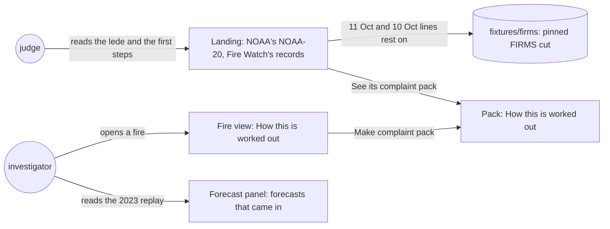

# Pack claims

**Version:** v1 · **Status:** Draft · **Type:** Bug · **Project type:** Web UI

**Shape doc:** docs/specs/judge-review/shape.md
**Depends on:** source-claims

The fire view, the complaint pack, the landing and the forecast panel stop making five claims that
the chain or the data doesn't support. The landing's earlier sightings rest on a committed copy of
NASA's archive, as every other figure on the page does.

## Problem

The hostile review run again on 2026-10-24, after source-claims shipped, scored the site 6.9/10. It
still found five claims that a company's lawyer could use:

- **"The first pass is the earliest satellite pass that saw the fire."** Every fire view and pack
  says this (`web/src/FireView.tsx:141`). For the example fire it is false: NOAA-20 saw fire 680 m
  away on 11 Oct, 11 hours before the first detection in Fire Watch's records. The landing now says
  so (`web/src/RealCase.tsx:24`), but the pack, which is what a buyer gets, doesn't. The landing's
  first step also says "the NOAA-20 satellite saw this fire" from 12 Oct (`web/src/RealCase.tsx:119`).
- **"Anyone can redo this from the chain and NASA FIRMS's public archive."** (`web/src/FireView.tsx:158`)
  The chain holds fingerprints, or one root per run, under random record IDs. Nothing on the chain
  ties to a FIRMS row without the records that Fire Watch's API sends.
- **The 11 Oct and 10 Oct sightings have no source a reader can check.** They are two dated
  constants (`web/src/RealCase.tsx:22-26`), read from FIRMS by hand on 2026-10-24. No data file,
  sha256 or command backs them, unlike every other figure on the landing.
- **"NOAA-20 places almost every detection within 400 m of the fire."** (`web/src/FireView.tsx:150`)
  Blonski and others (2023) measured where NOAA-20 places its image pixels, not how far a detection
  sits from the fire. A detection can sit anywhere in its 375 m pixel as well.
- **Two smaller ones.** The lede says "NASA's NOAA-20 satellite" (`web/src/Landing.tsx:48`).
  NOAA-20 is NOAA's satellite, and its detections come through NASA FIRMS. The 2023 table heads its
  column "Arrivals warned of, out of 135" (`web/src/ForecastPanel.tsx:55`). The 135 are forecasts
  whose fire came in, from 103 fires (`fixtures/backtest/2023-forecasts.csv`).

## Slice test

| Check                         | Result |
| ----------------------------- | ------ |
| Cuts every layer it needs     | yes: the fire view, the pack, the landing and the forecast panel in `web/src`, and a committed FIRMS cut in `fixtures/`. The API, the recorder and the chain don't change |
| One e2e test walks it         | yes: read the landing's lede and first steps, open the example pack's method, then open the e2e's 0332 fire and its forecast panel in the tool |
| Worth shipping alone          | yes: a lawyer loses five lines to quote, and a judge can check the earlier sightings |
| Fits (≤5 scenarios, ≤2 areas) | yes: 5 scenarios; two areas, the landing and the tool with its pack |

**Path:** full. Copy changes in four files, and a new committed data file.

## Flow



A judge reads the satellite and the records' start on the landing, whose earlier sightings rest on
a committed FIRMS cut. An investigator reads the same method in the fire view and the pack, and the
2023 table in the forecast panel.

## Acceptance criteria

```gherkin
Scenario: The fire view and the pack say the first pass is the earliest in Fire Watch's records
  Given the example pack of the ID-WOOD-CONCESSION-0332 fire, first detected on 12 Oct 05:16 UTC,
    1 hour after Fire Watch's records begin
  When a reader opens how the reading is worked out, in the pack or in the fire view
  Then it says the first pass is the earliest that Fire Watch's records hold, not the earliest the
    satellite made
  And the note on when the records begin says NASA's archive may hold earlier detections
  And the example pack names NOAA-20's 11 Oct detections under 1 km away, from the committed FIRMS
    cut of scenario 3

Scenario: The method claims only what a reader can check
  Given any fire's view or pack
  When a reader opens how the reading is worked out
  Then it says the reader's browser checks each record it was sent against the chain
  And it says a record matches a row of NASA FIRMS's archive by its time and place
  And it no longer says anyone can redo the reading from the chain and FIRMS's archive

Scenario: The landing's earlier sightings rest on a committed copy of NASA's archive
  Given FIRMS's NOAA-20, S-NPP, NOAA-21 and MODIS files for 10 to 12 Oct 2026 around the example
    fire, committed with their sha256 and the commands that fetched them
  When a test reads them against the example pack's first passes
  Then NOAA-20 saw fire under 1 km from the first fire's first detection on 11 Oct, outside the
    concession
  And other satellites saw fire under 1 km from the second fire's first pass on 10 Oct, on both
    sides of the edge

Scenario: The position-error note says what the study measured
  Given any fire's view or pack
  When a reader opens how the reading is worked out
  Then it says Blonski and others (2023) measured where NOAA-20 places its pixels
  And it says a detection can sit anywhere in its 375 m pixel as well

Scenario: The landing and the forecast panel say what they name and count
  Given the landing, and the 2023 replay in the forecast panel of the 0332 fire
  When a judge reads them
  Then the lede says NOAA-20 is NOAA's satellite, read through NASA FIRMS
  And the real case's first step says Fire Watch's records hold the fire from 12 Oct to 17 Oct, on
    8 passes and 283 detections
  And the 2023 table's column says its 135 are forecasts whose fire came in
```

The exact words come at pause 2. Scenarios 1 and 3 read the committed example pack, as the landing
e2e does (D137). Scenarios 2, 4 and 5's panel read the e2e's own 0332 fire in
`fixtures/firms/fire-origin.csv`.

## Scope

**In:**

- The method in the fire view and the pack: the first pass, the redo line and the position-error
  line (`OriginMethod`).
- The note on when the records begin, in the fire view and the pack, and the example pack's 11 Oct
  sightings, read from the committed FIRMS cut (O1).
- The landing's lede, its first step, and the 11 Oct and 10 Oct lines, which now rest on a
  committed FIRMS cut with a sha256 and a redo command (O2).
- The 2023 table's column head in the forecast panel.

**Out:**

- Looking up NASA's archive for every pack, to list earlier sightings of any fire: not planned.
  It puts the FIRMS key on the public API, spends FIRMS quota on each open, and a pack would change
  when FIRMS's answer does, against D33 (O1).
- Record IDs and fingerprints in the printed pack: not planned (O3). The roadmap names it.
- Swapping the example for a fire recorded after FireRuns went live: not planned. It needs a new
  pack, 283 new seals and the landing's copy again, which doesn't fit the deadline.
- Raising the 375 m margin for position error: not planned (D115).
- The written deliverables: on the `docs/submission` branch, not in this slice (judge-review O2).

## Open items

| ID | What | Type | Raised at | Owner | Status | Answer |
| -- | ---- | ---- | --------- | ----- | ------ | ------ |
| O1 | The pack can't know of sightings before Fire Watch's records for any fire. Does it only change its method's words, or does the example's pack also list its 11 Oct sightings? | question | spec p1 | user | Resolved | 2026-10-24: every fire view and pack says "earliest in Fire Watch's records", and the example's pack also lists its 11 Oct sightings from the pinned FIRMS cut of O2. A per-pack FIRMS lookup was asked for first, then dropped: it puts the FIRMS key on the public API and lets a pack change with FIRMS's answer (D33) |
| O2 | The 11 Oct and 10 Oct lines rest on a hand reading of FIRMS. Do we commit a pinned cut of FIRMS's files and a test, or drop the two lines from the landing? | question | spec p1 | user | Resolved | 2026-10-24: commit a pinned cut of the four satellites' files for 10 to 12 Oct, with sha256 and the commands that fetched them, and a test that holds the lines to it. D141 stays |
| O3 | The printed pack carries no record IDs or fingerprints, so a paper copy can't be checked against the chain. Is that in this slice? | question | spec p1 | user | Resolved | 2026-10-24: out. The pack's link checks every record in the reader's browser; the roadmap names a pack that carries its proofs |

_Never delete this section or its rows. See references/ledger.md._

## Glossary

- **NOAA-20**: a weather satellite run by NOAA, the US weather agency. Its VIIRS sensor sees fires,
  and NASA's FIRMS service publishes the detections.
- **FIRMS**: NASA's Fire Information for Resource Management System, which serves satellite fire
  detections as files.
- **Pinned cut**: a small copy of a source's files, committed with the sha256 of each file, so anyone
  can check it is the same copy.
- **Pixel geolocation**: where the satellite places a pixel on the ground, which can be off by a few
  hundred metres.
- **e2e**: end-to-end: one test that walks the whole slice as a user would.
