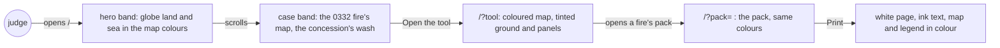
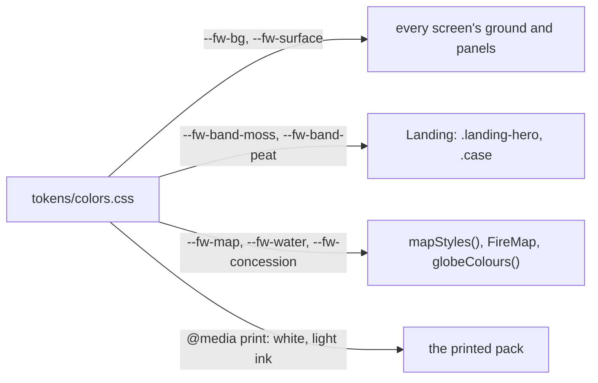
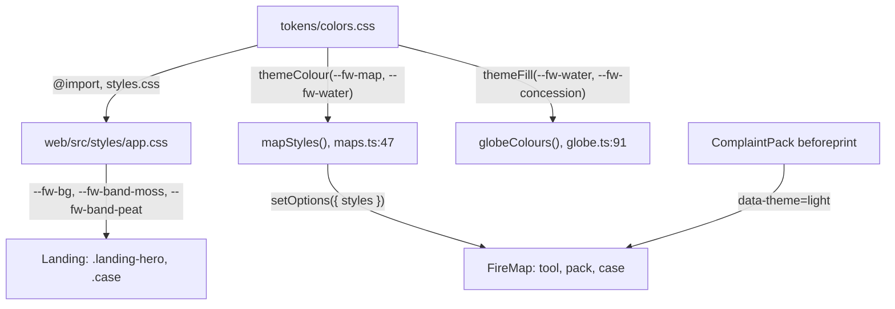
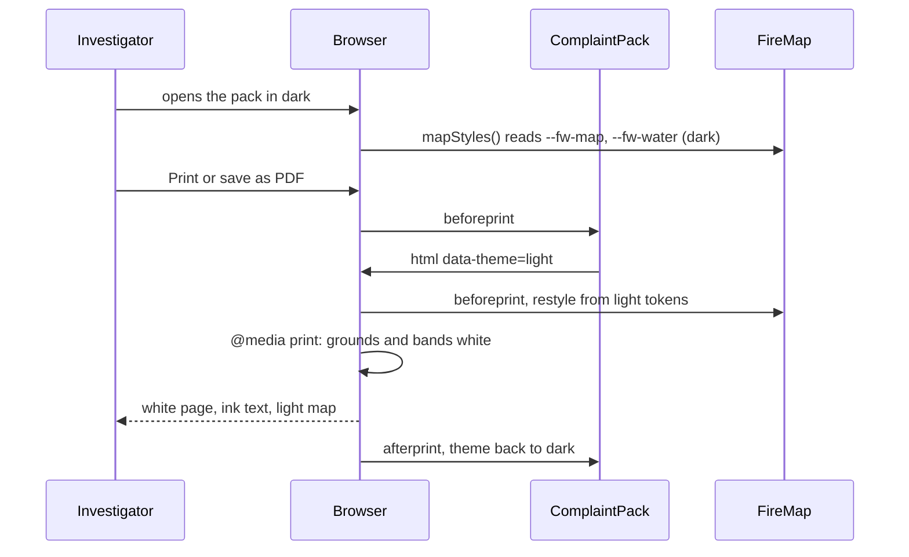

# Palette

**Version:** v1 · **Status:** Refined · **Type:** Enhancement · **Project type:** Web UI

**Depends on:** newcomer-walkthrough

Every screen takes colour from a deeper Peatland palette: the maps, the page ground and panels, and
two bands on the landing. It comes now because the builder found the site too grey as a newcomer, and
newcomer-walkthrough split it out (its O1).

## Problem

The builder read the site as a newcomer on 2026-10-21 and asked for more colour. Today the page ground
is `#f3f3f0`, the panels are `#ffffff` and the map's land is `#e7ebe4`: all three are near-grey. Teal
marks only links, buttons and focus, and ember marks only fire dots. The globe on the landing draws
grey-green land on a white sea.

The judges read the site once, before 2026-10-25. The demo video is due on 2026-10-24.

## Slice test

| Check                         | Result |
| ----------------------------- | ------ |
| Cuts every layer it needs     | yes: the design system's colour tokens and the screens that read them: the landing, the tool, the pack and the globe. The API, the recorder and the chain don't change |
| One e2e test walks it         | yes: open `/`, see the hero and case bands, open the tool's 0332 fire and its map, open the pack, and print it |
| Worth shipping alone          | yes: a judge sees land, water, the concession and the fire in colour, on every screen |
| Fits (≤5 scenarios, ≤2 areas) | yes: 5 scenarios, one area (`web/` and its design system) |

**Path:** full. The slice changes the palette of every screen and supersedes D4.

## User story

As a judge who has never seen Fire Watch, I want the screens to carry colour that means something
(land, water, the concession, the fire), so that the site reads as a real place and not a grey form.

## Flow



A judge meets colour on the landing's two bands, keeps it through the tool and the pack, and prints
the pack on a white page with only its map in colour.

## Acceptance criteria

```gherkin
Scenario: The landing opens on colour
  Given a judge opens "/" on a 1440 px wide screen, in light and then in dark
  When the hero shows
  Then the hero sits on the moss band, #e0ecce in light and #1d2514 in dark
  And the globe draws 14 Oct 2026's fires on moss land and a slate sea, the map's colours
  And "A real case" sits on the peat band, #e9e0d1 in light and #251e15 in dark

Scenario: The map reads as land, water and the concession
  Given an investigator opens the ID-WOOD-CONCESSION-0332 fire first seen 13 Oct 17:37 UTC in the tool
  When the map shows
  Then land is moss, water is slate, and the inside of the concession has an acacia green wash
  And the concession's dashed edge stays drawn over its wash
  And the fire colour keeps at least 3:1 contrast against the land and against the wash, in light and dark
  And so a reader who can't tell red from green still sees each newest-pass dot

Scenario: The ground carries colour and the rules hold
  Given the tool shows the 0332 fire's record panel next to its map
  When the investigator looks at the page ground and the panels
  Then the ground is #eef3e4 and the panels #fafcf6 in light, #121610 and #1a1f17 in dark
  And teal marks only links, buttons and focus
  And ember marks only fire
  And "Matches the chain" and "Does not match the chain" keep their own colours, icons and words

Scenario: Every pair passes WCAG AA in both themes
  Given the new palette in light and in dark
  When any text, control edge or status label is drawn on the ground, a panel or a band
  Then text reaches at least 4.5:1, and 3:1 at 24 px and larger
  And control edges and focus rings reach at least 3:1

Scenario: The pack prints on a white page
  Given the 0332 fire's complaint pack is open, in light or in dark
  When the investigator prints it to PDF
  Then the page is white and the text is dark ink
  And the map and its legend print in their colours
```

## Scope

**In:**

- A deeper Peatland palette: moss greens and peat browns, the same deep teal accent, in light and dark
  (O2, O3).
- The maps: land, water and the concession's inside on the tool's map, the pack's map, the landing's
  case map and the globe (O1). The concession's acacia wash supersedes D29's ink tint (O5, D96).
- The ground: the page background and the panels (O1).
- The landing: a band for the hero and a band for the real case (O1).
- Print: the pack prints on white with dark ink, its map and legend in colour (O4).
- The design system's colour tokens, its colours guideline and readme, and the brief's palette row and
  token trace.
- The `/design-sync` hand-over lines for the Claude Design project's copy, also owed by replay-pace.

**Out:**

- Teal on headings or icons: not planned. Teal means "you can act" (O3).
- Ember anywhere but fire: not planned (O3).
- Type, spacing, radius and motion: unchanged.
- The faded dots of older passes: unchanged. They fall below 3:1 by design, so the newest pass stands out.
- Windows' forced-colours mode: the system's own colours replace the palette there, as today.
- Record and seal fires beyond Indonesia's pulpwood concessions: world-recording, after the hackathon.

## Interface

The slice recolours the design system, so it changes tokens, not screens. Every screen reads its colours
from `docs/design/design-system/tokens/colors.css`. The landing adds two full-width bands, and the
map and the globe read a new water token.



The tokens reach each screen through the page's CSS. The map and the globe read them with
`themeColour` and `themeFill` when they draw.

| Token | Light | Dark | What it colours |
| ----- | ----- | ---- | --------------- |
| `--fw-bg` | `#eef3e4` | `#121610` | the page ground: pale sphagnum moss |
| `--fw-surface` | `#fafcf6` | `#1a1f17` | panels, roads on the map |
| `--fw-band-moss` (new) | `#e0ecce` | `#1d2514` | the landing's hero band |
| `--fw-band-peat` (new) | `#e9e0d1` | `#251e15` | the landing's real case band: peat soil |
| `--fw-map` | `#d9e8c4` | `#1e2613` | land on the maps and the globe: moss |
| `--fw-water` (new) | `#bdd6e0` | `#112028` | water on the maps and the globe's sea: slate |
| `--fw-concession` | `#2a7449` at 14% | `#8ec899` at 13% | inside a concession: acacia green, the plantation |
| `--fw-muted` | `#596055` | `#aeb3a6` | secondary text, darker so it passes on both bands |
| `--fw-control` | `#777f73` | `#71776b` | field and button edges, 3:1 on both bands |
| `--fw-line`, `--fw-faint`, fills, skeletons, ticks | moss-tinted | moss-tinted | re-tinted to sit on the new ground |

Unchanged: ink, the teal accent, ember, the status colours and the accent tint. In print, every
theme takes a white ground and the light theme's ink.

**Contrast, as built** (WCAG ratios, computed from the token values):

| Pair | Light | Dark | Floor |
| ---- | ----- | ---- | ----- |
| lowest text pair | 4.63, teal link on the peat band | 5.96, "does not match" red on a hover fill | 4.5 |
| muted text on the peat band | 4.97 | 7.68 | 4.5 |
| lowest control edge | 3.17, on the peat band | 3.26, on a hover fill | 3 |
| fire on land | 4.02 | 6.70 | 3 |
| fire on the concession wash | 3.38 | 5.11 | 3 |
| fire on water | 3.42 | 7.13 | 3 |

The text pairs are ink, muted, teal, and the two status colours, each on the ground, the panels, both
bands, hover fills and table heads.

**Motion tier:** none added. The globe stays tier 3 within its budget (D3), the replay tier 2, and the
rest tier 1.

**Components used:** none new. Three new tokens: `--fw-water`, `--fw-band-moss` and `--fw-band-peat`.
The bands are a full-width border image on the existing `.landing-hero` and `.case`, so `Landing.tsx`
doesn't change and the page doesn't widen.

**Design system:** Fire Watch, `docs/design/design-system/` (D2), recoloured here (D94, D96). The
Claude Design project's copy waits for the user's `/design-sync`.

**Preview:** `cd web && pnpm dev`, then, with `&theme=light` or `&theme=dark`:

- `http://localhost:5173/?preview=newcomer-walkthrough`: the landing, both bands, the globe and the case
- `http://localhost:5173/?preview=fire-origin`: the tool, its list and map
- `http://localhost:5173/?preview=complaint-pack`: the pack; print it to see the white page

The drift check passed over the 4 files written. `tsc -b` is clean and the 205 web unit tests pass. In a
390 px frame the landing is 375 px wide, so nothing scrolls sideways. In Playwright's print mode the
pack's ground is `rgb(255, 255, 255)` and its heading `rgb(31, 36, 33)`, in light and in dark.

## Technical plan

### Approach

Pause 2 built the palette into the real tokens (`e593dc5`): `tokens/colors.css` holds every value, and
the page imports it through `styles.css` and `web/src/styles/app.css:1`. The maps and the globe read
tokens with `themeColour` and `themeFill` (`web/src/maps.ts:27`), which resolve a token on a probe
element when they draw. The build left to do: trim the print block, add the tests, and bring the design
docs and decisions up to date.

Print already has a mechanism. On `beforeprint` the pack sets `data-theme="light"`
(`web/src/ComplaintPack.tsx:111`), and `FireMap` redraws the map from the light tokens
(`web/src/FireMap.tsx:303`). So the print block only whitens the grounds; the light theme sets the ink.

Relies on: D2, D3, D81, D94, D95, D96



Every colour starts in `colors.css`. CSS carries it to the screens, and the two token readers carry
it to the map and the globe.



A print turns the pack light first, redraws its map, then prints on white grounds.

### Changes

| File | What changes | Why |
| ---- | ------------ | --- |
| `docs/design/design-system/tokens/colors.css` | built at pause 2. The print block keeps only the white grounds (`--fw-bg`, `--fw-surface`, `--fw-table-head`, `--fw-hover-fill` and both bands); the pack's switch to light sets the ink | Scenarios 1 to 5 |
| `web/src/styles/app.css:271` | built at pause 2: the hero and case bands, and the case map's ground on phones | Scenario 1 |
| `web/src/maps.ts:49` | built at pause 2: water from `--fw-water`; roads keep `--fw-surface` | Scenario 2 |
| `web/src/globe.ts:93` | built at pause 2: the sea from `--fw-water` | Scenario 1 |
| `web/src/palette.test.ts` (new) | reads `colors.css`; checks every text, control and fire pair in light and dark; checks the two dark blocks match; checks print whitens the grounds | Scenarios 3 and 4 |
| `web/src/globe.test.ts` | `globeColours()` draws the sea in `--fw-water`, with `./maps` mocked as in `FireMap.test.tsx:8` | Scenario 1 |
| `web/e2e/palette.spec.ts` (new) | one test: `/` and its two bands, then the tool's 0332 fire and its map's styles, then the pack printed in dark | Scenarios 1, 2, 3 and 5 |
| `docs/design/system-brief.md` | the Palette and "Which side is inside" rows; the token trace for the ground, the bands, water, the wash and print | the brief matches the tokens |
| `docs/design/design-system/guidelines/colors.html` | swatches for `--fw-water`, `--fw-concession`, `--fw-band-moss` and `--fw-band-peat` | the guideline matches the tokens |
| `docs/design/design-system/guidelines/globe.html:25` | the sea is `--fw-water` | the guideline matches `globe.ts` |
| `docs/design/design-system/guidelines/detections.html:51` | "Concession: dashed edge, acacia wash inside" | the guideline matches the map |
| `docs/design/design-system/readme.md` | "deeper Peatland palette"; the wash; decisions D94, D95, D96 in place of D4 and D29 | the readme matches the tokens |
| `docs/design/design-system/.design-sync/conventions.md:34` | adds `--fw-water`, `--fw-band-moss` and `--fw-band-peat`, and the wash | the sync conventions match the tokens |
| `DECISIONS.md` | append D94, D95 and D96; D4 becomes `superseded by D94`, D29 `superseded by D96` | the palette changed |
| `CHANGELOG.md` | a line under `### Changed` | every screen looks different |

Reusing: `themeColour` and `themeFill`; the pack's `beforeprint` switch and `FireMap`'s restyle; the
`readFileSync(resolve(...))` idiom from `globe.test.ts:12`; `fake-google-maps.js` and its
`window.__fakeMap.styles`; the date and fire steps from `complaint-pack.spec.ts:28`.

### Earn-it

| Added | Triggered by |
| ----- | ------------ |
| `--fw-water` | Scenario 2: water needs its own colour; it was `--fw-surface`, which the panels now tint |
| `--fw-band-moss`, `--fw-band-peat` | Scenario 1: the two bands |
| The print block in `colors.css` | Scenario 5: with "Background graphics" ticked, the moss ground would print |
| `web/src/palette.test.ts` | Scenario 4: nothing checks contrast today, and the light wash's 3.38:1 is 0.38 above the floor |
| `web/e2e/palette.spec.ts` | the slice test: one e2e walks the slice |

### Non-functionals

|                      |                                                                               |
| -------------------- | ----------------------------------------------------------------------------- |
| **Load**             | None on the server. The page's CSS grows by under 1 kB before compression |
| **Breaks first**     | Nothing scales with load. The tightest pair is fire on the light wash, 3.38:1; a darker wash or lighter fire breaks 3:1 first, and `palette.test.ts` fails |
| **Security surface** | No change: no new input, secret or stored data |
| **Proof it works**   | On the live site in light, `getComputedStyle(document.body).backgroundColor` returns `rgb(238, 243, 228)`, and the landing's hero is moss |
| **Rollout**          | No flag, as D81 shipped the landing. It ships with the deploy on main; a `git revert` of the feat commits brings back D4's colours |

### Test plan

| Scenario | Test | Command |
| -------- | ---- | ------- |
| 1 The landing opens on colour | `web/e2e/palette.spec.ts` › "a judge meets the palette on the landing, the tool's map and the printed pack"; `web/src/globe.test.ts` › "draws the sea in --fw-water" | `cd web && pnpm e2e palette`; `cd web && pnpm test` |
| 2 The map reads as land, water and the concession | the e2e reads `window.__fakeMap.styles`: land `#d9e8c4`, water `#bdd6e0`; `palette.test.ts` › fire on land, the wash and water | `cd web && pnpm e2e palette`; `cd web && pnpm test` |
| 3 The ground carries colour and the rules hold | the e2e reads the tool's ground, `rgb(238, 243, 228)`; the slice adds no use of `--fw-accent` or `--fw-fire`, which `/review` checks in the diff | `cd web && pnpm e2e palette` |
| 4 Every pair passes WCAG AA | `web/src/palette.test.ts` › "every text, control and fire pair passes AA in light and dark" | `cd web && pnpm test` |
| 5 The pack prints on a white page | the e2e turns the pack dark, fires `beforeprint`, emulates print, and reads a white body and `rgb(31, 36, 33)` ink | `cd web && pnpm e2e palette` |

**E2E:** `web/e2e/palette.spec.ts` opens `/` and reads both bands. It opens the tool's 0332 fire first
seen 13 Oct 17:37 UTC and reads the map's styles and the ground. It then makes the pack and prints it in
dark.

### Chunks

Single chunk.

### Risks

| Risk | Mitigation |
| ---- | ---------- |
| Safari's drawing of the bands is unchecked (O7) | Where the border image fails, the band area shows the plain ground; the text keeps its contrast |
| The dark tokens live in two blocks, the media query and `[data-theme="dark"]`, which can drift apart | `palette.test.ts` checks the two blocks hold the same values |
| Google's stylers take six-digit hex only | `themeColour` already turns any resolved colour into six-digit hex (`maps.ts:26`) |

### Decisions to record

D94 and D95 drafted at pause 1, D96 at pause 2; pause 3 made no choice that rejected an option.
`/build` appends them to `DECISIONS.md`.

```
## D94 · 2026-10-21 · Deeper Peatland: colour on the maps, the ground and the landing's bands

Why: on 2026-10-21 the builder found the site too grey as a newcomer; colour sat only on links,
buttons and fire dots. Peatland still ties the look to the land the product watches. Teal stays the
one accent, only for "you can act", and sits far from ember, so it never reads as fire. Ember stays
for fire marks only. Every pair passes WCAG AA in both themes.
Rejected: D4's near-grey stone (too grey for a newcomer), a new family such as Survey ink blue, Haze
indigo or Canopy green (more of the half day, and D4's reasons against each still hold), teal on
headings and icons (teal means "you can act"), colour on the maps alone (the landing's first screen
stays grey).
Supersedes: D4
Source: docs/specs/palette.md
Status: active

## D95 · 2026-10-21 · Print the pack on a white page, with its map in colour

Why: a buyer prints the pack to PDF. A tinted ground costs ink and prints only when forced, while the
map's colours carry meaning: land, water, the concession and the fire.
Rejected: full colour print (the ground and panels print only when forced, and use more ink).
Source: docs/specs/palette.md
Status: active

## D96 · 2026-10-21 · Wash the inside of a concession acacia green with --fw-concession on every map

Why: a dashed edge alone doesn't show which side is inside (D29), and the ink tint reads grey on the
new moss land. Acacia green at 14% (light) and light acacia at 13% (dark) reads as the plantation, and
keeps fire at 3.38:1 and 5.11:1 against it.
Rejected: ink at 6% and 7% (D29; grey on moss), peat brown (reads as burned ground, and sits near
ember), a teal wash (teal means "you can act", D94), the dashed edge alone (the map can't back up an
inside or outside reading).
Supersedes: D29
Source: docs/specs/palette.md
Status: active
```

## Open items

| ID | What | Type | Raised at | Owner | Status | Answer |
| -- | ---- | ---- | --------- | ----- | ------ | ------ |
| O1 | Where the new colour goes: the map, the ground, bands on the landing, or more teal | question | spec p1 | user | Resolved | 2026-10-21: the map, the ground and the landing's bands; not more teal (D94) |
| O2 | Which colour family: a deeper Peatland, or three new families compared at pause 2 | question | spec p1 | user | Resolved | 2026-10-21: a deeper Peatland, with moss greens, peat browns and the same teal (D94) |
| O3 | Whether D4's and the brief's colour rules still hold: ember only for fire, teal only for acting, status colours apart, never alarmist, playful or salesy | question | spec p1 | user | Resolved | 2026-10-21: keep them all (D94) |
| O4 | What print does with the new colour | question | spec p1 | user | Resolved | 2026-10-21: a white page with dark ink; the map and its legend print in colour (D95) |
| O5 | What colour goes inside a concession: acacia green, peat brown, or D29's ink tint | question | spec p2 | user | Resolved | 2026-10-21: acacia green; fire keeps 3.38:1 on it in light and 5.11:1 in dark (D96) |
| O6 | The peat band, `#e9e0d1`, is a warm beige near the cream that generated sites often use | flag | spec p2 | user | Resolved | 2026-10-21: keep it; earth under the moss hero |
| O7 | Safari's drawing of the bands' border image is unchecked: WebKit can't launch on this host without `sudo` installs. Chrome and Firefox draw both bands full width | unproven | spec p3 | user | Accepted risk | 2026-10-21: gradient border images have worked in Safari for years, and a miss shows the plain ground with the text's contrast kept |

_Never delete this section or its rows. See references/ledger.md._

## Glossary

- **Token** — a named design value, such as `--fw-map`, that every screen reads instead of a raw colour.
- **Peatland** — the product's palette since D4: stone neutrals with a green cast and a deep teal accent.
- **WCAG AA** — the common accessibility standard: text contrast at least 4.5:1, large text and control
  edges 3:1.
- **Contrast ratio** — how much lighter one colour is than another, from 1:1 (the same) to 21:1 (black on
  white). It ignores hue, so it holds for colour-blind readers.
- **Band** — a full-width section of the page with its own background colour.
- **Wash** — a see-through colour laid over the map inside a concession's edge.
- **Sphagnum** — peat moss, the pale green that grows on a peat swamp's surface.
- **Acacia** — the fast-growing tree planted on pulpwood concessions.
- **Border image** — a CSS way to paint a box's background past its edges without making the page wider.
- **Concession** — land the Indonesian government licenses to a company; here, to grow trees for paper
  pulp.
- **e2e** — end-to-end: one test that walks the slice in a real browser, as a user would.
- **Playwright** — the tool that drives the browser in the e2e, and can pretend to print.
- **WebKit** — the engine inside Safari.
- **`beforeprint`** — the event a browser fires just before it prints a page.
