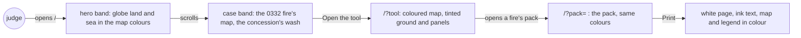

# Palette

**Version:** v1 · **Status:** Draft · **Type:** Enhancement · **Project type:** Web UI

**Depends on:** newcomer-walkthrough

Every screen takes colour from a deeper Peatland palette: the maps, the page ground and panels, and
two bands on the landing. It comes now because the builder found the site too grey as a newcomer, and
newcomer-walkthrough split it out (its O1).

## Problem

The builder read the site as a newcomer on 2026-10-21 and asked for more colour. Today the page ground
is `#f3f3f0`, the panels are `#ffffff` and the map's land is `#e7ebe4`: all three are near-grey. Teal
marks only links, buttons and focus, and ember marks only fire dots. The globe on the landing draws
grey-green land on a white sea.

The judges read the site once, before 2026-10-25. The demo video is due on 2026-10-24.

## Slice test

| Check                         | Result |
| ----------------------------- | ------ |
| Cuts every layer it needs     | yes: the design system's colour tokens and the screens that read them: the landing, the tool, the pack and the globe. The API, the recorder and the chain don't change |
| One e2e test walks it         | yes: open `/`, see the hero and case bands, open the tool's 0332 fire and its map, open the pack, and print it |
| Worth shipping alone          | yes: a judge sees land, water, the concession and the fire in colour, on every screen |
| Fits (≤5 scenarios, ≤2 areas) | yes: 5 scenarios, one area (`web/` and its design system) |

**Path:** full. The slice changes the palette of every screen and supersedes D4.

## User story

As a judge who has never seen Fire Watch, I want the screens to carry colour that means something
(land, water, the concession, the fire), so that the site reads as a real place and not a grey form.

## Flow



A judge meets colour on the landing's two bands, keeps it through the tool and the pack, and prints
the pack on a white page with only its map in colour.

## Acceptance criteria

```gherkin
Scenario: The landing opens on colour
  Given a judge opens "/" on a 1440 px wide screen, in light and then in dark
  When the hero shows
  Then the hero sits on a coloured band from the Peatland family, not on the grey ground
  And the globe draws 14 Oct 2026's fires on land and sea in the map's colours
  And the real case "A real case" sits on a second band, apart from the hero's

Scenario: The map reads as land, water and the concession
  Given an investigator opens the ID-WOOD-CONCESSION-0332 fire first seen 13 Oct 17:37 UTC in the tool
  When the map shows
  Then land, water and the inside of the concession each have their own Peatland colour
  And the concession's dashed edge stays drawn over its wash
  And every fire dot keeps at least 3:1 contrast against the land and against the wash, in light and dark
  And so a reader who can't tell red from green still sees each dot

Scenario: The ground carries colour and the rules hold
  Given the tool shows the 0332 fire's record panel next to its map
  When the investigator looks at the page ground and the panels
  Then both carry a clear Peatland tint, not near-grey
  And teal marks only links, buttons and focus
  And ember marks only fire
  And "Matches the chain" and "Does not match the chain" keep their own colours, icons and words

Scenario: Every pair passes WCAG AA in both themes
  Given the new palette in light and in dark
  When any text, control edge or status label is drawn on the ground, a panel or a band
  Then text reaches at least 4.5:1, and 3:1 at 24 px and larger
  And control edges and focus rings reach at least 3:1

Scenario: The pack prints on a white page
  Given the 0332 fire's complaint pack is open, in light or in dark
  When the investigator prints it to PDF
  Then the page is white and the text is dark ink
  And the map and its legend print in their colours
```

## Scope

**In:**

- A deeper Peatland palette: moss greens and peat browns, the same deep teal accent, in light and dark
  (O2, O3).
- The maps: land, water and the concession's inside on the tool's map, the pack's map, the landing's
  case map and the globe (O1). The concession's wash taking a hue supersedes D29's ink tint; pause 2
  drafts that entry with its values.
- The ground: the page background and the panels (O1).
- The landing: a band for the hero and a band for the real case (O1).
- Print: the pack prints on white with dark ink, its map and legend in colour (O4).
- The design system's colour tokens, its colours guideline and readme, and the brief's palette row and
  token trace.
- The `/design-sync` hand-over lines for the Claude Design project's copy, also owed by replay-pace.

**Out:**

- Teal on headings or icons: not planned. Teal means "you can act" (O3).
- Ember anywhere but fire: not planned (O3).
- Type, spacing, radius and motion: unchanged.
- Windows' forced-colours mode: the system's own colours replace the palette there, as today.
- Record and seal fires beyond Indonesia's pulpwood concessions: world-recording, after the hackathon.

## Open items

| ID | What | Type | Raised at | Owner | Status | Answer |
| -- | ---- | ---- | --------- | ----- | ------ | ------ |
| O1 | Where the new colour goes: the map, the ground, bands on the landing, or more teal | question | spec p1 | user | Resolved | 2026-10-21: the map, the ground and the landing's bands; not more teal (D94) |
| O2 | Which colour family: a deeper Peatland, or three new families compared at pause 2 | question | spec p1 | user | Resolved | 2026-10-21: a deeper Peatland, with moss greens, peat browns and the same teal (D94) |
| O3 | Whether D4's and the brief's colour rules still hold: ember only for fire, teal only for acting, status colours apart, never alarmist, playful or salesy | question | spec p1 | user | Resolved | 2026-10-21: keep them all (D94) |
| O4 | What print does with the new colour | question | spec p1 | user | Resolved | 2026-10-21: a white page with dark ink; the map and its legend print in colour (D95) |

_Never delete this section or its rows. See references/ledger.md._

## Decisions to record

Drafted at pause 1. `/build` appends them to `DECISIONS.md`.

```
## D94 · 2026-10-21 · Deeper Peatland: colour on the maps, the ground and the landing's bands

Why: on 2026-10-21 the builder found the site too grey as a newcomer; colour sat only on links,
buttons and fire dots. Peatland still ties the look to the land the product watches. Teal stays the
one accent, only for "you can act", and sits far from ember, so it never reads as fire. Ember stays
for fire marks only. Every pair passes WCAG AA in both themes.
Rejected: D4's near-grey stone (too grey for a newcomer), a new family such as Survey ink blue, Haze
indigo or Canopy green (more of the half day, and D4's reasons against each still hold), teal on
headings and icons (teal means "you can act"), colour on the maps alone (the landing's first screen
stays grey).
Supersedes: D4
Source: docs/specs/palette.md
Status: active

## D95 · 2026-10-21 · Print the pack on a white page, with its map in colour

Why: a buyer prints the pack to PDF. A tinted ground costs ink and prints only when forced, while the
map's colours carry meaning: land, water, the concession and the fire.
Rejected: full colour print (the ground and panels print only when forced, and use more ink).
Source: docs/specs/palette.md
Status: active
```

## Glossary

- **Token** — a named design value, such as `--fw-map`, that every screen reads instead of a raw colour.
- **Peatland** — the product's palette since D4: stone neutrals with a green cast and a deep teal accent.
- **WCAG AA** — the common accessibility standard: text contrast at least 4.5:1, large text and control
  edges 3:1.
- **Contrast ratio** — how much lighter one colour is than another, from 1:1 (the same) to 21:1 (black on
  white). It ignores hue, so it holds for colour-blind readers.
- **Band** — a full-width section of the page with its own background colour.
- **Wash** — a see-through colour laid over the map inside a concession's edge.
- **Concession** — land the Indonesian government licenses to a company; here, to grow trees for paper
  pulp.
