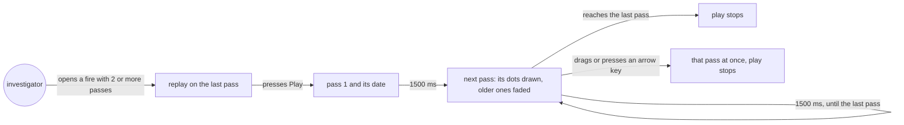
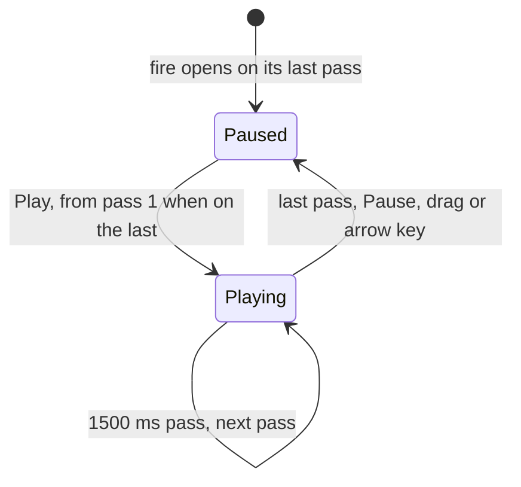
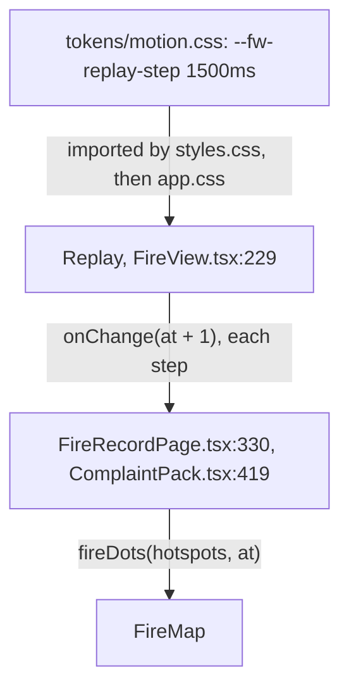
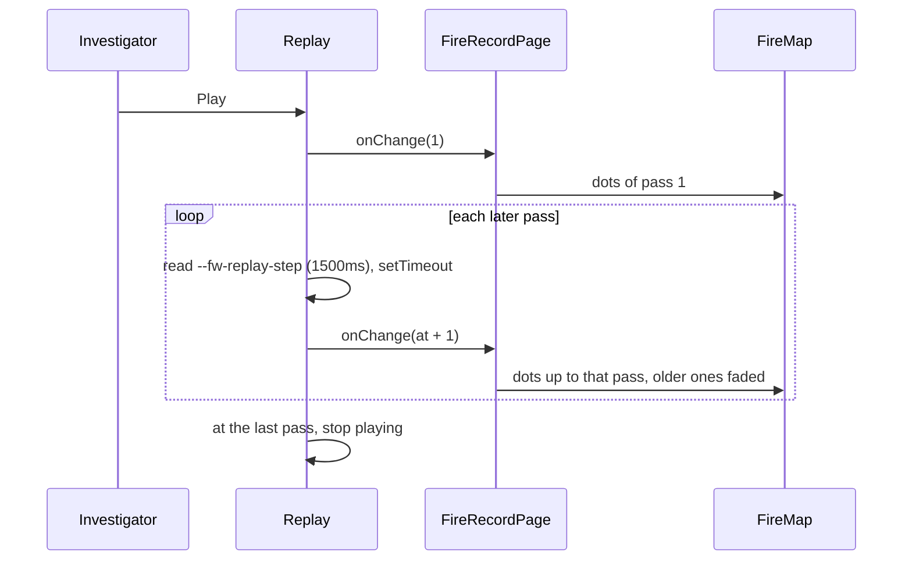

# Replay pace

**Version:** v1 · **Status:** Built · **Type:** Enhancement · **Project type:** Web UI

**Depends on:** fire-origin

Play in a fire's replay holds each satellite pass for 1500 ms, not 600 ms. It comes now because the
builder found the play button too fast to follow, and newcomer-walkthrough split it out (its O1).

## Problem

The builder read the site as a newcomer on 2026-10-21 and found the play button too fast to follow.
Play steps one pass every 600 ms (D30). The walkthrough's 8-pass 0332 fire plays in 4.2 s. The
longest live fire, 18 passes in the 25 busiest concessions, plays in 10.2 s. Half a second is too
short to see a pass's new dots land and read its date. The built page was faster still: it read the
step as 0.6 ms, so play ran to the last pass almost at once (O4).

## Slice test

| Check                         | Result |
| ----------------------------- | ------ |
| Cuts every layer it needs     | yes: the motion token and the replay that reads it. The API, the recorder and the chain don't change |
| One e2e test walks it         | yes: the fire-origin e2e plays the 0332 fire on Playwright's clock and sees each pass at 1.5 s |
| Worth shipping alone          | yes: anyone watching a fire can follow its spread pass by pass without dragging the slider |
| Fits (≤5 scenarios, ≤2 areas) | yes: 2 scenarios, one area (`web/` and its design system) |

**Path:** light. One token value changes, with no new interface, data or dependency. The number is
also written in five design docs, which puts the file count over three.

## User story

As an investigator or a judge watching a fire, I want play to hold each satellite pass long enough to
see where the fire grew and when, so that I can follow its spread without dragging the slider.

## Flow



Play starts from pass 1 and draws one more pass every 1500 ms until the last; dragging stops it at
once.

## States



## Acceptance criteria

```gherkin
Scenario: Play holds each pass for 1.5 seconds
  Given the tool shows the ID-WOOD-CONCESSION-0332 fire first seen 13 Oct 17:37 UTC, with 4 passes
  And the replay is on "Pass 4 of 4 · 15 Oct 18:43 UTC"
  When the investigator presses "Play the spread, pass by pass"
  Then the replay shows "Pass 1 of 4 · 13 Oct 17:37 UTC" until 1.5 seconds have passed
  And it shows "Pass 2 of 4 · 14 Oct 06:18 UTC" at 1.5 seconds
  And it shows pass 3 at 3 seconds and pass 4 at 4.5 seconds
  And play stops on pass 4

Scenario: Dragging moves at once and stops play
  Given the same fire plays from pass 1
  When the investigator drags the "Satellite pass" slider to pass 3
  Then the replay shows "Pass 3 of 4 · 14 Oct 17:20 UTC" at once
  And the replay is still on pass 3 after 4.5 seconds
```

## Scope

**In:**

- `--fw-replay-step` goes from 600 ms to 1500 ms. The tool's fire view and the complaint pack share
  `Replay`, so both slow down (D93).
- The design system's motion and detections guidelines, its readme, its conventions and the brief
  say 1500 ms.

**Out:**

- Back and Next pass buttons: not planned. Drag and the arrow keys already step one pass (O2).
- A marker for the newest pass: not planned (O2).
- More colour: palette, next.
- The Claude Design project's copy of the token: the `/design-sync` that palette hands over.

## Technical plan

### Approach

The replay's pace is one design token. `Replay` (`web/src/FireView.tsx:229`) reads
`--fw-replay-step` from the page before each step, then waits that long. A new value in
`tokens/motion.css` slows the fire view and the pack together. `Replay` also reads the token's unit,
because the build writes `1500ms` as `1.5s` (O4).

Relies on: D3, D93



The token reaches `Replay` through the page's CSS, and each step moves the parent's pass, which
redraws the map's dots.



### Changes

| File | What changes | Why |
| ---- | ------------ | --- |
| `docs/design/design-system/tokens/motion.css:8` | `--fw-replay-step: 600ms` becomes `1500ms` | Scenario 1 |
| `web/src/FireView.tsx:239` | `Replay` reads the token's unit, so the built `1.5s` is 1500 ms (O4); the fallback `\|\| 600` becomes `\|\| 1500` | Scenario 1 |
| `web/src/FireView.test.tsx:262` | the test token becomes `1500ms`; the play test checks pass 1 at 1499 ms and pass 2 at 1500 ms; a new test sets the built form, `1.5s`; the pause and drag tests wait 4500 ms, not 1800 ms | Scenarios 1 and 2 |
| `web/e2e/fire-origin.spec.ts:49` | install Playwright's clock before `page.goto`, pause it before Play, then step it with `runFor` through the 4 passes | Scenario 1 in a browser |
| `docs/design/design-system/guidelines/motion.html:25` | `--fw-replay-step 1500ms` | the guideline matches the token |
| `docs/design/design-system/guidelines/detections.html:60` | "every 1500 ms, so a 4-pass fire plays in 4.5 s and an 18-pass fire in 25.5 s" | the guideline matches the token |
| `docs/design/design-system/readme.md:12` | "one pass every 1500 ms" | the readme matches the token |
| `docs/design/design-system/.design-sync/conventions.md:41` | `(1500ms, one pass)` | the sync conventions match the token |
| `docs/design/system-brief.md:31` | "Replay speed: 1500 ms a pass", from replay-pace O1, 2026-10-21; line 61 says "1500 ms a step (a 4-pass fire in 4.5 s)" | the brief matches the token |
| `DECISIONS.md` | append D93; D30's Status becomes `superseded by D93` | the pace changed |
| `CHANGELOG.md` | a line under `### Changed` | the play button is slower |

Reusing: `Replay` and its `--fw-replay-step` read; the fire-origin e2e's 0332 fire and its
`fake-google-maps.js` route; `page.clock`, already used in `web/e2e/fire-record.spec.ts:54`.

### Non-functionals

|                      |                                                                               |
| -------------------- | ----------------------------------------------------------------------------- |
| **Load**             | None on the server. One timer runs in the visitor's browser while play runs |
| **Breaks first**     | Length, not load: a 40-pass fire would play for 58.5 s. Drag and the arrow keys still jump to any pass at once |
| **Security surface** | No change: no new input, secret or stored data |
| **Proof it works**   | On the live site, `getComputedStyle(document.documentElement).getPropertyValue("--fw-replay-step")` returns `1.5s`, and the 0332 fire's play takes 10.5 s |
| **Rollout**          | No flag (light path). It ships with the deploy on main; a `git revert` of the token commit puts back 600 ms |

### Test plan

| Scenario | Test | Command |
| -------- | ---- | ------- |
| 1 Play holds each pass | `web/src/FireView.test.tsx` › "plays from the first pass, one pass every --fw-replay-step, and stops on the last" | `cd web && pnpm test` |
| 1 in a browser | `web/e2e/fire-origin.spec.ts` › "opens the 0332 fire first seen outside and its first detection matches the chain" | `cd web && pnpm e2e fire-origin` |
| 1 The built `1.5s` token | `web/src/FireView.test.tsx` › "reads the step in seconds, as the build's minifier writes 1500ms" | `cd web && pnpm test` |
| 2 Dragging stops play | `web/src/FireView.test.tsx` › "moves to the pass dragged to and stops playing" | `cd web && pnpm test` |

**E2E:** `web/e2e/fire-origin.spec.ts` opens the 0332 fire, presses Play and sees passes 1 to 4 at
0, 1.5, 3 and 4.5 s on Playwright's clock.

### Chunks

Single chunk.

### Risks

| Risk | Mitigation |
| ---- | ---------- |
| Playwright's clock fakes `Date` and `requestAnimationFrame` for the whole page, which the date fields and the fake map may use | Install the clock before `page.goto` with time running. Pause it only before Play, and step with `runFor`, which also runs animation frames |
| A long fire now plays for longer: 25.5 s for 18 passes | Drag and the arrow keys still go to any pass at once (scenario 2) |

### Decisions to record

Recorded as D93.

## Review

2026-10-21 · 0 raw findings, 0 survived. Clean.

## Open items

| ID | What | Type | Raised at | Owner | Status | Answer |
| -- | ---- | ---- | --------- | ----- | ------ | ------ |
| O1 | How long play holds each pass. D30 set 600 ms: the 8-pass 0332 fire plays in 4.2 s, the longest live fire (18 passes) in 10.2 s | question | spec p1 | user | Resolved | 2026-10-21: 1500 ms a pass, so 0332 plays in 10.5 s and an 18-pass fire in 25.5 s (D93) |
| O2 | Whether stepping one pass at a time gets its own control: Back and Next buttons, or a marker for the newest pass | question | spec p1 | user | Resolved | 2026-10-21: slower play only; drag and the arrow keys already step one pass (D93) |
| O3 | The build branch goes off the default branch, `main`. `main` lacks newcomer-walkthrough, so it has no D82 to D92 and D93 would collide | flag | build | user | Decided alone | Chose: `feat/replay-pace` off `docs/spec-replay-pace`, which sits on `feat/newcomer-walkthrough`; merge newcomer-walkthrough first. Other: branch off `main` and renumber D93 to D82. Undo: rebase `feat/replay-pace` onto `main` after newcomer-walkthrough merges. 2026-10-21 |
| O4 | The plan said only the fallback changes in `Replay`. The build's CSS minifier writes `600ms` as `.6s`, and `Replay` read it with `parseFloat`, so play on the built site waited 0.6 ms a pass | flag | build | user | Decided alone | Chose: `Replay` scales a value without `ms` by 1000 (`a6744fe`), with a Fixed line in the CHANGELOG. Other: keep `ms` in the built CSS through a minifier setting. Undo: revert `a6744fe`; play then waits 1.5 ms a pass. 2026-10-21 |

_Never delete this section or its rows. See references/ledger.md._

## Glossary

- **Pass** — one trip of the NOAA-20 satellite over the area; it passes about twice a day.
- **Design token** — a named value, such as `--fw-replay-step`, that every screen reads from the
  design system's CSS.
- **e2e** — end-to-end: one test that walks the slice in a real browser, as a user would.
- **Playwright's clock** — a test tool that stops the page's timers, so the test moves time forward
  by exact amounts.
