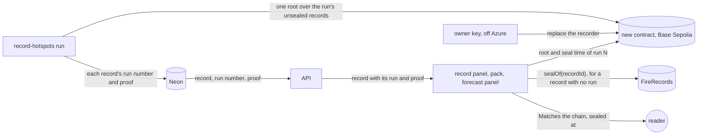

# Run roots

**Version:** v1 · **Status:** Draft · **Type:** Enhancement · **Project type:** Web UI

**Shape doc:** docs/specs/judge-review/shape.md
**Depends on:** None

The recorder seals one Merkle root per run on a new contract, whose recorder key an owner key can
replace. The page checks each new record's proof against its run's root, and old seals still check
on FireRecords. It comes now because complete-packs needs sealed runs, and a busy pass waits an
hour for its seals today.

## Problem

The recorder seals each record in its own transaction on FireRecords (D19). By 22 Oct 2026 it had
sealed 17,173 detections and 856 forecasts that way. Two things go wrong.

- A run stops sealing after 40 minutes (`api/src/firewatch/record_hotspots.py:30`). On 22 Oct 2026
  the 08:00 UTC run stored 994 detections and made 303 forecasts. It sealed 688 of the 1,297 and
  stopped. The other 609 waited for the 09:00 run. A company can point at the hour.
- FireRecords' recorder is `immutable` (`contracts/src/FireRecords.sol:20`). The key lives in the
  Azure job. If it leaks, a thief can seal a wrong fingerprint under any record ID not sealed yet,
  so the true record reads "Does not match". Nobody can take that power back.

complete-packs also needs each run's records sealed as one list, so a pack can show that none is
missing.

## Slice test

| Check                         | Result |
| ----------------------------- | ------ |
| Cuts every layer it needs     | yes: the new contract, the recorder, the API's record routes, and the record panel, pack and forecast panel |
| One e2e test walks it         | yes: on the e2e's anvil, the recorder seals a run's root, the owner replaces the recorder key, and the next run seals from the new key. The test opens a new detection, a pack with old and new seals, a changed record, and a forecast |
| Worth shipping alone          | yes: each run's records are sealed in one transaction within the run, and a leaked recorder key can be replaced |
| Fits (≤5 scenarios, ≤2 areas) | yes: 5 scenarios; two areas: recording (contract and recorder) and viewing (API and page), as fire-record counted them |

**Path:** full. It adds a contract, changes the recorder, the API and the page, and touches far
more than three files.

## User story

As a watchdog investigator, I want each new record sealed in the run that stores it, by a key that
can be replaced if it leaks, so that a company can't say a seal came late or from a stolen key.

## Flow



Each run seals one root on the new contract and stores each record's proof. The page checks a new
record's proof against its run's root, and an old record on FireRecords as today. Only the owner
key can replace the recorder.

## States

```mermaid
stateDiagram-v2
    [*] --> Stored: run stores a detection or makes a forecast
    Stored --> InRoot: run's root transaction succeeds
    Stored --> Stored: root transaction fails; the next run takes it
    InRoot --> [*]
```



A new record stays unsealed only until a run's root transaction succeeds. Each run's root covers
every record still unsealed, so a failed run's records go into the next run's root.

## Acceptance criteria

```gherkin
Scenario: A run seals its new detections and forecasts with one root
  Given a recorder run on 24 Oct 2026 at 08:00 UTC stores 994 new detections and makes 303 forecasts
  When the run finishes
  Then it has sent one transaction to the new contract, with one root for all 1,297 records
  And each of those detections reads "Matches the chain" in the tool and in a pack
  And each shows "Sealed" at that transaction's block time, by Base Sepolia's clock
  And each of the 303 forecasts reads the same in its fire's forecast panel

Scenario: A pack checks old seals and run roots together
  Given ID-WOOD-CONCESSION-0332's fire has 283 detections sealed one by one on FireRecords
  And a pass on 24 Oct 2026 adds 6 detections, sealed in that run's root
  When the reader opens the fire's complaint pack made after that pass
  Then it reads "289 of 289 detections match the chain"
  And each old detection still shows its own seal time on FireRecords
  And the landing's seal step still reads 283 of 283

Scenario: A detection changed after its run was sealed
  Given a detection sealed in the 24 Oct 2026 08:00 UTC run's root with fire power 12.40 MW
  And its stored fire power is later changed to 4.10 MW
  When the reader opens it in the tool or in a pack
  Then it reads "Does not match the chain"
  And the other detections of that run still read "Matches the chain"

Scenario: A run's root waits for the next run
  Given the 24 Oct 2026 08:00 UTC run stores 994 detections
  And its root transaction fails because the recorder wallet is empty
  When the reader opens one of them
  Then it reads "Not on chain yet"
  And once the wallet is topped up, the 09:00 run seals them in its own root with its new records
  And then each reads "Matches the chain", sealed at the 09:00 run's block time

Scenario: The owner replaces a leaked recorder key
  Given the recorder key in the Azure job leaks on 24 Oct 2026
  When the operator replaces the recorder with a new key, signed by the owner key
  Then a root sent from the old key is refused
  And a replacement sent from any key but the owner key is refused
  And the next run seals its root from the new key
  And every root sealed before the replacement still checks
```

## Scope

**In:**

- A new contract on Base Sepolia that stores one root per run, numbered in order, with its block
  time. Only the recorder key seals a root, and only the owner key replaces the recorder (O2).
- The recorder seals one root per run over every unsealed record: the run's new detections, its
  forecasts (O3), and any record a failed run left. The 40-minute seal budget goes.
- The switch: the recorder stops sealing on FireRecords. A record still unsealed then goes into the
  first root.
- The API sends each new record's run number, proof and the run's transaction.
- The record panel, the pack and the forecast panel check a new record's proof against its run's
  root, and an old record on FireRecords as today, in one Multicall3 read.
- The deploy: the contract verified on Basescan (D35), the job and the page pointed at it, and the
  job's image updated by the operator (D21).

**Out:**

- Proof that a pack's list of records is whole. complete-packs picks it up (O4).
- Moving FireRecords' 17,173 detection and 856 forecast seals into roots. No slice; they stay where
  they are and still check.
- Replacing the owner key. No slice; it stays off Azure, and a lost owner key means a new contract.
- Base mainnet. The roadmap write-up names it (shape O13).
- The landing's real case. Its 283 seals stay on FireRecords, and its check doesn't change.

## Technical plan

_(the rest is added at pause 3)_

### Decisions to record

Drafted at pause 1. `/build` appends them to `DECISIONS.md` and flips D19's Status line to
`superseded by D103` and D49's to `superseded by D105`.

```markdown
## D103 · 2026-10-22 · Seal one Merkle root per run on a new contract whose recorder can be replaced

Why: one transaction per record capped a run at 40 minutes (D19). On 22 Oct 2026 the 08:00 UTC run
sealed 688 of its 1,297 records and left 609 for the next hour. FireRecords' recorder is immutable,
so a leaked key can't be taken back. One root per run seals any number of records in one
transaction, and gives complete-packs a sealed list for each run. Old seals stay on FireRecords,
and the page reads both contracts.
Rejected: one seal per record on FireRecords, as D19 chose (a busy pass waits an hour for its
seals, and the recorder key can't be replaced).
Supersedes: D19
Source: docs/specs/run-roots.md
Status: active

## D104 · 2026-10-22 · A separate owner key, kept off Azure, can replace the recorder

Why: a leaked recorder key must be replaceable without a new contract. The owner key stays on the
operator's machine, never in Azure or the job, so a leak of the job's key doesn't take it too. The
owner key can do nothing but replace the recorder.
Rejected: a Safe multisig with 2 of 3 keys (one operator holds all three today, so it adds steps
but no second person).
Source: docs/specs/run-roots.md
Status: active

## D105 · 2026-10-22 · Make forecasts first in each run, as fingerprint version 3, and seal them in the run's root

Why: only the recorder seals, and a forecast's seal time is its evidence. The run makes its
forecasts before anything is sealed, and one root seals them with the run's detections in one
transaction, from the key the owner can replace (D104). Version 3 ABI-encodes the concession, fire
key, pass, made, until and forecast times, the two points and the rule version as whole numbers,
so Python and TypeScript produce identical bytes (D17). FireRecords' fixed key then seals nothing
new.
Rejected: forecasts keeping their own seals on FireRecords (553 transactions on 21 Oct 2026 from a
key that can't be replaced), a forecast job of its own (a second job holding the wallet key), the
API (read-only, no key, D21), hashing JSON (D17).
Supersedes: D49
Source: docs/specs/run-roots.md
Status: active

## D106 · 2026-10-22 · A record the API sends without its proof reads "Not on chain yet" until complete-packs

Why: the chain holds one root per run, so only a proof places a record under it, and the API sends
the proof. A record without one reads "Not on chain yet", never "Matches". complete-packs checks
each run's full list, which shows a missing record. A pack already says that Fire Watch's server
chose its records (D98). The seal time still comes from the chain alone (D97).
Rejected: "Should be sealed by now" for a record older than the newest root (an unsealed record's
time is also the API's word, so it adds a clock without closing the gap).
Source: docs/specs/run-roots.md
Status: active
```

## Open items

| ID | What | Type | Raised at | Owner | Status | Answer |
| -- | ---- | ---- | --------- | ----- | ------ | ------ |
| O1 | run-roots supersedes D19, which rejected a batch-seal contract, and splits old and new seals across two contracts (from shape O6) | flag | shape | user | Resolved | 2026-10-22: supersede D19. A new contract seals one root per run. Old seals stay on FireRecords, and the page reads both (D103) |
| O2 | Who holds the power to replace the recorder key on the new contract? (from shape O12) | question | shape | user | Resolved | 2026-10-22: a separate owner key on the operator's machine, never in Azure or the job. It can only replace the recorder (D104) |
| O3 | Do new forecasts go into the run's root, or keep their own seals on FireRecords? | question | spec p1 | user | Resolved | 2026-10-22: into the root with the run's detections, so FireRecords' fixed key seals nothing new (D105) |
| O4 | The chain alone can't say a record is in a run's root; the page needs the API's proof. A record the API sends without its proof reads "Not on chain yet", never "Matches" | flag | spec p1 | user | Accepted risk | 2026-10-22: until complete-packs, whose per-run lists show a missing record. A pack already says the server chose its records (D98). D106 |

_Never delete this section or its rows. See references/ledger.md._

## Glossary

- **Merkle root**: one hash that stands for a whole list of records. A change to any record changes
  it.
- **Proof**: the few hashes that link one record to its run's root. With them, the page works out
  the root from the record alone.
- **Run**: one hourly start of the recorder job.
- **Owner key**: the key that can replace the recorder key on the new contract, and do nothing
  else.
- **Multicall3**: a contract on Base Sepolia that answers many reads in one call (D38).
- **Basescan**: the public block explorer for Base Sepolia.
- **anvil**: a local test chain from Foundry, which the e2e runs on.
- **e2e**: end-to-end: one test that walks the whole slice as a user would.
