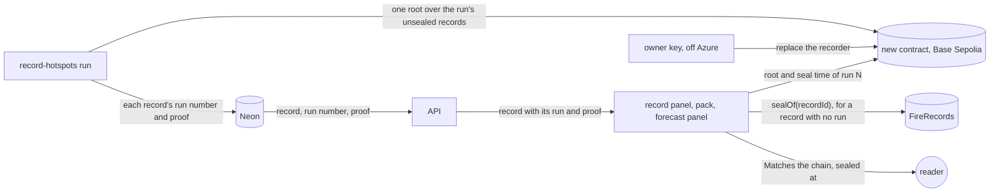
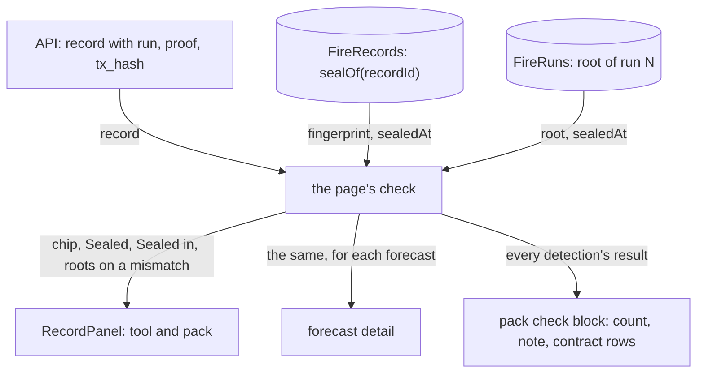
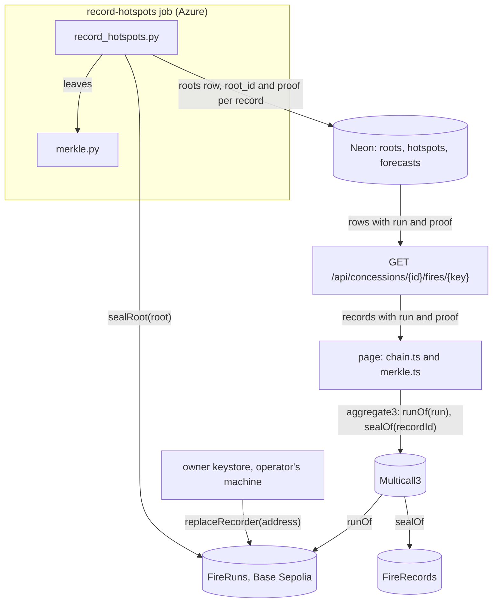
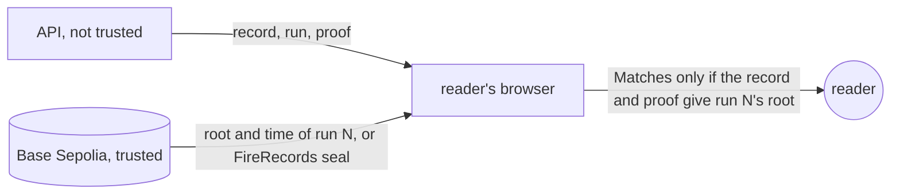
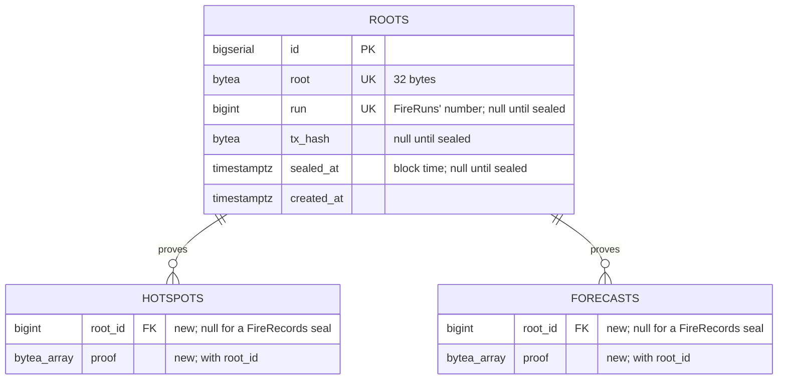

# Run roots

**Version:** v1 · **Status:** Built · **Type:** Enhancement · **Project type:** Web UI

**Shape doc:** docs/specs/judge-review/shape.md
**Depends on:** None

The recorder seals one Merkle root per run on a new contract, whose recorder key an owner key can
replace. The page checks each new record's proof against its run's root, and old seals still check
on FireRecords. It comes now because complete-packs needs sealed runs, and a busy pass waits an
hour for its seals today.

## Problem

The recorder seals each record in its own transaction on FireRecords (D19). By 22 Oct 2026 it had
sealed 17,173 detections and 856 forecasts that way. Two things go wrong.

- A run stops sealing after 40 minutes (`api/src/firewatch/record_hotspots.py:30`). On 22 Oct 2026
  the 08:00 UTC run stored 994 detections and made 303 forecasts. It sealed 688 of the 1,297 and
  stopped. The other 609 waited for the 09:00 run. A company can point at the hour.
- FireRecords' recorder is `immutable` (`contracts/src/FireRecords.sol:20`). The key lives in the
  Azure job. If it leaks, a thief can seal a wrong fingerprint under any record ID not sealed yet,
  so the true record reads "Does not match". Nobody can take that power back.

complete-packs also needs each run's records sealed as one list, so a pack can show that none is
missing.

## Slice test

| Check                         | Result |
| ----------------------------- | ------ |
| Cuts every layer it needs     | yes: the new contract, the recorder, the API's record routes, and the record panel, pack and forecast panel |
| One e2e test walks it         | yes: on the e2e's anvil, the recorder seals a run's root, the owner replaces the recorder key, and the next run seals from the new key. The test opens a new detection, a pack with old and new seals, a changed record, and a forecast |
| Worth shipping alone          | yes: each run's records are sealed in one transaction within the run, and a leaked recorder key can be replaced |
| Fits (≤5 scenarios, ≤2 areas) | yes: 5 scenarios; two areas: recording (contract and recorder) and viewing (API and page), as fire-record counted them |

**Path:** full. It adds a contract, changes the recorder, the API and the page, and touches far
more than three files.

## User story

As a watchdog investigator, I want each new record sealed in the run that stores it, by a key that
can be replaced if it leaks, so that a company can't say a seal came late or from a stolen key.

## Flow



Each run seals one root on the new contract and stores each record's proof. The page checks a new
record's proof against its run's root, and an old record on FireRecords as today. Only the owner
key can replace the recorder.

## States

```mermaid
stateDiagram-v2
    [*] --> Stored: run stores a detection or makes a forecast
    Stored --> InRoot: run's root transaction succeeds
    Stored --> Stored: root transaction fails; the next run takes it
    InRoot --> [*]
```



A new record stays unsealed only until a run's root transaction succeeds. Each run's root covers
every record still unsealed, so a failed run's records go into the next run's root.

## Acceptance criteria

```gherkin
Scenario: A run seals its new detections and forecasts with one root
  Given a recorder run on 24 Oct 2026 at 08:00 UTC stores 994 new detections and makes 303 forecasts
  When the run finishes
  Then it has sent one transaction to the new contract, with one root for all 1,297 records
  And each of those detections reads "Matches the chain" in the tool and in a pack
  And each shows "Sealed" at that transaction's block time, by Base Sepolia's clock
  And each of the 303 forecasts reads the same in its fire's forecast panel

Scenario: A pack checks old seals and run roots together
  Given ID-WOOD-CONCESSION-0332's fire has 283 detections sealed one by one on FireRecords
  And a pass on 24 Oct 2026 adds 6 detections, sealed in that run's root
  When the reader opens the fire's complaint pack made after that pass
  Then it reads "289 of 289 detections match the chain"
  And each old detection still shows its own seal time on FireRecords
  And the landing's seal step still reads 283 of 283

Scenario: A detection changed after its run was sealed
  Given a detection sealed in the 24 Oct 2026 08:00 UTC run's root with fire power 12.40 MW
  And its stored fire power is later changed to 4.10 MW
  When the reader opens it in the tool or in a pack
  Then it reads "Does not match the chain"
  And the other detections of that run still read "Matches the chain"

Scenario: A run's root waits for the next run
  Given the 24 Oct 2026 08:00 UTC run stores 994 detections
  And its root transaction fails because the recorder wallet is empty
  When the reader opens one of them
  Then it reads "Not on chain yet"
  And once the wallet is topped up, the 09:00 run seals them in its own root with its new records
  And then each reads "Matches the chain", sealed at the 09:00 run's block time

Scenario: The owner replaces a leaked recorder key
  Given the recorder key in the Azure job leaks on 24 Oct 2026
  When the operator replaces the recorder with a new key, signed by the owner key
  Then a root sent from the old key is refused
  And a replacement sent from any key but the owner key is refused
  And the next run seals its root from the new key
  And every root sealed before the replacement still checks
```

## Scope

**In:**

- A new contract on Base Sepolia that stores one root per run, numbered in order, with its block
  time. Only the recorder key seals a root, and only the owner key replaces the recorder (O2).
- The recorder seals one root per run over every unsealed record: the run's new detections, its
  forecasts (O3), and any record a failed run left. The 40-minute seal budget goes.
- The switch: the recorder stops sealing on FireRecords. A record still unsealed then goes into the
  first root.
- The API sends each new record's run number, proof and the run's transaction.
- The record panel, the pack and the forecast panel check a new record's proof against its run's
  root, and an old record on FireRecords as today, in one Multicall3 read.
- The deploy: the contract verified on Basescan (D35), the job and the page pointed at it, and the
  job's image updated by the operator (D21).

**Out:**

- Proof that a pack's list of records is whole. complete-packs picks it up (O4).
- Moving FireRecords' 17,173 detection and 856 forecast seals into roots. No slice; they stay where
  they are and still check.
- Replacing the owner key. No slice; it stays off Azure, and a lost owner key means a new contract.
- Base mainnet. The roadmap write-up names it (shape O13).
- The landing's real case. Its 283 seals stay on FireRecords, and its check doesn't change.

## Interface

No layout, token, component or motion changes. The slice adds rows to existing `fw-kv` lists and
changes some wording, so no preview was built, as in honest-claims. Each row and string is fixed
below. The design system's two craft checks have nothing new to judge.

**Motion tier:** 0. Nothing new moves, and the check chip keeps its existing `enter` (O5).

**Components used:** `RecordPanel`, `Chip`, the forecast detail in `ForecastPanel`, the pack's
check block in `ComplaintPack`, `fw-kv`, `fw-help`, `fw-link`, `fw-mono`, `ExternalIcon`. All
exist in `docs/design/design-system` and `web/src/styles/app.css`.

**Preview:** none. After `/build`, `/?preview=complaint-pack` and `/?preview=spread-forecast` show
the new rows on fixtures with old and new seals.

The new contract is called FireRuns on the page and in the code.



The page checks a record with a run against FireRuns, and a record without one against
FireRecords. The record panel, the forecast detail and the pack's check block show the result.

### A record's rows

| Chain answer | Chip | "Sealed" | "Sealed in" |
| --- | --- | --- | --- |
| not yet | Checking | left out | left out |
| FireRecords' fingerprint equals the record's | Matches the chain | the chain's time, then the gap after detection | FireRecords, in a seal of its own |
| the proof leads to run N's root on FireRuns | Matches the chain | run N's time, then the gap after detection | FireRuns, run N's root |
| FireRecords' fingerprint differs | Does not match the chain | the chain's time of the seal it holds | FireRecords, in a seal of its own |
| the proof doesn't lead to run N's root | Does not match the chain | run N's time | FireRuns, run N's root |
| no seal on FireRecords, or run N not sealed yet | Not on chain yet | left out | left out |
| read failed | none: "Couldn't reach Base Sepolia to check this record." and Check again | left out | left out |

"Sealed in" sits after "Fingerprint" and before "Transaction". "Transaction" links to the run's one
transaction for a record in a root, and to the record's own for an old one. The forecast detail
gets the same "Sealed in" row, after its fingerprint rows, and the same three rows on a mismatch (O7).

On a mismatch, an old record keeps "Sealed fingerprint" and "Fingerprint now". A record in a root
shows three rows in their place:

| Row | Value |
| --- | --- |
| Fingerprint now | the record's fingerprint, worked out in the browser |
| Run root on chain | run N's root, read from FireRuns |
| Run root now | the root worked out from the fingerprint now and the record's proof |

### Copy

| Where | Today | After |
| --- | --- | --- |
| `RecordPanel.tsx:37`, mismatch note, record in a root | The stored record has changed since it was sealed. The chain still holds the original fingerprint. | The stored record has changed since its run was sealed. The chain still holds the run's original root. |
| `RecordPanel.tsx:180`, "Show the raw record", record in a root | Fingerprint of this record: `<fingerprint>` | Fingerprint of this record: `<fingerprint>`. Run N's root, worked out from it and the `<k>` proof hashes above: `<root>` |
| `ComplaintPack.tsx:217`, check note | Your browser worked out each detection's fingerprint and read its seal from FireRecords on Base Sepolia, a test network. Fire Watch's server chose which records to send. NASA FIRMS's public archive shows whether one is missing. | Your browser worked out each detection's fingerprint and checked it on Base Sepolia, a test network. An older detection has a seal of its own on FireRecords. A newer one is under its recorder run's root on FireRuns. Fire Watch's server chose which records to send. NASA FIRMS's public archive shows whether one is missing. |
| `ComplaintPack.tsx:240`, the "Contract" row | Contract: `<FireRecords address>` | FireRecords: `<address>`, when the pack has a record without a run. FireRuns: `<address>`, when it has a record with one. Each links to its contract on Basescan |
| `ForecastPanel.tsx:277` | Each forecast is sealed in the run that makes it, or a later run if that one runs out of time. Every one stays listed here, right or wrong. | Each forecast is sealed in the run that makes it, or a later run if that one fails to seal. Every one stays listed here, right or wrong. |
| `ForecastPanel.tsx`, mismatch note, forecast in a root (O7) | This forecast has changed since it was sealed. The chain still holds the original fingerprint. | This forecast has changed since its run was sealed. The chain still holds the run's original root. |

The proof hashes show in the raw record because the API sends them with the record.

## Technical plan

### Approach

A new contract, FireRuns, keeps an ordered list of roots, each with its block time. Its recorder
seals a root, and its owner replaces the recorder. Each run of `record-hotspots` builds one Merkle
tree over every record still unsealed, stores the root and each record's proof in Neon, and then
sends the root. The fire route sends each record's run number and proof. The page reads FireRuns
for a record with a run and FireRecords for one without, in one Multicall3 call, and works out
the root from the record itself.

Relies on: D7, D10, D15, D17, D20, D21, D35, D38, D50, D97, D98, D103, D104, D105, D106, D107,
D108, D109, D110



The recorder writes proofs to Neon and roots to FireRuns. The page gets proofs from the API and
roots and old seals from the chain, all through one Multicall3 read.

```mermaid
sequenceDiagram
    participant R as record-hotspots
    participant D as Neon
    participant F as FireRuns
    participant A as API
    participant P as page
    R->>D: store detections, make forecasts (as today)
    R->>F: runOfRoot(root) for each stored root with no run
    F-->>R: sealed or not; resend the root if not
    R->>R: tree over unsealed records: root, proofs
    R->>D: INSERT roots, SET root_id and proof (commit)
    R->>F: sealRoot(root)
    F-->>R: receipt: RootSealed(run, root), block time
    R->>D: SET run, tx_hash, sealed_at (commit)
    P->>A: GET fire
    A-->>P: records with run and proof
    P->>F: runOf(run), through Multicall3
    F-->>P: root, sealedAt
    P->>P: rootFrom(leaf(recordId, fingerprint), proof) equals root?
```

A run seals before it records the run number, and records the root before it seals. A crash at
any point leaves a state that the next run finishes.



The browser trusts only the chain. A wrong record, run or proof gives "Does not match" or "Not on
chain yet", never "Matches" (D106).

### Changes

| File | What changes | Why |
| ---- | ------------ | --- |
| `contracts/src/FireRuns.sol` | New. `owner` (immutable) and `recorder`. `sealRoot(bytes32 root) returns (uint256 run)`: recorder only, refuses a zero root and a root already held, pushes the root with `uint64(block.timestamp)`, emits `RootSealed(uint256 indexed run, bytes32 indexed root)`. `replaceRecorder(address)`: owner only, refuses the zero address, emits `RecorderReplaced(previous, next)`. `runOf(uint256)` gives the root and time, or zeros past the end. `runOfRoot(bytes32)` gives whether it is sealed, its run and time | 1, 4, 5 |
| `contracts/test/FireRuns.t.sol` | New. Seal by the recorder, refusals for any other key, a zero root and a repeat root, zeros past the end, a replacement by the owner only, the old key refused after it, both events | 5 |
| `contracts/script/DeployRuns.s.sol` | New, as `Deploy.s.sol`: reads `OWNER_ADDRESS` and `RECORDER_ADDRESS` | 1, 5 |
| `api/migrations/005_run_roots.up.sql`, `.down.sql` | New `roots` table. `hotspots` and `forecasts` get `root_id` and `proof bytea[]`. The reader role gets SELECT on `roots`. Down drops them | 1, 4 |
| `api/src/firewatch/merkle.py` | New. `leaf(record_id, fingerprint)` and `tree(leaves)`, which gives the root and each leaf's proof (D108) | 1, 3 |
| `fixtures/merkle-vectors.json` | New. Trees of 1, 2, 3 and 5 leaves with their roots and proofs, from real record IDs and fingerprints, read by both test suites | 1, 3 |
| `api/src/firewatch/chain.py:17` | The ABI becomes FireRuns'. `seal`, `sealed` and `seal_tx_hash` give way to `seal_root(root)`, which returns the run, the transaction hash and the block time from the receipt, `run_of_root(root)`, and `root_tx_hash(root, sealed_at)`, which reuses `_first_block_after`. `now`, `balance_eth` and `_block` stay | 1, 4 |
| `api/src/firewatch/record_hotspots.py:30`, `:230`, `:236`, `:286`, `:300` | The 40-minute budget, `SEALS` and `_seal` go. A new `_seal_root` first finishes the stored roots with no run, then builds a tree over the hotspots and forecasts with no `tx_hash` and no `root_id`, stores it, sends it, and fills in `run`, `tx_hash` and `sealed_at`. A send the node refuses drops the new root at once (D110). The chain address comes from `FIRE_RUNS_ADDRESS`. The log line adds `roots=` and `run=` | 1, 4 |
| `api/src/firewatch/app.py:62`, `:72`, `:164`, `:310` | `FIRE_HOTSPOTS` and `FORECASTS` join `roots` for `run`. The fire route's records and `_forecast` add `run` and `proof` as hex, both null until the root is sealed. The concession route doesn't change (D109) | 1, 2 |
| `web/src/merkle.ts` | New. `leaf(recordId, fingerprint)` and `rootFrom(leaf, proof)`, as `merkle.py` (D108) | 1, 3 |
| `web/src/chain.ts` | Adds FireRuns' `runOf` and `checkReads(records)`. For each record it reads `runOf(run)` on FireRuns, each run once, or `sealOf(recordId)` on FireRecords, in one `aggregate3` per 500 reads (D38). It returns a `Seal` with its contract. `sealsOf` stays for the landing. `sealOf` and `sealsWithTime` go | 1, 2 |
| `web/src/RecordPanel.tsx:7`, `:42`, `:80`, `:158` | `checkSeal(seal, record, fingerprint)` gives the check, the seal time and `sealedIn`. `RecordPanel` takes `sealedIn` and shows the rows and copy in the Interface section | 1, 2, 3 |
| `web/src/ForecastPanel.tsx:111`, `:239`, `:277` | `ForecastCheck` gains `sealedIn`. The forecast detail shows the same rows. The copy at `:277` changes | 1, 3 |
| `web/src/FireRecordPage.tsx:15`, `:152`, `:174` | `FireRecordSource.sealOf` and `forecastSeals` return `Seal`s, checked with `checkSeal` | 1, 3 |
| `web/src/ComplaintPack.tsx:12`, `:97`, `:217`, `:240` | `PackSource.contract` becomes `contracts: { records, runs }`, and `sealsOf` returns `Seal`s. The note and the contract rows follow the Interface section | 2, 3 |
| `web/src/api.ts:10`, `:68`, `:187`, `:204` | `HotspotRecord` and `Forecast` gain `run` and `proof`. Both sources call `checkReads` | 1, 2 |
| `web/src/vite-env.d.ts:6` | Adds `VITE_FIRE_RUNS_ADDRESS` | 1 |
| `web/src/preview/*` | The fixture sources return `Seal`s. The complaint-pack and spread-forecast previews add records in a two-leaf root, one changed | 1, 3 |
| `web/e2e/env.ts`, `web/e2e/global-setup.ts` | Deploys FireRuns as anvil account 0's second contract, `0xe7f1725E7734CE288F8367e1Bb143E90bb3F0512`, with account 1 as owner. Runs 1 and 2 seal from account 0. Then the owner replaces the recorder with account 2, and runs 3 and 4 seal from it. Right after run 1, it moves the first pass of 0332's fire back to FireRecords, as the recorder sealed records before the switch (O8) | 2, 5 |
| `web/e2e/run-roots.spec.ts` | New. The slice's e2e, below | all |
| `.github/workflows/deploy.yml:94` | Passes `VITE_FIRE_RUNS_ADDRESS` from the GitHub variable `FIRE_RUNS_ADDRESS` | 1 |
| `infra/setup.sh:16`, `:60`, `:115` | The job gets `FIRE_RUNS_ADDRESS` in place of `CONTRACT_ADDRESS`, and the printout names the new GitHub variable | 1 |
| `README.md` | "Turning on run roots": the operator's steps under Rollout. "First deploy" deploys and verifies FireRuns too | 1, 5 |

Reusing: `Chain._first_block_after` and `_block` for the receipt and event lookups, the advisory
lock and the run row in `record_hotspots.main`, `fingerprint_v2` and `forecast_fingerprint` for the
leaves, the Multicall3 read and its 500-record chunks from `chain.ts`, the shared-vector pattern
of `fixtures/fingerprint-vectors.json`, `checkOf` for FireRecords seals, and the e2e's `run`,
`rpc` and `evm_mine` helpers.

### Data



A record's `tx_hash` and `sealed_at` take its root's values once the root is sealed. Every
existing "unsealed means `tx_hash IS NULL`" query then stays true: the recorder's count, the
health route, and the recorder check (D20).

**Migration:** expand only. `005_run_roots` adds a table and nullable columns. No backfill: the
17,173 detections and 856 forecasts sealed on FireRecords keep `root_id` null. The switch is the
job's new image. There is no contract step, because old records go on using FireRecords.

**Reverse:** point the job at its previous image first. The old recorder seals any record with no
`tx_hash` on FireRecords, including one in an unsent root. The page and the API read both
contracts, so they stay. `migrate down` drops the table and the columns. Run it only before any
root is sealed, because it removes the proofs those records need. `test_migrations.py` covers up,
down and up again.

### Earn-it

| Added | Triggered by |
| ----- | ------------ |
| FireRuns | Scenarios 1 and 5: one transaction per run, and a recorder that can be replaced (D103) |
| `runOfRoot` and the repeat-root refusal | The risk of a crash between the root's transaction and the database commit (D110) |
| `roots` table, `root_id`, `proof` | Scenario 1: the page needs each record's proof. Scenario 4: a root waits for a later run |
| `merkle.py`, `merkle.ts`, `fixtures/merkle-vectors.json` | Scenarios 1 and 3: Python builds the tree and the browser checks it, byte for byte |
| `FIRE_RUNS_ADDRESS`, `VITE_FIRE_RUNS_ADDRESS` | Scenario 1: the job and the page must find FireRuns |
| The owner's Foundry keystore | Scenario 5 and D104: the owner key stays off Azure and out of `.env` |

No new dependency: the API has `eth_abi` and `eth_utils`, and the page has `viem`.

### Non-functionals

|                      |                                                                               |
| -------------------- | ----------------------------------------------------------------------------- |
| **Load**             | One root transaction an hour. The biggest run so far had 1,297 records (22 Oct 2026 08:00 UTC), so 11 proof hashes each. The backfill day, 7,388 detections, would need 13. 0332's 283-detection pack grows from 30 KB to about 100 KB gzipped (simulated 2026-10-22) |
| **Breaks first**     | At 10×, a 4,880-detection fire's route carries about 1.5 MB gzipped of proofs. Then move proofs to a route of their own, asked for only by the pack. The root transaction stays one per run |
| **Security surface** | `sealRoot`: the recorder key only. `replaceRecorder`: the owner key only, from an encrypted Foundry keystore on the operator's machine. The page trusts the chain and hashes what the API sends. A wrong record, run or proof can't read "Matches" (D106). New data: roots and proofs, all public. No new secret in Azure or GitHub |
| **Proof it works**   | The job's log line: `recorded fetched=… sealed=1297 unsealed=0 roots=1 run=412 …`. Basescan shows one `sealRoot` an hour on FireRuns. `/api/health` keeps `last_sealed` and `unsealed=0` |
| **Rollout**          | No flag, as D81. In order: `migrate up` on Neon; merge, so Deploy ships the API and the page, which read both contracts; deploy and verify FireRuns from the owner keystore; set the `FIRE_RUNS_ADDRESS` variable and rerun Deploy (O10); point the job at the merged image with `FIRE_RUNS_ADDRESS` set (D21). Rollback: the job's previous image |

The operator's steps, with the real recorder address:

```sh
cast wallet new fire-runs-owner --password
cast send <owner address> --value 0.003ether --rpc-url https://sepolia.base.org \
  --private-key "$(grep '^RECORDER_PRIVATE_KEY=' .env | cut -d= -f2-)"
cd contracts && OWNER_ADDRESS=<owner address> RECORDER_ADDRESS=0x6f09c576Be8AFB0f2175A97A0eFa26DE23A532f3 \
  forge script script/DeployRuns.s.sol --rpc-url https://sepolia.base.org --account fire-runs-owner --broadcast
forge verify-contract <FireRuns address> src/FireRuns.sol:FireRuns --chain 84532 --watch \
  --constructor-args "$(cast abi-encode 'constructor(address,address)' <owner address> 0x6f09c576Be8AFB0f2175A97A0eFa26DE23A532f3)"
```

`/build` hands these over with the real addresses filled in, as each one becomes known.

### Test plan

| Scenario | Test | Command |
| -------- | ---- | ------- |
| 1, 4 | `api/tests/test_merkle.py`: the shared vectors, a 1-leaf tree, every proof leads to its root | `cd api && uv run pytest tests/test_merkle.py` |
| 1 | `api/tests/test_record_hotspots.py`: one run on anvil seals one root for its detections and forecasts, and each proof leads to `runOf(run)` | `cd api && PATH=$HOME/.foundry/bin:$PATH uv run pytest tests/test_record_hotspots.py` |
| 4 | the same file: an empty wallet drops the root; the next run seals both runs' records in one root. A stored root already on the chain is filled in, not resent | the same |
| 5 | the same file: after `replaceRecorder`, the old key's run fails and the new key's run seals | the same |
| 5 | `contracts/test/FireRuns.t.sol` | `cd contracts && forge test --match-contract FireRuns && forge fmt --check` |
| 1, 2 | `api/tests/test_app.py`: the fire route sends `run` and `proof` for a sealed root, nulls for a record on FireRecords or in an unsent root | `cd api && uv run pytest tests/test_app.py` |
| 1, 3 | `api/tests/test_migrations.py`: up, down and up with `005_run_roots`; the reader can read `roots` | `cd api && uv run pytest tests/test_migrations.py` |
| 1, 3 | `web/src/merkle.test.ts`: the shared vectors | `cd web && pnpm test src/merkle.test.ts` |
| 1, 2 | `web/src/chain.test.ts`: one `aggregate3` mixes FireRuns and FireRecords reads, each run read once | `cd web && pnpm test src/chain.test.ts` |
| 1, 2, 3 | `web/src/RecordPanel.test.tsx`, `ComplaintPack.test.tsx`, `ForecastPanel.test.tsx`: each row in the Interface table, the note, the contract rows | `cd web && pnpm test` |

**E2E:** `web/e2e/run-roots.spec.ts`. It opens the complaint pack of 0332's fire, whose first pass
sits on FireRecords and whose other passes sit in roots from both recorder keys. It reads "N of N
detections match the chain" and both contract rows. It opens one old and one new detection and
reads "Sealed in" for each. It changes a new detection's fire power and reads "Does not match the
chain", then puts it back. It opens the fire's forecast and reads "Sealed in" with FireRuns. It
taps the FireRuns link at 390 px, as the phone tap lessons say. Command: `cd web && pnpm e2e
e2e/run-roots.spec.ts`; the whole suite with `pnpm e2e`.

### Chunks

| Chunk | Scenarios | Files owned |
| ----- | --------- | ----------- |
| A | 5 | `contracts/src/FireRuns.sol`, `contracts/test/FireRuns.t.sol`, `contracts/script/DeployRuns.s.sol` |
| B | 1, 3, 4, 5 (recorder) | `api/`, `fixtures/merkle-vectors.json` |
| C | 1, 2, 3 (page) and the e2e | `web/`, `.github/workflows/deploy.yml`, `infra/setup.sh`, `README.md` |

A, then B, then C: B's tests deploy A's FireRuns build, and C reads B's vectors and runs B's
recorder in the e2e. No lockfile changes. Only one chunk runs the API suite.

### Risks

| Risk | Mitigation |
| ---- | ---------- |
| The deadline is 25 Oct 2026, three days off, and the switch needs the operator's hands | The API and the page ship first and work with FireRecords alone. The job switch is the last step. If it waits, nothing breaks |
| A crash after the root's transaction, before the commit | The root and the proofs are stored first. The next run asks `runOfRoot` and fills it in, or sends it again. FireRuns refuses a repeat (D110) |
| Python and TypeScript build different roots | Both test suites read `fixtures/merkle-vectors.json` |
| A thief with the recorder key adds roots before the owner replaces the key | They can't change or reorder a stored root, and a true record still checks. complete-packs must allow for roots with no stored list |
| The e2e's FireRecords history is staged, not recorded | Only 0332's first pass is moved, and the comment says it copies how the recorder sealed before the switch |
| Forecast seal times in the e2e move by a few seconds, as roots replace single seals | `/build` updates the expected times in `spread-forecast.spec.ts` |
| A lost owner key means the recorder can't be replaced | A new contract, as scope says. The keystore has a password, and the operator backs it up |

### Decisions to record

Recorded as D103, D104, D105, D106, D107, D108, D109, D110.

## Open items

| ID | What | Type | Raised at | Owner | Status | Answer |
| -- | ---- | ---- | --------- | ----- | ------ | ------ |
| O1 | run-roots supersedes D19, which rejected a batch-seal contract, and splits old and new seals across two contracts (from shape O6) | flag | shape | user | Resolved | 2026-10-22: supersede D19. A new contract seals one root per run. Old seals stay on FireRecords, and the page reads both (D103) |
| O2 | Who holds the power to replace the recorder key on the new contract? (from shape O12) | question | shape | user | Resolved | 2026-10-22: a separate owner key on the operator's machine, never in Azure or the job. It can only replace the recorder (D104) |
| O3 | Do new forecasts go into the run's root, or keep their own seals on FireRecords? | question | spec p1 | user | Resolved | 2026-10-22: into the root with the run's detections, so FireRecords' fixed key seals nothing new (D105) |
| O4 | The chain alone can't say a record is in a run's root; the page needs the API's proof. A record the API sends without its proof reads "Not on chain yet", never "Matches" | flag | spec p1 | user | Accepted risk | 2026-10-22: until complete-packs, whose per-run lists show a missing record. A pack already says the server chose its records (D98). D106 |
| O5 | Which motion tier the new rows use | question | spec p2 | user | Resolved | 2026-10-22: tier 0. Nothing new moves; the rows appear when the chain answers, and the chip keeps its existing `enter` |
| O6 | D110 says "A send that the node refuses, such as from an empty wallet, drops its root at once". For a stored root being sent again, that is D110's rejected option: an earlier send of it may still land | flag | build | user | Decided alone | Chose: drop only the run's new root, when its first send is refused before any transaction exists: an empty wallet, or a gas estimate that reverts, such as `NotRecorder` from a replaced key. A stored root sent again is never dropped, nor one whose receipt timed out or reverted; the run stops with its error. Other: drop any refused root. Undo: in `_seal_root`, catch `Refused` around the stored root's resend and drop it as the new root is. 2026-10-22 |
| O7 | The Copy table had no forecast-detail note or rows for a forecast in a root that no longer matches | flag | build | user | Decided alone | Chose: the forecast detail gets the record panel's three rows (Fingerprint now, Run root on chain, Run root now) and the note "This forecast has changed since its run was sealed. The chain still holds the run's original root." Other: keep "Sealed fingerprint" and "the original fingerprint", which name a fingerprint the chain doesn't hold. Undo: edit `ForecastPanel.tsx`'s note and drop `SealRows` there (commit 247b481). 2026-10-22 |
| O8 | The e2e row said "Last, it moves the first pass of 0332's fire back to FireRecords" | flag | build | user | Decided alone | Chose: move it right after run 1, so its three FireRecords seals sit at 13 Oct 20:00, minutes after the run, as real seals did. Other: after run 4, two days after detection. Undo: move `moveFirstPassToFireRecords()` after the runs loop in `web/e2e/global-setup.ts`. 2026-10-22 |
| O9 | Two files the plan didn't name: `web/e2e/fire-record.spec.ts`, whose seal-time helper read hotspot A from FireRecords, and `web/src/styles/app.css`, where the pack's two contract links overlapped as tap targets on a phone | flag | build | user | Decided alone | Chose: change both. The helper reads A's run root on FireRuns; on a coarse pointer each contract link is one 44 px box, as `.pack-foot .fw-link` is (commit 89bca10). Other: none that keeps the e2e and the tap check green. Undo: `git revert 89bca10`, and point the helper back at `sealOf`. 2026-10-22 |
| O10 | The Rollout order set the `FIRE_RUNS_ADDRESS` variable but didn't rebuild the page, which takes the address at build time | flag | build | user | Decided alone | Chose: the README reruns Deploy after the variable is set, before the job switch. The job keeps `CONTRACT_ADDRESS` beside `FIRE_RUNS_ADDRESS`, so rollback is the previous image alone. Other: the plan's order, where new run roots would read "Couldn't reach Base Sepolia" until the next deploy. Undo: drop the rerun from README step 5. 2026-10-22 |
| O11 | The Interface table gives a mismatch's "Sealed" as the seal's time alone, with no gap after detection | flag | build | user | Decided alone | Chose: keep "then the gap after detection" on a mismatch, as the panel does today for every seal. Other: drop the gap on a mismatch. Undo: in `RecordPanel.tsx`, show the gap only when the check matches. 2026-10-22 |
| O12 | `web/src/ComplaintPack.test.tsx` "reads the site, dates and basis of the 0332 fire" times out at vitest's 5 s in the full `pnpm test`. It passes alone in 3.1 s | flag | build | user | Decided alone | Chose: leave it. It fails the same way at 95c4af1, which holds `main`'s page code (5.9 s and 7.0 s in two runs). Other: raise its timeout here. Undo: none needed; raise the timeout in its own fix. 2026-10-22 |

_Never delete this section or its rows. See references/ledger.md._

## Glossary

- **Merkle root**: one hash that stands for a whole list of records. A change to any record changes
  it.
- **Proof**: the few hashes that link one record to its run's root. With them, the page works out
  the root from the record alone.
- **Run**: one hourly start of the recorder job.
- **Owner key**: the key that can replace the recorder key on the new contract, and do nothing
  else.
- **Multicall3**: a contract on Base Sepolia that answers many reads in one call (D38).
- **Basescan**: the public block explorer for Base Sepolia.
- **anvil**: a local test chain from Foundry, which the e2e runs on.
- **e2e**: end-to-end: one test that walks the whole slice as a user would.
- **Leaf**: the hash of one record at the bottom of a Merkle tree.
- **Inner node**: the hash of two nodes below it in the tree.
- **Receipt**: the chain's answer once a transaction is in a block: whether it worked, and the
  events it gave.
- **Foundry keystore**: a key file that Foundry keeps encrypted with a password, used with
  `--account`.
- **Advisory lock**: a Postgres lock that the recorder takes so that only one run works at a time.
- **gzip**: the compression the API already applies to its answers.
- **Backfill**: filling new columns from the data already there. This slice has none: old records
  keep their FireRecords seals.
- **Lockfile**: the file that pins each dependency's exact version. This slice changes none.
