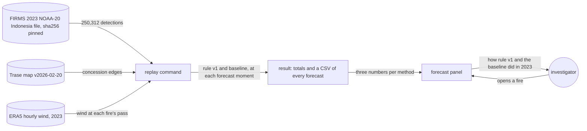
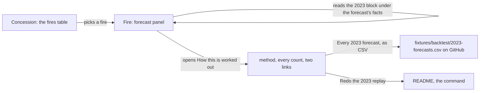
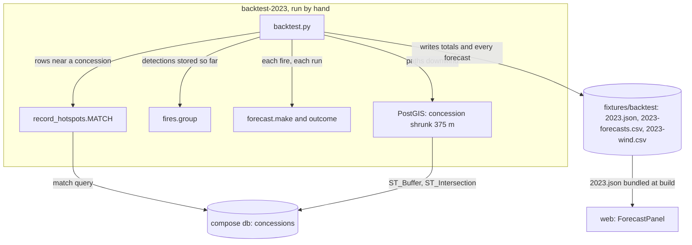
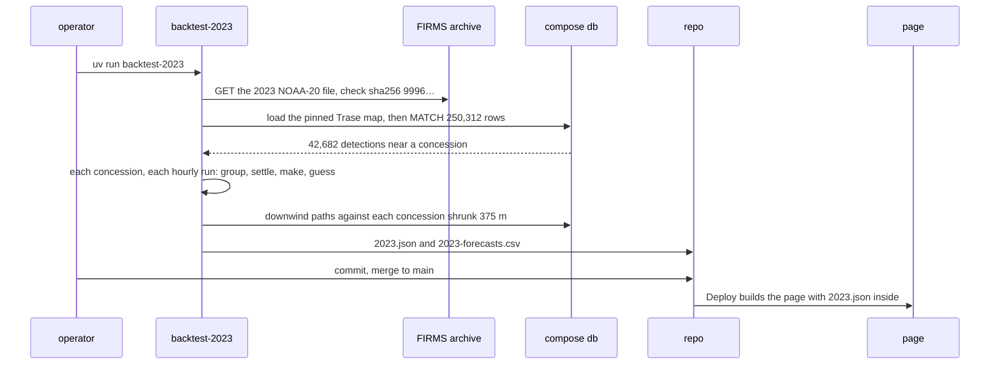
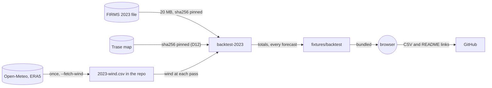

# Season backtest

**Version:** v1 · **Status:** Built · **Type:** Feature · **Project type:** Web UI

**Shape doc:** docs/specs/fire-watch/shape.md
**Depends on:** spread-forecast

A replay of 2023 runs forecast rule version 1, and a naive downwind baseline, at every moment the
recorder would have forecast. The forecast panel shows how often each one's warnings came true. It
comes now because spread-forecast shipped a rule with no proof (its O1, D42), and few live forecasts
can settle before 2026-10-24 (its O8).

## Problem

A buyer told "this fire is forecast to be seen inside" can't tell how much weight that carries. On
the week rule version 1 was chosen on, 441 of its 482 "inside" forecasts did not come in (D48). Live
forecasts count only from their seal, and the first ones were sealed on 2026-10-19. By the deadline
only a few days of outcomes exist.

2023 was a big fire year in Indonesia. FIRMS's yearly VIIRS NOAA-20 file for Indonesia holds 250,312
detections in 2023, and 42,682 of them are within 5 km of a concession. A scratch replay of rule
version 1 over 2023 made 20,277 forecasts. It used a 3-hour FIRMS lag and had no baseline yet.

- In 135 forecasts, a pass saw the fire inside within 48 hours. Rule version 1 said "inside" for 123.
- 3,751 of its 3,874 decided "inside" forecasts did not come in. That leaves out the 15 whose 48 hours
  end in 2024 (O8).
- For the arrivals it warned of, it was a median 11.7 hours off.

Those numbers mean little alone. They need a naive guess beside them, worked out the same way.

## Slice test

| Check                         | Result |
| ----------------------------- | ------ |
| Cuts every layer it needs     | yes: a replay command in `api/` with pinned inputs, its result committed to the repo, and the forecast panel in `web/`. No table, no new route, no seal |
| One e2e test walks it         | yes: run the replay on a cut of the 2023 file and check its CSV, then open a fire and see the committed result's numbers in the forecast panel (O12) |
| Worth shipping alone          | yes: anyone reading a forecast sees how often rule version 1's warnings came true in 2023, against a naive guess |
| Fits (≤5 scenarios, ≤2 areas) | yes: 5 scenarios; two areas: the replay (`api/`) and the forecast panel (`web/`) |

**Path:** full. The slice adds a new command, new pinned inputs, a committed result and a change to the page.

## User story

As a watchdog investigator, I want to see how often the forecast's warnings came true over a past
season, next to a naive guess, so that I can tell a buyer how much weight a warning carries.

## Flow



The replay reads three pinned inputs and makes both methods' forecasts at each moment. It writes the
totals and every forecast to the repo, and the forecast panel shows the totals.

How each forecast counts. Both methods forecast at the same moments, so the arrivals are the same
for both.

| The method said | In the 48 hours after the forecast was made | Counts as |
| --------------- | ------------------------------------------- | --------- |
| Seen inside by about a time | A pass sees the fire inside | An arrival warned of, with its hours off |
| Not within 48 hours | A pass sees the fire inside | An arrival missed |
| Seen inside by about a time | No pass sees the fire inside | An "inside" forecast that did not come in |
| Not within 48 hours | No pass sees the fire inside | A right "no" |
| Either | The fire joins an older fire first | Not checked (D44) |
| Either | A pass taken before the forecast was made, and stored after it, sees the fire inside | Not checked (D44) |
| Either | The 48 hours and D50's 6 end after 2023 | Listed as "ends after 2023", not counted (O8) |

## Acceptance criteria

```gherkin
Scenario: A 2023 forecast that came true counts as an arrival warned of
  Given FIRMS's 2023 VIIRS NOAA-20 Indonesia file, sha256 99969d97…, and Trase's map v2026-02-20
  And an ID-WOOD-CONCESSION-0263 fire whose 2023-09-27 06:05 UTC pass is 539 m outside the edge
    at the nearest
  When the replay runs rule version 1 over 2023
  Then the forecast after that pass says "Forecast to be seen inside by about 28 Sep 06:05 UTC"
  And the 2023-09-28 05:46 UTC pass sees the fire 523 m inside
  And the replay counts it as an arrival rule version 1 warned of, 19 minutes off

Scenario: A missed arrival and a false alarm both count against rule version 1
  Given an ID-WOOD-CONCESSION-0332 fire seen once, on 2023-10-14 05:46 UTC, 2,168 m outside
  And an ID-WOOD-CONCESSION-0264 fire whose third pass, 2023-09-28 18:28 UTC, is 1,334 m outside
  When the replay runs rule version 1 over 2023
  Then the 0332 forecast says "Not forecast to be seen inside", and the 2023-10-16 05:08 UTC pass
    sees the fire inside: an arrival missed
  And the 0264 forecast says "Forecast to be seen inside by about 29 Sep 06:28 UTC", and no pass
    sees the fire inside within 48 hours: an "inside" forecast that did not come in
  And the CSV lists both forecasts, and the totals count both

Scenario: The downwind baseline is judged on the same moments
  Given the 0263 fire's 2023-09-27 06:05 UTC pass, advancing 44 m an hour since the pass before
  And ERA5's 10 m wind at the fire at 06:00 UTC, from 127° at 3.5 m/s
  When the replay runs the baseline
  Then the baseline moves the fire toward 307° at 44 m an hour, and in 48 hours it gets no more
    than 375 m inside the edge
  And it says "Not forecast to be seen inside", so it misses the arrival that rule version 1 warned of
  And the 0332 fire, seen on one pass, has no recent rate, so the baseline says "Not forecast" for it

Scenario: The forecast panel says how the rule did in 2023, next to the baseline
  Given the committed 2023 result
  When anyone opens the ID-WOOD-CONCESSION-0332 fire of spread-forecast's scenario 1
  Then the forecast panel gives, for rule version 1 and for the downwind baseline: the arrivals
    warned of out of all of them, the "inside" forecasts that did not come in, and the median
    hours off
  And it says "A replay of 2023, run in 2026. Nothing in it was sealed in 2023."
  And "How this is worked out" gives every count, the forecasts not checked, and links to the CSV
    of every forecast and to the command that redoes it

Scenario: Anyone redoes the replay and gets the same result
  Given a fresh checkout, the pinned FIRMS file, the pinned Trase map and the pinned wind
  When anyone runs the replay command
  Then it writes the same totals and CSV, byte for byte, as the committed ones
  And when FIRMS has changed its 2023 file, the command stops with "has changed: sha256 <got>,
    expected 99969d97…" and writes nothing
```

Scenarios 1 to 3 come from the committed replay, with each pass stored by the first hourly run 3
hours after it (D57), and ERA5's wind from Open-Meteo (O13). The tests check them on a cut.

## Scope

**In:**

- All of 2023, 1 Jan to 31 Dec UTC (D52), from FIRMS's yearly VIIRS NOAA-20 file for Indonesia, pinned
  by sha256. It is the archive's standard processing. Live rows are near real time, and FIRMS keeps
  those only for about two months.
- Every row the recorder would keep: confidence n, l or h, within 5 km of a concession (D13). The
  match is against Trase's map v2026-02-20, the one the live site uses, without the permit-2024
  concessions (D16). The map covers 2023–2024 concessions.
- A forecast moment wherever the recorder would have made one: after each pass that leaves a fire
  near a concession not yet seen inside (D40). The replay calls the same `fires.py` and
  `forecast.py` code that the recorder runs.
- Two methods at each moment:
  - Forecast rule version 1 (D48).
  - The naive baseline (D51): the fire moves downwind at its recent advance rate, with ERA5's hourly
    10 m wind. A fire seen on one pass has no rate, so the baseline says "not forecast". Pause 3
    writes the rule out in full, as rule version 1 was.
- Outcomes by D44: only passes taken after a forecast was made count. Joined forecasts and those
  seen inside before they were made count neither way, and they are listed apart. So are the 15
  forecasts whose 48 hours and D50's 6 end after 2023 (O8).
- Each forecast counts once (D53). For each method there are three numbers: the arrivals warned of, the
  "inside" forecasts that did not come in, and the median hours off for the arrivals warned of.
- The totals and a CSV of every forecast for both methods, committed to the repo (D55).
- The forecast panel shows the three numbers for both methods, labelled as a replay (D54). "How this is
  worked out" gives every count and links to the CSV and the command.
- One command redoes the result byte for byte from the pinned inputs.

**Out:**

- A page or link of its own: not planned (D34).
- A seal of the result: not planned. A seal made in 2026 proves nothing about 2023 (shape O9, D55).
- 2023 fires in the fire view, on the map or as records: not planned. 2023 detections never enter
  the live tables.
- A tally of live forecasts as they settle: not planned. The fire view lists each live forecast with
  its outcome (D41).
- A new rule version tuned on 2023: not planned. It would be measured on the data it was tuned on.
- Other years and other satellites: not planned.
- Scoring where the fire crosses the edge: not planned (D44).
- Burned area and carbon: damage-estimate, slice 6.

## Interface

The forecast panel gets a block between the forecast's facts and "How this is worked out". The
block is titled "How this rule did on 2023, replayed" and holds a three-row table: rule version 1
next to the downwind guess. The page calls the baseline "Downwind guess". "How this is worked out"
gains the replay's method, a table of every count, and two links. The record still comes first
(D2), and the concession view and the pack don't change (D43, D46).



The investigator opens a fire and reads its forecast, then sees how the same rule did on 2023.
The disclosure gives every count and links to the forecasts and the command.

| Part | What shows |
| ---- | ---------- |
| Block title | "How this rule did on 2023, replayed" |
| Block table | Columns: "In 2023", "Rule version 1", "Downwind guess". Rows: "Arrivals warned of" (123 of 135), "Warnings that didn't come in" (3,751 of 3,874), "Median hours off" (11.7 h). A method that warned of none reads "None warned of" for hours off |
| Under the table | "A replay of 2023, run in 2026. Nothing in it was sealed in 2023." |
| "How this is worked out", added after the two existing paragraphs | "The 2023 replay runs this rule, and a downwind guess, at every moment the recorder would have forecast in 2023. It reads FIRMS's 2023 VIIRS NOAA-20 archive for Indonesia and the same concession map. The downwind guess moves the fire with ERA5's hourly wind, from Open-Meteo, at the rate it advanced since the pass before. A fire seen on one pass has no rate, so the guess says no." and "Both forecast at the same moments, and only passes after a forecast was made count. A warning is a forecast that the fire is seen inside." |
| Counts table | Columns: "Forecasts", "Rule version 1", "Downwind guess". Rows: "Warnings that came in", "Warnings that didn't come in", "Arrivals missed", "Said no, and stayed out", then across both columns: "Not checked: joined another fire first", "Not checked: seen inside before it was made", "Not counted: its 48 hours end after 2023", "Forecasts made", each as "246, the same for both" |
| Links | "Every 2023 forecast, as CSV" and "Redo the 2023 replay", above the existing "Forecast rule, version 1, in full" |

| State | What shows |
| ----- | ---------- |
| A forecast by rule version 1, in any of spread-forecast's states | The block, and the additions to "How this is worked out" |
| A forecast changed after its seal | The same. The block is about the rule, not this forecast |
| A forecast by a rule version with no replay | No block and no additions |
| No forecasts | Unchanged: one line, no block |
| Checking, or couldn't reach the chain | The same as the first row. The replay needs no chain read |

There is no loading or error state of its own. The page holds the totals, so the block needs no
request.

**The page expects:** `Backtest` and `BacktestTotals` in `web/src/api.ts`, and an optional
`backtest` on `FireRecordSource`, which `FireRecordPage` hands to `ForecastPanel`. `apiSource` fills
it from `fixtures/backtest/2023.json`, bundled at build (D59). The links point at
`fixtures/backtest/2023-forecasts.csv` and the README's "Redo the 2023 replay" section on GitHub.

**Motion tier:** 1. The block enters with the panel, and the disclosure opens as it does today
(`--fw-dur`). The block has no motion of its own.

**Components used:** `fw-panel`, a section `h3` as in the pack, `table-box` with `fw-table`,
`fw-help`, `fw-link` with the external icon, and the disclosure from the record panel. There is no
new component and no new token. `app.css` adds `.forecast-backtest` and row-header rules from
existing tokens.

**Design system:** Fire Watch, `docs/design/design-system/` (D2, D4).

**Preview:** real components in `web/src`: `ForecastPanel` (the block and the additions),
`FireRecordPage` (hands `backtest` to the panel) and `api.ts` (the types). Run `cd web && pnpm dev`
and open `http://localhost:5173/?preview=season-backtest`. Pickers switch between 4 states and the
themes, and `&state=none&theme=dark` links straight to one. The totals are the committed result,
`fixtures/backtest/2023.json`. The 2026 forecasts, seals and transactions are the
spread-forecast preview's, which are made up. Drift check passed over the 6 files written. All 8
tokens the new CSS uses exist in `docs/design/design-system/tokens/`. `tsc -b` is clean, and the
156 web unit tests pass. At 390 px with the disclosure open, the page has no sideways scroll.

## Technical plan

### Approach

A new command, `backtest-2023`, replays 2023 the way the hourly recorder would have run it. It
matches the pinned FIRMS file to the pinned Trase map in PostGIS with the recorder's own query. Then,
concession by concession and run by run, it groups the fires, settles waiting forecasts and makes
new ones with the recorder's `fires.py` and `forecast.py`. At each moment it also makes the downwind
guess. It writes the totals and every forecast to `fixtures/backtest/`. The page bundles the totals
file, so the forecast panel shows them with no request. The API, the recorder job, the database
schema and the chain don't change.

Relies on: D2, D13, D15, D16, D18, D25, D26, D34, D39–D41, D43, D44, D48, D50, D51–D56, D57–D60.

**Replay, as the recorder would have run** (D57), written out in `api/src/firewatch/backtest.py`:

1. Take every row of FIRMS's 2023 VIIRS NOAA-20 file for Indonesia with confidence n, l or h. Match
   each to every concession within 5 km with the recorder's `MATCH` query (D13). A detection's
   record ID is the sha256 of its latitude, longitude and time, so every run gives the same fires.
2. Each detection is stored 3 hours after it was taken, by the hourly run on or after then (D15).
3. At each run that stores a detection near a concession, group every detection of that concession
   stored so far (fire rule version 1).
4. Settle each waiting forecast with `forecast.outcome()`, as the recorder does (D50). A replay
   forecast has no seal, so it counts as sealed when it was made. A forecast whose 48 hours and 6
   more end between runs settles at that time, with the fires as they stood.
5. For each fire with a detection stored in this run and not yet seen inside, make one forecast
   with `forecast.make()`, and skip a pass already forecast after, as the recorder does.
6. At the same moment, make the downwind guess, below.
7. A forecast whose 48 hours and 6 more end after 2023 is listed as "ends after 2023" and not
   counted (D56).

**The downwind guess** (D51, D60):

1. Only a fire with an advance rate over 0, worked out as in rule version 1 step 3, gets a guess.
   Otherwise the guess says no.
2. Each detection on the newest pass moves with ERA5's 10 m wind, toward the wind's direction plus
   180°. It uses the nearest 0.25° grid point, at the hour nearest the newest pass's first detection.
   It moves at the advance rate for 48 hours.
3. The hours it needs: the first point of any detection's path more than 375 m inside the edge. That
   is the first point inside the concession shrunk by 375 m, in PostGIS.
4. When that is 48 hours or fewer, the guess is the newest pass's first detection plus those hours,
   rounded as rule version 1 step 4 rounds them. Otherwise it says no.

Lags of 1, 2, 3 and 4 hours in step 2 gave identical outcomes on 2023. Every pass shifts by the same
lag, and no pass changed sides of a forecast.



The command reads the pinned inputs, uses the compose database for geometry only, and writes the
result into the repo. The page bundles the totals.



The operator runs the replay once and commits its output. Deploy ships it with the page.



Three outside sources come in pinned: two by sha256 and the wind by git. Nothing goes out but public
files.

### Changes

| File | What | Why |
| ---- | ---- | --- |
| `api/src/firewatch/backtest.py` (new) | The replay and the guess above, and `main()`. Arguments: `--firms <path>` and `--map <path>` read files as given, or download the pinned ones. `--wind <path>` defaults to `fixtures/backtest/2023-wind.csv`. `--fetch-wind` fetches the hours it needs from Open-Meteo, at most 100 points a request and 35 s apart, with three tries each. It writes each answer to the wind file at once, and asks only for the hours the file lacks. `--out <dir>` defaults to `fixtures/backtest`. It loads the map into `DATABASE_URL` with `concessions.load()` and uses only that map's concession IDs. A missing wind hour stops it, naming the point and the hour. It writes nothing until the replay ends | Scenarios 1–5 |
| `api/src/firewatch/forecast.py:71` | Split rule step 3 out of `_lead_h()` as `advance_rate(passes)`, and rename `_rounded_h()` (`:67`) to `rounded_h()`. The recorder's forecasts don't change | Scenario 3; D60 |
| `api/src/firewatch/concessions.py:37` | `download()` takes `url` and `sha256`, defaulting to the map's, so the FIRMS file is checked the same way | Scenario 5 |
| `api/pyproject.toml` | `backtest-2023 = "firewatch.backtest:main"` | Scenario 5 |
| `fixtures/backtest/2023.json`, `2023-forecasts.csv`, `2023-wind.csv` (new, generated) | The committed result and the wind it used. The CSV has one row per forecast: `concession_id`, the fire's first detection (time, latitude, longitude), `after_pass_at`, `made_at`, `rule_inside_by`, `downwind_inside_by`, `outcome`, `seen_inside_at`. Rows are sorted by concession, made time and fire. It is 2.4 MB | D55, D58 |
| `fixtures/backtest/2023-cut.csv`, `trase-cut.geojson`, `2023-wind-cut.csv` (new) | Every 2023 row within 5 km of ID-WOOD-CONCESSION-0263, 0264 and 0332, 2023-09-20 to 10-20. Also those three boundaries, and the wind hours their forecasts need. All public data | Tests, e2e |
| `api/tests/test_backtest.py` (new) | On the cut: the 0263 forecast reads scenario 1, the 0332 and 0264 forecasts read scenario 2, and the guess reads scenario 3. Two runs write identical bytes, and a changed FIRMS file stops it with nothing written. A forecast made 2023-12-30 is "ends after 2023". The replay over `fixtures/firms/fire-origin.csv` gives the 0332 fire's three forecasts as `test_forecast.py` has them, so the replay's loop matches the recorder's | Scenarios 1–3, 5 |
| `README.md` | "Redo the 2023 replay": the compose db, the command, the sha256, and the credit to Open-Meteo and Copernicus (CC BY 4.0) | Scenario 5; O11 |
| `web/src/api.ts:171` | `apiSource.backtest` is `fixtures/backtest/2023.json`, imported | Scenario 4; D59 |
| `web/vite.config.ts:9` | Allow `../fixtures/backtest` for the dev server; the build needs nothing | Preview |
| `web/src/ForecastPanel.tsx` (pause 2) | Copy: "ERA5's hourly wind, from Open-Meteo". The two links point at the files above | Scenario 4; O11 |
| `web/src/preview/SeasonBacktestPreview.tsx` | The committed totals in place of the scratch ones | Preview |
| `web/src/ForecastPanel.test.tsx` | The block and the counts table for a rule version 1 forecast; none for version 2 or no forecasts; "None warned of" | Pause 2 states |
| `web/e2e/season-backtest.spec.ts` (new) | Runs the command on the cut against its own database, `firewatch_e2e_backtest`, into a temp folder. Checks the 0263, 0332 and 0264 rows. Then opens the 0332 fire and sees the committed totals | E2E |

Reusing: `record_hotspots.MATCH` through `match()`, `fires.group()`, `fires.distance_m()`,
`forecast.make()` and `outcome()`, `concessions.download()`, `_rows()` and `load()`,
`firms.parse()`, `migrate.up()`, `connect()`, the pytest `migrated_db` fixture, and the e2e's fake
map and the 0332 fire from spread-forecast's setup.

### Earn-it

| Added | Triggered by |
| ----- | ------------ |
| `backtest.py` and the `backtest-2023` command | Scenarios 1–5 |
| `--firms`, `--map`, `--wind` paths | The tests and the e2e run on the cut with no network |
| `--fetch-wind` | Scenario 5: the committed wind file must come from somewhere anyone can refetch (D58) |
| `--out` | The e2e writes to a temp folder, never over the committed result |
| `advance_rate()`, `rounded_h()` public | Scenario 3: the guess uses rule version 1's rate and rounding (D60) |
| `download(url, sha256)` | Scenario 5: the FIRMS file is pinned as the map is |
| Record IDs from place and time | Scenario 5: byte for byte |
| The cut fixtures | Tests and e2e |
| A Vite `fs.allow` entry | The dev server and the preview read the committed totals |

Cut: a table for the result (D55), an API route (D59), a seal (D55), shapely (D18), a cache for the
downloads, a feature flag.

### Non-functionals

|                      |                                                                               |
| -------------------- | ----------------------------------------------------------------------------- |
| **Load**             | One run by hand: 95 s with both downloads. `--fetch-wind` took 645 s, once: 16 requests 35 s apart. The page grows by about 0.5 KB of bundled JSON and makes no new request |
| **Breaks first**     | Open-Meteo's free limits, if more years are replayed: it refused the 15th request when they came 2 s apart. One year needs about 1,500 of its 10,000 daily calls |
| **Security surface** | No new route, no secret: neither the FIRMS archive nor Open-Meteo needs a key. Inputs: the FIRMS file and the map, both sha256-checked, and Open-Meteo's numbers, committed where review sees them. Stores public data only, with concession IDs and no company names (shape O10) |
| **Proof it works**   | The command prints `replayed year=2023 detections=42682 forecasts=20277 arrivals=135 rule_warned=123 downwind_warned=20 seconds=95`. The live fire view shows the block under a forecast |
| **Rollout**          | No flag. Run the replay, commit the result, merge to main; Deploy ships the page (D21). The API and the job don't change. Rollback: the page to the previous sha |

### Test plan

| Scenario | Test | Command |
| -------- | ---- | ------- |
| 1. A forecast that came true | `test_backtest.py::test_0263_warned_19_minutes_off`; `season-backtest.spec.ts` | `cd api && uv run pytest tests/test_backtest.py`; `cd web && pnpm e2e` |
| 2. A miss and a false alarm | `test_backtest.py::test_0332_missed`, `::test_0264_did_not_come_in`; `season-backtest.spec.ts` | both |
| 3. The guess on the same moments | `test_backtest.py::test_downwind_misses_0263`, `::test_one_pass_fire_gets_no_guess` | `cd api && uv run pytest tests/test_backtest.py` |
| 4. The panel | `ForecastPanel.test.tsx` "shows how rule version 1 did on 2023"; `season-backtest.spec.ts` | `cd web && pnpm test`; `cd web && pnpm e2e` |
| 5. Redo, byte for byte | `test_backtest.py::test_two_runs_write_the_same_bytes`, `::test_changed_firms_file_stops_it` | `cd api && uv run pytest tests/test_backtest.py` |
| Year end (D56) | `test_backtest.py::test_forecast_ending_in_2024_is_not_counted` | as above |
| The replay's loop is the recorder's | `test_backtest.py::test_replay_of_fire_origin_matches_the_recorder` | as above |
| The wind fetch tries again and keeps what it has (O14) | `test_backtest.py::test_fetch_wind_asks_again_after_a_cut_answer_and_keeps_what_it_has` | as above |
| Earlier slices | the full suites | `cd api && uv run pytest`; `cd web && pnpm test && pnpm e2e` |

pytest and e2e need `docker compose up -d --wait db` and `~/.foundry/bin` on `PATH`. Run one API
suite at a time.

**E2E:** `web/e2e/season-backtest.spec.ts` "replays a cut of 2023 and shows the committed result on
the 0332 fire". It runs `backtest-2023` on the cut and checks three rows of its CSV. The 0263 row
says inside by 2023-09-28T06:05Z and seen inside 05:46Z. The 0332 row says no and seen inside
2023-10-16T05:08Z. The 0264 row says inside by 2023-09-29T06:28Z and not seen inside. It then opens
the 0332 fire, first seen 13 Oct 17:37, and sees "123 of 135" and the other totals as
`fixtures/backtest/2023.json` holds them, and "A replay of 2023, run in 2026".

### Chunks

Single chunk. The web half needs the committed totals and the command, which the api half makes,
and the web half is small.

Order within it: `forecast.py` and `concessions.py`, then `backtest.py` and its tests on the cut,
then the full run with `--fetch-wind` and its commit, then the web changes and the e2e.

### Risks

| Risk | Mitigation |
| ---- | ---------- |
| The guess's warnings come true more often than rule version 1's: 20 of 284 against 123 of 3,874. A buyer may read rule version 1 as worse | The block shows both sides, and the arrivals warned of (123 against 20) sit first (D53) |
| FIRMS replaces its 2023 file, and the download no longer matches | `--firms <path>` reads a saved copy; the README gives the sha256 so anyone can check theirs |
| Open-Meteo refuses requests that come quickly | It is fetched once, 35 s apart, and the wind is committed (D58) |
| The replay's loop drifts from the recorder's `_forecast()` | Both call the same `fires.py` and `forecast.py`; a test replays fire-origin's 2026 rows and gets the recorder's forecasts |
| Another GEOS version moves an edge distance by a metre, and the bytes differ | Accepted (O10): the README names the compose db, PostGIS 3.5 as on Neon |
| The days left: 2026-10-24 is the last working day | A single chunk of one command and small page changes. The full run takes about 2 minutes plus 10 for the wind |

### Decisions to record

Recorded as D57, D58, D59, D60.

## Review

2026-10-20 · 4 raw findings, 0 survived. Clean.

## Open items

| ID | What | Type | Raised at | Owner | Status | Answer |
| -- | ---- | ---- | --------- | ----- | ------ | ------ |
| O1 | What the naive baseline is: downwind at the fire's recent speed (shape O12), the same plus rule v1's 375 m step, or "never comes in" | question | spec p1 | user | Resolved | 2026-10-19: downwind at the recent advance rate, with ERA5 wind. A fire seen on one pass has no rate, so the baseline says no (D51) |
| O2 | What counts as one result: every forecast, or each arrival once by the last forecast before it (114 against 86 on Aug–Oct) | question | spec p1 | user | Resolved | 2026-10-19: every forecast, as the live fire view lists them (D41, D53) |
| O3 | Which part of 2023: all of it (250,312 detections), Aug–Oct (189,545) or Jul–Nov (222,944) | question | spec p1 | user | Resolved | 2026-10-19: all of 2023 (D52) |
| O4 | What the replay reports for each method: three numbers, or only the hours off as the shape said | question | spec p1 | user | Resolved | 2026-10-19: arrivals warned of, "inside" forecasts that did not come in, and the median hours off (D53) |
| O5 | Where the reader sees the result: the forecast panel, a page with its own link, or the home page | question | spec p1 | user | Resolved | 2026-10-19: the forecast panel, with the full table under "How this is worked out"; no new link (D34, D54) |
| O6 | Whether the repo publishes every replay forecast or only the totals | question | spec p1 | user | Resolved | 2026-10-19: every forecast for both methods, as a CSV, about 2 MB (D55) |
| O7 | Whether the 2023 result is sealed on the chain | question | spec p1 | user | Resolved | 2026-10-19: no. The pinned inputs and the command let anyone redo it, and git history shows a later change (D55) |
| O8 | 15 forecasts are made after 2023-12-29 18:00 UTC. Their 48 hours, plus D50's 6, end in 2024, past the 2023 file | question | spec p1 | user | Resolved | 2026-10-19: listed in the CSV as "ends after 2023" and left out of the three numbers. Recorded as D56 |
| O9 | On what terms the downwind guess forecasts: rule version 1's (its rate, every newest-pass detection, hours rounded to the nearest 12), or literally (exact hours from the detection nearest the edge). Scratch: 11.7 h off against 17.1 h, from rounding alone | question | spec p3 | user | Resolved | 2026-10-19: rule version 1's terms; only the direction differs (D60) |
| O10 | Scenario 5 promises the same CSV byte for byte. Another GEOS version can move a PostGIS distance by a metre | flag | spec p3 | user | Accepted risk | 2026-10-19: the promise holds on the compose db (postgis/postgis:17-3.5, PostGIS 3.5 as on Neon). The README says so, and a test checks two runs give identical bytes |
| O11 | Open-Meteo's free API is for non-commercial use, under CC BY 4.0 with credit | flag | spec p3 | user | Accepted risk | 2026-10-19: a hackathon entry is non-commercial. The page says "from Open-Meteo", and the README credits Open-Meteo and Copernicus. A paid use later needs their licence |
| O12 | The page bundles the committed totals, so the e2e can't show its own run's numbers without a test-only build switch. Pause 1's slice test said it would | question | spec p3 | user | Resolved | 2026-10-19: the e2e runs the command on a cut and checks its CSV, then reads the committed totals on the page. The slice test row now says so (D59) |
| O13 | Scenario 3 said "ERA5's 10 m wind at the fire at 06:00 UTC, from 107° at 3.5 m/s" and "toward 287°". That wind was Open-Meteo's default blend of models at the detection itself, not ERA5 | flag | build | user | Decided alone | Chose: ask Open-Meteo for ERA5 only (`models=era5`), at the nearest 0.25° grid point as the plan says. It reads from 127° at 3.5 m/s, toward 307°, and the guess still says no for 0263. Other: Open-Meteo's default blend, which mixes in finer models. Undo: drop `models` from `fetch_wind()`, rerun with `--fetch-wind`, and put back the old scenario 3. 2026-10-19 |
| O14 | The plan said `--fetch-wind` writes the wind file once the replay ends. The first full run lost 12 requests when Open-Meteo ended the 13th answer at 83 KB of 2 MB | flag | build | user | Decided alone | Chose: three tries for each request, each answer written to the wind file at once, and a rerun asks only for the hours the file lacks (ad32727). The totals and the CSV are still written only when the replay ends. Other: one try, and the whole fetch again after any failure. Undo: `git revert ad32727`. 2026-10-19 |

_Never delete this section or its rows. See references/ledger.md._

## Glossary

- **Backtest / replay**: running a forecast over a past season to see how it would have done.
- **Naive baseline**: the simplest guess, used to show a forecast adds something.
- **Downwind guess**: the page's name for the naive baseline (D51).
- **Arrival**: a forecast moment after which a pass saw the fire inside within 48 hours.
- **Seen inside**: a detection inside the concession, more than 375 m from its edge (D26).
- **Advance rate**: how far a fire's newest pass reached past its earlier detections, per hour.
- **FIRMS**: NASA's free service that publishes satellite fire detections, live and archived.
- **VIIRS NOAA-20**: the satellite sensor whose detections Fire Watch records.
- **Standard processing**: FIRMS's reprocessed archive, which replaces the near-real-time rows.
- **ERA5**: the European weather service's hourly record of past weather, here served by Open-Meteo.
- **sha256**: a fingerprint of a file; any change to the file changes it.
- **e2e**: end-to-end: one test that walks the whole slice as a user would.
- **Open-Meteo**: a free weather API that serves ERA5's past weather.
- **CC BY 4.0**: a licence that lets anyone reuse data, provided they credit the source.
- **NetCDF**: the file format Copernicus ships ERA5 in; reading it needs its own library.
- **GEOS**: the geometry library under PostGIS; its version can change a distance in the last digit.
- **Bundled**: built into the page's JavaScript, so it loads with the page and needs no request.
