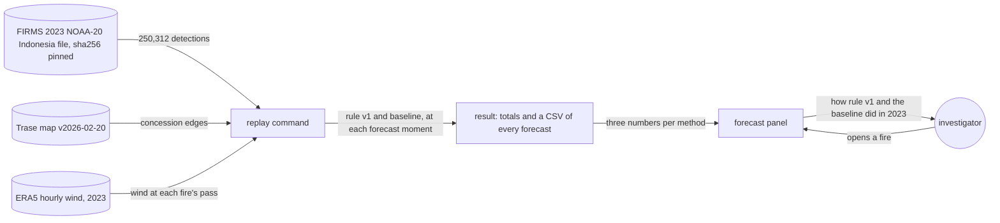

# Season backtest

**Version:** v1 · **Status:** Draft · **Type:** Feature · **Project type:** Web UI

**Shape doc:** docs/specs/fire-watch/shape.md
**Depends on:** spread-forecast

A replay of 2023 runs forecast rule version 1, and a naive downwind baseline, at every moment the
recorder would have forecast. The forecast panel shows how often each one's warnings came true. It
comes now because spread-forecast shipped a rule with no proof (its O1, D42), and few live forecasts
can settle before 2026-10-24 (its O8).

## Problem

A buyer told "this fire is forecast to be seen inside" can't tell how much weight that carries. On
the week rule version 1 was chosen on, 441 of its 482 "inside" forecasts did not come in (D48). Live
forecasts count only from their seal, and the first ones were sealed on 2026-10-19. By the deadline
only a few days of outcomes exist.

2023 was a big fire year in Indonesia. FIRMS's yearly VIIRS NOAA-20 file for Indonesia holds 250,312
detections in 2023, and 42,682 of them are within 5 km of a concession. A scratch replay of rule
version 1 over 2023 made 20,277 forecasts. It used a 3-hour FIRMS lag and had no baseline yet.

- In 135 forecasts, a pass saw the fire inside within 48 hours. Rule version 1 said "inside" for 123.
- 3,753 of its 3,876 decided "inside" forecasts did not come in.
- For the arrivals it warned of, it was a median 11.7 hours off.

Those numbers mean little alone. They need a naive guess beside them, worked out the same way.

## Slice test

| Check                         | Result |
| ----------------------------- | ------ |
| Cuts every layer it needs     | yes: a replay command in `api/` with pinned inputs, its result committed to the repo, and the forecast panel in `web/`. No table, no new route, no seal |
| One e2e test walks it         | yes: run the replay on a cut of the 2023 file, open a fire, and see rule version 1's and the baseline's numbers from that run in the forecast panel |
| Worth shipping alone          | yes: anyone reading a forecast sees how often rule version 1's warnings came true in 2023, against a naive guess |
| Fits (≤5 scenarios, ≤2 areas) | yes: 5 scenarios; two areas: the replay (`api/`) and the forecast panel (`web/`) |

**Path:** full. The slice adds a new command, new pinned inputs, a committed result and a change to the page.

## User story

As a watchdog investigator, I want to see how often the forecast's warnings came true over a past
season, next to a naive guess, so that I can tell a buyer how much weight a warning carries.

## Flow



The replay reads three pinned inputs and makes both methods' forecasts at each moment. It writes the
totals and every forecast to the repo, and the forecast panel shows the totals.

How each forecast counts. Both methods forecast at the same moments, so the arrivals are the same
for both.

| The method said | In the 48 hours after the forecast was made | Counts as |
| --------------- | ------------------------------------------- | --------- |
| Seen inside by about a time | A pass sees the fire inside | An arrival warned of, with its hours off |
| Not within 48 hours | A pass sees the fire inside | An arrival missed |
| Seen inside by about a time | No pass sees the fire inside | An "inside" forecast that did not come in |
| Not within 48 hours | No pass sees the fire inside | A right "no" |
| Either | The fire joins an older fire first | Not checked (D44) |
| Either | A pass taken before the forecast was made, and stored after it, sees the fire inside | Not checked (D44) |
| Either | The 48 hours and D50's 6 end after 2023 | Listed as "ends after 2023", not counted (O8) |

## Acceptance criteria

```gherkin
Scenario: A 2023 forecast that came true counts as an arrival warned of
  Given FIRMS's 2023 VIIRS NOAA-20 Indonesia file, sha256 99969d97…, and Trase's map v2026-02-20
  And an ID-WOOD-CONCESSION-0263 fire whose 2023-09-27 06:05 UTC pass is 539 m outside the edge
    at the nearest
  When the replay runs rule version 1 over 2023
  Then the forecast after that pass says "Forecast to be seen inside by about 28 Sep 06:05 UTC"
  And the 2023-09-28 05:46 UTC pass sees the fire 523 m inside
  And the replay counts it as an arrival rule version 1 warned of, 19 minutes off

Scenario: A missed arrival and a false alarm both count against rule version 1
  Given an ID-WOOD-CONCESSION-0332 fire seen once, on 2023-10-14 05:46 UTC, 2,168 m outside
  And an ID-WOOD-CONCESSION-0264 fire whose third pass, 2023-09-28 18:28 UTC, is 1,334 m outside
  When the replay runs rule version 1 over 2023
  Then the 0332 forecast says "Not forecast to be seen inside", and the 2023-10-16 05:08 UTC pass
    sees the fire inside: an arrival missed
  And the 0264 forecast says "Forecast to be seen inside by about 29 Sep 06:28 UTC", and no pass
    sees the fire inside within 48 hours: an "inside" forecast that did not come in
  And the CSV lists both forecasts, and the totals count both

Scenario: The downwind baseline is judged on the same moments
  Given the 0263 fire's 2023-09-27 06:05 UTC pass, advancing 44 m an hour since the pass before
  And ERA5's 10 m wind at the fire at 06:00 UTC, from 107° at 3.5 m/s
  When the replay runs the baseline
  Then the baseline moves the fire toward 287° at 44 m an hour, and in 48 hours it gets no more
    than 375 m inside the edge
  And it says "Not forecast to be seen inside", so it misses the arrival that rule version 1 warned of
  And the 0332 fire, seen on one pass, has no recent rate, so the baseline says "Not forecast" for it

Scenario: The forecast panel says how the rule did in 2023, next to the baseline
  Given the committed 2023 result
  When anyone opens the ID-WOOD-CONCESSION-0332 fire of spread-forecast's scenario 1
  Then the forecast panel gives, for rule version 1 and for the downwind baseline: the arrivals
    warned of out of all of them, the "inside" forecasts that did not come in, and the median
    hours off
  And it says "A replay of 2023, run in 2026. Nothing in it was sealed in 2023."
  And "How this is worked out" gives every count, the forecasts not checked, and links to the CSV
    of every forecast and to the command that redoes it

Scenario: Anyone redoes the replay and gets the same result
  Given a fresh checkout, the pinned FIRMS file, the pinned Trase map and the pinned wind
  When anyone runs the replay command
  Then it writes the same totals and CSV, byte for byte, as the committed ones
  And when FIRMS has changed its 2023 file, the command stops with "has changed: sha256 <got>,
    expected 99969d97…" and writes nothing
```

Scenarios 1 to 3 come from the scratch replay and from ERA5, checked on 2026-10-19. Pause 3 fixes
when a replay forecast counts as made. The scratch run used 3 hours after the pass, rounded up to
the next whole hour.

## Scope

**In:**

- All of 2023, 1 Jan to 31 Dec UTC (D52), from FIRMS's yearly VIIRS NOAA-20 file for Indonesia, pinned
  by sha256. It is the archive's standard processing. Live rows are near real time, and FIRMS keeps
  those only for about two months.
- Every row the recorder would keep: confidence n, l or h, within 5 km of a concession (D13). The
  match is against Trase's map v2026-02-20, the one the live site uses, without the permit-2024
  concessions (D16). The map covers 2023–2024 concessions.
- A forecast moment wherever the recorder would have made one: after each pass that leaves a fire
  near a concession not yet seen inside (D40). The replay calls the same `fires.py` and
  `forecast.py` code that the recorder runs.
- Two methods at each moment:
  - Forecast rule version 1 (D48).
  - The naive baseline (D51): the fire moves downwind at its recent advance rate, with ERA5's hourly
    10 m wind. A fire seen on one pass has no rate, so the baseline says "not forecast". Pause 3
    writes the rule out in full, as rule version 1 was.
- Outcomes by D44: only passes taken after a forecast was made count. Joined forecasts and those
  seen inside before they were made count neither way, and they are listed apart. So are the 15
  forecasts whose 48 hours and D50's 6 end after 2023 (O8).
- Each forecast counts once (D53). For each method there are three numbers: the arrivals warned of, the
  "inside" forecasts that did not come in, and the median hours off for the arrivals warned of.
- The totals and a CSV of every forecast for both methods, committed to the repo (D55).
- The forecast panel shows the three numbers for both methods, labelled as a replay (D54). "How this is
  worked out" gives every count and links to the CSV and the command.
- One command redoes the result byte for byte from the pinned inputs.

**Out:**

- A page or link of its own: not planned (D34).
- A seal of the result: not planned. A seal made in 2026 proves nothing about 2023 (shape O9, D55).
- 2023 fires in the fire view, on the map or as records: not planned. 2023 detections never enter
  the live tables.
- A tally of live forecasts as they settle: not planned. The fire view lists each live forecast with
  its outcome (D41).
- A new rule version tuned on 2023: not planned. It would be measured on the data it was tuned on.
- Other years and other satellites: not planned.
- Scoring where the fire crosses the edge: not planned (D44).
- Burned area and carbon: damage-estimate, slice 6.

## Open items

| ID | What | Type | Raised at | Owner | Status | Answer |
| -- | ---- | ---- | --------- | ----- | ------ | ------ |
| O1 | What the naive baseline is: downwind at the fire's recent speed (shape O12), the same plus rule v1's 375 m step, or "never comes in" | question | spec p1 | user | Resolved | 2026-10-19: downwind at the recent advance rate, with ERA5 wind. A fire seen on one pass has no rate, so the baseline says no (D51) |
| O2 | What counts as one result: every forecast, or each arrival once by the last forecast before it (114 against 86 on Aug–Oct) | question | spec p1 | user | Resolved | 2026-10-19: every forecast, as the live fire view lists them (D41, D53) |
| O3 | Which part of 2023: all of it (250,312 detections), Aug–Oct (189,545) or Jul–Nov (222,944) | question | spec p1 | user | Resolved | 2026-10-19: all of 2023 (D52) |
| O4 | What the replay reports for each method: three numbers, or only the hours off as the shape said | question | spec p1 | user | Resolved | 2026-10-19: arrivals warned of, "inside" forecasts that did not come in, and the median hours off (D53) |
| O5 | Where the reader sees the result: the forecast panel, a page with its own link, or the home page | question | spec p1 | user | Resolved | 2026-10-19: the forecast panel, with the full table under "How this is worked out"; no new link (D34, D54) |
| O6 | Whether the repo publishes every replay forecast or only the totals | question | spec p1 | user | Resolved | 2026-10-19: every forecast for both methods, as a CSV, about 2 MB (D55) |
| O7 | Whether the 2023 result is sealed on the chain | question | spec p1 | user | Resolved | 2026-10-19: no. The pinned inputs and the command let anyone redo it, and git history shows a later change (D55) |
| O8 | 15 forecasts are made after 2023-12-29 18:00 UTC. Their 48 hours, plus D50's 6, end in 2024, past the 2023 file | question | spec p1 | user | Resolved | 2026-10-19: listed in the CSV as "ends after 2023" and left out of the three numbers. Drafted as D56, approved with pause 2 |

_Never delete this section or its rows. See references/ledger.md._

## Glossary

- **Backtest / replay**: running a forecast over a past season to see how it would have done.
- **Naive baseline**: the simplest guess, used to show a forecast adds something.
- **Arrival**: a forecast moment after which a pass saw the fire inside within 48 hours.
- **Seen inside**: a detection inside the concession, more than 375 m from its edge (D26).
- **Advance rate**: how far a fire's newest pass reached past its earlier detections, per hour.
- **FIRMS**: NASA's free service that publishes satellite fire detections, live and archived.
- **VIIRS NOAA-20**: the satellite sensor whose detections Fire Watch records.
- **Standard processing**: FIRMS's reprocessed archive, which replaces the near-real-time rows.
- **ERA5**: the European weather service's hourly record of past weather, here served by Open-Meteo.
- **sha256**: a fingerprint of a file; any change to the file changes it.
- **e2e**: end-to-end: one test that walks the whole slice as a user would.
