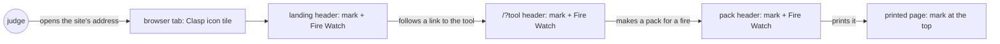
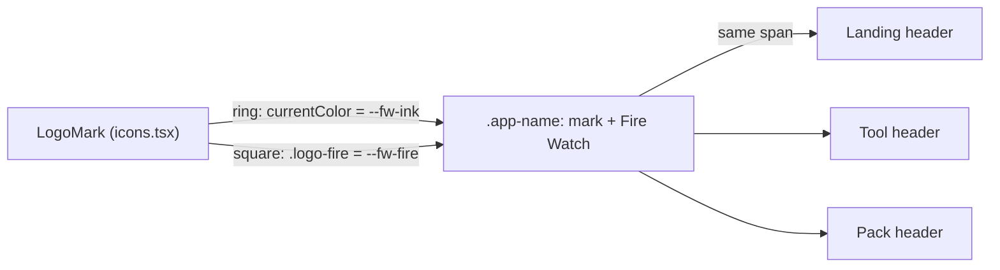
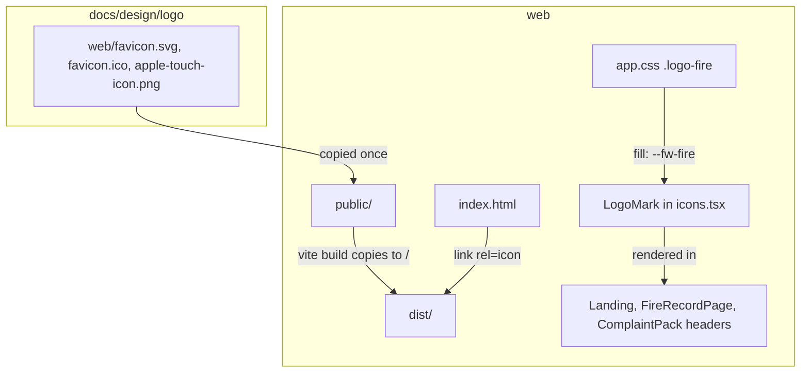
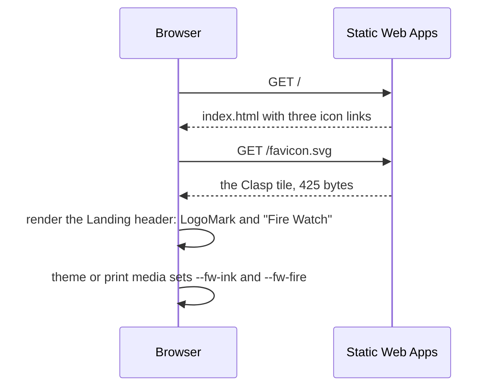

# Site logo

**Version:** v1 · **Status:** Shipped · **Type:** Enhancement · **Project type:** Web UI

**Depends on:** None

The Clasp mark goes into the page header next to the name, and into the browser tab as the
favicon. It comes now because the hackathon entry is judged on 2026-10-25, and the site still shows
a plain text name and the browser's blank tab icon.

## Problem

Every page header shows "Fire Watch" as plain text (`web/src/Landing.tsx:37`,
`web/src/FireRecordPage.tsx:206`, `web/src/ComplaintPack.tsx:210`). `web/index.html` links no icon,
so the browser tab and a bookmark show a blank page icon. A judge with six tabs open cannot find
Fire Watch's tab at a glance. The logo kit in `docs/design/logo/` is done, but nothing in `web/`
uses it.

## Slice test

| Check                         | Result |
| ----------------------------- | ------ |
| Cuts every layer it needs     | yes: `web/index.html`, `web/public/` and the shared page header. The API, the recorder and the chain don't change |
| One e2e test walks it         | yes: one test opens the landing, then the tool, and checks the mark in each header and the icon links in the page head. Print is checked with Playwright's print media |
| Worth shipping alone          | yes: a judge sees the mark in the tab and on every page |
| Fits (≤5 scenarios, ≤2 areas) | yes: 5 scenarios, one area (`web/` and its design system) |

**Path:** full. The mark is a new interface element in three page headers and `index.html`. That
is more than three files.

## User story

As a judge or an investigator with many tabs open, I want Fire Watch's own mark in its tab and its
header, so that I can find the page and know it is the same tool on every page.

## Flow



The judge sees the icon in the tab, then the same mark in the header of the landing, the tool and
the pack.

## Acceptance criteria

```gherkin
Scenario: The landing header shows the mark
  Given a judge opens the site's address in a light-theme browser
  When the landing loads
  Then the header shows the Clasp mark to the left of "Fire Watch"
  And the ring is ink and the square is ember
  And a screen reader reads the header name as "Fire Watch", once

Scenario: The mark follows a dark theme
  Given the judge's system is set to dark
  When the landing loads
  Then the ring and the name are the dark ink and the square is the dark ember
  And the mark stays visible on the dark header

Scenario: The tool header shows the same mark
  Given the judge is on the landing
  When the judge opens the tool at "/?tool"
  Then the tool's header shows the same mark beside "Fire Watch" at the same size

Scenario: The browser tab shows the icon
  Given a judge opens the site's address
  When the page head loads
  Then the tab shows the Clasp icon tile from "/favicon.svg"
  And "/favicon.ico" and "/apple-touch-icon.png" are linked for browsers without SVG icons

Scenario: The printed pack keeps the mark in colour
  Given an investigator has made a pack for the ID-WOOD-CONCESSION-0332 fire first seen 13 Oct 17:37 UTC
  When the investigator prints the pack
  Then the top of the printed page shows the mark beside "Fire Watch" on white
  And the ring is the light ink and the square is the light ember
```

## Scope

**In:** the mark in the shared page header on the landing, the tool and the pack, on screen and in print. One line in the design-system rules that names the logo as the one use of the fire colour away from the map (O1). The favicon
(`favicon.svg`, `favicon.ico`) and the Apple touch icon in `web/index.html`.

**Out:**

- A social preview image (`og:image`) for links shared in chat or on the submission page. A later
  slice, `share-preview`, if wanted.
- A web app manifest and install icons. No later slice: nobody installs Fire Watch as an app.
- A README banner. Docs work, not a slice.
- Making the header name a link to the landing. The tool already has "About Fire Watch".

## Interface



One `LogoMark` component draws the mark beside the name in each page's existing `.app-top` header.
The ring takes the text colour and the square takes `--fw-fire`. The theme tokens and the print
tokens change both, with no new token.

- **Size:** 24 px, the kit's small cut, because the kit says to use the small cut under 32 px. The
  name stays live text in IBM Plex Sans SemiBold, 8 px (`--fw-space-2`) from the mark.
- **Screen readers:** the SVG is `aria-hidden`, so the header reads "Fire Watch" once.
- **Phones:** at 390 px the mark and the name fit on one line beside "Open the tool".
- **Header height:** the 24 px mark is about 1.5 px taller than the name's line. The header grows
  by that much on every page.

**Motion tier:** 0. The mark does not move.

**Components used:** `.app-top`, `.app-name`, `.fw-link`, `.fw-help`, and the hand-drawn SVG
pattern in `web/src/icons.tsx`. The new CSS adds two rules that read `--fw-fire` and set no new
value.

**Preview:** `/?preview=site-logo` on `pnpm dev`. It shows the landing, tool and pack headers in
the light and dark themes. Print uses the light tokens, by the `@media print` block in
`docs/design/design-system/tokens/colors.css`.

## Technical plan

### Approach

The header mark is already in the three pages from pause 2. This plan adds the tab icons, the
design-system rule from O1, and one e2e test. The icon files are copies of the kit's
`docs/design/logo/web/` files in `web/public/`, which Vite copies to the site root at build time.

Relies on: D2 (direction A, Clear record), D72 and D74 (landing at `/`, tool at `/?tool`), D95
(print is a white page with dark ink, the map in colour), D148 (drafted below).



The kit's three icon files go into `web/public/`, and `index.html` links them. `LogoMark` draws
the header mark and takes its colours from the tokens.



The browser asks for `/favicon.svg` from the head of `index.html`. It colours the header mark from
the tokens of the current theme or print media.

### Changes

| File | What changes | Why |
| ---- | ------------ | --- |
| `web/index.html:6` | Add `<link rel="icon" href="/favicon.svg" type="image/svg+xml">`, `<link rel="icon" href="/favicon.ico" sizes="48x48">` and `<link rel="apple-touch-icon" href="/apple-touch-icon.png">` | scenario 4 |
| `web/public/favicon.svg`, `favicon.ico`, `apple-touch-icon.png` | New: copies of `docs/design/logo/web/` | scenario 4 |
| `web/src/icons.tsx` | `LogoMark`, the small cut as an SVG. Done at pause 2 | scenarios 1 to 3, 5 |
| `web/src/Landing.tsx:38`, `web/src/FireRecordPage.tsx:206`, `web/src/ComplaintPack.tsx:210` | `<LogoMark />` in `.app-name`. Done at pause 2 | scenarios 1, 3, 5 |
| `web/src/styles/app.css:12` | `.app-name` is an inline flex row with an 8 px gap. `.logo-fire` fills with `--fw-fire`. Done at pause 2 | scenarios 1, 2, 5 |
| `web/src/preview/SiteLogoPreview.tsx`, `preview.css`, `web/src/main.tsx` | The `site-logo` preview route, in development only. Done at pause 2 | pause 2 |
| `docs/design/design-system/readme.md:10` | "fire colour is for fire marks only" adds "and the logo's square, which stands for a fire" | O1 |
| `web/e2e/site-logo.spec.ts` | New: the e2e below | scenarios 1 to 5 |

Reusing: the `Icon` file's hand-drawn SVG pattern in `web/src/icons.tsx`, the `.app-top` header, the
theme and print token blocks in `docs/design/design-system/tokens/colors.css`, and the
`emulateMedia` steps from `web/e2e/palette.spec.ts`.

### Earn-it

| Added | Triggered by |
| ----- | ------------ |
| `LogoMark` component | Scenarios 1, 3 and 5: one shape in three headers |
| `site-logo` preview route | Pause 2: the preview shows every header in both themes |
| Three icon files in `web/public/` | Scenario 4. The `.ico` and the touch icon serve browsers and iPhones that don't read an SVG icon |

### Non-functionals

|                      |   |
| -------------------- | - |
| **Load**             | Each first visit adds one request for the 425-byte `favicon.svg`, which the browser then caches. The header SVG adds about 200 bytes to the JS bundle |
| **Breaks first**     | Nothing at 10×. The files are static and served by Static Web Apps |
| **Security surface** | No input and no secrets. The files are public static images |
| **Proof it works**   | `curl -sI <site>/favicon.svg` answers `200` with `content-type: image/svg+xml`, and the tab shows the tile |
| **Rollout**          | No flag. Rollback is `git revert` of the slice's commits, and the next deploy restores the text-only header and the blank tab |

### Test plan

| Scenario | Test | Command |
| -------- | ---- | ------- |
| 1 · The landing header shows the mark | `web/e2e/site-logo.spec.ts` | `cd web && pnpm e2e site-logo` |
| 2 · The mark follows a dark theme | `web/e2e/site-logo.spec.ts` | same |
| 3 · The tool header shows the same mark | `web/e2e/site-logo.spec.ts` | same |
| 4 · The browser tab shows the icon | `web/e2e/site-logo.spec.ts`: the three `link` tags, and a `200` for each file from the server | same |
| 5 · The printed pack keeps the mark in colour | `web/e2e/site-logo.spec.ts`, with `emulateMedia({ media: "print" })` | same |
| No regressions | the web unit suite and type check | `cd web && pnpm test && npx tsc -b` |

**E2E:** `site-logo.spec.ts` opens `/` in light, checks the header's accessible name, and checks the
ring and square fills against `--fw-ink` and `--fw-fire`. It switches to dark and checks again,
then opens `/?tool` and checks the same mark there. It fetches the three icon links, then opens the
example pack, fires `beforeprint` as a browser does before it prints, and checks the fills in print media. The colours are read from the tokens and not
written as hex, as `docs/learnings/no-hex-in-tests.md` says. The pause-2 code passed before this
test existed, so each check is proven with a mutant, as `docs/learnings/pause-2-code-needs-mutants.md` says.

### Chunks

Single chunk.

### Risks

| Risk | Mitigation |
| ---- | ---------- |
| The copies in `web/public/` and the kit in `docs/design/logo/web/` can drift apart | The kit's README names `web/public/` as the place the icons are used. A changed mark updates both in one commit |
| Browsers cache favicons hard, so a visitor from before the deploy may keep the blank icon for a while | Accepted. It is cosmetic and clears on its own |

### Decisions to record

Recorded as D148.

## Review

2026-10-24 · 1 raw finding, 0 survived. Clean.

## Open items

| ID  | What | Type | Raised at | Owner | Status | Answer |
| --- | ---- | ---- | --------- | ----- | ------ | ------ |
| O1  | The design system says fire colour is for fire marks only. The logo's square is ember because it stands for a fire. Is the logo an allowed use? | question | spec p1 | user | Resolved | Yes. The square is a fire mark. The design-system rules name the logo as the one use away from the map. Ink-only in the app was rejected. 2026-10-24 |
| O2  | The pack header is printed. Should the printed pack show the mark in colour, in ink only, or not at all? | question | spec p1 | user | Resolved | In colour: light ink ring, light ember square. The print rule already keeps the map in colour. 2026-10-24 |
| O3  | The kit's dark version is 1/256 thinner so that light-on-dark doesn't look heavier. One shared header mark would use one geometry in both themes. Is that difference acceptable at header size? | flag | spec p1 | user | Accepted risk | At 24 to 28 px the difference is under a tenth of a pixel. The colours still change with the theme tokens. 2026-10-24 |

_Never delete this section or its rows. See references/ledger.md._

## Glossary

- **Favicon** — the small icon in a browser tab and a bookmark
- **Apple touch icon** — the icon an iPhone uses when a page is saved to the home screen
- **Clasp** — the logo: a ring closed by a square, from `docs/design/logo/README.md`
- **e2e** — end-to-end: one test that walks the whole slice as a user would
