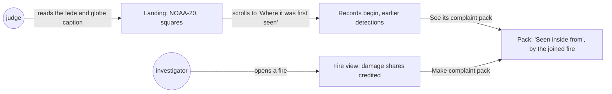
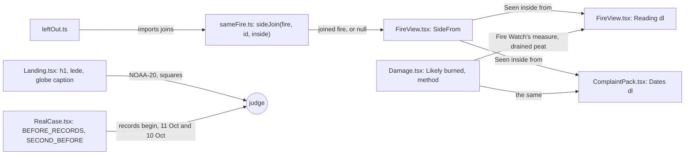

# Source claims

**Version:** v1 · **Status:** Draft · **Type:** Bug · **Project type:** Web UI

**Shape doc:** docs/specs/judge-review/shape.md
**Depends on:** claim-fixes, origin-and-range

The landing names the one satellite Fire Watch reads and when its records begin. The globe caption
counts squares, the damage estimate credits its shares to Fire Watch's own check, and a joined
fire's inside time names the fire it came from. A hostile review of the live site on 2026-10-24
found each of these unsupported.

## Problem

The review of 2026-10-24 scored the live site 6.0/10 and found 12 claims the chain or the data
doesn't support. Four of them are in the page's own words, and a company's lawyer could use each:

- **"Satellites first saw it" rests on one satellite and a late start.** The landing's h1 says "show
  where satellites first saw it", and the real case says "The satellite first saw it on 12 Oct 05:16
  UTC". The recorder reads only `VIIRS_NOAA20_NRT` (`api/src/firewatch/firms.py:11`), and the
  example's records begin 1 hour before its first detection (`recorded_before_h: 1` in
  `web/public/case/pack-0332.json`). FIRMS's archive, read on 2026-10-24, holds earlier detections
  of the same ground:

  | Fire | Satellite | When (UTC) | Distance | Side |
  | ---- | --------- | ---------- | -------- | ---- |
  | First fire, first seen 12 Oct 05:16 | NOAA-20 | 11 Oct 05:33 | 0.96 km | outside |
  | | NOAA-20 | 11 Oct 18:15 | 0.68 km | outside |
  | | S-NPP | 11 Oct 17:56 | 0.65 km | outside |
  | Second fire, first seen 13 Oct 06:37 | S-NPP | 10 Oct 05:33 | 0.59 km | inside and outside |
  | | MODIS | 10 Oct 08:22 | 0.48 km | inside and outside |
  | | NOAA-21 | 10 Oct 17:41 | 0.34 km | outside |

  Each distance is to the nearest detection of that fire's first pass in the pack. The sides hold:
  the first fire was seen outside earlier too, and the second on both sides. The dates don't.
- **"Every dot is one detection."** The globe caption says so, but `globe-day` keeps one dot per
  0.01° cell outside the example's box (`api/src/firewatch/globe_day.py:105`).
- **"NASA's 2023 shares."** "Likely burned" reads "At NASA's 2023 shares: 62% of peat, 42% of other
  ground", and the method says "the share NASA found burned in 2023". NASA published no such share.
  Fire Watch measured it on NASA's MODIS map, over large patches only (`damage_check.py`,
  `fixtures/damage/2023-check.json`). Over all ground near concessions the share was 15.1%.
- **The example pack's "Seen inside from" is another fire's.** It reads 2026-10-13 06:37 UTC, the
  first sighting of the fire joined on 14 Oct (`inside_from_unix` equals `joined[0].first_seen_unix`
  in the pack). Read under "First seen outside", it says the fire spread in, which is the company's
  story.

## Slice test

| Check                         | Result |
| ----------------------------- | ------ |
| Cuts every layer it needs     | yes: the landing, the fire view, the pack and the damage estimate in `web/src`, and the README. The recorder and the chain don't change |
| One e2e test walks it         | yes: read the landing's lede, globe caption and first-sighting step, open the example pack and read its inside time, then open the 0332 fire in the tool and read its damage |
| Worth shipping alone          | yes: a judge reads which satellite and when the records begin, and a lawyer loses four lines to quote |
| Fits (≤5 scenarios, ≤2 areas) | yes: 4 scenarios; two areas, the landing and the fire view with its pack |

**Path:** full. Copy changes in more than three files.

## Flow



A judge meets the satellite, the records' start and the squares on the landing, then the joined
fire's inside time in the example pack. An investigator reads the credited shares in the fire view
and the pack.

## Acceptance criteria

```gherkin
Scenario: The landing names the satellite and when Fire Watch's records begin
  Given the landing's real case, read from the committed pack of the ID-WOOD-CONCESSION-0332 fire
    cut at 17 Oct 2026 09:00 UTC, first detected on 12 Oct 05:16 UTC, 1 hour after its records begin
  When a judge reads the landing's lede and scrolls to "Where it was first seen"
  Then the lede says Fire Watch reads NASA's NOAA-20 satellite
  And the step says Fire Watch's records first show the fire on 12 Oct 05:16 UTC, an hour after
    they begin
  And it says NOAA-20 saw fire under 1 km from it on 11 Oct, before recording began, also outside
    the concession

Scenario: The globe caption counts squares, not detections
  Given the landing's globe of 14 Oct 2026
  When a judge reads its caption before the flight to the example fire
  Then it says each dot marks a square about 1 km across where NOAA-20 detected fire
  And it still gives 62,489 detections worldwide, 9,923 of them in and around Indonesia

Scenario: The damage estimate credits its shares to Fire Watch's own check
  Given the ID-WOOD-CONCESSION-0332 fire of damage-check scenario 1, 59.21 ha inside on peat,
    144.31 ha outside on peat and 6.30 ha outside on other ground
  When the investigator opens the fire
  Then "Likely burned" says the shares are the ones Fire Watch measured on NASA's 2023 burned-area
    map, in large patches: 62% of peat, 42% of other ground
  And "How this is worked out" says Fire Watch treats all peat as drained
  And its complaint pack reads the same

Scenario: A joined fire's inside time names the fire it came from
  Given the example pack: the 0332 fire first seen outside on 12 Oct 05:16 UTC, joined on 14 Oct
    17:20 UTC to a fire first seen on 13 Oct 06:37 UTC on both sides of the edge
  When a reader opens the pack
  Then "Seen inside from" reads "2026-10-13 06:37 UTC" with words saying it was the joined fire
    that was seen inside
  And a fire with no join keeps "Seen inside from" as it reads now
```

The exact words come at pause 2. The 0332 fire of scenario 3 is the e2e's own record in
`fixtures/firms/fire-origin.csv`. Scenarios 1 and 4 read the committed pack, as the landing e2e does
(D137). The e2e's records hold no joined fire, so scenario 4 is walked through the example pack
(D118).

## Scope

**In:**

- The landing's h1, lede, hero caption and "Where it was first seen" step name NOAA-20 and when
  Fire Watch's records begin, and the step gives NOAA-20's earlier detections of 11 Oct (O1).
- The globe caption says each dot is a square about 1 km across.
- "Likely burned" and the method credit the shares to Fire Watch's check of NASA's MODIS map, in
  large patches (O3). The method says all peat is treated as drained.
- "Seen inside from" in the fire view and the pack names the joined fire when its first inside
  detection came from one (O2).
- The docs that judges read (O4): README and OVERVIEW say a record hasn't changed "since it was
  sealed"; README and ARCHITECTURE say a root is sealed for each run with new records; and the
  README's features drop the removed latest-hotspot page.

**Out:**

- Swapping the landing's example fire: not planned. The sides of both first sightings hold with
  every satellite's detections (D111).
- Lowering the damage shares, or scaling them by fire size: not planned unless O3 says so (D127).
- Reading S-NPP, NOAA-21 or MODIS in the recorder: a later slice. This one names the one satellite.
- The forecast panel's claims the review found weak, "Every one stays listed here" and a
  forecast shown with no skill note: not planned. The panel already shows 3,751 of 3,874.

## Interface

Copy changes in the real components, and one line that names a joined fire. Nothing is added,
moved or restyled.



`sideJoin` replays the fire rule's pair test, which `leftOut.ts` already shares with the API through
`fixtures/join-vectors.json`, over the fire's detections pass by pass. It finds the pass whose
detection first put the fire more than 375 m on a side. When that detection wasn't joined to the
fire's first detection yet, it names the join that brought it in. The pair test moves from
`leftOut.ts` to `sameFire.ts`, so the fire view can use it without loading the chain code.

| Where | Was | Now |
| ----- | --- | --- |
| Landing h1 | …show where satellites first saw it. | …show where the satellite first saw it. |
| Landing lede | It shows where satellites first saw a fire and how it spread… | It shows where NASA's NOAA-20 satellite first saw a fire and how it spread… |
| Hero caption, at the fire | The satellite first saw it on 12 Oct as one detection, 3,100 m outside the concession. On 14 Oct it joined a second fire, first seen the day before on both sides of the edge. | Fire Watch's records first show it on 12 Oct as one detection, 3,100 m outside the concession. On 14 Oct it joined a second fire, first recorded the day before on both sides of the edge. |
| Globe caption | Every dot is one detection by the NOAA-20 satellite on 14 Oct 2026: 62,489 worldwide, 9,923 of them in and around Indonesia. | Each dot is a square about 1 km across where the NOAA-20 satellite detected fire on 14 Oct 2026, and near the example fire, one detection. That day it made 62,489 detections worldwide, 9,923 of them in and around Indonesia. |
| "Where it was first seen" | The satellite first saw it on 12 Oct 05:16 UTC as one detection, outside the concession and 3,100 m from its edge. It didn't see the fire again for 25 hours, so that detection may be a separate fire. The satellite can miss fire… Scroll on… | Fire Watch's records first show it on 12 Oct 05:16 UTC as one detection, outside the concession and 3,100 m from its edge. The satellite didn't see the fire again for 25 hours, so that detection may be a separate fire. The satellite can miss fire… Fire Watch's records begin 1 hour before this detection and read only NASA's NOAA-20 satellite. In NASA's archive, NOAA-20 saw fire under 1 km from here on 11 Oct, before recording began, also outside the concession. Scroll on… |
| Pass 2 of 8 | …These include another fire, first seen on this pass more than 1 km from the first, on both sides of the edge. | The same, then: In NASA's archive, other satellites saw fire on that ground on 10 Oct, also on both sides of the edge. |
| "Seen inside from", fire view and pack, joined | 2026-10-13 06:37 UTC | 2026-10-13 06:37 UTC, by the fire joined to this one on 14 Oct 17:20 UTC |
| "Seen inside from", no join, or this fire's own | 2026-10-15 18:43 UTC | 2026-10-15 18:43 UTC |
| "Likely burned" line | At NASA's 2023 shares: 62% of peat, 42% of other ground. | At the shares Fire Watch measured on NASA's 2023 burned-area map, in large patches: 62% of peat, 42% of other ground. |
| Damage method, first paragraph | …at the share NASA found burned in 2023, below. | …at the share that Fire Watch found burned on NASA's 2023 map, below. |
| Damage method, check table | In 2023, NASA's MODIS burned-area map checked the squares of every detection within 5 km of a concession: | Fire Watch checked the squares of every 2023 detection within 5 km of a concession against NASA's MODIS burned-area map: |
| Damage method, CO₂ range | …which comes from one study. | …which comes from one study. Fire Watch treats all peat as drained, since WRI's map doesn't say which is, and IPCC gives no figure for a wildfire on undrained tropical peat. |

The pass 2 line is in this pause's draft, not in O1's answer. It tells the second fire's dates as
O1 tells the first's. The 11 Oct and 10 Oct facts are dated constants beside `SEALED_WHEN`, from the
committed copy's cut (D84, D85). IPCC's Table 2.6 lists "Tropical, Wildfire (undrained peat): No
literature found", read on 2026-10-24.

**Motion tier:** none new. The notes and panels enter as they do now (tier 1).

**Components used:** the landing's `h1`, `landing-lede` and `figcaption`, the real case's step, the
fire view's and the pack's `fw-kv`, and the damage panel's `fw-kv` with `sub`, `fw-help` and the
check `fw-table`. There is no new component, no new token and no CSS change.

**Design system:** Fire Watch, `docs/design/design-system/` (D2).

**Preview:** real components in `web/src`, after `cd web && pnpm dev`:
`http://localhost:5173/?preview=origin-confidence` (states: the 0332 fire and its pack with the
joined fire's inside time, the firm 0356 fire with no join, and the landing) and
`?preview=damage-estimate` (the peat fire). The drift check passed over the 7 files changed.
`tsc -b` is clean, and all 329 web unit tests pass. At 390 px every state is 390 px wide once the
preview's State picker is hidden.

**Craft checks:** a one-line prompt would add a "Data sources" footnote or an info icon. This puts
each source in the sentence that rests on it, with no new component. Next to Stripe's documentation,
the reference for D2, each figure says where it comes from at the point of use.

## Open items

| ID | What | Type | Raised at | Owner | Status | Answer |
| -- | ---- | ---- | --------- | ----- | ------ | ------ |
| O1 | How does the landing tell the example's first sighting, given that NOAA-20 saw the first fire's ground on 11 Oct, before recording began, and other satellites saw the second fire's ground on 10 Oct? | question | spec p1 | user | Resolved | 2026-10-24: name both dates. Fire Watch's records first show it on 12 Oct 05:16, an hour after they begin, and NOAA-20 saw fire under 1 km away on 11 Oct, also outside. The sides hold, so D111 stays |
| O2 | What does "Seen inside from" say when the first inside detection came from a joined fire? | question | spec p1 | user | Resolved | 2026-10-24: keep the time and say the fire joined on 14 Oct was the one seen inside. A fire with no join reads as now |
| O3 | Does "Likely burned" only credit the shares, or also show the 15.1% all-ground share? The second shows a lower share, and D127 rejected it | question | spec p1 | user | Resolved | 2026-10-24: credit the shares to Fire Watch's own measure on NASA's map, in large patches, and keep D127's figures |
| O4 | Which of the smaller doc fixes go in: "since it was sealed", a root only for a run with new records, and the README's removed latest-hotspot feature? | question | spec p1 | user | Resolved | 2026-10-24: all three |

_Never delete this section or its rows. See references/ledger.md._

## Glossary

- **NOAA-20, NOAA-21, S-NPP:** three satellites that carry the same VIIRS fire sensor and pass at
  different times of day.
- **MODIS:** an older NASA fire sensor with 1 km pixels; its burned-area map uses 500 m pixels.
- **Large patch:** more than 20 joined 375 m squares (D127).
- **Joined fire:** a fire that came within 1 km and 48 hours of another, so Fire Watch counts them
  as one (D25).
- **e2e:** end-to-end: one test that walks the whole slice as a user would.
