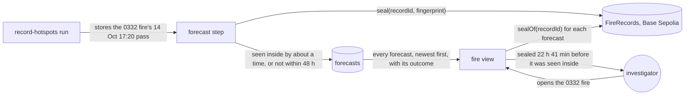
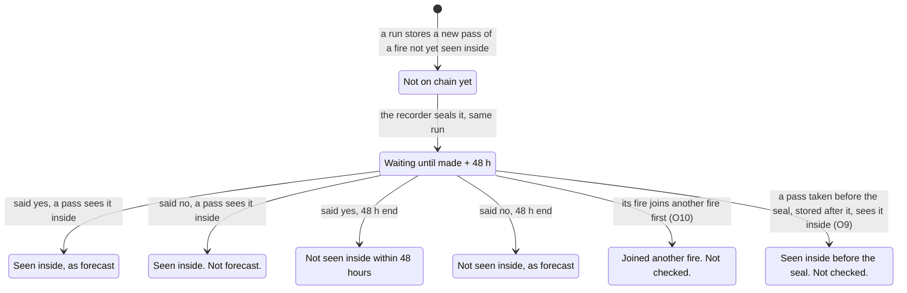

# Spread forecast

**Version:** v1 · **Status:** Draft · **Type:** Feature · **Project type:** Web UI

**Shape doc:** docs/specs/fire-watch/shape.md
**Depends on:** fire-origin

After each satellite pass, the recorder forecasts whether each fire near a concession will be seen
inside it within 48 hours, and when, and seals the forecast on the chain. The fire view lists every
forecast with how it turned out, so anyone can check it was made before the fire came in. It comes
now because season-backtest needs the forecast, and a sealed forecast only counts from the day the
forecasts start (shape O9).

## Problem

The fire view says where a fire was first seen and how it spread. It says nothing about where the
fire goes next. When a fire burns just outside a concession, the investigator can't tell whether it
will reach the land, or when. A warning to the buyer is useful only before the fire arrives. A
forecast shown afterwards proves nothing about when it was made, unless it was sealed first.

Most fires near a concession never come in. From 2026-10-12 to 15, a pass left a fire near a
concession not yet seen inside it 1,820 times. Seen inside means a detection inside, more than
375 m from the edge (D26). In 31 of the 1,820, a pass saw the fire inside within 48 hours, 11 to 47
hours later. 28 of those 31 were already within 500 m of the edge. Most forecasts will rightly say
"no". The few that say "yes" are the ones that matter.

The ID-WOOD-CONCESSION-0361 fire is the example. It was first seen 2026-10-12 05:16 UTC, 1,613 m
outside the edge. On its 2026-10-15 18:43 UTC pass, 47 detections were all outside, the nearest
140 m from the edge. The 2026-10-16 18:21 UTC pass saw 7 detections inside, up to 1,298 m from the
edge. The recorder stored the 15 Oct pass at 2026-10-16 02:16 UTC. A forecast made then would have
been sealed about 16 hours before the fire was seen inside.

## Slice test

| Check                         | Result |
| ----------------------------- | ------ |
| Cuts every layer it needs     | yes — a forecast step in the hourly recorder, a forecasts table, a forecast seal on the deployed FireRecords, the fire route, the fire view, and the job's image set by hand (D21) |
| One e2e test walks it         | yes — record the ID-WOOD-CONCESSION-0332 fire's first 3 passes on anvil, run the recorder, open the fire and see its newest forecast with "Matches the chain"; record its 2026-10-15 18:43 UTC pass, run again, and see that forecast's outcome |
| Worth shipping alone          | yes — the investigator sees which fires near a concession are forecast to come inside within 48 hours, sealed before they do, and how every earlier forecast turned out |
| Fits (≤5 scenarios, ≤2 areas) | yes — 5 scenarios; two areas: recording (the forecast step and its seal) and viewing (the fire route and the fire view), counted as walking-skeleton and fire-record counted them |

**Path:** full — new data, a new kind of seal and a new part of the fire view.

## User story

As a watchdog investigator, I want to see whether a fire burning near a concession is forecast to
be seen inside it within 48 hours, and when, sealed before it happens, so that I can warn the
buyer while there is time, and later show that the forecast came before the fire.

## Flow



After each pass the recorder makes a forecast and seals it. The investigator opens the fire, sees
every forecast with its outcome, and their browser checks each seal.

## States

One forecast, from its seal to its outcome:



| Forecast said | In its 48 hours | Reads |
| ------------- | --------------- | ----- |
| Seen inside by about a time | A pass sees the fire inside | "Seen inside 15 Oct 18:43 UTC, 43 minutes after the forecast time" |
| Seen inside by about a time | No pass sees it inside | "Not seen inside within 48 hours" |
| Not within 48 hours | A pass sees the fire inside | "Seen inside 16 Oct 18:21 UTC. Not forecast." |
| Not within 48 hours | No pass sees it inside | "Not seen inside, as forecast" |
| Either | The fire joins another fire before it is seen inside | "Joined another fire before it was seen inside. Not checked." |
| Either | A pass taken before the seal, and stored after it, sees the fire inside | "Seen inside on a pass before this forecast was sealed. Not checked." |
| Either | The 48 hours have not ended | "Waiting until 16 Oct 20:00 UTC" |

## Acceptance criteria

```gherkin
Scenario: A fire outside gets a sealed forecast after a pass
  Given the ID-WOOD-CONCESSION-0332 fire of fire-origin scenario 1 is recorded and sealed
  And the recorder's 2026-10-14 20:00 UTC run stores its 2026-10-14 17:20 UTC pass:
    4 detections outside, 32 to 761 m from the edge
  And no detection of the fire is yet inside and more than 375 m from the edge
  When that run finishes
  Then the fire has a forecast for ID-WOOD-CONCESSION-0332, made 2026-10-14 20:00 UTC,
    sealed on Base Sepolia in the same run
  And the forecast gives the time the fire is forecast to be seen inside and where it crosses
    the edge, or reads "Not forecast to be seen inside by 16 Oct 20:00 UTC"
  And the fire view lists it first, above the forecasts made after the 2026-10-13 17:37 and
    2026-10-14 06:18 UTC passes
  And each forecast reads "Matches the chain"

Scenario: A forecast that came true was sealed before the fire was seen inside
  Given the 0332 fire's forecast from scenario 1 was sealed 2026-10-14 20:02 UTC
  And it reads "Forecast to be seen inside by about 15 Oct 18:00 UTC"
  When the recorder stores the 2026-10-15 18:43 UTC pass, with detections inside 405 and 804 m
    from the edge
  Then the forecast reads "Seen inside 15 Oct 18:43 UTC, 43 minutes after the forecast time"
  And "Sealed 22 hours 41 minutes before the pass that saw it inside"
  And the recorder makes no more forecasts for this fire and ID-WOOD-CONCESSION-0332

Scenario: Forecasts that turned out wrong stay listed
  Given the ID-WOOD-CONCESSION-0361 fire's forecast, sealed 2026-10-16 02:20 UTC after its
    2026-10-15 18:43 UTC pass, reads "Not forecast to be seen inside by 18 Oct 02:16 UTC"
  And the ID-WOOD-CONCESSION-0341 fire's forecast, sealed 2026-10-14 20:02 UTC after its
    2026-10-14 17:20 UTC pass, 190 m outside the edge at the nearest, reads
    "Forecast to be seen inside by about 15 Oct 06:00 UTC"
  When the 2026-10-16 18:21 UTC pass sees 7 of the 0361 fire's detections inside, up to 1,298 m
    from the edge
  And no pass sees the 0341 fire inside by 2026-10-16 20:00 UTC
  Then the 0361 forecast reads "Seen inside 16 Oct 18:21 UTC. Not forecast."
  And the 0341 forecast reads "Not seen inside within 48 hours"
  And both stay listed on their fires, each with "Matches the chain"

Scenario: A forecast changed after its seal
  Given the 0332 fire's forecast from scenario 2, sealed
  And its forecast time is changed in the database from 2026-10-15 18:00 to 18:40 UTC
  When anyone opens the 0332 fire
  Then that forecast reads "Does not match the chain"
  And the fire's other forecasts still read "Matches the chain"

Scenario: A fire that joins another fire before it is seen inside
  Given an ID-WOOD-CONCESSION-0341 fire first seen 2026-10-17 05:23 UTC, one detection 2,501 m
    outside the edge, with its forecast sealed after that pass
  When the 2026-10-17 18:04 UTC pass links it, through detections 1,185 to 2,286 m outside the
    edge, to an older fire seen inside since 2026-10-13 06:37 UTC
  Then its forecast reads "Joined another fire before it was seen inside. Not checked."
  And the joined fire's view lists that forecast with that reading
  And no later pass of the joined fire counts as this forecast's arrival
```

Scenario 1's forecast comes from the rule chosen at pause 3, and its exact reading is written in
then. Scenarios 2 to 5 give the forecast in their Given, so they hold whatever the rule says.

## Scope

**In:**

- After each recorder run that stores new detections of a fire, one forecast for each concession
  the fire is near and not yet seen inside. Seen inside is fire-origin's rule: a detection inside,
  more than 375 m from the edge (D26). On a quiet day this makes about 278 forecasts: 278 in the
  24 hours to 2026-10-17 07:03 UTC, across 75 concessions.
- A forecast looks 48 hours ahead from when it is made. It gives the time the fire is forecast to
  be seen inside and the point on the edge where it crosses. Or it says the fire is not forecast
  to be seen inside by then.
- The forecast rule is chosen at pause 3, and published in the repo and on the page with a version
  number, as the fire rule is. This slice makes no claim that it beats a baseline. season-backtest
  measures that (O1).
- The recorder wallet seals each forecast on the deployed FireRecords in the run that makes it,
  under its own random record ID (D9).
- The fire view lists every forecast made for the fire and concession, newest first, "no" as well
  as "yes". Each shows its outcome once known. The reader's browser checks each seal (D7).
- Outcomes read as the table above. Only passes taken after a forecast's seal count toward it
  (O9). A forecast whose fire joins another fire before it is seen inside closes unchecked (O10).
  Neither of those counts as right or wrong. The crossing point is drawn on the map, and only the
  time is scored (O11).
- No more forecasts for a fire and concession once the fire is seen inside.
- The page says "forecast to be seen inside", never "will reach" or "will burn".

**Out:**

- Forecasts in the complaint pack — not planned; a later slice if the demo needs it (O7).
- Where a fire goes once it is inside, and forecasts for fires already seen inside — not planned.
- Accuracy against a baseline, and forecasts for past fires — season-backtest, labelled as a
  replay (O1, O8).
- Scoring where the fire crosses the edge — not planned (O11).
- Alerts when a fire is forecast to come in, by email or push — not planned.
- Fires that burn more than 5 km from every concession — never recorded (D13).
- Other satellites — not planned (fire-origin).
- Company names — not planned (shape O10).

## Open items

| ID | What | Type | Raised at | Owner | Status | Answer |
| -- | ---- | ---- | --------- | ----- | ------ | ------ |
| O1 | A spread forecast built in about 3 days beats a naive baseline (fire moves downwind at its recent speed) on 2023 fires (from shape O12) | unproven | shape | user | Accepted risk | 2026-10-19: ship a published rule, chosen at pause 3, with no proof first. season-backtest measures it against the baseline and reports the result, good or bad. On 2026-10-12 to 15, "never comes in" was right 1,789 times in 1,820 (D42) |
| O2 | What one forecast says: when the fire is seen inside, a chance that it is, or where its front is next | question | spec p1 | user | Resolved | 2026-10-19: the time it is forecast to be seen inside and where it crosses the edge, or that it is not forecast to be seen inside. Right or wrong for each fire (D39) |
| O3 | When a fire counts as having reached the concession: seen inside by fire-origin's rule, or any detection inside or within 375 m of the edge | question | spec p1 | user | Resolved | 2026-10-19: seen inside, a detection inside and more than 375 m from the edge (D26, D39) |
| O4 | How far ahead a forecast looks: 24, 48 or 72 hours. The 31 arrivals on 2026-10-12 to 15 came 11 to 47 hours after the pass before, 14 of them after 24 hours | question | spec p1 | user | Resolved | 2026-10-19: 48 hours (D39) |
| O5 | Which fires get a forecast: every fire not yet seen inside, only fires seen on 2 or more passes, or only fires within 1 km of the edge | question | spec p1 | user | Resolved | 2026-10-19: every fire near a concession not yet seen inside, one forecast per concession, after each run that stores new detections of it (D40) |
| O6 | Which forecasts are sealed and shown: every one, every one sealed with only the newest shown, or only those that say the fire comes in | question | spec p1 | user | Resolved | 2026-10-19: every one, "yes" or "no", sealed and listed on the fire with its outcome (D41) |
| O7 | Whether the complaint pack carries the fire's forecasts | question | spec p1 | user | Resolved | 2026-10-19: no, the fire view only. A later slice can add it if the demo needs it (D43) |
| O8 | A forecast counts only from its seal, and 5 days remain to 2026-10-24. If no forecast fire comes inside before then, the demo has forecasts but no checked arrival. Detections fell to 780 on 2026-10-16, then rose to 1,929 on 10-17 and 2,084 on 10-18 | flag | spec p1 | user | Accepted risk | 2026-10-19: show live forecasts and outcomes as they come. season-backtest's 2023 replay, labelled as a replay, carries the accuracy number. Ship the recorder's forecast step first (D42) |
| O9 | A pass can be acquired before a forecast's seal but stored after it. NOAA-20 sometimes passes twice about 100 minutes apart (0361: 2026-10-14 17:20 and 19:00 UTC), and FIRMS takes 2 to 3 hours. None of the 31 arrivals came that way. Does such a pass count toward the forecast? | question | spec p1 | user | Resolved | 2026-10-19: no. Only passes taken after the seal count. Such a forecast reads "Seen inside on a pass before this forecast was sealed. Not checked." and counts neither way (D44) |
| O10 | A fire not yet seen inside can join an older fire before it is seen inside on its own: 28 times from 2026-10-16 to 18, often a fire already inside. Checked against the joined fire, its forecast would read "seen inside" with none of its own detections inside. Example: the 0341 fire of scenario 5 | question | spec p1 | user | Resolved | 2026-10-19: the forecast closes, not checked, and counts neither way, here and in season-backtest (D44) |
| O11 | Whether the point where a forecast says the fire crosses the edge is scored, or only the time | question | spec p1 | user | Resolved | 2026-10-19: drawn on the map, not scored. Only the time is scored, as the shape says (D44) |

_Never delete this section or its rows. See references/ledger.md._

## Glossary

- **Detection / hotspot** — a point where a satellite saw unusual heat, usually a fire.
- **Pass** — one satellite overhead; NOAA-20 sees a given spot about twice a day.
- **Fire** — detections grouped by fire-origin's rule: within 1 km and 48 hours of one another.
- **Seen inside** — a detection inside the concession, more than 375 m from its edge.
- **Forecast** — here, a statement made after a pass about whether and when a fire will be seen
  inside within 48 hours.
- **Seal** — writing a record's fingerprint to the chain once, so later changes show.
- **Fingerprint** — a short code computed from a record; any change to the record changes it.
- **Record ID** — the random 32-byte number that names one seal on the chain.
- **Base Sepolia** — the public test blockchain the seals live on.
- **Naive baseline** — the simplest guess, used to show a forecast adds something.
- **Backtest / replay** — running a forecast over a past season to see how it would have done.
- **FIRMS** — NASA's free service that publishes satellite fire detections.
- **anvil** — a local test blockchain the e2e test seals on.
- **e2e** — end-to-end: one test that walks the whole slice as a user would.
