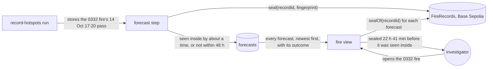
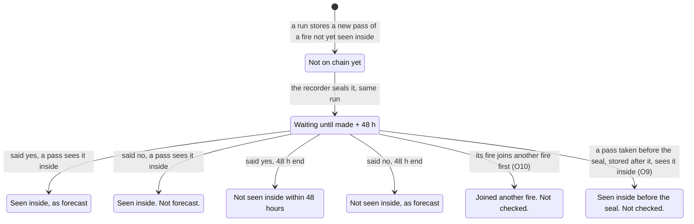
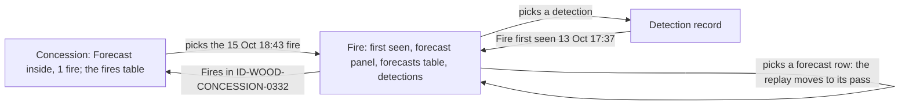
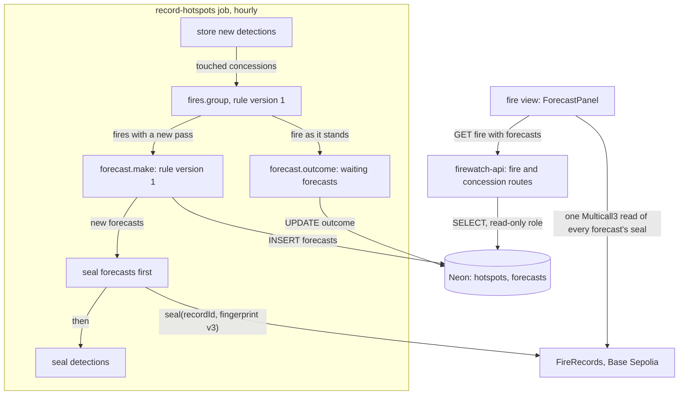
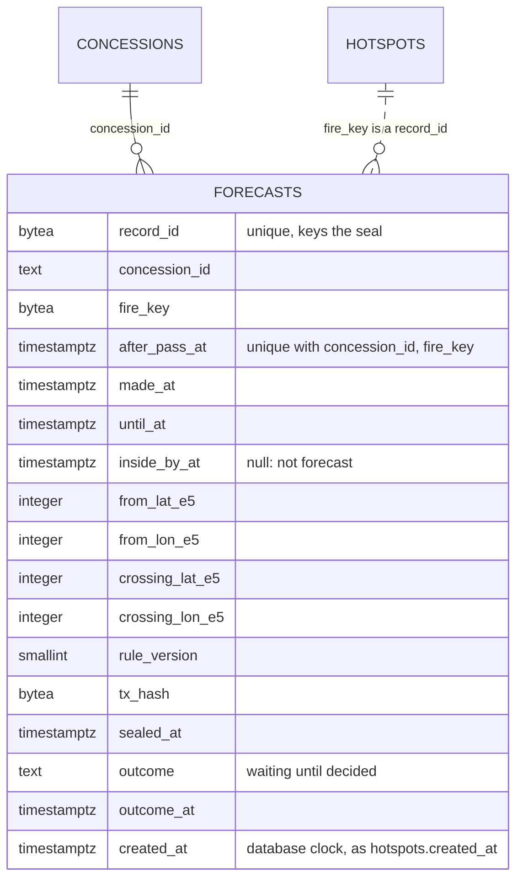

# Spread forecast

**Version:** v1 · **Status:** Built · **Type:** Feature · **Project type:** Web UI

**Shape doc:** docs/specs/fire-watch/shape.md
**Depends on:** fire-origin

After each satellite pass, the recorder forecasts whether each fire near a concession will be seen
inside it within 48 hours, and when, and seals the forecast on the chain. The fire view lists every
forecast with how it turned out, so anyone can check it was made before the fire came in. It comes
now because season-backtest needs the forecast, and a sealed forecast only counts from the day the
forecasts start (shape O9).

## Problem

The fire view says where a fire was first seen and how it spread. It says nothing about where the
fire goes next. When a fire burns just outside a concession, the investigator can't tell whether it
will reach the land, or when. A warning to the buyer is useful only before the fire arrives. A
forecast shown afterwards proves nothing about when it was made, unless it was sealed first.

Most fires near a concession never come in. From 2026-10-12 to 15, a pass left a fire near a
concession not yet seen inside it 1,820 times. Seen inside means a detection inside, more than
375 m from the edge (D26). In 31 of the 1,820, a pass saw the fire inside within 48 hours, 11 to 47
hours later. 28 of those 31 were already within 500 m of the edge. Most forecasts will rightly say
"no". The few that say "yes" are the ones that matter.

The ID-WOOD-CONCESSION-0361 fire is the example. It was first seen 2026-10-12 05:16 UTC, 1,613 m
outside the edge. On its 2026-10-15 18:43 UTC pass, 47 detections were all outside, the nearest
140 m from the edge. The 2026-10-16 18:21 UTC pass saw 7 detections inside, up to 1,298 m from the
edge. The recorder stored the 15 Oct pass at 2026-10-16 02:16 UTC. A forecast made then would have
been sealed about 16 hours before the fire was seen inside.

## Slice test

| Check                         | Result |
| ----------------------------- | ------ |
| Cuts every layer it needs     | yes — a forecast step in the hourly recorder, a forecasts table, a forecast seal on the deployed FireRecords, the fire route, the fire view, and the job's image set by hand (D21) |
| One e2e test walks it         | yes — record the ID-WOOD-CONCESSION-0332 fire's first 3 passes on anvil, run the recorder, open the fire and see its newest forecast with "Matches the chain"; record its 2026-10-15 18:43 UTC pass, run again, and see that forecast's outcome |
| Worth shipping alone          | yes — the investigator sees which fires near a concession are forecast to come inside within 48 hours, sealed before they do, and how every earlier forecast turned out |
| Fits (≤5 scenarios, ≤2 areas) | yes — 5 scenarios; two areas: recording (the forecast step and its seal) and viewing (the fire route and the fire view), counted as walking-skeleton and fire-record counted them |

**Path:** full — new data, a new kind of seal and a new part of the fire view.

## User story

As a watchdog investigator, I want to see whether a fire burning near a concession is forecast to
be seen inside it within 48 hours, and when, sealed before it happens, so that I can warn the
buyer while there is time, and later show that the forecast came before the fire.

## Flow



After each pass the recorder makes a forecast and seals it. The investigator opens the fire, sees
every forecast with its outcome, and their browser checks each seal.

## States

One forecast, from its seal to its outcome:



| Forecast said | In its 48 hours | Reads |
| ------------- | --------------- | ----- |
| Seen inside by about a time | A pass sees the fire inside | "Seen inside 15 Oct 18:43 UTC, 13 hours 23 minutes after the forecast time" |
| Seen inside by about a time | No pass sees it inside | "Not seen inside within 48 hours" |
| Not within 48 hours | A pass sees the fire inside | "Seen inside 16 Oct 18:21 UTC. Not forecast." |
| Not within 48 hours | No pass sees it inside | "Not seen inside, as forecast" |
| Either | The fire joins another fire before it is seen inside | "Joined another fire before it was seen inside. Not checked." |
| Either | A pass taken before the seal, and stored after it, sees the fire inside | "Seen inside on a pass before this forecast was sealed. Not checked." |
| Either | The 48 hours have not ended | "Waiting until 16 Oct 20:00 UTC" |

## Acceptance criteria

```gherkin
Scenario: A fire outside gets a sealed forecast after a pass
  Given the ID-WOOD-CONCESSION-0332 fire of fire-origin scenario 1 is recorded and sealed
  And the recorder's 2026-10-14 20:00 UTC run stores its 2026-10-14 17:20 UTC pass:
    4 detections outside, 32 to 761 m from the edge
  And no detection of the fire is yet inside and more than 375 m from the edge
  When that run finishes
  Then the fire has a forecast for ID-WOOD-CONCESSION-0332, made 2026-10-14 20:00 UTC,
    sealed on Base Sepolia in the same run
  And it reads "Forecast to be seen inside by about 15 Oct 05:20 UTC", crossing the edge at
    2.84194°S, 112.71793°E
  And the fire view lists it first, above the forecasts made after the 2026-10-13 17:37 UTC pass,
    "Not forecast to be seen inside by 15 Oct 20:00 UTC", and the 2026-10-14 06:18 UTC pass,
    "Forecast to be seen inside by about 15 Oct 06:18 UTC"
  And each forecast reads "Matches the chain"

Scenario: A fire forecast inside is seen inside after the forecast's seal
  Given the 0332 fire's forecast from scenario 1 was sealed 2026-10-14 20:02 UTC
  And it reads "Forecast to be seen inside by about 15 Oct 05:20 UTC"
  When the recorder stores the 2026-10-15 18:43 UTC pass, with detections inside 405 and 804 m
    from the edge
  Then the forecast reads "Seen inside 15 Oct 18:43 UTC, 13 hours 23 minutes after the forecast
    time"
  And "Sealed 22 hours 41 minutes before the pass that saw it inside"
  And the recorder makes no more forecasts for this fire and ID-WOOD-CONCESSION-0332

Scenario: Forecasts that turned out wrong stay listed
  Given the ID-WOOD-CONCESSION-0361 fire's forecast, sealed 2026-10-16 02:20 UTC after its
    2026-10-15 18:43 UTC pass, reads "Not forecast to be seen inside by 18 Oct 02:16 UTC"
  And the ID-WOOD-CONCESSION-0341 fire's forecast, sealed 2026-10-14 20:02 UTC after its
    2026-10-14 17:20 UTC pass, 190 m outside the edge at the nearest, reads
    "Forecast to be seen inside by about 15 Oct 06:00 UTC"
  When the 2026-10-16 18:21 UTC pass sees 7 of the 0361 fire's detections inside, up to 1,298 m
    from the edge
  And no pass sees the 0341 fire inside by 2026-10-16 20:00 UTC
  Then the 0361 forecast reads "Seen inside 16 Oct 18:21 UTC. Not forecast."
  And the 0341 forecast reads "Not seen inside within 48 hours"
  And both stay listed on their fires, each with "Matches the chain"

Scenario: A forecast changed after its seal
  Given the 0332 fire's forecast from scenario 2, sealed
  And its forecast time is changed in the database from 2026-10-15 05:20 to 18:40 UTC
  When anyone opens the 0332 fire
  Then that forecast reads "Does not match the chain"
  And the fire's other forecasts still read "Matches the chain"

Scenario: A fire that joins another fire before it is seen inside
  Given an ID-WOOD-CONCESSION-0341 fire first seen 2026-10-17 05:23 UTC, one detection 2,501 m
    outside the edge, with its forecast sealed after that pass
  When the 2026-10-17 18:04 UTC pass links it, through detections 1,185 to 2,286 m outside the
    edge, to an older fire seen inside since 2026-10-13 06:37 UTC
  Then its forecast reads "Joined another fire before it was seen inside. Not checked."
  And the joined fire's view lists that forecast with that reading
  And no later pass of the joined fire counts as this forecast's arrival
```

Scenarios 1 and 2 read forecast rule version 1 (D48) on the real detections of the 0332 fire.
Scenarios 3 and 5 give the forecast in their Given, so they hold whatever the rule says.

## Scope

**In:**

- After each recorder run that stores new detections of a fire, one forecast for each concession
  the fire is near and not yet seen inside. Seen inside is fire-origin's rule: a detection inside,
  more than 375 m from the edge (D26). On a quiet day this makes about 278 forecasts: 278 in the
  24 hours to 2026-10-17 07:03 UTC, across 75 concessions.
- A forecast looks 48 hours ahead from when it is made. It gives the time the fire is forecast to
  be seen inside and the point on the edge where it crosses. Or it says the fire is not forecast
  to be seen inside by then.
- The forecast rule is chosen at pause 3, and published in the repo and on the page with a version
  number, as the fire rule is. This slice makes no claim that it beats a baseline. season-backtest
  measures that (O1).
- The recorder wallet seals each forecast on the deployed FireRecords in the run that makes it,
  under its own random record ID (D9).
- The fire view lists every forecast made for the fire and concession, newest first, "no" as well
  as "yes". Each shows its outcome once known. The reader's browser checks each seal (D7).
- Outcomes read as the table above. Only passes taken after a forecast's seal count toward it
  (O9). A forecast whose fire joins another fire before it is seen inside closes unchecked (O10).
  Neither of those counts as right or wrong. The crossing point is drawn on the map, and only the
  time is scored (O11).
- No more forecasts for a fire and concession once the fire is seen inside.
- The page says "forecast to be seen inside", never "will reach" or "will burn".

**Out:**

- Forecasts in the complaint pack — not planned; a later slice if the demo needs it (O7).
- Where a fire goes once it is inside, and forecasts for fires already seen inside — not planned.
- Accuracy against a baseline, and forecasts for past fires — season-backtest, labelled as a
  replay (O1, O8).
- Scoring where the fire crosses the edge — not planned (O11).
- Marking concessions with a fire forecast to come in on the concession list — not planned (O14).
- Alerts when a fire is forecast to come in, by email or push — not planned.
- Fires that burn more than 5 km from every concession — never recorded (D13).
- Other satellites — not planned (fire-origin).
- Company names — not planned (shape O10).

## Interface

The fire view gains a forecast panel between where the fire was first seen and its detections. The
panel shows one forecast in full, the newest by default. Under it, a table lists every forecast for
the fire, newest first. The concession view marks fires whose waiting forecast says they come in.
Record first, map second, as before (D2).



The investigator opens a concession, sees which fire is forecast to come in, and opens it. They read
the forecast and its outcome, and pick an earlier forecast to see the fire as it stood then.

| Step | Left column | Map |
| ---- | ----------- | --- |
| Concession | As fire-origin, plus "Forecast inside: 1 fire within 48 hours" in the details when any fire has one. Fires forecast to be seen inside come first, then the largest (D45); the note above the table says so. In the fires table, "Forecast inside by about 16 Oct 18:00" under Where first seen | As fire-origin |
| Fire | As fire-origin, then the forecast panel: the forecast as its title ("Forecast to be seen inside by about 15 Oct 05:20 UTC"), its chain status, the outcome in medium weight, one line on its seal, then Made (with the pass it followed), Checked against, Crosses the edge, Fingerprint, Transaction, and two disclosures: "How this is worked out" and "Show the raw forecast". With 2 or more forecasts: "3 forecasts for this fire, newest first. Pick one to see the fire as it stood then." and a table: Made (UTC) with its chain status under it, and Forecast with its outcome under it. Then the detections, unchanged | As fire-origin, plus the picked forecast's line: the detections guideline's spread forecast mark, a dashed accent line from where it runs to where it crosses the edge. It shows while the replay is at or after the pass the forecast followed. A crossing mark sits on the edge where the line ends, added to the detections guideline through `/design-system` before `/build` (D47). The legend adds "Spread forecast, to where it crosses the edge" while the line shows |
| Record | Unchanged | Unchanged |

| State | What shows |
| ----- | ---------- |
| Waiting | "Waiting until 16 Oct 20:00 UTC" |
| Seen inside, as forecast | "Seen inside 15 Oct 18:43 UTC, 13 hours 23 minutes after the forecast time", then "Sealed 22 hours 41 minutes before the pass that saw it inside, by Base Sepolia's clock." |
| Came, not forecast | "Seen inside 15 Oct 18:43 UTC. Not forecast." |
| Said inside, stayed out | "Not seen inside within 48 hours" |
| Said no, stayed out | "Not seen inside, as forecast" |
| Joined | "Joined another fire before it was seen inside. Not checked." Made adds ", for a fire that later joined this one" |
| Seen before the seal | "Seen inside on a pass before this forecast was sealed. Not checked." |
| Changed after its seal | Chip "Does not match the chain"; the outcome reads "Changed after its seal, so its outcome isn't shown."; Sealed fingerprint and Fingerprint now, as in the record panel |
| Not on chain yet | Chip "Not on chain yet"; "Not on the chain yet. The recorder seals each forecast in the run that makes it." |
| Checking | Chip "Checking"; "Reading its seal from Base Sepolia." |
| Couldn't reach the chain | "Couldn't reach Base Sepolia to check the forecasts." and Check again |
| No forecasts, seen inside at once | "No forecasts. This fire was seen inside on its first pass, so there was nothing to forecast." |
| No forecasts, before forecasting | "No forecasts. Fire Watch began forecasting on 2026-10-13 09:00 UTC, and makes one only after a pass that leaves a fire not yet seen inside." with the real start time |

**Fixed copy.** "How this is worked out": "After each satellite pass, Fire Watch forecasts whether a
fire not yet seen inside the concession will be seen inside within 48 hours, and when. Seen inside
means a detection inside, more than 375 m from the edge, half the widest VIIRS pixel." and "Each
forecast is sealed in the run that makes it, and every one stays listed here, right or wrong. Only
passes after its seal count. A forecast whose fire joins another fire first is not checked." Then
a link, "Forecast rule, version 1, in full". Pause 3 names the file it opens.

**Chain check.** The page reads every forecast's seal in one Multicall3 read when the fire opens,
as a pack reads its detections (D38). "Sealed … before the pass that saw it inside" uses the seal's
time from the chain, not the API's `sealed_at`, so the server can't move it (D7).

**The page expects** (pause 3 settles it): `GET /api/concessions/<id>/fires/<key>` adds
`forecasts`, newest first, each as `Forecast` in `web/src/api.ts`, and `forecasts_from_unix`. Each
fire in `GET /api/concessions/<id>` adds `forecast_inside_by_unix`. The chain read returns each
forecast's fingerprint and seal time.

**Motion tier:** 2 for the replay only, as fire-origin set it. The forecast line steps with the
replay and has no motion of its own. The panel enters and swaps at tier 1 (`--fw-dur`).

**Components used:** `fw-panel`, `fw-kv`, `fw-table` (with the selected row), `fw-chip` (all four
states, through the record panel's `Chip`, now shared with the pack), `fw-help`, `fw-link`,
`fw-btn`, `fw-mono`, the disclosure from the record panel, and from the detections guideline: the
spread forecast mark, fire dots, older-to-newer opacity, first-seen diamonds, the concession edge
with its inside tint, and the replay timeline. One new map marker, the crossing mark, comes through
`/design-system` before `/build` (D47); the preview doesn't draw it yet. No new token.

**Design system:** Fire Watch, `docs/design/design-system/` (D2, D4, D22, D29, D30).

**Preview:** real components in `web/src`: `ForecastPanel` (new), `FireView` (a forecast slot),
`FireMap` (the line and its legend row), `ConcessionView` (the count and the marker),
`FireRecordPage` (the chain read, the picked forecast, the replay jump) and `api.ts` (the types).
Run `cd web && pnpm dev` and open `http://localhost:5173/?preview=spread-forecast`. Pickers at the
top switch between 11 states and themes; `&state=hit&theme=dark` links straight to one. The
detections are the fire-origin fixture's real VIIRS NOAA-20 rows from 2026-10-12 to 15. The
forecasts, seals and transactions are made up, as if forecasting began 2026-10-13 09:00 UTC. Each
forecast runs from the centre of its pass to the nearest point on the edge. Scenario 3 shows on the
real 0540 fire that came within 192 m and stayed out, and scenario 5 on the real 0332 fire that two
outside detections joined on 13 Oct 17:37. The "seen before the seal" state isn't in the preview,
because no real fire has done it. Drift check passed over the 12 files written, and all 19 tokens
used exist in `docs/design/design-system/tokens/`. `tsc -b` is clean and the 121 web unit tests
pass.

## Technical plan

### Approach

The hourly recorder job makes, seals and checks the forecasts. After it stores a run's detections,
it reads Base Sepolia's latest block time as "now". It groups each concession that the run touched,
or that holds a waiting forecast, with fire rule version 1 (D25). Then it does three things:

- It stores the outcome of each waiting forecast that the fire as it now stands decides (D44, D50).
- It makes one forecast for each fire that got a new pass and is not yet seen inside, with forecast
  rule version 1 (D48).
- It seals the new forecasts as fingerprint version 3, before the run's detection seals (D49).

The API adds the forecasts to the fire route and ranks the concession route's fires (D45). The page
is the pause 2 code, already in `web/src`, plus the real chain read and the crossing mark.

Relies on: D7, D9, D15, D17, D19, D20, D21, D24–D27, D31, D38, D39–D47, D48–D50.

**Forecast rule, version 1** (D48), written out in `api/src/firewatch/forecast.py` so anyone can
redo it:

1. Take the fire, by fire rule version 1, from every detection near the concession stored so far.
2. The newest pass's distance is its detection nearest the edge: the edge distance when it is
   outside, 0 when it is inside. A fire with a detection inside and more than 375 m from the edge
   is seen inside and gets no forecast.
3. The advance rate: for each newest-pass detection, take the distance to the nearest detection on
   an earlier pass of the fire. Divide the largest of these by the hours from the first detection
   of the pass before to the first detection of the newest pass. A one-pass fire has no rate.
4. With a rate over 0, it needs (distance + 375 m) / rate hours to be seen inside. When that is 48
   or fewer, it is forecast to be seen inside by the newest pass's time plus those hours. The hours
   are rounded to the nearest 12, with 12 at the least.
5. Otherwise, a fire within 375 m of the edge is forecast to be seen inside 12 hours after its
   newest pass.
6. Otherwise, it is not forecast to be seen inside within 48 hours of the forecast.
7. A forecast inside runs from the detection in step 2 to the nearest point on the concession's
   edge. That is where it is forecast to cross.

On 2026-10-12 to 16 there were 2,007 forecast moments, and 41 fires were seen inside within 48
hours. The rule forecast 482 of the moments inside. All 41 arrivals were among them, and 441 of the
482 did not come in. The 17 arrivals that the advance rate timed were a median 1.0 hour off. The
other 24 were timed only to the next pass, and the median across all 41 was 11.7 hours off.



Only the job writes and seals; the API reads; the browser checks each forecast against the chain
itself.

```mermaid
sequenceDiagram
    participant J as record-hotspots job
    participant D as Neon
    participant C as Base Sepolia
    participant B as browser
    participant A as API
    J->>D: store the 0332 fire's 14 Oct 17:20 pass (4 detections)
    J->>C: latest block time: 2026-10-14 20:00
    J->>D: group 0332; the fire is 32 m outside, advancing 69 m/h
    J->>D: INSERT forecast: inside by about 15 Oct 05:20, crossing 2.84194°S 112.71793°E
    J->>C: seal(recordId, fingerprint v3), sealed 20:02
    J->>C: seal the pass's detections
    B->>A: GET /api/concessions/ID-WOOD-CONCESSION-0332/fires/<key>
    A-->>B: the fire, and its 3 forecasts newest first
    B->>C: Multicall3: sealOf for each forecast
    C-->>B: fingerprints and seal times, "Matches the chain"
    J->>D: next day: store the 15 Oct 18:43 pass, 2 detections more than 375 m inside
    J->>D: UPDATE outcome: seen inside 15 Oct 18:43, after the 20:02 seal
```

The run makes and seals the forecast. The page reads it and checks its seal. A later run stores the
pass that decides it.

### Changes

| File | What | Why |
| ---- | ---- | --- |
| `api/migrations/003_forecasts.up.sql` (new), `003_forecasts.down.sql` (new) | Table `forecasts`, as in Data; `GRANT SELECT` to `firewatch_reader` when it exists, as `002_fire_record.up.sql` does. Down drops the table | Scenarios 1–5 |
| `api/src/firewatch/forecast.py` (new) | The rule above, `RULE_VERSION = 1`. `make(fire, concession_id, now, crossing)` returns a forecast or none; `crossing` is a callable that asks PostGIS for `ST_ClosestPoint(ST_Boundary(boundary), point)` on the full boundary. `outcome(forecast, fire, now, stored_at)` works as follows. When the fire holding the forecast's key detection has another key, and that key's detection was stored before the forecast, it returns `joined`; a key that moves to a row stored later, such as a late row of the fire's own first pass, is the same fire. When the fire has a detection inside, more than 375 m from the edge, taken after the forecast's pass and at or before the seal, it returns `seen_before_seal`. When that detection comes after the seal and by the forecast's end, it returns `seen_inside`. When now is 6 hours past the end, it returns `not_seen_inside`. Otherwise it returns none. Pure functions, no I/O (D18: no shapely) | Scenarios 1–3, 5; D44 |
| `api/src/firewatch/fingerprint.py:43` | `TYPES_V3` and `forecast_fingerprint()`: version 3, concession ID, fire key, pass, made, until and forecast times (0 for "not"), the two points as whole numbers times 100,000 (0 for "not"), rule version | Scenario 4; D49 |
| `api/src/firewatch/chain.py` | `now()`: the latest block's time | D50 |
| `api/src/firewatch/record_hotspots.py` | `INSERT` (`:63`) also returns `record_id`; `store()` (`:109`) returns the new rows. `main()` (`:154`) builds `Chain` straight after storing and takes `now` from it. New `_forecast()` groups each concession touched or with a waiting forecast, stores outcomes, inserts forecasts `ON CONFLICT DO NOTHING`, skips a pass the fire was already forecast after, and commits. Its errors go into the run's `error` but don't stop sealing. New `_seal_forecasts()` runs before `_seal()` (`:135`) within the same 40 minutes. `COUNT_UNSEALED` (`:78`) adds forecasts. The log line adds `forecasts=`, `forecasts_sealed=`, `outcomes=` and `forecast_ms=` | Scenarios 1–3, 5; D49, D50 |
| `api/src/firewatch/app.py` | `fire()` (`:233`) adds `forecasts`: those for the concession whose `fire_key` is one of the fire's record IDs, newest first, each with `concession_id`. It also adds `forecasts_from_unix`, the earliest `made_at`. A pack (`as_of`) gets none (D43). `concession()` (`:199`) gives each fire `forecast_inside_by_unix`: its newest forecast that didn't join another fire, keyed on any of its detections, still waits and says inside. It ranks those fires first, then as today (`:210`, D45). `RECORDER` (`:81`) counts unsealed forecasts too. The logs add `forecasts=` | Scenarios 1–5; D45 |
| `api/tests/test_forecast.py` (new) | The 0332 fire after each of its 3 passes reads as scenario 1 (not; 15 Oct 06:18; 15 Oct 05:20); the rate's 48 h edge and the 12 h rounding; a one-pass fire within 375 m reads next pass; one 400 m out reads not; outcomes: seen inside (scenario 2), not seen, as forecast and not, joined (scenario 5's real detections), seen before the seal, and a join and an arrival in one run reads joined | Scenarios 1–3, 5 |
| `api/tests/test_record_hotspots.py` | A run makes and seals forecasts before detections; a second run stores the outcome; a rerun adds no forecast; a forecast error still seals detections and fills `error`; the 40-minute cap covers forecast seals | Scenarios 1, 2 |
| `api/tests/test_app.py` | Forecasts on the fire route, a joined fire's included; none on a pack; forecast-inside fires ranked first with `forecast_inside_by_unix`; health counts unsealed forecasts; reuses `record()` (`:34`) | Scenarios 1, 3, 5 |
| `api/tests/test_migrations.py` | `003_forecasts` in up, down, up; the reader can read `forecasts` | Data |
| `api/tests/test_fingerprint.py`, `fixtures/fingerprint-vectors.json` | Version 3 vectors, shared with the page | Scenario 4 |
| `README.md` | The operator's steps: `migrate up` before merge, then the job image by digest after it | Rollout |
| `web/src/fingerprint.ts`, `fingerprint.test.ts` | `forecastFingerprint()`, version 3, against the shared vectors | Scenario 4 |
| `web/src/chain.ts:30` | `sealsWithTime()`: each seal's fingerprint and seal time, one Multicall3 call per 500; `sealsOf` maps it to fingerprints | Scenario 2; D7, D38 |
| `web/src/api.ts:164` | `Forecast` gains `concession_id`; `apiSource` adds `forecastSeals` and `forecastFingerprint` | Scenarios 1–4 |
| `web/src/` (pause 2) | `ForecastPanel`, `FireView`, `FireMap`, `ConcessionView`, `FireRecordPage`, `format.ts`, `app.css`: already written. Two additions: after its end, a waiting forecast reads "Waiting for the last passes before 16 Oct 20:00 UTC"; and `FireMap` draws the crossing mark as `/design-system` defines it (D47) | Scenarios 1–5 |
| `web/src/*.test.ts(x)` | New `ForecastPanel.test.tsx` covers the 13 states of pause 2. `ConcessionView.test.tsx` adds the count, the marker and the order note. `FireMap.test.tsx` checks that the line and mark draw only at or after their pass. `FireRecordPage.test.tsx` checks that a pick moves the replay and the forecasts are read in one call. `format.test.ts` adds `duration` | Pause 2 states |
| `web/e2e/global-setup.ts:94`, `web/e2e/spread-forecast.spec.ts` (new) | anvil starts at 2026-10-13 19:00 UTC (`--timestamp`, checked on 2026-10-19). Four recorder runs follow at chain times 13 Oct 20:00, 14 Oct 09:00, 14 Oct 20:00 and 15 Oct 21:00. For each run, `evm_setNextBlockTimestamp` sets the time and the FIRMS fixture server answers the rows up to that run's pass. The end state holds the same 44 records as today | E2E |

Reusing: `fires.group()`, `distance_m()`, the `CONCESSION_DETECTIONS` query, `connect()`, `Chain`,
the recorder's lock, budget and receipt waiting, `_record()` and `_hex()`, `sealsOf`'s Multicall3
call, the `record()` and `client` pytest fixtures, and the e2e harness with its anvil, FIRMS server
and fake map.

### Data



**Migration:** expand only: one new table, nothing existing changes, so there is no backfill or
switch. No contract step follows.
**Reverse:** `003_forecasts.down.sql` drops `forecasts`; `test_up_down_up` runs it. The old API and
job never read the table, so either can run with it in place.

### Earn-it

| Added | Triggered by |
| ----- | ------------ |
| `forecasts` table | Scenarios 1–5: a forecast must exist before its outcome, and its seal names it |
| `forecast.py` | D48: the rule in one module anyone can read and rerun |
| Fingerprint version 3 | Scenario 4: a changed forecast must read "Does not match the chain" |
| Stored outcome | D50: a join and an arrival told apart by which came first |
| `Chain.now()` | D50: the forecast's clock is the seals' clock; the e2e stages past runs with it |
| Unsealed forecasts in health | Risk: a stalled forecast seal loses its evidence; D20's check then fails |
| `sealsWithTime()` | Scenario 2: "sealed before the pass" uses the chain's time (D7) |
| Four e2e runs with anvil's clock | E2E: scenarios 1 and 2 need a forecast made before the pass that decides it |

Cut: wind data (D48), a forecast job of its own (D49), a cache, a new contract (D19), shapely
(D18), a feature flag.

### Non-functionals

|                      |                                                                               |
| -------------------- | ----------------------------------------------------------------------------- |
| **Load**             | About 420 forecasts a day, from 2,080 forecast moments on 2026-10-12 to 16. Each is a seal at 5.8 s (recorder runs since 2026-10-16), about 40 minutes of sealing a day across 24 runs. The wallet holds 0.0353 ETH after 11,403 transactions, enough for about 86,000 more seals. The API adds one indexed query per fire and concession view |
| **Breaks first**     | Seal time. At 10×, 4,200 forecasts a day are about 6.8 hours of sealing, and detection seals fall behind on busy days. Then: a batch seal contract, which D19 rejected for now |
| **Security surface** | No new route; the fire and concession GETs grow. The read-only role gets `SELECT` on `forecasts`. The job's wallet key and its reach don't change (D15, D21). Inputs: stored detections, the concession boundary, the chain's block time. Stores public data only: no names (shape O10) |
| **Proof it works**   | The job logs `recorded fetched=… new=… forecasts=142 forecasts_sealed=142 outcomes=37 forecast_ms=4100`; the API logs `served fire id=… forecasts=3`; `/api/health` counts unsealed forecasts; the live fire view shows a forecast with "Matches the chain" |
| **Rollout**          | No flag. In order: the operator runs `migrate up`; merge to main (Deploy ships the API, then the page); the operator points the job at the merged image by digest (D21). Until then the page reads "No forecasts for this fire yet." Rollback: the job to its previous digest, the API and page to the previous sha; `migrate down` only if the table must go |

### Test plan

| Scenario | Test | Command |
| -------- | ---- | ------- |
| 1. Sealed forecast after a pass | `test_forecast.py::test_0332_after_each_pass`; `test_record_hotspots.py::test_run_makes_and_seals_forecasts_first`; `spread-forecast.spec.ts` | `cd api && uv run pytest`; `cd web && pnpm e2e` |
| 2. Seen inside after the seal | `test_forecast.py::test_seen_inside_after_the_seal`; `test_record_hotspots.py::test_next_run_stores_the_outcome`; `spread-forecast.spec.ts`; `ForecastPanel.test.tsx` "reads seen inside and how long before it was sealed" | all three |
| 3. Wrong forecasts stay listed | `test_forecast.py::test_not_forecast_but_seen_inside`, `::test_forecast_inside_but_not_seen`; `ForecastPanel.test.tsx` | `cd api && uv run pytest`; `cd web && pnpm test` |
| 4. Changed after its seal | `test_fingerprint.py` and `fingerprint.test.ts` version 3 vectors; `ForecastPanel.test.tsx` "hides a changed forecast's outcome" | both |
| 5. Joined first | `test_forecast.py::test_joined_before_seen_inside`; `test_app.py::test_fire_lists_forecasts_of_fires_that_joined_it` | `cd api && uv run pytest` |
| Ranking and marker (D45) | `test_app.py::test_concession_ranks_forecast_inside_fires_first`; `ConcessionView.test.tsx` | both |
| Migration | `test_migrations.py::test_up_down_up` | `cd api && uv run pytest` |
| Earlier slices still work | `fire-record.spec.ts`, `fire-origin.spec.ts`, `complaint-pack.spec.ts` on the four-run setup | `cd web && pnpm e2e` |

pytest and e2e need `docker compose up -d --wait db` and `~/.foundry/bin` on `PATH`. Run one API
suite at a time.

**E2E:** `web/e2e/spread-forecast.spec.ts` "forecasts the 0332 fire inside after its third pass,
and the next day's pass sees it inside after the seal". It sets 2026-10-12 to 2026-10-15 and opens
ID-WOOD-CONCESSION-0332. It opens the fire first seen 13 Oct 17:37 and sees "Forecast to be seen
inside by about 15 Oct 05:20 UTC" with "Matches the chain". It then sees "Seen inside 15 Oct 18:43
UTC, 13 hours 23 minutes after the forecast time". It picks the 13 Oct 20:00 forecast and sees
"Seen inside 15 Oct 18:43 UTC. Not forecast."

### Chunks

| Chunk | Scenarios | Files owned |
| ----- | --------- | ----------- |
| A | 1–5 (job, rule, API) | `api/`, `fixtures/`, `README.md` |
| B | 1–5 (page), e2e | `web/` |

Before `/build`: `/design-system` adds the crossing mark to the detections guideline (D47).
A and B run in parallel. B builds against the shapes in `web/src/api.ts` and reads the
version 3 vectors that A owns in `fixtures/`. Its fingerprint test and e2e pass once A is in.
Each lockfile sits inside its chunk's folder, and neither chunk adds a dependency. Ship A to the job
first: forecasts count only from their seal.

### Risks

| Risk | Mitigation |
| ---- | ---------- |
| 441 of 482 "inside" forecasts on 2026-10-12 to 16 did not come in, and D45 lists those fires first, so a buyer may discount the warnings | Every forecast stays listed with its outcome (D41); season-backtest publishes the rate on 2023 (D42) |
| The rule was chosen on the week it was measured on | season-backtest measures it on 2023 against the baseline (D42) |
| Forecasts start only after two hand steps, `migrate up` and the job's image (D21); each day's delay loses that day's forecasts | Ship chunk A first; README steps; do both on the day it merges |
| A newer fire lit inside within 1 km joins the forecast's fire, which then reads "seen inside" | Same fire by D25, as fire-origin O4 accepted; the fire view shows each pass |
| A pass's rows split across two runs: the forecast used the first run's rows, and redoing it from all of them can differ | One forecast per pass: the recorder skips a pass the fire was already forecast after, even when a late row moves the fire's key, and such a key change is not a join (O24); the forecast keeps its pass and made times; rare |
| Forecast seals go first, so detection seals wait longer on busy days | About 14 minutes a pass run; health counts both; D20's check fails on a stall |
| The e2e moves from one recorder run to four with anvil's clock, under three existing specs | The same 44 records at the end; all four e2e specs run |

### Decisions to record

Recorded as D48, D49, D50.

## Review

2026-10-19 · 6 raw findings, 5 survived, 5 fixed.

- correctness · `api/src/firewatch/forecast.py:127` · a late row of a forecast's own pass no longer reads as a join or makes a second forecast · `8c9a6e4`
- correctness · `api/src/firewatch/record_hotspots.py:225` · count forecasts and outcomes only after the commit · `2e912e7`
- coverage · `api/src/firewatch/record_hotspots.py:95` · a recorder test that closes a quiet concession's forecast · `ccdd64d`
- ui · `web/src/styles/app.css:205` · 44 px tap targets for the rule link and the forecast rows, with a phone e2e · `1e31c3c`
- quality · `web/src/api.ts:73` · the comment on `outcome_unix` says it is null for a joined forecast · `885b43c`

## Open items

| ID | What | Type | Raised at | Owner | Status | Answer |
| -- | ---- | ---- | --------- | ----- | ------ | ------ |
| O1 | A spread forecast built in about 3 days beats a naive baseline (fire moves downwind at its recent speed) on 2023 fires (from shape O12) | unproven | shape | user | Accepted risk | 2026-10-19: ship a published rule, chosen at pause 3, with no proof first. season-backtest measures it against the baseline and reports the result, good or bad. On 2026-10-12 to 15, "never comes in" was right 1,789 times in 1,820 (D42) |
| O2 | What one forecast says: when the fire is seen inside, a chance that it is, or where its front is next | question | spec p1 | user | Resolved | 2026-10-19: the time it is forecast to be seen inside and where it crosses the edge, or that it is not forecast to be seen inside. Right or wrong for each fire (D39) |
| O3 | When a fire counts as having reached the concession: seen inside by fire-origin's rule, or any detection inside or within 375 m of the edge | question | spec p1 | user | Resolved | 2026-10-19: seen inside, a detection inside and more than 375 m from the edge (D26, D39) |
| O4 | How far ahead a forecast looks: 24, 48 or 72 hours. The 31 arrivals on 2026-10-12 to 15 came 11 to 47 hours after the pass before, 14 of them after 24 hours | question | spec p1 | user | Resolved | 2026-10-19: 48 hours (D39) |
| O5 | Which fires get a forecast: every fire not yet seen inside, only fires seen on 2 or more passes, or only fires within 1 km of the edge | question | spec p1 | user | Resolved | 2026-10-19: every fire near a concession not yet seen inside, one forecast per concession, after each run that stores new detections of it (D40) |
| O6 | Which forecasts are sealed and shown: every one, every one sealed with only the newest shown, or only those that say the fire comes in | question | spec p1 | user | Resolved | 2026-10-19: every one, "yes" or "no", sealed and listed on the fire with its outcome (D41) |
| O7 | Whether the complaint pack carries the fire's forecasts | question | spec p1 | user | Resolved | 2026-10-19: no, the fire view only. A later slice can add it if the demo needs it (D43) |
| O8 | A forecast counts only from its seal, and 5 days remain to 2026-10-24. If no forecast fire comes inside before then, the demo has forecasts but no checked arrival. Detections fell to 780 on 2026-10-16, then rose to 1,929 on 10-17 and 2,084 on 10-18 | flag | spec p1 | user | Accepted risk | 2026-10-19: show live forecasts and outcomes as they come. season-backtest's 2023 replay, labelled as a replay, carries the accuracy number. Ship the recorder's forecast step first (D42) |
| O9 | A pass can be acquired before a forecast's seal but stored after it. NOAA-20 sometimes passes twice about 100 minutes apart (0361: 2026-10-14 17:20 and 19:00 UTC), and FIRMS takes 2 to 3 hours. None of the 31 arrivals came that way. Does such a pass count toward the forecast? | question | spec p1 | user | Resolved | 2026-10-19: no. Only passes taken after the seal count. Such a forecast reads "Seen inside on a pass before this forecast was sealed. Not checked." and counts neither way (D44) |
| O10 | A fire not yet seen inside can join an older fire before it is seen inside on its own: 28 times from 2026-10-16 to 18, often a fire already inside. Checked against the joined fire, its forecast would read "seen inside" with none of its own detections inside. Example: the 0341 fire of scenario 5 | question | spec p1 | user | Resolved | 2026-10-19: the forecast closes, not checked, and counts neither way, here and in season-backtest (D44) |
| O11 | Whether the point where a forecast says the fire crosses the edge is scored, or only the time | question | spec p1 | user | Resolved | 2026-10-19: drawn on the map, not scored. Only the time is scored, as the shape says (D44) |

| O12 | Near the edge the forecast line is a few pixels long: 0332's 14 Oct 20:00 forecast runs about 100 m, 0540's about 190 m. Where it crosses can't be read off the map. A mark would be a new map marker in the design system | question | spec p2 | user | Resolved | 2026-10-19: add a crossing mark on the edge through `/design-system` before `/build`; `FireMap` follows it (D47) |
| O13 | The fires table ranks largest first (D28), so 0332's one fire forecast to come in sits 18th of 34 | question | spec p2 | user | Resolved | 2026-10-19: fires forecast to be seen inside come first, then the largest (D45, supersedes D28) |
| O14 | Whether the concession list marks concessions with a fire forecast to come in | question | spec p2 | user | Resolved | 2026-10-19: not in this slice; the concession view shows them (D46) |

| O15 | Which forecast rule ships as version 1. On 2026-10-12 to 16, 2,007 moments, 41 seen inside: the advance rate, else 375 m, forecast 482 inside (41 came, 0 missed; median time error 11.7 h, 1.0 h for the 17 the rate timed); the rate alone 221 (17 came, 24 missed); 375 m alone 343 (38 came, 3 missed; 11.7 h). Each warns falsely about 9 times in 10, and D45 lists those fires first | question | spec p3 | user | Resolved | 2026-10-19: the advance rate to the nearest edge, else 375 m means the next pass (D48) |
| O16 | Where a forecast's outcome is worked out: stored by the recorder once decided, or by the API on each request | question | spec p3 | user | Resolved | 2026-10-19: the recorder stores it, by the chain's clock (D50) |
| O17 | The recorder can group every touched concession and make its forecasts within its 40-minute run on 0.25 vCPU. On a laptop, about 170 concessions take under 30 ms each | unproven | spec p3 | user | Accepted risk | 2026-10-19: build as planned and read `forecast_ms` in the job log after deploy. If it passes a few minutes, group only the concessions with new detections |

| O18 | D47 said `/design-system` adds the crossing mark to the detections guideline before `/build`. It had not when the build ran | flag | build | user | Decided alone | Chose: `FireMap` draws a provisional mark from existing tokens: a 5 px ring, `--fw-surface` fill, 1.5 px `--fw-accent` edge, above the line and under the selected ring; no legend key. Other: wait for `/design-system`. Undo: run `/design-system` for the mark, then make `FireMap` draw what it defines (commit 74b4d39). 2026-10-19 |
| O19 | Scenario 5's test was `test_0341_joined_before_seen_inside`, on the real 0341 fire. Its detections aren't in `fixtures/fires/scenarios.json`, and a fixture read from the live database needs approval | flag | build | user | Decided alone | Chose: `test_joined_before_seen_inside` on a real join in the fixture: the 0332 fire `0x3c75…`, 1,054 and 1,365 m outside, that the 13 Oct 17:37 pass joined to `0x2ee3…`, seen inside since 13 Oct 06:37. Other: add 0341's detections from the live database. Undo: approve that fixture, then point the test at it. 2026-10-19 |
| O20 | The plan counted unsealed forecasts in `unsealed`, but not whether `sealed` counts forecast seals. The recorder check fails when `last_sealed == 0 and unsealed > 0` | flag | build | user | Decided alone | Chose: the run's `sealed` and the log's `sealed=` count both kinds, as `unsealed` does; `forecasts_sealed=` gives the forecast part. Other: `sealed` counts hotspots only, and a run that seals only forecasts trips the check. Undo: count only `hotspots_sealed` in `record_hotspots.main()` (commit f1caa43). 2026-10-19 |
| O21 | The job needed the API's fire grouping and its two queries, which lived in `app.py`. `fires.py` was not in the plan | flag | build | user | Decided alone | Chose: move them into `fires.stored()`, shared by the API and the job. Other: the job imports `app.py`, which builds the FastAPI app on import. Undo: `git revert 6d03ac7`, then import from `app.py`. 2026-10-19 |
| O22 | `infra/neon-reader.sql` grants the read-only role its tables on a fresh database. It was not in the plan | flag | build | user | Decided alone | Chose: add `forecasts` to its GRANT, so a fresh setup's fire route can read forecasts. Other: rely on the migration's grant alone, which runs only when the role already exists. Undo: drop `forecasts` from that line (commit 708688f). 2026-10-19 |
| O23 | The plan did not say what `outcome_at` holds for a forecast that joined another fire or was not seen inside | flag | build | user | Decided alone | Chose: null for both; it is the arrival pass's time for "seen inside" and "seen before the seal". The page shows no time for the other two. Other: the time of the joining pass, or the forecast's end. Undo: set it in `forecast.outcome()`. 2026-10-19 |
| O24 | The plan said a forecast reads joined when the fire holding its key detection has another key, and that the unique key keeps one forecast per pass. A late row of the fire's own first pass that sorts first moves the key: the forecast read joined, and a second forecast was made for the same pass | flag | review | user | Decided alone | Chose: joined only when the new key's detection was stored before the forecast, by a new `forecasts.created_at`; the recorder skips a pass already forecast; the concession view finds a fire's newest forecast on any of its detections. The panel's Made line still adds ", for a fire that later joined this one" when the key moved. Other: read any key change as a join, and accept a second forecast for the pass. Undo: `git revert 8c9a6e4`. 2026-10-19 |

_Never delete this section or its rows. See references/ledger.md._

## Glossary

- **Detection / hotspot** — a point where a satellite saw unusual heat, usually a fire.
- **Pass** — one satellite overhead; NOAA-20 sees a given spot about twice a day.
- **Fire** — detections grouped by fire-origin's rule: within 1 km and 48 hours of one another.
- **Seen inside** — a detection inside the concession, more than 375 m from its edge.
- **Forecast** — here, a statement made after a pass about whether and when a fire will be seen
  inside within 48 hours.
- **Seal** — writing a record's fingerprint to the chain once, so later changes show.
- **Fingerprint** — a short code computed from a record; any change to the record changes it.
- **Record ID** — the random 32-byte number that names one seal on the chain.
- **Base Sepolia** — the public test blockchain the seals live on.
- **Naive baseline** — the simplest guess, used to show a forecast adds something.
- **Backtest / replay** — running a forecast over a past season to see how it would have done.
- **FIRMS** — NASA's free service that publishes satellite fire detections.
- **anvil** — a local test blockchain the e2e test seals on.
- **e2e** — end-to-end: one test that walks the whole slice as a user would.
- **Lockfile** — the file that pins the exact version of every dependency.
- **Backfill** — filling a new column or table from the data already there.
- **Advance rate** — how far a fire's newest pass reached past its earlier detections, per hour.
- **ABI-encode** — the chain's fixed byte layout for values, so two languages hash the same bytes.
- **Multicall3** — a contract that answers many contract reads in one call.
- **PostGIS** — the Postgres extension that measures distances and shapes on the map.
- **Block time** — the time Base Sepolia stamps on each block; a seal's time is its block's.
- **Digest** — the fixed fingerprint of a container image, so a re-pushed tag can't change it.
- **vCPU** — one virtual processor core; the job gets a quarter of one.
