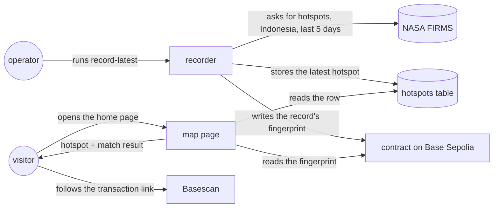
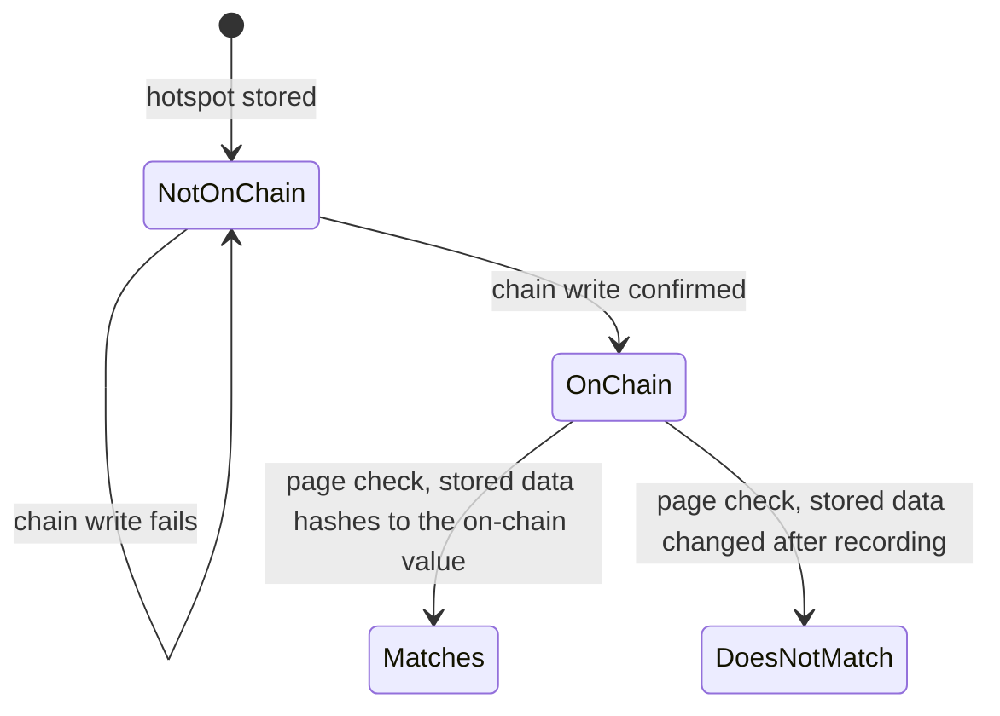
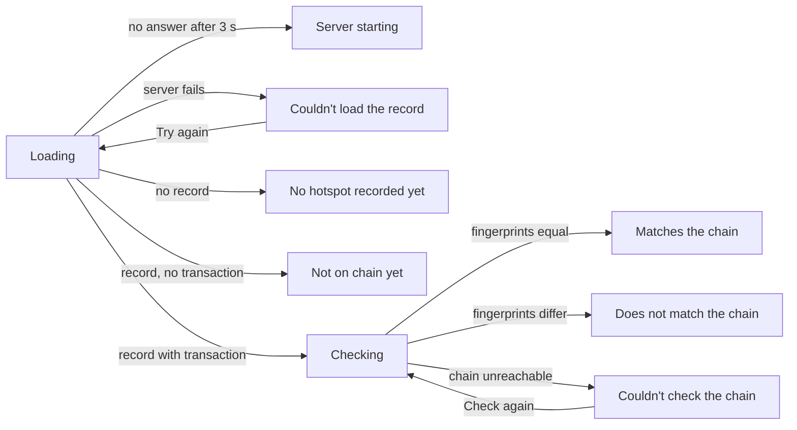
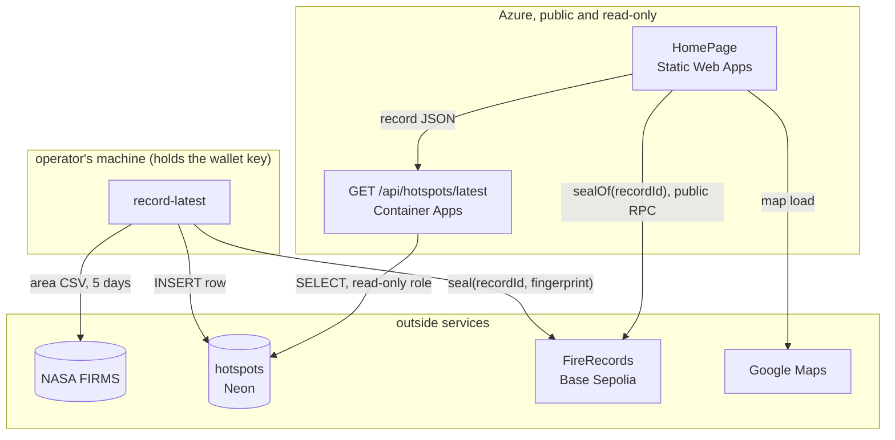
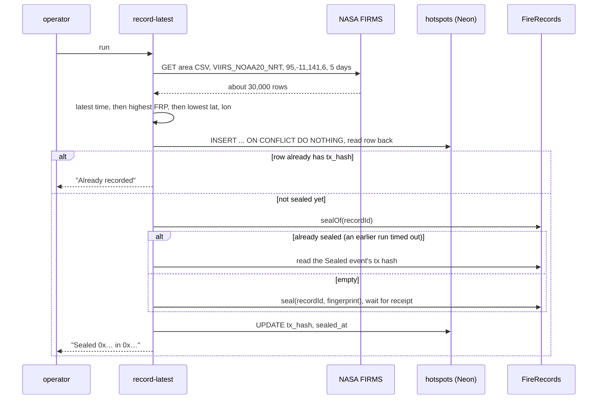
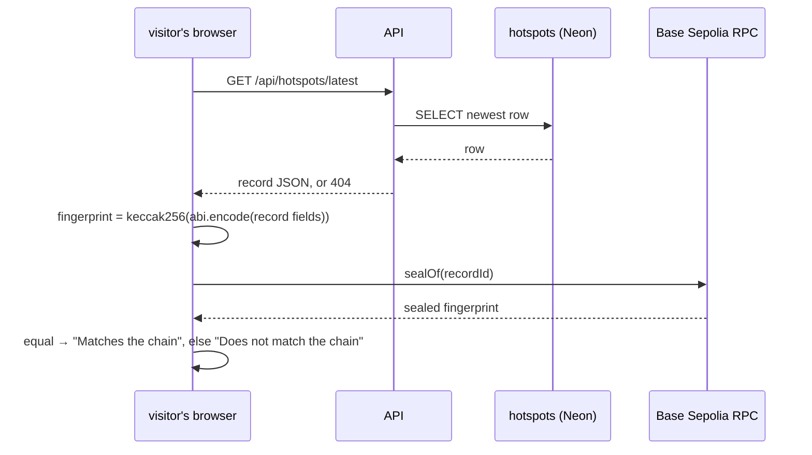
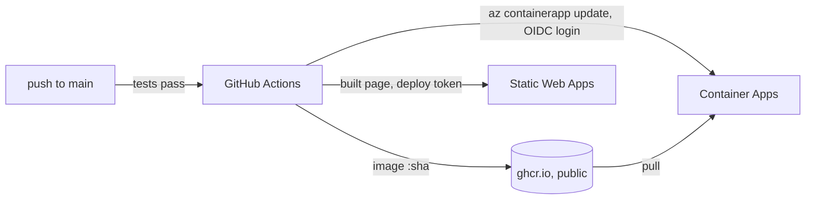
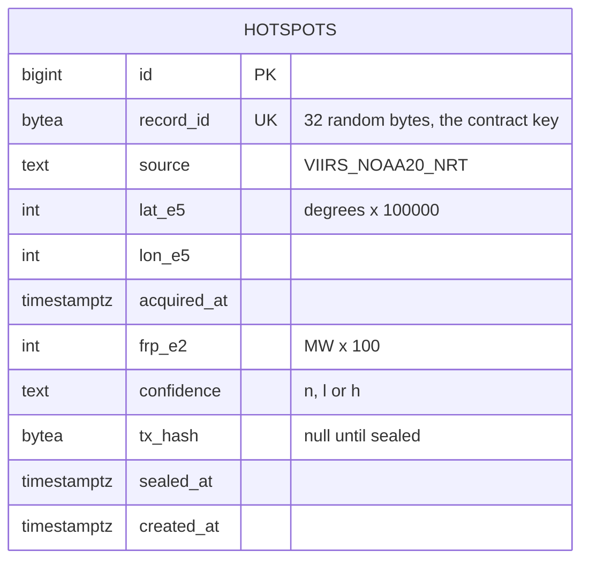

# Walking skeleton

**Version:** v1 · **Status:** Built · **Type:** Skeleton · **Project type:** Web UI

**Shape doc:** docs/specs/fire-watch/shape.md
**Depends on:** None

One real fire hotspot from NASA FIRMS is stored, sealed on Base Sepolia, and shown on a
deployed map page with a check that the stored record still matches the chain. It comes
first because every later slice needs these rails, and none of them are proven yet.

## Problem

Nothing exists yet. Every later slice needs the same path: fetch real fire data, store
it, seal it on chain, read it back on a page, and deploy all of it. Until that path works
end to end, any slice built on it is built on guesses about four outside services.

## Slice test

| Check                         | Result                                                                                   |
| ----------------------------- | ---------------------------------------------------------------------------------------- |
| Cuts every layer it needs     | yes — FIRMS fetch, Postgres row, contract write, API, map page, deploy                   |
| One e2e test walks it         | yes — record the latest hotspot from a FIRMS fixture on a local chain, open the page, see it marked "Matches the chain" |
| Worth shipping alone          | yes, as a skeleton — a visitor sees a real fire with a record they can check on Basescan |
| Fits (≤5 scenarios, ≤2 areas) | yes — 5 scenarios; two areas: recording and viewing                                      |

**Path:** full — new interface, new data, new dependencies, empty repo.

## User story

As a watchdog investigator, I want to see a real fire hotspot together with proof that its
record hasn't changed since it was written, so that I can trust the data before I build a
complaint on it.

## Flow



The operator records the latest hotspot; a visitor opens the page, sees it on the map, and
sees whether the stored record still matches what was written to the chain.

## States



`Matches` and `DoesNotMatch` are worked out each time the page loads; they are not stored.

## Acceptance criteria

```gherkin
Scenario: Operator records the latest hotspot
  Given NASA FIRMS reports a VIIRS NOAA-20 hotspot at latitude 0.4312, longitude 101.2154
    (Riau), acquired 2026-10-12 06:18 UTC, fire power 14.2 MW, confidence "nominal"
  And it is the most recent hotspot in the Indonesia box (95,-11,141,6) over the last 5 days
  When the operator runs record-latest
  Then one hotspots row is stored with those values
  And the record's fingerprint is written to the contract on Base Sepolia
  And the row keeps the transaction hash
  And running record-latest again before a newer hotspot appears stores nothing new
    and prints "Already recorded"

Scenario: Visitor sees the hotspot and its proof
  Given that hotspot is recorded and on chain
  When a visitor opens the home page
  Then the map is centred on 0.4312, 101.2154 with one marker
  And a panel shows "2026-10-12 06:18 UTC", "VIIRS NOAA-20", "14.2 MW"
  And the panel says "Matches the chain"
  And the transaction hash links to that transaction on Basescan

Scenario: Stored record changed after recording
  Given that hotspot is on chain
  And its stored longitude was later edited from 101.2154 to 101.3154
  When a visitor opens the home page
  Then the panel says "Does not match the chain"

Scenario: Chain write fails, then succeeds on rerun
  Given the recorder wallet holds 0 Base Sepolia ETH
  When the operator runs record-latest
  Then the hotspot row is stored and marked not on chain
  And the command exits with an error that includes "insufficient funds"
  And the page panel says "Not on chain yet"
  When the wallet is funded and the operator runs record-latest again
  Then the same hotspot is written to the chain, with no second row

Scenario: No hotspots to record
  Given FIRMS reports no VIIRS NOAA-20 hotspots in the Indonesia box for the last 5 days
  When the operator runs record-latest
  Then nothing is stored or written to the chain
  And the command prints "No hotspots in the last 5 days"
  And the page shows the last recorded hotspot, or "No hotspot recorded yet" when there is none
```

## Scope

**In:**
- One source (VIIRS NOAA-20 near real-time), one area (Indonesia box), one hotspot: the
  most recent, ties broken by the higher fire power.
- `record-latest`, run by the operator. Recording needs the database credentials and the
  recorder wallet key, so there is no public write path. Visitors can only read.
- A contract that only appends: a record's fingerprint can be written once and never
  changed.
- The home page: map, one marker, details panel, match result, Basescan link.
- Deployed: page on Azure Static Web Apps, API on Azure Container Apps, database on Neon,
  contract on Base Sepolia. CI runs the e2e test on every push.

**Out:**
- Matching hotspots to concessions, picking an area and dates, more than one hotspot — fire-record.
- Recording on a schedule — fire-record.
- Other satellites and sources — fire-record.
- Where a fire started and how it spread — fire-origin.
- A public page to check any record by its ID — complaint-pack.

## Stack

The decision record for the whole project: on Azure wherever that doesn't cost the
product something, at $0 a month. Drafted as D-entries at pause 3.

| Layer             | Choice                                        | Why                                                                                 |
| ----------------- | --------------------------------------------- | ----------------------------------------------------------------------------------- |
| Backend           | Python, FastAPI                               | The hard parts are geo, satellite and ML work, where Python's libraries are strongest |
| Frontend          | React, Vite, TypeScript                       | A richer map and timeline UI than server-rendered pages; types catch API shape mistakes |
| Map               | Google Maps JavaScript API                    | Its style rules paint land and water in Peatland colours, which Azure Maps can't (O11); 10,000 free map loads a month |
| Database          | Postgres + PostGIS on Neon free               | Spatial queries in the database; $0. Azure Postgres B1MS costs about $23 a month; Azure SQL's free tier would be used up in about 2 days by a 15-minute poller |
| Backend host      | Azure Container Apps                          | Runs the same Docker image as tests; scheduled jobs for later polling; monthly free allowance |
| Frontend host     | Azure Static Web Apps, Free plan              | $0 and on Azure. The free plan can't forward `/api`, so the backend allows the site's address with a CORS rule |
| Secrets           | Container Apps secrets, plus a local `.env`   | Free. The API's only secret is the database read credential. `record-latest` runs on the operator's machine, so the wallet key and FIRMS key stay in an untracked `.env`. Key Vault costs $0.03 per 10,000 reads |
| Chain             | Base Sepolia, Solidity contract               | A public chain no side of a dispute controls, with a real smart contract; anyone can check records on Basescan |
| Contract tooling  | Foundry (forge, anvil)                        | Fast contract tests; anvil gives e2e and CI a local chain with no faucet             |
| Python packages   | uv                                            | Lockfile, already installed                                                         |
| JS packages       | pnpm                                          | Lockfile, already installed                                                         |
| Tests             | pytest (API), Playwright (e2e)                | —                                                                                   |
| CI                | GitHub Actions                                | The hackathon requires a public GitHub repo; Actions deploys to Azure               |
| Container images  | GitHub Container Registry, public             | Free for public images; Azure Container Registry Basic is about $5 a month          |

**Cost guardrails.** Target $0 a month. Every service above runs inside a free allowance
(checked 2026-10-13). Azure and Google have cards on file and no hard spending cap, so:

| Where               | Guardrail                                                                                       |
| ------------------- | ----------------------------------------------------------------------------------------------- |
| Container Apps API  | Min 0, max 1 replica, 0.25 vCPU and 0.5 GiB. Free allowance covers about 1,900 wakes a month. Worst case if kept busy all month: about $20 |
| Log Analytics       | Daily cap of 0.1 GB. First 5 GB a month free and 31 days' retention included                   |
| Azure budget        | $1 a month on the Projects subscription; email at 50% and 100% of actual cost and 100% of forecast |
| Google Maps key     | Locked to the site's address (O7); map loads capped at 300 a day in the Cloud console (O12)      |
| Google budget       | $1 a month on the Maps billing account; email at 50%, 90% and 100%                               |
| Neon, Static Web Apps | Nothing to set: the free plans stop instead of billing                                        |

Budget alerts only send email; they never stop spending. They catch what the other
guardrails miss.

## Interface

One screen, the home page. The record column comes first and the map second, in both reading
order and focus order (D2). Desktop: header, then a 360–440 px record column beside a
full-height map. Under 720 px wide the map moves below the panel, 320 px tall.



The page loads the record, then checks it against the chain; Server starting is Loading with
a note added, and ends the same ways.

**Fixed copy.** Header: "Fire Watch" and "Records are sealed on Base Sepolia, a test network".
Title: "Latest recorded hotspot". Under it: "The newest NASA FIRMS fire detection in and around
Indonesia, sealed on a public blockchain so anyone can check it hasn't changed since."

**Record panel**, titled "Hotspot record", with the status label beside the title:

| Row         | Shows                                                    | Type |
| ----------- | -------------------------------------------------------- | ---- |
| Detected    | 2026-10-12 06:18 UTC                                     | Sans |
| Satellite   | VIIRS NOAA-20                                            | Sans |
| Location    | 0.4312°N, 101.2154°E                                     | Mono |
| Fire power  | 14.2 MW                                                  | Sans |
| Confidence  | Nominal                                                  | Sans |
| Fingerprint | first 10 and last 6 characters                           | Mono |
| Transaction | `0x` plus 8, then the last 6; links to `sepolia.basescan.org/tx/{hash}` in a new tab | Mono |

"Show the raw record" opens the stored record as JSON plus the full fingerprint.

| State                    | Status label and note                                                                 | Map                          |
| ------------------------ | ------------------------------------------------------------------------------------- | ---------------------------- |
| Loading                  | Grey bars in the panel's exact shape, so nothing moves when the record arrives        | Whole watch area, no marker  |
| Server starting          | As Loading, plus "Starting the server after a quiet spell. This can take up to a minute; the record loads on its own." | Whole watch area          |
| Couldn't load the record | "The server didn't answer. Try again in a moment." and a Try again button             | Whole watch area             |
| No hotspot recorded yet  | "The newest hotspot appears here once it is recorded and sealed."                      | Whole watch area             |
| Not on chain yet         | "This record is stored but not sealed on the chain yet, so it can't be checked." Transaction row reads "Not sent yet" | Centred on the record, one marker |
| Checking                 | "Comparing the stored record with the chain."                                         | Centred on the record        |
| Matches the chain        | "The stored record is exactly what was sealed on Base Sepolia."                        | Centred on the record        |
| Does not match the chain | "The stored record has changed since it was sealed. The chain still holds the original fingerprint." Shows "Sealed fingerprint" and "Fingerprint now" rows | Centred on the stored, changed location |
| Couldn't check the chain | No label. "Couldn't reach Base Sepolia to check this record." and a Check again button | Centred on the record       |

The last row, Couldn't load and Server starting are proven by component tests, not acceptance
scenarios (O10).

**Cold-start notice.** The server sleeps when idle and takes 21 s or more to wake (O8). The
Server starting note above says so on the page, and the README and the Devpost entry carry:
"The backend sleeps when no one is using it, so the first visit after a quiet spell can take up
to a minute."

**Map.** Google Maps JavaScript API with inline style rules: land `--fw-map`, water `--fw-surface`,
following the page theme (O11). Centred on the record at Google zoom 8, about 180 px per degree: the whole zoom nearest the
150 first planned, since a map without a map ID can't zoom in fractions. That shows about 4.6° of
longitude across an 840 px map. One marker from the detections guideline: a 9 px fire dot (the 5–20 MW size) inside
the 14 px selected ring. Zoom in and out use the system's secondary button, 40 px square, 44 px on
touch screens.

**Motion tier:** 1. The panel's content fades in with a 4 px rise over `--fw-dur` (180 ms). The Checking icon spins once every 900 ms.
The marker lands: the dot grows from 40% and the ring closes in from 160%, over
`--fw-dur-slow` (240 ms), the ring starting `--fw-dur-fast` later. Status changes, the raw
record opening and zoom all ease with `--fw-ease`. With reduced motion every duration is 0
and the Checking icon stays still.

**Components used:** `fw-panel`, `fw-kv`, `fw-chip` (ok, bad, pending, checking), `fw-help`,
`fw-btn` (primary and secondary), `fw-link`, `fw-mono`, `fw-empty`, `fw-skeleton`, the record
panel and map marker guidelines. No new components or tokens.

**Design system:** Fire Watch, `docs/design/design-system/` (D2, D4).

**Preview:** `docs/design/walking-skeleton/preview.html`, published at
https://claude.ai/artifact/FhUCnsZefu4UZX7e8E4eTG. Its map is drawn from Natural Earth
coastlines as a stand-in for the Google map, and its fingerprint and transaction hash are
worked out for the preview.

## Technical plan

### Approach

The operator's machine runs `record-latest`. It picks the latest FIRMS hotspot, stores it in
Neon and seals its fingerprint in a write-once contract on Base Sepolia. A read-only FastAPI
service returns the stored record. The visitor's browser then recomputes the fingerprint and
reads the sealed one straight from Base Sepolia, so the "Matches" verdict never depends on
trusting our server (D7). The repo is empty, so every file below is new.

Relies on: D1, D2, D4, D5, and D6–D11 drafted below.



Only the operator's machine can write, because it alone holds the database owner login and the
recorder wallet key. Everything on Azure only reads. The browser checks the chain itself.



The recorder stores the row before it touches the chain. A failed or timed-out write therefore
leaves a row with no `tx_hash`, and the next run seals that same row (scenario 4).



The page loads the record, hashes it in the browser and compares that with what the chain holds.



Every push runs the tests. A push to main also ships the API image and the page. The operator
runs migrations and `record-latest` by hand.

### Changes

| File | What | Why |
| ---- | ---- | --- |
| `contracts/src/FireRecords.sol` | `seal(bytes32 recordId, bytes32 fingerprint)`, recorder-only, reverts `AlreadySealed`; `sealOf(recordId)` returns fingerprint and time; `Sealed` event with indexed `recordId` | Scenarios 1, 4; scope "only appends" (D9) |
| `contracts/test/FireRecords.t.sol`, `script/Deploy.s.sol`, `foundry.toml` | Tests; deploy with the recorder address as constructor argument | Scenario 1 |
| `api/pyproject.toml`, `api/uv.lock` | FastAPI, uvicorn, psycopg 3, web3.py, httpx, pytest | Stack |
| `api/src/firewatch/firms.py` | Fetch the area CSV (base URL from `FIRMS_BASE_URL`), parse, validate ranges, pick the latest | Scenarios 1, 5 |
| `api/src/firewatch/fingerprint.py` | `record_fields()` and `fingerprint()`, version 1 (D8) | Scenarios 1–3 |
| `api/src/firewatch/chain.py` | `seal()`, `sealed()`, `seal_tx_hash()` over a hand-written ABI; turns a funds error into "insufficient funds in the recorder wallet" | Scenarios 1, 4 |
| `api/src/firewatch/record_latest.py` | The CLI, entry point `record-latest` | Scenarios 1, 4, 5 |
| `api/src/firewatch/app.py` | `GET /api/hotspots/latest` (200 or 404), `GET /api/health`; CORS for `ALLOWED_ORIGIN` only | Scenarios 2, 3, 5 |
| `api/src/firewatch/db.py`, `migrate.py`, `api/migrations/001_hotspots.{up,down}.sql` | Connection from `DATABASE_URL`; up and down runner (D10) | Scenario 1, reverse path |
| `api/Dockerfile` | `python:3.12-slim`, no build tools, runs uvicorn on 8000 | Deploy; a smaller image starts faster (O8) |
| `api/tests/` | pytest suites below | Test plan |
| `compose.yaml` | `postgres:17` for local tests | pytest and e2e need a real Postgres |
| `fixtures/fingerprint-vectors.json`, `fixtures/firms/` | Shared hash vectors; FIRMS CSV fixtures (Riau hotspot, ties, empty) | Python and TypeScript must agree (D8) |
| `web/` (Vite, React, TS, pnpm) | `HomePage`, `RecordPanel`, `HotspotMap` (OverlayView marker, since the advanced marker needs a map ID), `fingerprint.ts`, `chain.ts` (viem), `api.ts` | Scenarios 2, 3, 5; O10 states |
| `web/src/styles` | Imports `docs/design/design-system/styles.css`; no copy | D2, D4 |
| `web/e2e/`, `web/playwright.config.ts` | Playwright: starts anvil, Postgres, API and `vite preview`; deploys the contract; runs `record-latest` against the FIRMS fixture; fakes `google.maps` via route interception | The e2e harness (new) |
| `.github/workflows/ci.yml` | Jobs: contracts, api, web, e2e on every push | Scope "CI runs e2e on every push" |
| `.github/workflows/deploy.yml` | On main: push `ghcr.io/<owner>/firewatch-api:<sha>`, update Container Apps, deploy the page | Scope "Deployed" |
| `infra/setup.sh` | One-time `az` script: resource group, Container Apps (min 0, max 1, 0.25 vCPU, 0.5 GiB), Log Analytics daily cap, Static Web Apps Free, $1 budget, OIDC credential for Actions | Cost guardrails |
| `infra/neon-reader.sql` | `firewatch_reader` role with SELECT on `hotspots` only | Scope "visitors can only read" |
| `README.md` | Cold-start line (O8), run commands | O8 |

Reusing: nothing; the repo is empty. The design system CSS is imported, not copied.

**Fingerprint, version 1** (D8), the same in `fingerprint.py` and `fingerprint.ts`:
`keccak256(abi.encode(uint8 1, string source, int32 lat_e5, int32 lon_e5, uint64 acquired_unix,
uint32 frp_e2, string confidence))`. Example: `"VIIRS_NOAA20_NRT", 43120, 10121540, 1791785880,
1420, "n"`. FIRMS gives up to 5 decimals for latitude and longitude and 2 for FRP (checked on
30,013 rows), so whole numbers hold every value exactly. `acq_time` arrives as `427` for 04:27
and is padded before parsing.

### Data



Unique on `(source, lat_e5, lon_e5, acquired_at)`, so a rerun finds the same row. PostGIS is
not enabled yet; fire-record turns it on when it needs spatial queries.

**Migration:** a new table only. Contract step: none.
**Reverse:** `001_hotspots.down.sql` drops `hotspots`. `test_migrations.py` runs up, down, up.

### Earn-it

| Added | Triggered by |
| ----- | ------------ |
| `FireRecords` contract | Scenario 1 (seal); scope "only appends" |
| Recorder-only `seal` | Without it, anyone could seal a record ID first with a wrong fingerprint (D9) |
| `sealOf` check and `Sealed` event lookup before sending | Scenario 4 "no second row"; a timed-out write must not be sent twice |
| viem in the browser | Scenarios 2, 3: the page checks the chain itself (D7) |
| Vitest and Testing Library | O10 states; fingerprint parity with Python |
| Playwright | The one e2e (stack) |
| `firewatch_reader` role | Scope "visitors can only read" |
| `FIRMS_BASE_URL` setting | The e2e serves a fixture CSV instead of calling NASA |
| Fake `google.maps` in e2e | CI must not spend map loads or hold a key |
| `compose.yaml` Postgres | pytest and e2e need a real database |
| `/api/health` | Proof it works; the Container Apps probe |
| `infra/setup.sh` | Guardrails written down once, not clicked by hand |

Cut: PostGIS (no spatial query yet), Key Vault (D6), ORM and Alembic (D10), Bicep (one-time
setup, a script is enough), Basescan contract verification (needs an Etherscan key; not in
any scenario).

### Non-functionals

|                      |                                                                               |
| -------------------- | ----------------------------------------------------------------------------- |
| **Load**             | Tens of visits a day during judging. Each visit: 1 API call, 1 RPC call, 1 map load. One `record-latest` run per operator session |
| **Breaks first**     | Google's 10,000 free map loads, at about 330 a day. Next, the public Base Sepolia RPC rate limit; `VITE_RPC_URL` can switch to a free provider key. The API at max 1 copy handles far more than either |
| **Security surface** | Public: two GET routes, no input, CORS for the site only, database read-only role. Trusts: FIRMS CSV (ranges checked), RPC answers. Secrets: `DATABASE_URL` (reader) as a Container Apps secret; owner login, wallet key and FIRMS key only in the operator's `.env`; Maps key public by design, locked to the site (O7); deploy token and OIDC in GitHub. Data: public satellite data only, nothing personal |
| **Proof it works**   | `/api/health` returns `{"status":"ok","database":"ok"}`; the API logs `served hotspot record_id=0x… sealed=yes`; the live page shows "Matches the chain" |
| **Rollout**          | No flag; nothing live to protect. Roll back the API with `az containerapp update --image …:<previous sha>`, the page by rerunning deploy on the previous commit, the schema with `migrate down`. The contract can't change; a broken one is replaced by a new deploy and a new `VITE_CONTRACT_ADDRESS`, and old seals stay readable on the old one |

### Test plan

| Scenario | Test | Command |
| -------- | ---- | ------- |
| 1. Operator records | `api/tests/test_record_latest.py::test_records_and_seals`, `::test_rerun_prints_already_recorded` | `cd api && uv run pytest` |
| 2. Visitor sees it | `web/e2e/skeleton.spec.ts` "visitor sees the hotspot and its proof" | `cd web && pnpm e2e` |
| 3. Record changed | `web/e2e/skeleton.spec.ts` "edited longitude reads Does not match" | `cd web && pnpm e2e` |
| 4. Write fails, then succeeds | `test_record_latest.py::test_unfunded_wallet_keeps_row_unsealed`, `::test_rerun_after_funding_seals_same_row`; `web/src/RecordPanel.test.tsx` "Not on chain yet" | `cd api && uv run pytest`; `cd web && pnpm test` |
| 5. No hotspots | `test_record_latest.py::test_no_hotspots_stores_nothing`; `RecordPanel.test.tsx` "No hotspot recorded yet" | as above |
| O10 states | `web/src/HomePage.test.tsx`: couldn't load, server starting after 3 s, couldn't check the chain | `cd web && pnpm test` |
| Fingerprint parity | `api/tests/test_fingerprint.py`, `web/src/fingerprint.test.ts`, both on `fixtures/fingerprint-vectors.json` | both commands |
| Contract rules | `contracts/test/FireRecords.t.sol`: recorder only, write once, event | `cd contracts && forge test` |
| Reverse migration | `api/tests/test_migrations.py::test_up_down_up` | `cd api && uv run pytest` |
| Latest-pick rule | `api/tests/test_firms.py`: latest time, FRP tie, lat/lon tie, `acq_time` 427 | `cd api && uv run pytest` |

pytest needs `docker compose up -d db` and anvil on the path.

**E2E:** `web/e2e/skeleton.spec.ts` "visitor sees the hotspot and its proof". It records the Riau
fixture hotspot on anvil, opens the page and sees "Matches the chain". There's no e2e harness
in the repo yet; chunk C builds it.

### Chunks

| Chunk | Scenarios | Files owned |
| ----- | --------- | ----------- |
| A | 1, 4 (contract side) | `contracts/` |
| B | 1, 4, 5 (recording), API | `api/`, `compose.yaml`, `fixtures/` |
| C | 2, 3, 5 (page), O10, e2e | `web/` |
| D | Deploy, CI, guardrails | `.github/`, `infra/`, `README.md`, `.gitignore` |

A, B and C run in parallel. B and C write their own copies of the contract's ABI, so neither
waits on A's build. The e2e passes only once A, B and C are all in. D comes last. Each lockfile
sits inside its chunk's directory.

### Risks

| Risk | Mitigation |
| ---- | ---------- |
| Python and TypeScript hash differently, so every record reads "Does not match" | Shared vectors tested on both sides; the e2e asserts "Matches the chain" |
| No test ETH when it's time to deploy (O2) | Everything before the final deploy runs on anvil; retry Coinbase, then QuickNode |
| The public RPC rate-limits browsers during judging | `VITE_RPC_URL` is one setting; a free provider key swaps in without code changes |
| Cold start 21 s or more, plus Neon waking (O8) | The note and README line; time a cold start with the real image during build |
| Google key copied and abused, card on file (O7, O12) | Referrer lock, Maps-only API restriction, 300-a-day quota, $1 budget alert |
| Basescan shows the contract unverified, with raw hex input | Accepted for the skeleton; verification goes to complaint-pack |

### Decisions to record

Recorded as D6, D7, D8, D9, D10, D11.

## Open items

| ID | What | Type | Raised at | Owner | Status | Answer |
| -- | ---- | ---- | --------- | ----- | ------ | ------ |
| O1 | NASA FIRMS free key and archive cover the region and seasons needed (from shape O6). Docs checked 2026-10-13: area endpoint `/api/area/csv/{MAP_KEY}/{SOURCE}/{west,south,east,north}/{1..5}/{date}`, VIIRS near-real-time and archive sources, 5,000 calls per 10 minutes. Not yet called with a real key | unproven | shape | user | Resolved | Called with the real key 2026-10-13: `VIIRS_NOAA20_NRT`, box 95,-11,141,6, 1 day → 4,135 hotspots (2026-10-12); `VIIRS_NOAA20_SP` for 2023-09-15 → 1,930 hotspots, with a `type` column the live feed lacks |
| O2 | Base Sepolia test ETH is available from a faucet without holding mainnet ETH; Alchemy's rule is unclear | unproven | spec p1 | user | Accepted risk | Alchemy refused ("insufficient balance") and the Coinbase faucet sign-in code didn't arrive; wallet balance is 0. Proceeding: code, tests and CI use anvil, and test ETH is only needed for the Base Sepolia deploy at the end of build. Retry Coinbase, then QuickNode, before that deploy. 2026-10-13 |
| O9 | The skeleton shows whatever hotspot is latest in the box, which also covers Malaysia and Singapore. On 2026-10-13 the latest was at 1.348, 104.176, east of Singapore, possibly an industrial flare (unchecked). Filtering false alarms and using real boundaries is fire-record's job | flag | spec p1 | user | Accepted risk | 2026-10-13: accepted for the skeleton; a demo may open on a non-Indonesian point until fire-record adds real borders and false-alarm filtering |
| O3 | Assuming the React app is built with Vite and TypeScript | assumption | spec p1 | user | Resolved | Vite + TypeScript. 2026-10-13 |
| O4 | Assuming container images go to GitHub Container Registry, public | assumption | spec p1 | user | Resolved | GitHub Container Registry, public; Azure Container Registry rejected at about $5 a month. 2026-10-13 |
| O5 | Neon free gives 1 GB per project; the concession maps plus the 2023 archive may not fit. Not needed by this slice | flag | spec p1 | user | Accepted risk | Not needed by this slice. Measure when fire-record loads the maps; Neon paid storage is $0.35 per GB a month if 1 GB isn't enough. 2026-10-13 |
| O6 | Neon free gives 100 compute-hours a month and sleeps after 5 idle minutes; polling more often than about every 15 minutes would use them up (estimate). Polling starts in a later slice | flag | spec p1 | user | Accepted risk | Not needed by this slice. The poller runs no more often than every 15 minutes; revisit when fire-record specs it. 2026-10-13 |
| O7 | The Google Maps key sits in the browser, so anyone can copy it. The billing account has a card on it (confirmed 2026-10-13), so map loads past the free 10,000 a month are charged | flag | spec p1 | pause 3 | Resolved | 2026-10-13: production key locked to the Static Web Apps address and to the Maps JavaScript API only; a separate development key locked to `http://localhost:5173/*`; e2e uses a fake `google.maps`, so CI holds no key; $1 Google budget alert; map loads capped at 300 a day (O12) |
| O8 | The backend scales to zero, so the first visitor after a quiet spell waits for it to start; the wait is unmeasured. Keeping one copy running costs more than the free allowance | flag | spec p1 | user | Accepted risk | 2026-10-13: keep scale to zero ($0) and tell judges: the Server starting note says it can take up to a minute, and the README and Devpost entry say the same. Spike: cold start 20.5, 23.3, 21.1 s with a minimal 209 MB image; always-on at the smallest size would cost about $5.60–7.80 a month |
| O10 | The acceptance criteria don't say what the page shows when the server or the chain can't be reached. Proposed in the preview: "Couldn't load the record" with Try again; "Couldn't reach Base Sepolia to check this record." with Check again; a "Starting the server" note after 3 s of loading. Proven by component tests rather than new scenarios, so the slice stays at 5 | question | spec p2 | user | Resolved | 2026-10-13: keep all three as designed, proven by component tests; no new scenarios |
| O11 | Azure Maps tiles can't take the Fire Watch colours: its style overrides only switch borders and layers on or off (Azure Maps docs, checked 2026-10-13). The map will be neutral grey, not the Peatland green-grey of the preview | flag | spec p2 | user | Resolved | 2026-10-13: switch to Google Maps. Spike: inline style rules painted land, Tesso Nilo forest and water within 1 point per channel of the Peatland values, light and dark, at zoom 8, 10 and 12; no map ID needed |
| O12 | Google's docs name only per-minute map-load quotas (300 per IP, 30,000 per project); even the lowest per-minute setting allows more than 10,000 loads a month. Whether a per-day quota exists is unchecked. Without one, the referrer lock and the budget alert are the only protection | flag | spec p2 | user | Resolved | 2026-10-13: the console has a per-day map-load quota for the Maps JavaScript API; cap it at 300 a day (about 9,000 a month, under the 10,000 free). On a busy day the map stops loading until midnight Pacific time |
| O13 | Assuming a third tie-break. FIRMS stamps a whole pass with one minute, so 1,086 of 30,013 rows shared the latest time on 2026-10-13; FRP breaks almost every tie. For the rest: lowest latitude, then lowest longitude, so a rerun always picks the same hotspot | assumption | spec p3 | user | Resolved | 2026-10-13: lowest latitude, then lowest longitude |

## Glossary

- **Walking skeleton** — the thinnest working path through every layer, deployed, before features.
- **e2e** — end-to-end: one test that walks the whole slice as a user would.
- **Hotspot** — a point where a satellite detected unusual heat, usually a fire.
- **NASA FIRMS** — NASA's free service publishing satellite fire hotspots, live and archived.
- **VIIRS NOAA-20** — the fire-detecting sensor on the NOAA-20 satellite, about 375 m per pixel.
- **Fire power (FRP)** — how much heat the fire gives off, in megawatts.
- **Motion tier 1** — small movements only: hover, press, things appearing, 120–240 ms.
- **Reduced motion** — a device setting that asks pages not to animate; the page then changes instantly.
- **Natural Earth** — free public-domain map outlines of coasts and countries.
- **Fingerprint (hash)** — a short code computed from the record; change one digit and it changes completely.
- **Base Sepolia** — a free test network for Base, an Ethereum-compatible blockchain.
- **Basescan** — a public website for looking up Base transactions.
- **Faucet** — a site that hands out free test-network coins to pay transaction fees.
- **anvil** — Foundry's local blockchain for tests.
- **Neon** — a hosted Postgres service with a free plan that sleeps when idle.
- **PostGIS** — the Postgres extension for maps and shapes.
- **Azure Container Apps** — Azure's service for running Docker containers that scale to zero.
- **Azure Static Web Apps** — Azure's hosting for static web pages, served from many locations.
- **Azure Key Vault** — Azure's locked store for keys and passwords.
- **Budget alert** — an email when spending passes a set amount; it does not stop anything.
- **Daily cap** — a Log Analytics setting that stops taking in logs for the day once the limit is reached.
- **Google Maps JavaScript API** — Google's map for web pages; supplies the map background, coloured by our style rules.
- **CORS rule** — a setting on the backend that says which website's pages may call it.
- **Compute-hour** — Neon's unit of database running time.
- **Scale to zero** — the service shuts down when nobody uses it and starts again on the next request.
- **keccak256** — the fingerprint function Ethereum-style chains use.
- **ABI encoding** — Ethereum's fixed byte layout for typed values; the same in every language.
- **RPC** — the web address a page or program calls to read from or write to a chain.
- **viem** — a TypeScript library for reading chains and ABI-encoding values.
- **web3.py** — the Python library for the same job.
- **psycopg** — the standard Python driver for Postgres.
- **OverlayView** — Google Maps' way to place our own HTML on the map without a map ID.
- **OIDC login** — GitHub Actions proves who it is to Azure without a stored password.
- **Record ID** — a random 32-byte label for each record; the key for its seal on chain.
