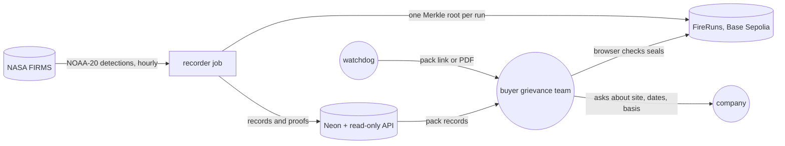

# Fire Watch: implementation and adoption strategy

Fire Watch records NASA FIRMS fire detections near Indonesia's pulpwood concessions every hour and
seals each run on Base Sepolia. D-numbers are entries in `DECISIONS.md`.

## Who adopts it first, and why

**1. Watchdog investigators who already file grievances with buyers.** They run satellite
monitoring and trace concessions to buyers (`docs/specs/fire-watch/shape.md`, O3). Mighty Earth's
system covers more than 3,500 oil palm concessions
([Mighty Earth](https://mightyearth.org/rapid-response-palm-oil/)). Companies dispute the origin:
KLK was reported saying fires "originated outside" a concession
([Weirdkaya](https://weirdkaya.com/indonesian-media-claims-msian-sporean-companies-linked-to-fires-in-indonesia/)),
and Wilmar said an allegation did not identify "the specific sites, dates or the basis"
([BHRRC](https://business-humanrights.org/en/latest-news/wilmar-international-group-respond-to-transboundary-hazes-allegation)).

The investigator (`web/src/Landing.tsx`, D36):

1. picks up to 31 days at `/?tool`, then a concession;
2. opens a fire: where the satellite first saw it against the edge, then each pass;
3. reads the notes on weak first sightings, joined fires and what the satellite can miss
   (D113, D114, D139);
4. makes a pack and puts its link or PDF in the grievance (D95).

**2. Buyers' grievance teams.** Wilmar says fire alerts in supplier concessions "are assessed
through our grievance mechanism" and it "would welcome any specific, concession-level
information" (BHRRC above). A pack gives the concession, dates and basis.

The grievance officer (`web/src/ComplaintPack.tsx`, D97, D120, D121):

1. opens the link; their browser works out each detection's fingerprint and checks it on Base
   Sepolia;
2. reads how many detections match the chain;
3. reads whether a detection was left out of the runs in the pack's window. Older detections,
   sealed singly on FireRecords, have no list on the chain; FIRMS's archive checks those;
4. asks the company for a response (shape, Today).

Packs name concession IDs, not companies (shape O10).

## How it runs today

- **Hosting, $0 a month** (D6, `infra/setup.sh`): the page on Azure Static Web Apps Free; the API
  on Azure Container Apps, scaled to zero; Neon Free Postgres. A cold start takes about 21 s.
- **Recorder** (D13, D15, D103): a Container Apps job runs `record-hotspots` hourly. It keeps
  detections within 5 km of a concession and seals one root for the run's new records.
  First live run: 2026-10-16 (`docs/specs/fire-record.md`).
- **Alerts** (D20): a GitHub workflow emails the operator after 2 hours without a good run, or
  when a run seals nothing while records wait.

The operator (`README.md`) funds the recorder wallet with faucet test ETH; points the job at each
new recorder image by hand, since GitHub's deploy can't reach the wallet key (D21); loads map
versions with `load-concessions`; replaces a leaked recorder key with the owner key, kept off
Azure (D104); and reads $1 budget alerts.

## Adoption plan

No partner has agreed to any phase.

| Phase | Needs | It worked if |
| ----- | ----- | ------------ |
| 1. User test | Six testers, the live site | Each task meets its pass mark |
| 2. Pilot with one watchdog | A group filing grievances over pulpwood concessions; a chain that lasts (`docs/specs/judge-review/shape.md`, O13); a second key holder | Assumption: over one fire season, packs go into real grievances, and no company reply says a grievance gave no site, date or basis |
| 3. More land | A concession map anyone can download (D12) | Packs on the new map pass the same checks |

D104 rejected a multisig owner key only because one person holds every key. A partner changes that.

## Costs and who pays

| Item | Today | Limit, then price | Source |
| ---- | ----- | ----------------- | ------ |
| Static Web Apps | $0 | 100 GB | D6 |
| Container Apps | $0 | 180,000 vCPU-s, 2 million requests; always on $5.60–7.80 a month | D6 |
| Neon | $0 | 100 CU-hours, recorder estimated at about 27; 1 GB, 37.4 MiB after 30 simulated days, then $0.35 per GB | `fire-record.md` O6, O7; `walking-skeleton.md` O5 |
| Google Maps | $0 | 10,000 loads a month, capped at 300 a day | `walking-skeleton.md` O12 |
| Base Sepolia | $0, faucet test ETH | One transaction per run | D103 |

Today the builder pays $0.

Assumption: in a pilot, the watchdog or a grant pays above free tiers. Nobody has offered.

Base mainnet gas per run is not worked out in the repo.

## Risks to adoption

| Risk | What we'd do |
| ---- | ------------ |
| Nobody has tested it | Phase 1 before any pilot |
| Pulpwood only: 294 Trase concessions. GFW's oil palm map can't be downloaded for Indonesia (D12, D16) | Add an open map when one exists (D86) |
| The test network can close (judge-review O13) | Move to Base mainnet before a pilot |
| A company says the fire started elsewhere | The page says "first seen", never "started" (D26), and names NOAA-20 and what it misses: cloud, smoke, canopy, smouldering peat (D139, D141) |
| The server chooses a pack's records (D98) | The browser checks run roots for a left-out detection (D119); older seals need FIRMS's archive (D120) |
| One person holds every key | A second key for the partner (D104) |
| 21 s cold start; public RPC allows 25 calls a second (D38) | Always-on API; a provider RPC key (`walking-skeleton.md`) |

## User testing

No watchdog, buyer or other user has tested Fire Watch yet. That risk was accepted
(`docs/specs/judge-review/shape.md`, O3). This is a plan, not results.

**Who.** Assumption: three watchdog investigators who have filed a fire grievance, and three
buyer staff who handle supplier grievances, each alone on the live site for 45 minutes. Nobody is
recruited yet.

**Tasks.** Pass marks are Assumptions.

| # | Task | Pass |
| - | ---- | ---- |
| W1 | Watchdog: find a fire on ID-WOOD-CONCESSION-0332; say which side it was first seen on, and whether that sighting is weak | Right side and weak flag, unaided, within 10 minutes |
| W2 | Watchdog: make a pack, copy its link, save a PDF | The link opens the same fire elsewhere; the PDF shows the check result |
| B1 | Buyer: open a pack and check its seals | States how many detections match the chain, within 5 minutes |
| B2 | Buyer: open a local copy with one stored record changed, as `web/e2e/complaint-pack.spec.ts` does | Names the record that doesn't match |
| B3 | Buyer: say what the pack does not prove | Names a limit, such as: first seen is not where it started |
| All | Would you use this in a real grievance? What stops you? | Recorded, not scored |

Phase 1 passes when at least two of three testers pass each task (Assumption).
