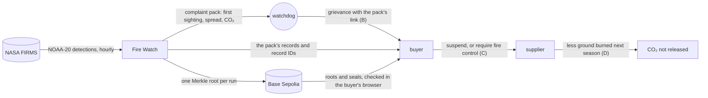

# Fire Watch: climate impact assessment

Fire Watch records NOAA-20 fire detections near Indonesia's pulpwood concessions, seals them on a
blockchain, and estimates each fire's CO₂. It cuts no emissions by itself. Any climate effect runs
through grievances: a buyer who can check where a fire was first seen, and what it released, has
less room to dismiss the complaint.

Every figure below names its file in this repo or a public URL. "t" is a tonne.

## 1. The CO₂ at stake

### One fire: the example in ID-WOOD-CONCESSION-0332

The input is the example fire's complaint pack, `web/public/case/pack-0332.json`, cut at 17 Oct 2026
09:00 UTC. On 24 Oct 2026 the live API returned the same bytes (sha256 `33037b98…38728fa`). The fire
has 283 detections over 8 passes. It was first seen in Fire Watch's records on 12 Oct 2026 at 05:16
UTC.

The pack's `damage` field gives the ground in the fire's joined 375 m squares, split at the
concession's edge and by WRI's peat map. The factors are in `web/src/Damage.tsx:8-21`.

| Step | Peat | Other ground | Source |
| ---- | ---- | ------------ | ------ |
| Ground in the squares, inside + outside | 500.72 + 524.65 = 1,025.37 ha | 755.97 + 532.86 = 1,288.83 ha | pack, `damage` |
| Share likely burned | 61.8% | 42.2% | `2023-check.json` |
| Likely burned | 633.7 ha | 543.9 ha | row 1 × row 2 |
| CO₂ a hectare | 353 t dry matter × 0.464 carbon as CO₂ × 44/12 = 600.6 t (289.2 to 911.9) | 42.2 t dry matter × 1.58 = 66.7 t | IPCC, below |
| CO₂ | 380,600 t (183,300 to 577,900) | 36,300 t | row 3 × row 4 |

The fire released **220,000 to 610,000 t of CO₂**, about 420,000 t at IPCC's average. About half,
110,000 to 300,000 t, came from ground inside the concession. Peat is 44% of the ground and 91% of
the CO₂. At the World Bank's 2015 average of US$6,192 a hectare, the likely burned ground cost about
US$7.3 million.

To redo it, pass the pack's `damage` field to `estimate()` in `web/src/Damage.tsx:37`. I ran it on
24 Oct 2026 and got these figures.

Sources:

- Peat, IPCC 2013 Wetlands Supplement, Tables 2.6 and 2.7:
  https://www.ipcc-nggip.iges.or.jp/public/wetlands/pdf/Wetlands_separate_files/WS_Chp2_Drained_Inland_Organic_Soils.pdf
- Other ground, IPCC 2006 Guidelines, Volume 4, Tables 2.4 and 2.5, secondary tropical forest:
  https://www.ipcc-nggip.iges.or.jp/public/2006gl/pdf/4_Volume4/V4_02_Ch2_Generic.pdf
- Cost, World Bank, The Cost of Fire (2016), US$16.1 billion over 2.6 million ha burned in 2015:
  https://openknowledge.worldbank.org/entities/publication/391e19f4-18f7-56c2-8c28-bb89cc9e7d6f

### One season: 2023 near pulpwood concessions

In 2023 NOAA-20 made 42,682 detections within 5 km of a concession on Trase's map. Their squares
join into 456,345 ha. Fire Watch checked them against NASA's MODIS burned-area map, MCD64A1
(https://lpdaac.usgs.gov/products/mcd64a1v061/). `damage-check-2023` redoes the check byte for byte
from pinned files, and writes `fixtures/damage/2023-check.json`. Every figure below comes from that
file.

| | Ground | Mapped burned by MODIS |
| - | ------ | ---------------------- |
| All squares | 456,345 ha | 68,826 ha, 15.1% |
| Peat in large patches | 31,915 ha | 19,722 ha, 61.8% |
| Other ground in large patches | 25,536 ha | 10,781 ha, 42.2% |
| Outside large patches | not split | 38,323 ha |

The file does not split the 38,323 ha outside large patches into peat and other ground. So the
season's CO₂ is given as a floor, which counts all of it as other ground, and a ceiling, which counts
all of it as peat. Both use the CO₂ a hectare above: 600.6 t for peat (289.2 to 911.9) and 66.7 t for
other ground.

| | Peat burned | CO₂ |
| - | ----------- | --- |
| Floor | 19,722 ha | 15.1 million t (9.0 to 21.3) |
| Ceiling | 58,045 ha | 35.6 million t |

That is **at least 15 million t of CO₂ in one season**. Peat is at least 29% of the burned ground and
78% of the floor's CO₂. At the World Bank's average, the 68,826 ha cost about US$426 million.

Fire Watch's per-fire shares, 61.8% and 42.2%, come from large patches. Applied to every 2023 square
they would give about 213,000 ha burned, three times what MODIS mapped, so a small fire's estimate
may run high, as the page says.

## 2. Carbon reduction scenarios

These are scenarios, not forecasts. Each step after the pack is something people do, and is
untested.

A buyer checks a pack in their own browser. The check needs each record's fields and random record
ID, which Fire Watch's API sends. The chain holds only a fingerprint for each record on FireRecords,
or one Merkle root for each run on FireRuns.

CO₂ not released in a season = S × B × C × D.

- **Assumption:** S, the CO₂ at stake, is 15.1 million t a season (9.0 to 21.3), the 2023 floor
  above. Reason: it is the only season measured, and the floor rests on committed data alone. The
  ceiling, 35.6 million t, would raise every row by 2.4 times. Seasons vary a lot: by Greenpeace's
  figures, Indonesia's burned area was 2,604,500 ha in 2015 and 164,100 ha in 2017.
  https://www.greenpeace.org/southeastasia/press/3098/palm-oil-and-pulp-companies-with-most-burned-land-go-unpunished-as-indonesian-forest-fires-rage/
- **Assumption:** B, the share of S in fires that a watchdog takes to a buyer with a Fire Watch pack,
  is 5%, 15% or 30%. Reason: a guess. No watchdog has used Fire Watch
  (`docs/specs/judge-review/shape.md`, O3). One watchdog already monitors more than 3,500 oil palm
  concessions, so the reach exists (https://mightyearth.org/rapid-response-palm-oil/).
- **Assumption:** C, the share of those grievances where the buyer makes the supplier act, is 10%,
  25% or 50%. Reason: a guess, as I found no public rate. Government sanctions have been rare: Greenpeace found
  that none of the ten palm oil concessions with the largest burned areas in 2015 to 2018 got a
  serious civil or administrative sanction (same URL as S).
- **Assumption:** D, the cut in the next season's burned ground where a supplier acts, is 10%, 25%
  or 50%. Reason: a guess, as I found no study that measures it. Fires return to the same
  concessions (https://news.mongabay.com/2019/10/indonesia-forest-fires-palm-oil-pulp-paper-concession-greenpeace/).
  RSPO certification had no causal effect on active fire detection rates (Carlson and others, 2018,
  PNAS, https://pmc.ncbi.nlm.nih.gov/articles/PMC5776786), so pressure alone may cut nothing.
- **Assumption:** every action taken on a Fire Watch grievance counts as Fire Watch's effect.
  Reason: none. This overstates its share, since some grievances would succeed without it.

| Scenario | B | C | D | CO₂ not released a season | With IPCC's peat range |
| -------- | - | - | - | ------------------------- | ---------------------- |
| Low | 5% | 10% | 10% | about 7,600 t | 4,500 to 10,600 t |
| Middle | 15% | 25% | 25% | about 142,000 t | 84,000 to 199,000 t |
| High | 30% | 50% | 50% | about 1.1 million t | 670,000 to 1.6 million t |

The middle row is about a third of the example fire's CO₂, each season. Zero is as defensible as the low
row, given Carlson and others.

## 3. Limits

- **No user has tested Fire Watch.** No watchdog or buyer has seen it
  (`docs/specs/judge-review/shape.md`, O3). B and C are untested.
- **One satellite.** Fire Watch reads only NOAA-20, which is NOAA's satellite; its detections come
  through NASA FIRMS. NOAA-20 passes about twice a day. Cloud, heavy smoke, tree canopy and smouldering
  peat can hide a fire (`web/src/FireView.tsx:154-157`). The example fire was first seen in Fire
  Watch's records on 12 Oct. NOAA-20 saw fire under 1 km away on 11 Oct, before recording began
  (`docs/specs/source-claims.md:27`).
- **One map.** Trase's 294 licensed Indonesian pulpwood concessions (`DECISIONS.md`, D12 and D16).
  No palm oil, no other country. Trase gives no accuracy for its lines.
- **The estimate's ranges.** Only peat fuel has an IPCC 95% interval, 170 to 536 t of dry matter a
  hectare. It puts peat's CO₂ at 48% to 152% of the middle figure. Other ground keeps one figure,
  since its interval reaches zero. Peat's gas factor, 464 g a kilogram, comes from one study with no
  interval. All peat counts as drained. The burned shares come from one year's large patches. A
  detection means fire somewhere in its 375 m pixel, not that the whole pixel burned.
- **CO₂ only.** Methane and carbon monoxide are left out. Methane would add about 200 t of
  CO₂-equivalent a hectare of peat (`DECISIONS.md`, D68).
- **The forecast counts for nothing here.** In 2023, 3,751 of rule version 1's 3,874 warnings never
  came in (`fixtures/backtest/2023.json`). No scenario credits early warning.
- **A test network.** The seals are on Base Sepolia, which can be shut down
  (`docs/specs/judge-review/shape.md`, O13).
- **Fire Watch's own footprint is not measured.** It sends one transaction for each hourly run with
  new records, and its API scales to zero when idle (`DECISIONS.md`, D6).
