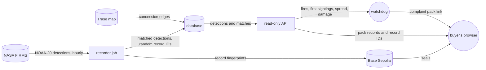

# Fire Watch: problem and solution

IEEE ClimateChain Global Hackathon · Climate Data & Environmental Monitoring ·
[Live page](https://orange-rock-0f5eae400.1.azurestaticapps.net)

## The problem

Watchdog groups watch plantation land by satellite. Mighty Earth's system "monitors more than 3500
oil palm concessions in Indonesia and Malaysia"
([Mighty Earth](https://mightyearth.org/rapid-response-palm-oil/)). A concession is land the
government licenses to a company. When one burns, the watchdog files a grievance with the companies
that buy from it.

Two answers from companies in 2026:

- The fires "originated outside" the concession "before spreading in"
  ([Weirdkaya](https://weirdkaya.com/indonesian-media-claims-msian-sporean-companies-linked-to-fires-in-indonesia/)).
- The allegation "does not identify the specific sites, dates or the basis on which incidents have
  been attributed"
  ([BHRRC](https://business-humanrights.org/en/latest-news/wilmar-international-group-respond-to-transboundary-hazes-allegation)).

The buyer holds two accounts of one fire and nothing shared to check them against. It picks one,
and suspends the supplier or closes the case.

In Indonesian courts, concession holders answer for fires on their land "regardless of whether or
not they can be proven to have started the fires"
([Mongabay 2019](https://news.mongabay.com/2019/10/palm-oil-indonesia-arjuna-utama-sawit-musim-mas-forest-fires/);
a [2023 case](https://news.mongabay.com/2023/08/indonesian-oil-palm-firm-slapped-with-61m-fine-for-fires-on-its-plantation/)
ended in a US$61 million fine). Singapore's haze law presumes cause from satellite images; a
company's defence is a natural cause or a third party
([RSIS](https://rsis.edu.sg/rsis-publication/nts/co15021-singapores-transboundary-haze-pollution-act-silver-bullet-or-silver-lining/)).
A grievance desk is not a court. And Greenpeace says weak deterrence has "allowed fires to
burn in the same concessions almost every year"
([Mongabay 2019](https://news.mongabay.com/2019/10/indonesia-forest-fires-palm-oil-pulp-paper-concession-greenpeace/)).

## What Fire Watch shows

Fire Watch reads NOAA-20 fire detections from NASA FIRMS hourly, matches them to pulpwood
concessions on Trase's map of Indonesia, and seals each record's fingerprint on Base Sepolia, a
public test blockchain. For one fire it shows:

- **Where it was first seen in Fire Watch's records**, against the concession's edge. It names a
  side only beyond 375 m from the edge, half the widest pixel. It says "first seen", never
  "started".
- **How it spread**, replayed one satellite pass at a time.
- **An estimate of its damage**: the ground that likely burned, the CO₂ and the cost, split at the
  concession's edge.
- **A complaint pack** at one link, printable to PDF: the site, the dates, the first sighting, the
  spread, the estimate and every record. The buyer's browser rebuilds each record's fingerprint
  from the fields and random record ID that Fire Watch's API sends, and checks it against Base
  Sepolia. A changed record stops matching. For newer records, the pack also shows that no stored
  detection of the fire was left out.

### One real fire

The [example pack](https://orange-rock-0f5eae400.1.azurestaticapps.net/?pack=ID-WOOD-CONCESSION-0332&fire=0x13b417c6f54dd95c7c418b5df3f34963cf00f46555d5cae74693cdffbb1d1cf7&as_of=1792227600)
is a fire at ID-WOOD-CONCESSION-0332 in Central Kalimantan.

- Fire Watch's records first show it on 12 Oct 2026 at 05:16 UTC, as one detection 3,100 m outside
  the concession. The satellite didn't see it again for 25 hours, so that detection may be a
  separate fire.
- On 13 Oct a second fire was first recorded, on both sides of the edge. On 14 Oct they came within
  1 km, so Fire Watch counts them as one.
- From 12 to 17 Oct, NOAA-20 saw it on 8 passes: 283 detections, 164 inside the concession.
- Damage estimate: about 1,200 ha likely burned, 630 ha inside; 220,000 to 610,000 t of CO₂; about
  US$7.3 million.
- Fire Watch's records begin an hour before the first detection. In NASA's archive, NOAA-20 saw
  fire under 1 km away on 11 Oct, also outside. Other satellites saw fire on the second fire's
  ground on 10 Oct, on both sides of the edge.

The record doesn't decide the case. It gives both sides the same checkable facts, gaps included.

## How it works

Readings such as the first sighting are worked out from sealed detections by a published rule. They
are not sealed themselves.

## Limits

- **No user has tested it.** No watchdog or buyer has seen Fire Watch.
- **One satellite, one map.** It reads only NOAA-20, and only Trase's pulpwood concession map of
  Indonesia. Its records begin in October 2026. The satellite misses fire under cloud, heavy smoke
  or thick canopy, and peat that smoulders with too little heat to show.
- **A test network.** Seals sit on Base Sepolia. The chain holds only fingerprints, so a check
  needs each record's fields and record ID from Fire Watch's API. The example's records predate the
  left-out check, so only NASA FIRMS's archive would show one missing.
- **The damage is an estimate.** A detection means fire somewhere in its 375 m pixel. The burned
  shares come from Fire Watch's own check of NASA's MODIS map for 2023. The estimate is not sealed.
- **The forecast is weak.** After each pass, it forecasts whether a fire near a concession will be
  seen inside within 48 hours, and seals that. On a 2023 replay it warned of 123 of 135 arrivals,
  but 3,751 of its 3,874 warnings never came in. Its near-edge step alone did about as well. The
  forecast is a sealed list of calls, each kept with its outcome. It is not a warning to act on,
  and the complaint pack leaves it out.
