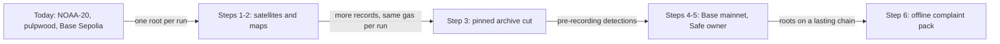

# Fire Watch: scalability and sustainability roadmap

D-numbers are in `DECISIONS.md`. Chain and price readings: 2026-10-24, about 10:35 UTC.

## Where it stands

- **One satellite:** NOAA's NOAA-20, read through NASA FIRMS as `VIIRS_NOAA20_NRT`, in one box
  around Indonesia (`api/src/firewatch/firms.py:11-12`).
- **One map:** Trase's Indonesian pulpwood concessions, less four likely-proposed ones (D12, D16).
- **Hourly runs** of a Container Apps job (D15, `infra/setup.sh:55`).
- **One Merkle root per run with new records**, on FireRuns,
  `0x8b2EF6848f9F8c5aC2810D959c52d71084A33734`, Base Sepolia (D103). Older seals: FireRecords,
  `0x6a55489a05a9c79d2cd35212878d113557dceb2a`.
- **Hosting at $0:** Static Web Apps Free, Container Apps scaled to zero, Neon Free (D6).

## Phases



## Steps

**1. More satellites: S-NPP, NOAA-21, MODIS.**
Takes: reading `VIIRS_SNPP_NRT`, `VIIRS_NOAA21_NRT` and `MODIS_NRT` from FIRMS's
[area API](https://firms.modaps.eosdis.nasa.gov/api/area/). The source is already in each
fingerprint and each row's unique key (`fingerprint.py:82`, `migrations/001_hotspots.up.sql:13`).
The fire rule needs a version 3: its 14-hour weak-sighting gap assumes NOAA-20's 12-hour revisit
(`fires.py:54`). MODIS needs its own parser and edge margin: its pixel is about 1 km, not 375 m,
and its confidence 0–100%, not low, nominal or high
([FIRMS FAQ](https://www.earthdata.nasa.gov/data/tools/firms/faq)); the parser takes only `n`, `l`
and `h` (`firms.py:16`).
Gives: more passes a day, so fewer first sightings rest on one detection and a long gap.

**2. More maps: palm oil, other countries.**
Takes: a concession map anyone can download. GFW's Indonesian layers are view only and its oil palm
data is from 2012 (D12). `load-concessions` loads one pinned file per map version, which each record
names (D17). Another country needs its own FIRMS box (`firms.py:12`).
Gives: palm oil and other countries. One root per run lifts D86's limit: the world's 62,489 fires
on 14 Oct 2026 were 25 times the busiest day's seals at one transaction each. Storage and matching
time become the limits.

**3. A pinned archive cut.**
Takes: the live feed reaches back 5 days (`firms.py:15`). A command like `backtest-2023`, which
pins a FIRMS archive file by sha256 (README), cuts the archive near each concession for the
days before recording began. The fire view marks those detections as archive, not sealed.
Gives: a first sighting checked against detections before recording began. The landing's example
fire is first in the records on 12 Oct, an hour after they begin; in FIRMS's archive, NOAA-20 saw
fire 0.96 km away on 11 Oct (`docs/specs/source-claims.md:27`, D141). The pin shows the cut hasn't
changed since it was made, not when FIRMS published those rows.

**4. Base mainnet.**
Takes: deploy FireRuns there, fund the recorder with real ETH, and set `RPC_URL` and
`FIRE_RUNS_ADDRESS` (README, "Turning on run roots").
Gives: roots off a test network that can be shut down (judge-review shape O13).

**5. A multisig owner key.**
Takes: two more key holders; D104 turned down a 2-of-3 Safe only for lack of them. FireRuns' owner
is `immutable` (`contracts/src/FireRuns.sol:22`), so the Safe must own step 4's deploy, or mainnet
needs a second FireRuns.
Gives: no one person can swap in a recorder key.

**6. A complaint pack that carries its proofs offline.**
Takes: a pack file with each record, its proof, and every record of its window's runs, which the
page fetches from the API today (D109, D122).
Gives: a grievance that still checks if Fire Watch's API is gone. The reader needs the file, the
page's open code and any Base RPC.

## Cost to run on Base mainnet

**Gas per seal.** `cast receipt` on FireRuns' five `sealRoot` transactions gives 114,384 gas for
run 1 (71 records) and 97,284 for each of runs 2 to 5 (1,446, 3, 46 and 788 records, from the live
`/api/runs?first=1&last=5`). A root is 32 bytes however long its list. Run 1 cost 17,100 more
for setting the run count from zero; `forge test --gas-report` also gives 114,384 as `sealRoot`'s
maximum.

**Runs per year.** At most one root per hourly run: 24 × 365 = 8,760. Only runs with new records
seal, so the real count is lower: 5 roots from 23 Oct 19:00 to 24 Oct 09:00 UTC (`cast call` on
`runOf`). More satellites and maps add records, not roots.

- Assumption: gas price 0.006 gwei (6,000,000 wei), from
  `cast gas-price --rpc-url https://mainnet.base.org`.
- Assumption: L1 data fee 601,350,116 wei a seal, from Base mainnet's GasPriceOracle `getL1Fee`
  (`0x420000000000000000000000000000000000000F`) given run 2's signed transaction.
- Assumption: ETH at $2,369.46, from
  [CoinGecko](https://api.coingecko.com/api/v3/simple/price?ids=ethereum&vs_currencies=usd).

```
per seal = 97,284 × 6,000,000 + 601,350,116 = 584,305,350,116 wei
per year = 584,305,350,116 × 8,760 = 0.00511851 ETH × $2,369.46 = $12.13
at 10 × the gas price, per year = $121.17
```

## Hosting cost as it grows

| Service | Free limit | Today | Next step |
| - | - | - | - |
| Static Web Apps | 100 GB a month, none sold past it ([quotas](https://learn.microsoft.com/en-us/azure/static-web-apps/quotas)) | Free (D6) | Standard: $9 a month, 100 GB, then $0.20 per GB |
| Container Apps | 180,000 vCPU-s, 360,000 GiB-s, 2 million requests a month ([billing](https://learn.microsoft.com/en-us/azure/container-apps/billing)) | API and job at 0.25 vCPU, 0.5 GiB (`infra/setup.sh:47,57`) | $0.000034 per vCPU-s, $0.000004 per GiB-s, $0.40 per million requests |
| Neon | 100 CU-hours and 1 GB a project ([pricing](https://neon.com/pricing)) | About 27 CU-hours a month, estimated (`fire-record.md` O7); 37.4 MiB after 30 simulated days (O6), plus 36 MB of peat (`damage-estimate.md` O11) | Launch: $0.106 per CU-hour, $0.35 per GB-month |

Azure prices: [retail prices API](https://prices.azure.com/api/retail/prices), in the regions of
`infra/setup.sh:21-22`.

- **Container Apps.** At 0.25 vCPU the grant is 720,000 replica-seconds a month: 1,000 s for each
  of 30 days' 720 hourly runs, shared with the API. More sources make runs longer. An API busy for a
  730-hour month (2,628,000 s) costs (0.25 × 2,628,000 − 180,000) × $0.000034 +
  (0.5 × 2,628,000 − 360,000) × $0.000004 = $20.03, as `walking-skeleton.md` estimated.
- **Neon.** Storage grows with every source and map: each detection, match and proof is kept.

## Sustainability

**Who could pay.** The builder pays $0 today (D6). Assumption: in a pilot, the watchdog, a buyer's
grievance team or a grant pays what passes the free tiers. Nobody has offered
(`docs/submission/adoption-strategy.md`). Before Neon, the worst case is $12.13 of gas,
12 × $9 = $108 of Static Web Apps and 12 × $20.03 = $240.36 of busy API: $360.49 a year.

**If the project stops.**

- The chain keeps each run's root and seal time on FireRuns, and each older fingerprint on
  FireRecords. Neither contract can change or delete one.
- The records and proofs live in Neon. A root fingerprints a list but doesn't hold it, so nobody can
  rebuild a record from the chain. If Neon goes, only copies kept elsewhere still check, such as
  step 6's pack file.
- Base Sepolia roots last only as long as that test network (O13). Step 4 moves new roots off it.
- The code is MIT licensed. Another group can restart the recorder, but it seals only from its own
  start.
