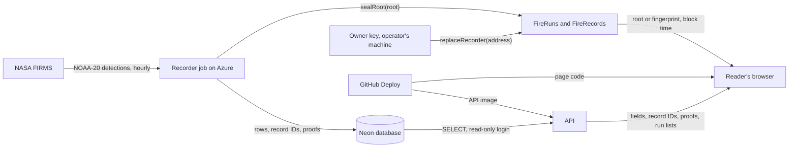

# Fire Watch: security and data integrity

Fire Watch seals NASA FIRMS fire detections near Indonesia's pulpwood concessions on Base Sepolia.
Each claim here points to a file in this repo or a command run on 2026-10-24.

| On Base Sepolia (chain ID 84532) | Address | Holds |
| --- | --- | --- |
| FireRecords | `0x6a55489a05a9c79d2cd35212878d113557dceb2a` | One fingerprint per record, before FireRuns |
| FireRuns | `0x8b2EF6848f9F8c5aC2810D959c52d71084A33734` | One Merkle root per run; 5 runs by 24 Oct 10:35 UTC |
| Recorder key | `0x6f09c576Be8AFB0f2175A97A0eFa26DE23A532f3` | `recorder()` on both contracts |
| Owner key | `0xac57C74a4A4fE81052edD540555EB9D7791882A7` | `owner()` on FireRuns |

Read with `cast` on `https://sepolia.base.org`.

## What is protected, and from whom

The evidence is a detection's place, time, fire power, confidence and concession match, as Fire
Watch stored it (`api/src/firewatch/fingerprint.py:73-94`). It must hold up against:

- **a plantation company disputing a grievance**, who says the record was changed or dated to suit;
- **a dishonest operator**, who edits, deletes or backdates database rows;
- **a leaked key**, used to seal false records;
- **a broken server**, which loses or withholds records.

## Trust path

The browser ignores the API's verdict and seal times (D7, D97). It still trusts the page code it
was served, the RPC node it reads, and the API for the fields.

## What the chain proves

- **A record hasn't changed since it was sealed.** The page recomputes the fingerprint. It compares
  an older record with `sealOf` on FireRecords, and walks a newer one's proof up to its run's root
  on FireRuns (`web/src/RecordPanel.tsx:74-82`). Leaves are hashed twice so they can't pass for
  inner nodes (`api/src/firewatch/merkle.py:1-13`, D108).
- **When it was sealed, by the chain's clock.** Both contracts store the block time
  (`contracts/src/FireRecords.sol:32`, `contracts/src/FireRuns.sol:41`), and the page shows only
  that (`RecordPanel.tsx:202-209`).
- **In a pack from FireRuns' time, no stored detection of the fire was left out.** The browser
  rebuilds each run's root in the pack's window, then lists any detection the fire rule joins to
  the pack that the pack lacks (`web/src/leftOut.ts:31-61`, D119, D124).

Checked on 2026-10-24: all 283 records of the example pack (`web/public/case/pack-0332.json`)
match `sealOf` on FireRecords. Runs 1 to 5, rebuilt from `GET /api/runs?first=1&last=5` (2,354
records), match all five roots on FireRuns.

## What it doesn't prove

- **That Fire Watch stored every detection FIRMS had.** The left-out check covers runs on FireRuns
  only, and sees only records the recorder stored. With no runs from the API there is no check, and
  the pack says the server chose its records (D125, `web/src/ComplaintPack.tsx:259-262`). Only
  FIRMS's public archive shows a detection never stored (D119).
- **That the satellite saw everything.** Fire Watch reads one source, VIIRS on NOAA-20
  (`api/src/firewatch/firms.py:11`). Cloud, smoke, canopy and smouldering peat hide fire (D139).
- **That a detection came from FIRMS.** A seal shows Fire Watch held the record then, not that NASA
  published it.
- **Anything from the chain alone.** The chain holds a root or fingerprint and a time
  (`FireRuns.sol:8-11`, `FireRecords.sol:7-10`). A check needs the record's fields and random
  32-byte record ID (`record_hotspots.py:171`, `web/src/merkle.ts:6-8`), which only Fire Watch's
  API serves.
- **That older packs are complete.** FireRecords' 17,173 detection seals have no list on chain
  (D120, `ComplaintPack.tsx:613-616`).

## Keys

| Key | Kept | Can | Can't |
| --- | --- | --- | --- |
| Recorder | Container Apps secret on the recorder job (`infra/setup.sh:64-66`), and the operator's untracked `.env` (`README.md:68-71`) | Seal a new root on FireRuns (`FireRuns.sol:35-41`), or a new fingerprint on FireRecords under an unused ID (`FireRecords.sol:27-33`) | Change or remove a seal (`FireRecords.sol:31`, `FireRuns.sol:40`); choose a seal time |
| Owner | Encrypted Foundry keystore on the operator's machine, never in `.env` or Azure (D104, `README.md:245-247`) | Replace FireRuns' recorder (`FireRuns.sol:48-53`) | Seal anything (`FireRuns.sol:36`); touch FireRecords |

If the recorder key leaks, the owner names a new recorder and the old key is refused
(`README.md:264-269`, `contracts/test/FireRuns.t.sol:93-111`). All 18 contract tests passed under
`forge test` on 2026-10-24.

## Server side

- **Read-only API.** It logs in as `firewatch_reader`, which has SELECT only
  (`infra/neon-reader.sql:4-6`, `setup.sh:54`). Routes are GET, CORS admits only the site, and a
  request covers at most 31 days or 100 runs (`api/src/firewatch/app.py:25-26`, `214-218`). On
  Azure, only the recorder job holds a login that writes (`setup.sh:64`).
- **What GitHub can deploy (D21).** For the API, GitHub signs in to Azure by OIDC from main only
  (`setup.sh:84-97`), with Contributor on the API app and Reader on the group, which can't read
  secrets (`setup.sh:105-110`). It ships the API and the page, never the recorder job; the operator
  sets that image by hand, by digest (`setup.sh:24`, `README.md:219-222`).
- **Secrets.** `.env` is git-ignored (`.gitignore:2`). The recorder key, database owner URL and
  FIRMS key are Container Apps secrets (`setup.sh:64-67`). The only keys in tracked files are
  anvil's local test keys (`web/e2e/env.ts:3-13`).
- **Dependency audits in CI.** `pip-audit` on the API's runtime packages
  (`.github/workflows/ci.yml:49-52`), and `pnpm audit --prod`, which fails on high or critical
  advisories (`ci.yml:71`).
- **Watching.** An hourly workflow emails after 2 hours without a good run, or when a run seals
  nothing while records wait (`.github/workflows/recorder-check.yml:28-38`).

## Known gaps and residual risks

- **Test network.** Seals last only as long as Base Sepolia (`docs/specs/judge-review/shape.md:94`).
- **Seal delays.** In the example pack, passes 1 to 6 (12 to 15 Oct) were sealed 22.8 to 93.4
  hours after the satellite took them, one per transaction through 16 Oct, as the first live run's
  5-day backfill drained (`docs/specs/fire-record.md:455`). Passes 7 and 8 took 2.7 to 2.8 hours.
  On FireRuns runs 1 to 5 the gap was 2.1 to 3.2 hours, of which 12 to 17 seconds fell between
  storing and sealing. Until its seal, a stored row can be edited without a trace.
- **One hot key writes both contracts.** FireRecords' recorder can't be replaced
  (`FireRecords.sol:18`), so a leaked key could add seals there for good, each with its real, late
  time.
- **One owner key**, fixed at deploy (`FireRuns.sol:22`), with no multisig (D104). Its holder can
  name any recorder.
- **Page and API ship together.** A hijacked deploy could serve a page that says "Matches" for
  anything. The check's code is public (D7).
- **One RPC**, set at build (`web/src/chain.ts:8`, `.github/workflows/deploy.yml:93`). The page
  trusts it.
- **The PDF pack carries no proofs.** A print shows each detection's time, side of the edge and
  check result (`ComplaintPack.tsx:400`), and the pack's link (`ComplaintPack.tsx:458`). Record IDs,
  fingerprints and proofs sit only in an opened row's folded raw record (`RecordPanel.tsx:251-263`).
  Checking a PDF again needs the link and a live API.
- **One copy of the records**, in Neon (`docs/ARCHITECTURE.md:59`, D109).
- **No rate limit** on the open API, which runs one copy at most (`setup.sh:53`). GitHub Actions are
  pinned by tag, not commit (`deploy.yml:46-97`).
- **Not audited.** No third party has audited the contracts or run a penetration test.

## Threats

| Threat | What stops it today | What's left |
| --- | --- | --- |
| A row is edited after its seal | The page shows "Does not match the chain" (`RecordPanel.tsx:35-43`) | Edits before the seal |
| A detection is deleted from a pack | Rebuilt run roots list it as left out (`leftOut.ts:31-61`) | Packs before FireRuns; detections never stored |
| A record is backdated | Seal time is the block time, read from the chain (D97) | Its detection time is the row's word |
| The API reports a false "Matches" | The browser does the check itself (D7) | A hijacked deploy can change the page |
| The API withholds records, runs or proofs | "Not on chain yet" (D106), or no left-out check (D125) | The check is lost; nothing false shows |
| The recorder key leaks | The owner replaces it on FireRuns | FireRecords keeps the old key; fake roots seal until noticed |
| The owner key leaks | It stays off Azure (D104) | It can't be replaced, and can name any recorder |
| GitHub's deploy is hijacked | It can't reach the recorder job or its key (D21) | It can ship a lying API and page |
| The database is lost | Seals stay on chain | Nothing can be checked |
| The recorder stalls | The recorder check emails after 2 hours | A stall over 2 days loses detections (`firms.py:13`) |
| A concession match is disputed | Map version and matches are sealed (D17) | Not that the map is right |
